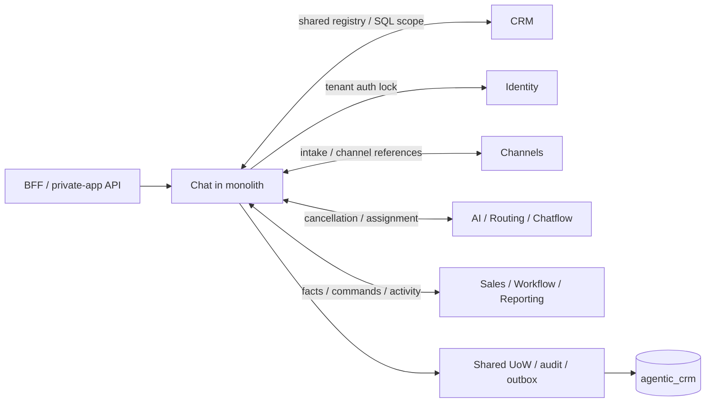

# Chat: ranh giới hiện tại và kế hoạch thay thế

SRC-108 review2026-10-18:16new import entries explicitly reviewed for D2. New incoming dispatch-server/outbound-main composition; outgoing coordinator/job→Node crypto, Ajv/formats, TypeORM type, contracts, infrastructure-only workload-transport, existing local UoW/commands. Native HTTP adds Identity-owned HumanDispatchEnrollment local application port and session hash helper, with a separate Identity credential and no shared Chat transaction/session SQL. This is an explicit baseline BFF port, to be replaced at physical extraction; it does not authorize Connector imports of backend/domain code. No new Chat→Connector/Identity implementation import in the coordinator. Rebaseline records these exact reviewed edges only; SQL coupling described below remains.

2026-10-18, PLAN-006E/SRC-092. [Authority contract](../contracts/chat-extraction-boundary.md), [baseline có thể kiểm tra](chat-dependencies.json), [topology chung](../system/deployment-topology.md). Đây là preparation/CI gate; Chat chưa có database hay deploy unit độc lập.

AST inventory ghi253 dependency entries:37incoming,216outgoing. Một entry là import/re-export kèm tập symbol; không phải số service hoặc SQL query.216outgoing gồm60tới kernel,116tới module nghiệp vụ và40tới package. Các số này hỗ trợ rà dependency, không dùng để suy số transaction.

| Dependency group | Outgoing từ Chat | Incoming vào Chat | Replacement / owner |
|---|---:|---:|---|
| Identity |49|0| Current auth/delegation; native BFF adapter ở boundary |
| CRM |48|2| Local Chat registry + CRM metadata/contact/activity APIs |
| Channels/Connector |9|5| Binding/transport/receipt API; no shared TransactionScope |
| Agents/Routing |2|7| Proposal/reservation/cancellation saga; Chat owner CAS |
| Chatflow |3|1| Pinned run/dispatch fence + asynchronous cancellation |
| Sales |3|5| Authorized need/session/source/outcome references |
| Workflow |1|3| Typed command/read + durable event/cancel receipts |
| Reporting |1|2| Owner producer ports and reporting computation separated |
| External API |0|3| Existing private-app grants intersect current Chat policy |
| Kernel/entrypoints |60|9| Local UoW/audit/receipt/inbox/outbox, Chat API/worker/admin composition |
| Runtime/shared packages |40|0| Explicit allowed package imports; no second domain authority |



Particularly sensitive reverse dependencies: CRM activity writes Chat contribution rows, Sales session context writes contribution rows, Channels normalized content uses Chat validation, Agents operations reads Chat domain directly, Workflow application/need recovery calls Chat domain. Kernel database CLI also imports Chat backfills. These must be replaced or moved before disabling the old writer; changing only Chat's outgoing imports is insufficient.

## Check and review workflow

```powershell
. ./scripts/dev-shell.ps1
pnpm architecture:chat
node --test scripts/tests/chat-boundary.test.mjs
```

Check runs in `pnpm verify` and therefore the existing verify-container CI job. Artifact `artifacts/chat-boundary/summary.json` contains counts and added/removed edges, no payload, account data or secrets. New source edge/symbol/type→value dependency fails. Removing imports/symbols passes, reports shrinkage; splitting/combining imports or local alias renaming does not invent coupling. Declared namespace dependencies count as a namespace, not each member used.

Review `git diff -- docs/architecture/chat-dependencies.json` after a deliberate source change. For an approved replacement or removal, update explicitly with `node scripts/check-chat-boundary.mjs --write-baseline`, rerun check, and record the task/change ID and owning-service replacement in the execution log. Do not regenerate the baseline automatically in CI. Its purpose is to expose remaining monolith work and prevent unreviewed additions, not to authorize those imports inside a future `services/chat` runtime.

Scanner walks current backend runtime source, excludes tests, records both direct import directions and outbound packages; rejects unresolved relative references, computed import/require and TS paths/baseUrl/rootDirs aliases. It does not parse SQL/FKs, validate DI, inspect calls inside an existing imported namespace or prove transitive service independence. Full extraction requires the contract matrix, native permission/data comparisons and retained fault tests.

## Sequencing

1. PLAN-006E/SRC-092: reviewed current boundary and automated growth guard. Complete for this scope.
2. PLAN-006F/SRC-093: [machine protocol/contract kit](../development/dispatch-contract.md) specifies independent authority admission and unknown semantics, with executable reference tests. Durable runtime/mTLS/DB implementation remains gated; no TTL permission cache or global atomicity claimed.
3. Remaining PLAN-006: ingestion/cancel/read/consumer compatibility and broker contracts. Cover current Inbox/session/need/routing/Reporting/External API features, not just historical M2.
4. PLAN-007B: filled table manifests, own schema/grants, registry row partition, snapshot/replay/single-writer/rollback. Only then claim physical extraction source.

Do not move Chat tables or restart app processes to run this check. Local Reporting remains container3004; Connector main binding remains unconfigured; no runtime change in SRC-092.
