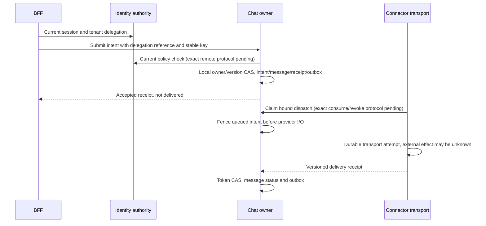

# Chat extraction boundary — PLAN-006E / SRC-092

T01 update2026-10-18: [owner v1](chat-owner-v1.md) and [complete capability/consumer mapping](../architecture/chat-owner-consumers.md) resolve the non-send admission/target/capacity/consumer protocol placeholders below. D2 dispatch/exchange/control remain versioned separately. This is design evidence only; T02 table/partition/backfill gate and all physical cutover gates remain open.

2026-10-18, CHG-20261018-07. Ready for the bounded dependency guard and authority design below; **not Ready for physical Chat cutover**. Dependencies PLAN-005, PLAN-006D, SRC-038, SRC-082, SRC-089, SRC-091 DONE. [Service rules](service-boundaries.md), [Chat](../services/chat.md), [ownership](../data/service-ownership.md), [ADR-023](../decisions/README.md#adr-023--shared-crm-platform-and-phased-runtime-separation). No new table, endpoint, provider integration or business behavior in SRC-092.

## Current blockers verified in source

`conversation/domain.ts` reads/writes RecordRegistry and shares TransactionScope with CRM, Identity, Channels, AI and Chatflow. `ownership-port.ts` cancels queued messages and invokes orchestration callbacks in that same transaction. `outbound.ts` locks tenant→registry→intent, reads current Human/AI permissions, transitions queued→sending before calling Sender outside SQL. `channels/ports.ts` still reads channel_connection/touchpoint/Page metadata using the caller's scope. `activity.ts` composes CRM notes, Workflow and Chatflow activity sources. Moving these files into a container leaves shared transactions/SQL and cannot be counted as extraction.

The current source also includes classification, session/need lifecycle, routing/workspace, connected reporting and private-app reads. An extraction limited to the old text inbox would silently lose these features. Current conversation_id is the persistent thread identifier; session_id is the episode. Preserve both and existing public routes/cursors/receipt keys.

## Ownership and replacement boundaries

| Current coupling | Target authority and replacement | Completion evidence before cutover |
|---|---|---|
| crm_record owner/version/team/share/history for Conversation | Chat local record aggregate, same tenant/resource UUIDs and exact versions. CRM keeps schema definitions and eventually a navigation/search projection only. Generic writes route to Chat; never mutate a second registry copy. | Backfill/count/hash/tenant reference comparison and single-writer switch; no cross-schema FK or UoW |
| IdentityAuthorization/withFieldPolicies/owner eligibility | Identity canonical current native-session/principal/seat/team/field authorization; Chat combines it with local owner/revision/resource state. CRM remains property-schema authority. | Scoped authenticated delegation and revocation race tests; no account credential/role SQL in Chat |
| ChannelReferences + Sender | Connector owns binding/Page/control/transport credentials and durable delivery receipt. Chat owns intent and message status. Replace shared scope with versioned binding, dispatch and receipt calls. | Connection/tenant/contact binding; lost-ACK/duplicate/revocation/failure cases |
| CRM identity/contact/property/activity ports | CRM owns canonical lookup/resolve, Contact liveness, metadata and original note body. Chat retains confirmed mapping refs/cache and local activity reference projection. | Explicit not-found versus unavailable; current Contact/field access, no fallback Contact creation on error |
| AI/Chatflow cancellation hooks | Chat atomically increments owner revision and cancels its queued intents, then local outbox publishes cancellation. AI/Chatflow reconcile their own runs and cannot dispatch on stale revision. | Late delivery/cancel race, blocked new sends before remote confirmation when required, pinned existing run versions |
| Routing | Routing proposes owner/queue/capacity assignment; Chat commits local expected-version/owner-revision CAS. Reservation release/confirmation is a saga. | Duplicate/reordered proposals, orphan reservation repair, no remote transaction callback |
| Sales/Workflow/Reporting/External API readers | Authorized owner read/command APIs; external app scope is intersected with current Chat policy. Projections never grant access. | All current consumers mapped, cursor/field/revoke parity and no direct Chat SQL |
| Shared reliability kernel | Per-service receipts/audit/outbox/inbox and local UoW; only protocol/value helpers may be shared. | Distinct runtime grants, receipt retention and replay/recovery proof |

## Identity and dispatch semantics to preserve

The shared tenant lock currently gives stronger atomicity than an arbitrary remote permission cache. Extraction must not silently replace it with a TTL claim. Native session stays at the BFF/Identity boundary; domain requests use authenticated workload identity plus a tenant/actor/delegation reference. Caller-provided principal/tenant/owner values are constraints, never proof. Identity must check current session/account security revision, membership, principal status, seat, role/team and field denial; Chat checks its current local record policy separately. No Keycloak or forwarded Human password/cookie to Connector.

Proposed next exact protocol has these operation roles (names below are contracts to specify, **not implemented URLs**): Identity CheckDelegation, CRM ReadMetadata/LookupContactIdentity, Chat SubmitMessage/ClaimDispatch/ReadDispatchReceipt, Connector PrepareDelivery/BeginDelivery/ReadDeliveryReceipt. Each mutation binds tenant, producer, audience, command/idempotency ID, conversation_id, crm_contact_id, connection_id, actor reference, expected owner revision, payload digest and deadline. Same key/different digest is409; timeout after acceptance is unknown and is resolved from the existing receipt with the same key, never a new send key. Replay output still requires current read rights.

Use synchronous authoritative checks, fail closed on dependency outage. PLAN-006F must specify transport authentication/key rotation, exact DTO/errors, durable grant issue/consume/revoke and in-flight linearization before remote dispatch code. A successful Identity RPC alone does not make subsequent Chat/Connector commits atomic with revoke. No residual revocation window is accepted by this document; if a bounded grant window is proposed, it needs an explicit contract/change entry and adversarial acceptance. Do not declare distributed runtime Ready from this responsibility matrix.

Required race outcomes: takeover before claim cancels queued work; claim before takeover is in-flight and may reach provider, never falsely reported cancelled. Crash/timeout after effect→unknown, lookup only; unknown cannot become retryable failure merely because lookup timed out. Late sent receipt can reconcile unknown only for the same tenant/intent/attempt token; stale receipt cannot rewrite a newer attempt. Only proven pre-dispatch failure may be retried. Human and AI follow the same owner fences; hosted provider control remains a separate gate.

## Data and rollout gate

PLAN-007B must enumerate physical tables/columns plus row partitions in registry, sharing, audit, receipts, outbox and property index; current ownership matrix is not a migration manifest. Every target table including journals requires explicit tenant scope/template, forward migration and restricted runtime grants. Never rename/move whole crm_record or copy all tenant policy into Chat. CRM metadata remains one authority; deploy groups can remain together while removing shared transaction requirements.

Retained synthetic fixtures: migrate destination separately, shadow authorized reads with watermark, compare counts/hashes/versions/ACL per tenant, quiesce old Chat writers (API/worker/retries), reconcile pending dispatch and pin old receipts, transfer single writer, resume same public IDs/routes and verify native flows. No manual dual-write. Before first destination write rollback may restore old routing; after writes, require reverse replay/reconciliation or forward recovery, never switch to stale tables. No DB reset/volume deletion. Backup/restore and historical unknown-send reconciliation must be tested before traffic transfer.

## Executable dependency gate — Ready SRC-092

T09 / CHG-20261027-02 retirement supersedes the temporary import budget below: the legacy Conversation source directory and every boundary edge must now be absent. Required baseline/Chat composition files must be present and nonempty; a disconnected reintroduced legacy file also fails. The original reviewed JSON baseline stays immutable historical evidence, and `--write-baseline` is disabled. This is source retirement evidence; main runtime acceptance remains T09.

Implement a deterministic TypeScript AST inventory of direct relative source imports across `services/core-baseline/src/modules/conversation/`, both inbound and outbound; track outbound package imports explicitly too. Include static imports, type imports, re-exports, literal dynamic import/require and import-type nodes; distinguish syntax and imported/exported symbols. Normalize Windows/POSIX paths, resolve .js source references to TypeScript/index files. Ignore comments and test files. Current backend config has no path aliases; reject path/baseUrl/rootDirs alias introduction until the scanner supports it. Reject unresolvable relative source imports and nonliteral dynamic loads; do not silently omit them.

Check the inventory against an explicitly reviewed checked-in baseline. New edges or new imported symbols fail; removals pass and are reported. No default auto-update, no broad module wildcards. Updating the baseline requires a documented change/task with replacement-owner rationale, not a way to make CI green. Baseline entries are acknowledged extraction work, not approval of those dependencies in a future service. Generate a human-readable summary/artifact without code payload/secrets. Integrate check into pnpm verify and CI; do not change the running app.

The guard is syntactic evidence, not proof of absence of SQL, runtime DI, FK, shared UoW or transitive authority coupling. Namespace imports are recorded as a whole namespace; changing its internals/usage requires semantic review. File/symbol inventory supports manual semantic review above. Existing public module ports are still monolith ports even if their file is named port. Do not infer a callable service from a successful check.

| Acceptance | Expected result |
|---|---|
| CEX-01 | Source evidence + current feature/authority replacement matrix reviewed; remaining gates explicit |
| CEX-02 | Deterministic inbound/outbound source inventory and reviewed baseline; added edge/symbol fails, removal allowed |
| CEX-03 | Fixtures detect re-export, type, dynamic literal, require, namespace, side-effect imports; comments ignored; computed dynamic path rejected |
| CEX-04 | Cross-platform path resolution, missing target and alias configuration fail closed; baseline duplicate/malformed entries rejected |
| CEX-05 | Actual workspace check, focused script tests, lint/docs and CI wiring validated; remote CI status separate |
| CEX-06 | Service/ownership/roadmap/tracker/log/checkpoint synchronized; runtime/data unchanged, no extraction claimed |

Next gate PLAN-006F: exact Identity delegation and Chat↔Connector dispatch machine contracts with durable persistence/crypto/time/revoke/unknown semantics and executable fixtures. Then complete remaining PLAN-006 broker/consumer/compatibility contracts before PLAN-007B migration source. This scoped task does not mark the parent PLAN-006 DONE.

2026-10-18 follow-up: PLAN-006F/SRC-093 now supplies [dispatch v1 machine contract and reference kit](chat-dispatch-v1.md). Identity consume, Chat claim and Connector start have explicit independent in-flight boundaries; no cached permission TTL. Only schemas/model tests are implemented. Actual durable persistence, transport and physical cutover still require the remaining gates above.
