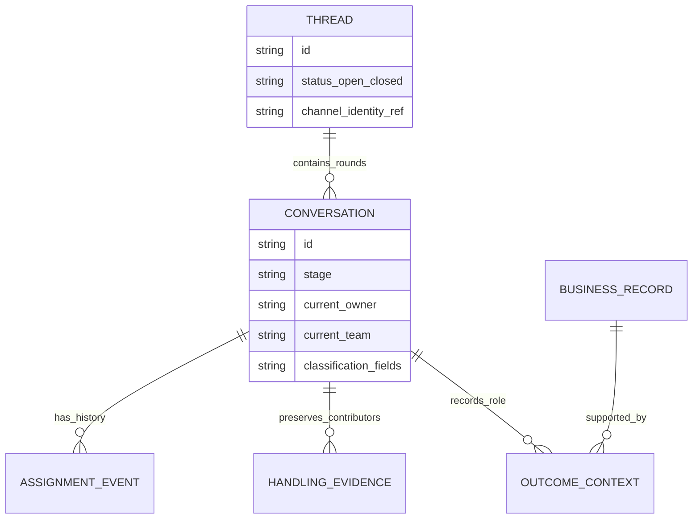

# Thread và Conversation — mô hình sản phẩm đã chốt

CHG-20261016-04 / SRC-081: [Thread identity, need enrichment and recovery](need-follow-up.md) supersedes earlier exclusions for this bounded scope. Current canonical Chat APIs use conversation_id (SRC-082 / CHG-20261016-05); deprecated thread_id artifacts remain readable through scoped compatibility. Need-scoped default/custom values, on-demand provider protocol, Human pins and read_need/recover_need workflow actions are implemented separately from general autonomous Agent Runtime or live channel delivery. See task evidence for actual validation.

2026-10-16 implementation authorization: [exact additive contract](thread-conversation-implementation.md), PLAN-033A/SRC-078. The product-only status below describes the original decision; source status/evidence is in the task tracker.

PLAN-033 · CHG-20261015-04 · 2026-10-15. **Product direction approved by user; PLAN-033A exact gate DONE, implementation SRC-078.** Đây là nguồn chuẩn mới về thuật ngữ, phân loại lượt trao đổi, related outcomes và bảo toàn đóng góp khi chuyển owner. Các contract API/physical đã triển khai tiếp tục mô tả baseline đến khi có versioned cutover; không đổi schema/source trong task này.

## 1. Định nghĩa và mapping tương thích

| Thuật ngữ đích | Ý nghĩa | Tên baseline đang tồn tại |
|---|---|---|
| Thread | Mạch tin nhắn trên một channel identity; có open/closed | Conversation, conversation_id trong các API hiện hành |
| Conversation | Một lượt trao đổi/xử lý trong Thread, có stage, owner và custom fields phân loại theo lượt | Acquisition session / Conversation Session, conversation_session_id |
| Business outcome record | Lead, Deal hoặc Ticket được tạo/tiếp tục khi đủ điều kiện | Lead/Deal đã có; Ticket capability còn gate riêng |
| Conversation contribution | Lịch sử người/team/AI thực hiện công việc trong một lượt | Chưa có unified episode-level contribution contract; có message actors, ownership history, stage evidence và Sales context riêng |

Không đổi nghĩa `conversation_id` tại chỗ. Consumer cũ vẫn hiểu đó là Thread baseline; `conversation_session_id` vẫn là lượt cũ. Metadata object key `conversation` hiện tại cũng không được tái sử dụng âm thầm cho entity lượt. Exact gate phải chọn version/alias, stable ID mapping và consumer migration. Auth session, Chatflow session và AI execution không thuộc phép đổi tên này.

Thread không có nghĩa một Thread cho toàn bộ khách trên channel loại Facebook. Identity namespace gồm tenant, kết nối/Page phía doanh nghiệp và customer/provider identity/thread key. Email có thể có nhiều thread cho cùng Contact. Không hợp nhất khách giữa Pages từ ID trần.

## 2. Lifecycle và stage

User chốt Thread open/close và Conversation stage. Các quy tắc bên dưới giữ semantics của SRC-068/069, không thêm timeout hay tự reopen historical episode:

1. Thread chứa nhiều Conversations theo thời gian; tối đa một Conversation active. Conversation cần ranh giới bắt đầu/kết thúc để xác định lượt, tách với stage nghiệp vụ; exact wire có thể dùng lifecycle field hoặc ended_at.
2. Inbound hợp lệ khi có Conversation active nối vào lượt đó; referral mới chỉ thêm touchpoint, không reset stage/nguồn hoặc mở lượt khác.
3. Đóng Thread kết thúc Conversation active trong cùng command consistency boundary. Conversation đã kết thúc còn lịch sử/stage/fields; không đồng nghĩa Lead/Deal/Ticket đã hoàn tất. Thread closed không có Conversation active.
4. Inbound hợp lệ sau lần đóng mở lại cùng Thread và tạo Conversation mới. Không mở lại Conversation lịch sử. Tin trễ/duplicate dùng các guard baseline, không tạo lượt giả.
5. Pending/snooze là trạng thái xử lý/overlay, không thêm giá trị thứ ba vào Thread open/closed trong model đích; legacy pending cần mapping tương thích tại PLAN-033A.
6. Chuyển owner/team không đóng/mở Thread, không tách Conversation, không reset stage/custom values/origin. Handoff có thể hủy/pause queued automation theo owner revision như baseline; giữ trạng thái thực của tin đang sending.

Conversation stage tiếp tục dùng process version pin và history như SRC-069. Chuyển stage không tự chứng minh milestone, qualify Lead, resolved Ticket hoặc won Deal. Các thao tác administrative reopen không có inbound và outbound-initiation nằm trong exact gate; task này không tự bổ sung command.

## 3. Custom fields của Conversation

User chốt khả năng mở rộng field để phân loại từng lượt: ví dụ lý do liên hệ, loại yêu cầu, nhóm sản phẩm quan tâm trong lần trao đổi, kết quả tư vấn của lượt. Định nghĩa/type/options/field ACL thuộc canonical Object Platform metadata; giá trị và lịch sử lượt thuộc authority Chat, không copy vào Contact.

Một Conversation mới có giá trị riêng; không tự kế thừa toàn bộ field của lượt cũ. Nếu sau này có carry-forward, phải explicit mapping/provenance. Field chỉ chứa phân loại của lượt không trở thành nguồn authoritative của nhu cầu lâu dài hoặc outcome. Contact giữ danh tính; Lead giữ qualification/need; Deal giữ commercial outcome; Ticket giữ support issue.

Default/required/visibility, update sau khi kết thúc, schema evolution, retention và API/query/report exposure cần exact gate. Không bắt buộc field qualification trước khi nhận inbound tối thiểu. Field history phải cho biết actor/time/revision; không biến thay owner thành thay tác giả giá trị cũ. Không đặt arbitrary custom fields thay structured acquisition/source evidence.

SRC-074 chưa hỗ trợ extensions trên Conversation baseline hoặc acquisition session. Quyết định này là yêu cầu mở rộng được phê duyệt, chưa phải capability đã chạy. Không bật nút tạo field chỉ bằng cách đổi display label.

## 4. Contact panel và related outcomes

Trong Inbox, dưới phần Contact có **Related objects** hiển thị các hồ sơ liên quan mà người dùng được đọc. Mỗi object hỗ trợ có nút **Tạo Lead / Tạo Deal / Tạo Ticket** khi có capability và quyền tạo; backend luôn kiểm lại quyền, field ACL, tenant/contact/context và điều kiện nghiệp vụ.

- Không có create quyền: không hiện hành động tạo cho object đó; vẫn có thể xem hồ sơ được quyền đọc. Chưa có runtime capability: không giả một nút hoạt động.
- Có quyền nhưng chưa đủ dữ liệu: cho biết các yêu cầu còn thiếu khi mở form; command chỉ tạo sau validation. Không hardcode một stage chung để tạo mọi loại outcome; qualification/consent/Deal/Ticket rules thuộc service sở hữu.
- Không cần tạo outcome để chuyển tiếp Conversation hoặc để agent hoàn tất lượt. Một lượt có thể không tạo outcome; một lượt cũng có thể liên quan nhiều hồ sơ.
- Chọn hồ sơ có sẵn để tiếp tục; không tạo duplicate chỉ vì mở lượt mới. Current selection phải rõ trên từng action, không áp cho tất cả hồ sơ cùng Contact.
- Tạo từ lượt hiện tại giữ `created` context; follow-up giữ liên kết chăm tiếp; origin bất biến; tạo từ Lead sang Deal giữ lineage và tách create context. Outcome owner theo command/eligibility riêng, không tự đồng bộ với Conversation owner.
- Lead, Deal, Ticket là ba loại hồ sơ, không phải chuỗi bắt buộc và cũng không tự là conversion thành công. Tạo Deal không đồng nghĩa won/doanh thu; tạo Ticket không đồng nghĩa resolved.

Ticket remains Draft/unimplemented beyond its existing gate. Quyết định UX này không bỏ qua domain/API/authorization/readiness của Ticket.

## 5. Chuyển giao và lịch sử đóng góp

Conversation có current owner Human/AI và team/queue xử lý. Chuyển giao cho agent khác hoặc team khác là command riêng, cần quyền assign/transfer và target eligibility. Team queue có thể chưa có cá nhân nhận; chưa được coi người đích đã làm việc. Không yêu cầu tạo Lead/Ticket làm trung gian để handoff.

Owner hiện tại dùng để định tuyến, kiểm quyền gửi và hàng đợi. **Owner hiện tại không thay thế lịch sử người đã đóng góp.** Mô hình đích cần truy hồi:

| Dữ liệu logic | Nội dung tối thiểu | Cách sử dụng |
|---|---|---|
| Assignment transition | Conversation ref; from/to principal và team; người chuyển; lý do; timestamp; revision | Xem chuỗi bàn giao; suy khoảng chịu trách nhiệm có coverage |
| Handling action | Conversation ref; actor human/AI/service; team-at-event nếu có evidence; loại hành động; occurred/recorded time; source ID/revision | Ai gửi tin, ghi chú, cập nhật stage/field, ghi evidence, kết thúc lượt |
| Outcome context | Conversation ref; outcome ref; created/follow_up/closing; actor/time và source lineage | Tách người tạo/chăm/chốt, không gán hết cho current owner |

Đây là logical evidence requirements, không đề xuất ba bảng mới hoặc một writer chung. Reuse source events/history khi đủ; exact gate quyết định projection và phần cần bổ sung. Chat là authority handling/assignment của Conversation; Sales/Ticket sở hữu action outcome; Reporting chỉ chiếu dữ liệu qua versioned APIs/events. Historical ACL vẫn dùng quyền đọc hiện tại; bảo toàn evidence không tự cấp quyền vĩnh viễn cho người từng xử lý.

Người thực hiện khác owner tại thời điểm hành động: supervisor có thể chuyển giao, collaborator có thể ghi note, AI có thể tạo response. Lưu actor thật và executor/provenance cần thiết; không đổi message author khi bàn giao. Event gửi thành công đến sau handoff vẫn thuộc actor/intent thực tế, không gán cho người đang sở hữu khi receipt về.

Trong báo cáo cần phân biệt: người đang phụ trách, người từng được giao, người có action, người tạo/chốt outcome. Thời gian được giao không tự là thời gian lao động; số tin không tự là hiệu quả. Work-time, tỷ trọng đóng góp và công thức credit chưa được phê duyệt. Team lịch sử phải có snapshot/evidence; không join membership hôm nay để viết lại lịch sử. Không suy coverage episode-level/team-at-event hoàn chỉnh từ audit cũ; dữ liệu thiếu ghi unknown/partial, không backfill đoán.

Ví dụ A/Team1 xử lý C1, ghi phân loại; supervisor chuyển C1 sang B/Team2; B tạo L1. C1 vẫn một ID/stage/source; lịch sử giữ action của A, người chuyển và create action của B. Báo cáo current owner là B nhưng A vẫn xuất hiện trong đóng góp có evidence. Nếu B chuyển lại A, tạo transition mới; không thay transition cũ.

## 6. Model logical

Logical groups only; BUSINESS_RECORD đại diện Lead/Deal/Ticket và classification_fields đại diện các field definitions/values, không phải bảng hoặc JSON column mới. Assignment/handling/outcome không tạo cross-service FK/UoW. Mọi data design tiếp theo phải tenant_id NOT NULL và table templates đúng owning service.

## 7. Acceptance và triển khai tiếp

Các scenario dưới đây là product acceptance; [SRC-078 evidence](../tracking/details/SRC-078.md) ghi phạm vi local/native đã kiểm chứng và Reporting/Ticket chưa kích hoạt:

- TC-01: T1/C1 active, referral mới giữ C1; close T1 kết thúc C1; inbound tiếp mở T1/C2, C1 lịch sử giữ nguyên.
- TC-02: C1 và C2 cùng Thread có phân loại khác nhau; sửa field C2 không đổi C1/Contact; field deny không rò qua UI/export.
- TC-03: Contact Related objects chỉ có create actions được phép và được triển khai; thiếu dữ liệu bị validation; revoke trước submit/replay bị chặn.
- TC-04: A→B/team transfer giữ Conversation ID/stage/fields/origin và author history; không tạo Lead/Deal/Ticket ngầm.
- TC-05: A không có create permission nhưng có transfer được bàn giao; B đủ quyền có thể tạo outcome; B không thừa hưởng quyền của A hoặc supervisor.
- TC-06: B tạo Lead, A từng reply và supervisor chuyển; báo cáo phân biệt ba vai trò, không gán toàn bộ action cho B; không nhân Deal amount theo số contributors.
- TC-07: Stale owner revision, close/transfer race, AI→Human, queued cancel và sending late receipt đúng actor, idempotent, không gửi dưới quyền cũ.
- TC-08: Team membership thay đổi sau lượt không viết lại team-at-event; dữ liệu lịch sử không đủ có coverage partial/unknown.
- TC-09: Old conversation_id/session IDs, source refs, workflow/report bindings và historical links vẫn đúng nghĩa qua versioned cutover; không sửa migrations lịch sử.
- TC-10: Một lượt xử lý nhiều outcomes: lựa chọn record rõ, close Thread không tự đóng tất cả outcomes; no-outcome vẫn kết thúc/bàn giao bình thường.

PLAN-033A phải kiểm kê source/metadata consumers, chốt exact lifecycle/owner authority, field/storage/ACL/API/event models, related-outcome eligibility, migration/compatibility và reporting grain, rồi tách source tasks. Không đổi production capability hoặc claiming contribution dashboard từ product approval này.
