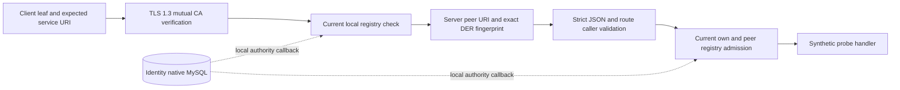

# Current workload TLS boundary — PLAN-007C10 / SRC-105

2026-10-19 override: [ADR-026/local HTTP](local-workload-http.md) makes TLS optional for explicitly configured local development/tests. The rules below still apply when `WORKLOAD_TRANSPORT=tls`; there is no fallback from a failed TLS request. HTTP local no longer reads or renews 24-hour leaves.

Ready scoped transport design, 2026-10-18 / CHG-20261018-20. Prerequisites [native registry](../data/identity-workload-registry.md) SRC-104 and [dispatch profile](chat-dispatch-v1.md). This slice supplies a reusable backend transport adapter and actual loopback HTTPS acceptance; no dispatch route/main bootstrap or remote registry endpoint is registered. Connector/Chat still require owner wire adapters. No DDL, Human policy, provider, CA issuance service or production deployment.

## Transport rules

The client performs its registry check after the TLS handshake and before sending the HTTP body. The diagram separates the authority and transport boundaries, not a distributed registry deployment. `createWorkloadAgent(expectedService)` configures the URI checker at agent scope for Node24 keepalive; caller still revalidates actual socket peer and registry on each request. Caller owns/destroys the pooled agent. CA/key/cert buffers are snapshotted per server/request, so changing the caller's configuration object cannot silently change an existing server's registered identity.

Node HTTPS with TLS1.3 only, require trusted operator CA and verified client certificate, rejectUnauthorized=true on server and client. Each leaf has exactly one SAN, URI:spiffe://agentic-crm/service/identity|chat|connector; CA certificates are rejected as leaves, lifetime >0 <=24h, current notBefore <= now < notAfter checked on every request including keepalive. Compare SHA256 of leaf DER, never subject CN/header/body service identity. Wrong service target fails even if signed by same CA. No DNS fallback; URI identity is deliberate service-name verification. Private keys stay outside source/logs in operator-managed files.

The adapter requires an injected current-authority callback, no default/cached allow. At server admission validate peer service allowlist, validate request DTO/tenant, then check own certificate and peer certificate against native current registry for the business tenant. Client verifies CA/expected URI and current registry for both its own cert and the server before sending the body. Local callback is allowed in baseline/native test; a production remote implementation remains blocked on an exact nonrecursive registry trust/bootstrap contract. This avoids claiming a static CA/allowlist as current authorization. A service being disabled after an admission follows the in-flight boundary; no retroactive recall.

Route is exact POST path (no query/fragment); each route declares caller allowlist and a strict validation function returning tenant_id/request_id. The server only invokes handler after all admission checks. Control body <=16KiB, optional payload routes require explicit <=96KiB with owner schema enforcing normalized <=64KiB. JSON object only, duplicate keys at any depth rejected including escaped spellings, max nesting64, no trailing garbage, unknown fields rejected by route validator. UTF-8 must decode without replacement. Content-Type application/json optionally charset=utf-8; reject compressed body, Authorization and Cookie. Headers never supply workload identity. Response JSON bounded by route response limit (default16KiB), errors only code/request_id (null until a valid request ID is known); never raw body/SQL/stack/keys.

Default total request deadline2s includes body, current-registry lookup and handler; AbortSignal propagates, no admission/handler after expired lookup, response ends once. Client deadline includes connect/current checks/response, no automatic retry. Exact composed owner operations use the bounded `ownerDeadline` profile; [Chat ingress accept/read](chat-exchange-v1.md) use10s on both sides (CHG-20261025-03). Registry and dispatch remain2s. Response must be JSON object, duplicate-free and within configured byte bound. Higher-level caller validates response schema/correlation and re-reads receipts after uncertain outcomes. Generic transport cannot undo committed business effects: handler must use owning ledger idempotency/fences and observe cancellation. Transport error does not prove a business mutation failed.

Transport belongs to backend kernel for this first native boundary; imports Node only, no domain implementation. No new shared package/service counted. Future package move needs reviewed lint/build boundary; do not import backend kernel into Connector. Public traffic remains unchanged.

## Acceptance

| ID | Required evidence |
|---|---|
| WTLS-01 | Real TLS1.3 HTTP request with CA/client/server leaves and native MySQL registry on both sides; expected service URI and fingerprints |
| WTLS-02 | Missing client cert, unknown CA, wrong service, extra/malformed SAN, >24h leaf and TLS1.2 reject before handler |
| WTLS-03 | Same keepalive socket denied after cert/service/tenant scope revocation, including server cert revocation; no cached allow |
| WTLS-04 | Oversize/invalid UTF-8/duplicate escaped keys/query/unknown fields/credentials/method rejects; minimized errors and no handler effect |
| WTLS-05 | Current-registry outage/timeout/client abort fail closed; request deadline2s, no delayed handler or automatic retry |
| WTLS-06 | Bounded client response/JSON checks, persistent fixture/keys in ignored .local, no main service restart; builds/unit/lint/docs |

Native harness uses new short-lived synthetic leaves under a retained test CA; keeps old certificate files/DB audit, never deletes prior data. Test route is an explicit synthetic probe, not one of the dispatch business endpoints. Test certs are trusted operator registration metadata; this is real TLS evidence plus native local registry, not evidence of a distributed registry API or a provider send. Remote Chat claim proof response still requires exact wire schema before endpoint wiring.
