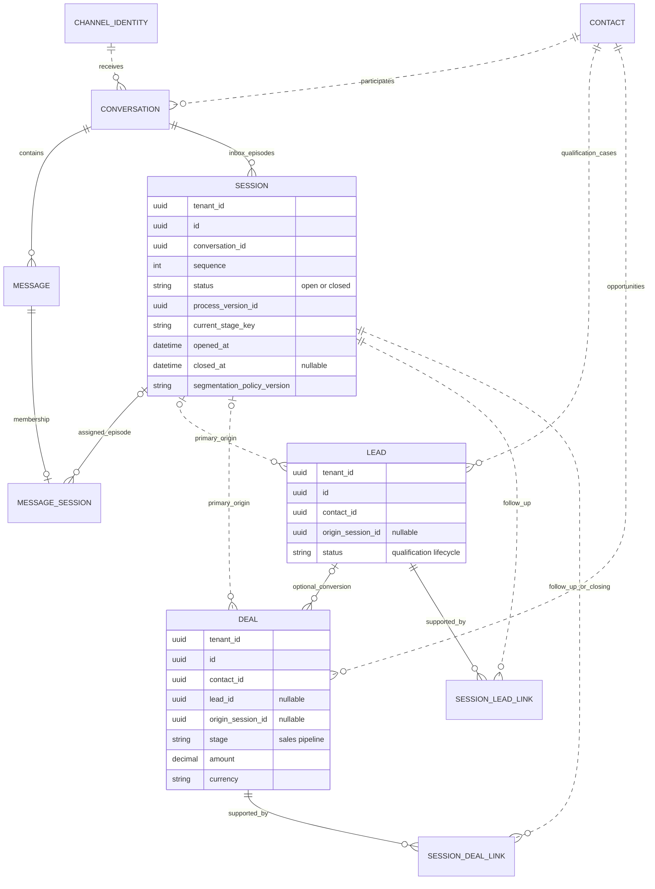
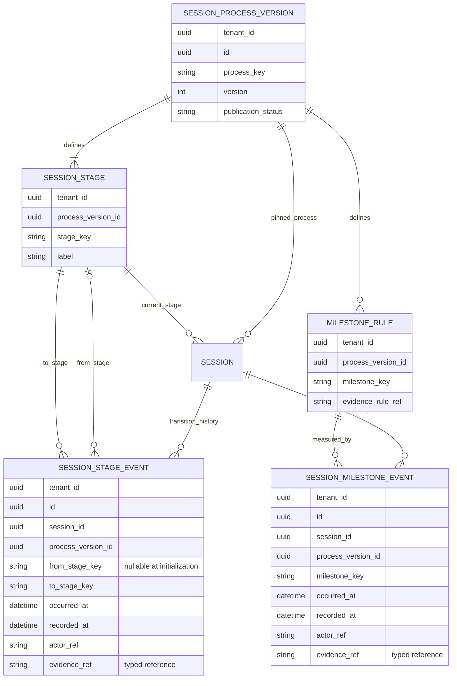
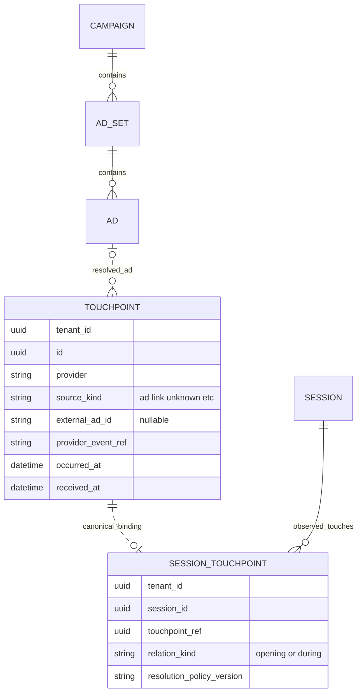

# ERD chốt — Conversation, Session, hành vi, Lead và Deal

CHG-20261013-08 · 2026-10-13 · Owner Codex. **Thiết kế logical đã được người dùng chấp thuận**, gồm clarification CHG-20261013-07 và session stage/milestone. Đây là nguồn chuẩn mô hình đích cho lát cắt Chat→Sales. SRC-068 implements the [exact Customer360/session slice](../contracts/customer-360-session.md): referral preservation, touchpoint membership, create/follow-up/closing context, direct Deal and explicit Lead duplicate consolidation. SRC-069 implements [versioned session stages, scoped evidence/corrections and connected behavioral funnel](../contracts/session-progress.md) in forward29. Logical names below do not imply one physical table per entity.

**Second review CHG-20261013-09:** khung entity/cardinality được giữ; còn semantic gates về origin versus creation context, milestone subject, stage versus evidence và lifecycle consistency tại mục7. Đây là findings/đề xuất cho exact contract, không tự thêm schema hoặc coi các lựa chọn chưa chốt là user-approved. Các mô tả metric bên dưới đã sửa để không đồng nhất inherited origin với nơi thực sự tạo record.

## 1. Hội thoại và cơ hội bán hàng

CONTACT là danh tính CRM; CHANNEL_IDENTITY là identity phía doanh nghiệp (Page/Instagram account...), không phải contact_identity của khách. Conversation gắn Contact qua canonical contact identity đã kiểm chứng trong đúng namespace Page/channel; không merge người dùng giữa Pages từ ID trần.

SESSION là một lượt inbox, không phải một nhu cầu, một Ad click hoặc Chatflow session. Một Conversation có nhiều session theo thời gian, tối đa một session open. SESSION.status open/closed là thuật ngữ logical mới; physical acquisition_v1 hiện dùng active/closed, không rename cột/giá trị tại phiên này. Pending/snooze là trạng thái/overlay xử lý, không mặc nhiên kết thúc session.

MESSAGE_SESSION biểu diễn membership hiện có: một message có tối đa một canonical session; legacy có thể chưa có membership, late/unresolved có membership nhưng session null. Không suy message chỉ nói về một Deal từ membership theo thời gian. Contact/Conversation/session bindings phải cùng tenant và nhất quán.

Lead riêng phục vụ qualification/handoff; không bắt buộc trước Deal. Nhiều Lead/session và nhiều Deal/Lead vẫn hợp lệ khi là nhu cầu/cơ hội khác nhau, không dùng để nhân bản cùng giao dịch. Direct Deal được phép có validated origin session mà không cần Lead trung gian trong thiết kế đích.

Lead/Deal có tối đa một primary origin session, nullable cho manual/unresolved. Deal tạo từ Lead kế thừa primary origin và nguồn ban đầu; các phiên chăm tiếp không ghi đè origin. SESSION_LEAD_LINK và SESSION_DEAL_LINK thể hiện liên kết hỗ trợ/chăm tiếp (và closing evidence khi có), không lưu origin authoritative lần hai. Một phiên có thể hỗ trợ nhiều records; một record có thể qua nhiều phiên/kênh. Không tự gắn tất cả records cùng Contact; command phải chọn rõ và kiểm quyền từng đầu. Current generic associations có thể tái sử dụng qua ports; physical mapping cần exact design, không tạo hai writer cho cùng relation.

Primary origin là lineage acquisition, **không luôn là context của thao tác create**. Ví dụ Lead L1 xuất phát S1, Deal D1 được tạo khi xử lý S2 từ L1: D1.origin_session_id=S1; create context là S2 nếu có evidence. Không đổi origin sang S2 chỉ để đo năng suất, cũng không gọi S1 là phiên thực hiện create D1. Context của create cần fact/ref riêng trong exact contract (có thể nằm trên Sales event, không bắt buộc một entity mới); create ngoài phiên được phép không có context, không suy từ phiên đang active tại lúc report chạy.

## 2. Stage hiện tại và lịch sử chuyển đổi hành vi

- `status`: lượt xử lý đang open hay đã closed.
- `current_stage_key`: giai đoạn tư vấn hiện tại, luôn thuộc process version được session pin; là trạng thái phục vụ vận hành.
- `SESSION_STAGE_EVENT`: lịch sử chuyển stage, kể cả quay lại hoặc đi nhánh. Current stage và event phải nhất quán, không hai nguồn chuẩn độc lập.
- `SESSION_MILESTONE_EVENT`: mốc hành vi đã đạt, có thời điểm/evidence. Một milestone có thể xuất hiện nhiều lần; retry cùng source event/command không tạo thêm fact. COUNT DISTINCT session_id theo milestone cho phễu, không đếm số event.
- Cấu hình được version hóa; sửa bộ stage/rule tạo version mới, không diễn giải lại sự kiện cũ theo label/rule hiện hành. Session pin một version, không đổi âm thầm giữa lượt.
- Actor có thể Human/AI/system nhưng quyền và evidence rules quyết định ai được xác nhận. `evidence_ref` là reference có loại/owner, không chứa transcript/token; manual confirmation cần audit và tiêu chí, không mặc nhiên chấp nhận suy đoán của AI.
- Đóng session không xóa milestones. Stage lùi không xóa mốc đã đạt; correction/retraction sai dữ liệu phải có event/audit riêng theo exact contract tương lai.
- Session mới bắt đầu giai đoạn riêng; không reset Contact/Deal đang chăm. Ad mới trong cùng session không reset stage hoặc milestones.

Bộ mặc định để thiết kế chi tiết: **mới tiếp nhận → đã phản hồi → khách tương tác lại → xác định nhu cầu → thống nhất bước tiếp theo**. Nhánh tiếp theo có thể đặt lịch/nhận báo giá/chuyển sales. Không ép mọi phiên đi đủ đường; gửi lời mời không tự đồng nghĩa khách đồng ý. Quy tắc tính lời chào tự động, phản hồi thực, evidence cho nhu cầu và bước tiếp theo phải được chốt/test trước implementation.

Lead created/Deal created/Deal won/appointment booked là business facts từ owning service, không tạo một cột `session.won` hoặc `session.revenue` để nhập thủ công. Có thể hiển thị/project như outcome/milestone có source reference, nhưng authority và tiền vẫn ở đúng domain. Appointment chưa triển khai không được coi là capability đã có.

## 3. Touchpoints quảng cáo độc lập với phiên xử lý

Một session chứa 0..N touchpoints; một touchpoint được resolve về tối đa một canonical session trong lát cắt này, chưa resolve thì không có link và không tạo session giả. External ad ID vẫn được giữ khi Marketing chưa resolve; không ép FK tới Ad hoặc bỏ evidence. Touchpoint có thể là shortlink/nonpaid; không mặc định mọi referral đều paid. Dedup/correlation nhiều webhook cho cùng tương tác cần provider-specific contract.

Khách chạm Ad B khi S1 open: append evidence/link B, giữ S1, stage và công việc đang xử lý; không cancel reply/AI/Chatflow chỉ vì Ad thay đổi. Khi agent close rồi khách gửi inbound đủ điều kiện mới mở S2 trên cùng thread. Không idle timeout theo quyết định hiện hành. Referral-only khi closed, outbound-initiated session và late reconciliation là exact-policy gate, không tự chốt thêm.

Opening source và danh sách touches là evidence. First/last/multi-touch attribution là policy Reporting riêng, có version/window/as_of; không thay opening source thành latest Ad hoặc cộng đủ won value cho mỗi touchpoint. Bản nguồn pin từ acquisition_v1 là dữ liệu lịch sử, không backfill/resegment thiếu evidence.

## 4. Grain và cách đọc phễu

Chọn cohort sessions có inbound đủ điều kiện, opened_at trong [from,to), kèm policy version, observation window/as_of và coverage. Mẫu số bao gồm sessions không có Lead. Phễu hành vi đếm distinct session đạt milestone; tỷ lệ bước sau trên bước trước phải dùng đúng giao của cùng cohort/ordered evidence, không suy chỉ từ thứ tự label.

Phễu **theo primary origin** Session→Lead/Deal/Won đếm distinct sessions theo acquisition lineage, một session chỉ tính một lần mỗi outcome dù nhiều Lead/Deal. Đây không phải số record thực sự được tạo/chốt trong lượt xử lý đó. Won sau close vẫn có thể thuộc origin cohort nếu nằm trong window. Direct Deal là nhánh bỏ qua Lead, không vẽ funnel tuyến tính giả. Won value cộng mỗi Deal một lần theo currency; báo cáo create activity cần create context, hỗ trợ/chốt ở phiên khác cần evidence riêng, không credit toàn bộ giá trị cho cả origin và mọi follow-up. Không dùng cách gắn thêm association bất kỳ như bằng chứng phiên đã tạo/chốt record.

## 5. Ownership và compatibility

Tất cả entities/link/config/history trong logical model đều tenant-bound; physical application table tương ứng bắt buộc tenant_id NOT NULL. ID và references luôn kèm tenant, không có default tenant. Đường chấm biểu thị logical cross-owner reference; mọi cạnh đều là quan hệ nghiệp vụ, không khẳng định đã có physical FK. Chỉ cân nhắc FK nội bộ owning schema; cross-service không SQL/FK/shared UoW.

| Nhóm logical | Owner/schema đích | Mapping/giới hạn |
|---|---|---|
| Contact/customer identity | CRM Core / crm_core | Contact/identity hiện hữu; không tái tạo vì có phiên mới |
| Channel identity và raw touchpoint evidence | Connector / crm_connector | Baseline Channels đang giữ authority; reuse touchpoint hiện có |
| Conversation, message, session, memberships, session-touchpoint binding | Chat / crm_chat | Session hiện hữu conversation_acquisition_session; không rename/drop trong thiết kế này |
| Session process version, stage/rule, stage/milestone history | Chat / crm_chat | Chat owns domain semantics; catalog có thể expose qua CRM metadata ports, không sao chép authority |
| Lead, Deal, primary origin và domain follow-up semantics | Sales / crm_sales | Generic associations CRM có thể phục vụ typed context qua ports; exact mapping giữ một writer |
| Ad/Campaign/Ad Set metadata | Marketing / crm_marketing | Chỉ resolve từ nguồn được phép; không chuyển credential ownership |
| Funnel, outcome projection và attribution result | Reporting / crm_reporting | Derived, current ACL/coverage và chống fan-out; không ghi ngược nguồn authoritative |

Đã có qua SRC-068/069: giữ phiên khi referral mới, touchpoint memberships, immutable source/context, direct Deal, configurable pinned stages/history, need-scoped manual milestones/corrections và connected behavioral funnel. Physical session_progress giữ process_version (số phiên bản trong tenant), current stage và CAS; session_need là subject rõ ràng, không tự tạo/merge Lead. Rule engine tự suy milestones và joined revenue/Meta report chưa nằm trong phạm vi này.

Trước source: exact API/events/auth/commands, table templates theo [DB guideline](database-guidelines.md), keys/indexes/retention, event dedup/CAS/evidence, producer coverage, forward migration và compatibility policy. Không sửa migration25/26 hay claim bảng logical đã tồn tại. Rollout giữ acquisition_v1 history, pin policy phiên mới; không diễn giải lại mọi cohort cũ như có cùng segmentation.

## 6. Acceptance cho implementation tiếp theo — NOT_RUN

1. S1 open + Ad B: cùng session ID/current stage, giữ draft/work hợp lệ, thêm touchpoint duy nhất sau retry; không phát closed/opened giả.
2. Agent close + inbound mới: S2 mới, stage khởi đầu theo pinned process; Contact/thread/Deal cũ giữ context.
3. Hai touches/multiple messages không tăng số sessions; unresolved evidence không thành session giả hoặc organic có chứng cứ giả.
4. Stage chuyển/lùi/bỏ bước có history; milestones chỉ đạt khi đủ evidence; duplicate delivery không nhân fact. Version mới không sửa nghĩa lịch sử.
5. S1 tạo D1, S2 chăm/chốt: origin S1 và follow-up S2 truy hồi được; mỗi report additive chỉ cộng một lần giá trị D1.
6. Direct Deal từ session không cần Lead rỗng; Lead→Deal giữ origin, manual thiếu evidence nullable; mọi link kiểm tenant/contact/ACL.
7. Một phiên có nhiều Lead/Deal hoặc nhiều milestone events: COUNT DISTINCT session theo cohort; tiền không fan-out, currency tách; close không xóa conversion muộn.
8. Cross-tenant refs, field-deny, forged evidence, stale stage CAS, permission revocation, replay và policy/version mismatch bị chặn theo exact contract.

Historical review: [findings](chat-sales-model-review.md). Baseline: [SRC-053 contract](../contracts/acquisition-session-implementation.md). Marketing context: [combined historical ERD](marketing-erd.md).

## 7. Review lần hai — semantic gates trước exact contract

CHG-20261013-09,2026-10-13. Kết luận: giữ mô hình hiện tại; không bỏ session, không thêm sub-session chỉ vì nhiều nhu cầu, không gộp status/stage/milestone. Rà soát bằng tình huống logical, không runtime test. Mục này không đổi các cardinality đã chốt hoặc tự chọn policy nghiệp vụ mới.

| Mức | Finding và tình huống | Kết luận / việc cần chốt |
|---|---|---|
| P1 | Origin và create context bị dùng như cùng một ý nghĩa: S1 sinh L1, S2 tạo D1 từ L1; inherited D1 origin vẫn S1 | Đã sửa wording/metric: acquisition-origin report khác create-activity report. Exact Sales contract cần lưu context create có evidence, nullable khi tạo ngoài phiên; placement event/ref/column chưa chốt |
| P1 | Một session có hai nhu cầu: A qualified nhưng chưa thống nhất, B chưa qualified nhưng khách đã chốt bước tiếp theo. COUNT DISTINCT session có cả hai mốc có thể làm một funnel nhu cầu tưởng như đã đi trọn | Session stage là tiến trình tương tác tổng quan, không đại diện stage mọi Lead/Deal. Với mốc gắn nhu cầu cần subject/context ref và rule scope; any-subject engagement funnel phải ghi rõ, funnel cùng nhu cầu phải giữ cùng subject/lineage. Chưa chọn chính sách tổng hợp any/all hoặc focus mặc định |
| P2 | Agent chuyển stage thủ công và rule engine quan sát message có thể cùng sinh milestone, hoặc stage bị xem là đủ chứng minh khách đã đồng ý | Không suy achievement chỉ từ label/current stage. Exact command/evidence rules cần xác định manual confirmation nào hợp lệ; source-event receipt/idempotency chống ghi trùng, stage event và milestone event dùng cùng evidence khi thích hợp nhưng không auto sinh hai fact độc lập |
| P2 | Conversation.status và Session.status đều mutable sẽ sinh trạng thái thread closed nhưng vẫn có session open; inbound/close đồng thời có thể tạo hai session | Một lifecycle command/orchestrator Chat phải giữ tối đa một open session và nhất quán trạng thái. Pending/snooze không close. Exact lock/CAS/dedup và lifecycle-authority mapping cần chốt trước DDL; không mở hai API cập nhật status độc lập |
| P2 | Chỉ có closed_at không giải thích vì sao dừng; message/referral đến muộn và correction có thể làm báo cáo thay đổi mà không thể đối soát | Giữ close reason/actor đã có ý nghĩa ở baseline và định nghĩa evidence/time policy. Late evidence phải phân biệt occurred_at/recorded_at; correction/retraction append-only, valid facts theo as_of; không xóa history hay tự reopen session cũ. Không đồng nhất agent close với lost hoặc hết quan tâm |

### Ràng buộc consistency cần cụ thể hóa

- `current_stage` là trạng thái materialized của lịch sử transition có thứ tự/revision rõ. Session/process/from/to/milestone keys phải tenant/version-consistent; ngày xảy ra event không đủ thay sequence/CAS. Versioned transition rules chỉ cho các nhánh hợp lệ, không bắt mọi stage là tuyến tính.
- Milestone rule và event cần phân biệt scope toàn session (ví dụ agent response) với scope nhu cầu/record (ví dụ agreed next step cho Lead A). Source facts thuộc Sales không bị Chat xác nhận thay; quyền đọc projected facts cần current rights của owning domain. Evidence về một Lead không tự làm tất cả Leads cùng phiên qualified.
- Milestone và stage history là hai semantics, không bắt buộc hai infrastructure event stores riêng. Exact DDL có thể dùng typed domain journal phù hợp; đừng tăng bảng/engine chỉ vì sơ đồ có hai logical entities.
- Follow-up link uniqueness phải tenant/session/record/role-consistent; adding link không sửa immutable origin và không đổi Contact của record. Retry khác event order không được làm report đếm thêm Deal. Generic CRM link reuse cần một writer/mapping rõ, không dual-write authoritative links ở CRM và Sales.
- Metadata version cross-session: cohort phải expose version hoặc có mapping semantic được duyệt. Hai label giống nhau ở hai process versions không tự bảo đảm cùng tiêu chí. Default process/published initial stage và cách chọn process cho session mới là gate cấu hình, không mặc định version bất kỳ.
- Auto-enrollment khi session mới và giới hạn gửi tin của provider độc lập status/stage. Giữ session open không chứng minh được phép gửi tin vô hạn; quy tắc gửi đã thuộc Connector/channel contract, không thêm timeout session để mô phỏng quyền gửi.

### Counterexamples cần thêm vào acceptance — NOT_RUN

9. S1→L1, S2→create D1 từ L1: acquisition origin report ghi S1; create-activity report ghi S2 nếu evidence có, không ghi cả hai cho cùng metric; create ngoài session không đoán context.
10. A/B trong cùng session: mốc A-qualified và B-agreed không thành funnel hoàn chỉnh của cùng nhu cầu; stage session không đổi Lead/Deal pipeline tự động.
11. Manual stage jump + duplicate/out-of-order rule events: không tạo evidence giả, không nhân milestone; event hợp lệ sau close vẫn được xử lý theo temporal policy nhưng không tự reopen.
12. Close/inbound race, version update và permission revoke: đúng một canonical open session, stage/event revision nhất quán, denied data không rò qua milestone/report projections.
13. Sửa xác nhận nhầm: append correction/retraction, report phân biệt as_of và valid achievements; lịch sử gốc không bị ghi đè.

Không có bằng chứng cần đổi kiến trúc lõi; các gaps trên là lý do logical approval chưa đủ promote replacement source task READY. Khuyến nghị chốt các invariants/metric definitions trong một exact contract tiếp theo thay vì tiếp tục thêm entity rộng hơn.
