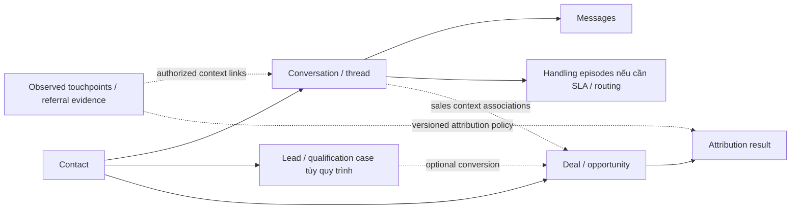

# Review mô hình Chat → Lead → Deal

**Decision CHG-20261013-08:** người dùng đã chốt giữ session theo lượt inbox và tách status/stage/history/milestones; [ERD cuối](chat-sales-erd.md) là chuẩn logical đích. Các lựa chọn còn ghi proposed bên dưới lưu lịch sử review; triển khai/runtime và exact contract vẫn chưa thay đổi.

2026-10-13 · Codex · Review-only. Đối chiếu source/contracts SRC-045/046/053 và tài liệu sản phẩm chính thức. Đây là findings và phương án đề xuất, không phải contract Ready hoặc quyết định thay đổi mô hình đã được duyệt. Không sửa migration/source/runtime; historical acceptance giữ nguyên. CHG-20261013-06 ghi nhận design risks trước khi mở rộng connected attribution.

## Kết luận

**Clarification CHG-20261013-07:** người dùng xác nhận chạm Ad mới khi hội thoại chưa close phải giữ session đang mở, và yêu cầu đo phễu theo từng lượt inbox. Vì vậy khuyến nghị cụ thể là giữ durable session/episode cho lượt inbox; không bỏ session chỉ để giống UI sản phẩm khác. Chỉ quy tắc giữ open session trên Ad mới đã được chấp thuận; metric/link/attribution details dưới đây là đề xuất cần exact contract. Runtime acquisition_v1 vẫn tách theo referral, chưa thay đổi.

Contact tách Conversation và Deal là hợp lý. Lead riêng hợp lý khi có công đoạn qualification/handoff độc lập. Acquisition session có thể hữu ích như một đơn vị phân đoạn, nhưng hiện đang gộp ba ý nghĩa: lượt chạm marketing, phiên xử lý chat và context tạo nhu cầu. Quan hệ origin một chiều hiện có không biểu diễn đầy đủ hành trình bán hàng qua nhiều lần chat/kênh.

Không thể suy schema nội bộ của sản phẩm khác từ UI/documentation. Các đối chiếu dưới đây chỉ nói object/API/workflow semantics được công bố; không kết luận họ không có bảng session nội bộ.

## Đối chiếu sản phẩm

| Hệ thống | Semantics công bố | Ý nghĩa khi so mô hình |
|---|---|---|
| [Kommo](https://support.kommo.com/docs/kommo-basics) | Lead là một sales opportunity có value/stage, đi tới won/lost; Contact có nhiều Leads; chat gắn với Lead | Lead của Kommo gần Deal hiện tại, không chứng minh cần chuỗi Lead qualification → Deal ở mọi case |
| [Kommo Facebook](https://support.kommo.com/docs/facebook-messenger-comments) | Incoming leads được accept/delete/link; có thể nối chat với Contact đã tồn tại; Page khác tạo incoming lead riêng | Cần xử lý quay lại/gắn vào record cũ, không chỉ tạo record từ phiên mới |
| [respond.io Lifecycle](https://respond.io/help/workspace-settings/workspace-settings-lifecycle) | Sales stages gắn Contact; có thể thao tác trong Inbox | Đơn giản cho funnel theo người; không tương đương nhiều cơ hội song song trên một Contact |
| [respond.io triggers](https://respond.io/help/workflows/workflow-triggers) | Conversation Opened/Closed, Click-to-Chat Ads và Lifecycle Updated là các trigger riêng | Chat lifecycle, ad interaction và sales lifecycle là các tín hiệu riêng; không suy chi tiết storage |
| [HubSpot objects](https://knowledge.hubspot.com/records/understand-objects) | Lead theo dõi qualification của Contact/Company; Deal theo dõi giao dịch; có associations | Tách Lead/Deal là mẫu hợp lệ nhưng cần ranh giới và quy tắc conversion rõ |
| [HubSpot attribution](https://knowledge.hubspot.com/reports/create-attribution-reports) | Lưu tương tác và phân bổ credit theo model, phân biệt Contact Create/Deal Create/Deal Revenue | Nguồn lúc tạo record khác attribution kết quả; primary origin có thể giữ nhưng không thay mọi attribution policy |

Đọc các trang chính thức ngày 2026-10-13. Meta live referral reference trả429; dùng [snapshot chính thức đã lưu](../references/meta/2026-10-06-plan003/messenger-webhooks--webhook-events--messaging_referrals.md.txt) trong repo, không claim live verification. Snapshot cho thấy referral có thể từ ADS hoặc SHORTLINK và có standalone callback trên thread đã tồn tại.

## Findings theo mức ưu tiên

### P1 — Referral marketing đang thay đổi vòng đời xử lý chat

Evidence lịch sử SRC-053: domain.receive/acquisition-storage trong monolith từng đóng phiên active khi referral đổi. Source đó đã được gỡ ở T09; [quy tắc identity hiện hành](../contracts/conversation-identity.md) và [Chat ingress](../../services/chat/src/ingress-message.ts) giữ phiên đang mở. Finding này mô tả trạng thái tại ngày review, không phải hành vi hiện tại.

Case: agent/bot đang hỏi thông tin để chốt nhu cầu A, khách bấm quảng cáo B rồi gửi tiếp số điện thoại. Chưa có bằng chứng họ bỏ A, nhưng hệ thống cắt orchestration/reply cũ. Referral mới là evidence về tương tác, không đủ chứng minh một nhu cầu hoặc phiên phục vụ mới.

Đề xuất: lưu touchpoint mới độc lập; chỉ thay sales context/đóng episode theo policy rõ. Tiếp tục kiểm tra độ phù hợp của reply với context mới, nhưng không dùng mọi referral như lệnh hủy toàn bộ công việc. Không tự bỏ cơ chế fencing hiện tại trước khi có contract thay thế.

### P1 — Attribution và mẫu số conversion phụ thuộc thao tác đóng chat

Evidence: organic inbound dùng phiên active; không có timeout; [session source contract](../contracts/chat-session-source.md) pin nguồn phiên được chọn. Ví dụ S1 bắt đầu từ Ad A; một tuần sau khách tự quay lại, agent chưa close thì Lead mới vẫn lấy A. Nếu agent đã close, inbound không referral tạo organic session. Cùng hành vi khách hàng có thể ra nguồn/mẫu số khác chỉ vì vận hành Inbox.

Session conversion vẫn là metric hợp lệ nếu gọi đúng là conversion của phiên theo policy acquisition_v1. Nó không tự chứng minh conversion của ad click, nhu cầu, khách mới hoặc nguyên nhân doanh thu. Một khách bấm lại cùng Ad nhiều lần cũng tăng số session dù chỉ có một nhu cầu.

Đề xuất: tách cohort theo operational episode, touchpoint, Contact và sales opportunity; công bố event eligibility/window/coverage. Giữ nguồn quan sát ở opening, không dùng nó như nguồn của mọi nhu cầu phát sinh vô hạn sau đó.

### P1 — Origin chưa đủ cho một Deal đi qua nhiều cuộc trao đổi

Evidence: Lead chỉ pin một conversation/session, Deal sao chép snapshot Lead trong [deal domain](../../services/core-baseline/src/modules/sales/deals.ts). Generic [associations](../../services/core-baseline/src/modules/crm/platform.ts) đã có; không đúng nếu nói hệ thống hoàn toàn thiếu N:N. Tuy nhiên chưa có contract sales-context chuyên biệt cho session/message evidence ↔ Lead/Deal, vai trò liên kết, ambiguity và UI chọn cơ hội đang xử lý.

Case: L1/D1 sinh từ Ad A; khách quay lại qua Ad B, chat tiếp trên Page khác hoặc điện thoại để chốt chính D1. Origin A hợp lệ để trả lời nguồn ban đầu; B không được thể hiện như một tương tác giúp chốt trong đường origin hiện tại. Tạo L2/D2 chỉ để giữ B sẽ nhân bản cơ hội và có thể nhân tiền.

Đề xuất: primary origin tách khỏi các conversation/touchpoint associations hỗ trợ cơ hội hiện có. Không auto-link mọi thứ chỉ vì cùng Contact; nhiều Deal đồng thời cần lựa chọn rõ và quyền trên từng record. Message membership theo thời gian không đồng nghĩa message nói về đúng một Deal.

### P2 — Lead/Deal thiếu ranh giới vận hành và vòng đời chuyển đổi

Evidence: Lead có qualification/handoff/accepted; Deal cho tạo từ bất kỳ Lead đọc được, cùng Contact, không disqualified. Không yêu cầu qualified/accepted, không đánh dấu converted hoặc chống tạo lại cùng nhu cầu bằng command key khác. Đây là chủ ý phase1, không tự kết luận authorization defect. Idempotency chỉ chống retry cùng command, không chống sales duplication.

Đề xuất: nếu SDR/AI qualify rồi chuyển đội sales, giữ Lead như intake/qualification case; định nghĩa linked/converted outcome và nhiều Deal khi tách cơ hội thật. Với chat-sales đơn giản, cho tạo Deal trực tiếp và ẩn bước Lead khỏi luồng mặc định. Không ép một Lead/một Deal toàn hệ thống nếu nhu cầu cần tách; phải rõ đâu là opportunity mới, alternative quote và order/receipt.

### P2 — Tạo Deal trực tiếp làm mất nguồn có thể chứng minh

Evidence: POST Deal chỉ nhận contact_id/lead_id/title/amount/currency; không lead_id thì source manual và không session. Agent có thể chốt khách từ Inbox nhưng phải tạo Lead trung gian mới giữ được nguồn theo command hiện tại. Manual là cách tạo record, không chứng minh kênh acquisition.

Đề xuất: tương lai cho direct Deal mang validated chat/touchpoint context độc lập với Lead. Giữ phân biệt creation method, observed entry source và attribution. Không cho client tự gán ad_id.

### P1 gate trước live/report — Input referral và missing evidence chưa đủ cho provider thật

[Exact contract](../contracts/acquisition-session-implementation.md) nêu rõ referral-only event chưa hỗ trợ. Mock acquisition nhận referral gắn inbound mới và coi đó là paid. Meta snapshot có ADS/SHORTLINK và callback độc lập; mapping provider thật phải phân loại đúng, correlate/dedup giữa event shapes, lưu occurred_at/received_at và xử lý event đến muộn. Chưa có test live để chứng minh coverage.

Không có referral chỉ có nghĩa không quan sát thấy referral, không đủ kết luận organic. Contract organic hiện đã ghi caveat này; label/report cần giữ caveat hoặc dùng unknown/no_observed_paid_referral. Không đổi record cũ ngầm. Snapshot bất biến phải đi cùng correction/enrichment có version/audit, vì bất biến không làm một lựa chọn origin sai trở thành đúng.

### P2 — Thread dài hạn nhưng automation chỉ bắt lần tạo thread

[Workflow engine](../../services/core-baseline/src/modules/workflow/engine.ts) starter hiện bắt conversation.created; [SRC-053 evidence](../tracking/details/SRC-053.md) đã ghi auto-start ở session tiếp theo nằm ngoài scope. Khách quay lại cùng thread không tự chạy lại flow khởi đầu theo trigger này. Cần separate opened/reopened/referral/enrollment semantics và re-entry policy, không emit giả conversation.created.

## Phương án đề xuất để review tiếp

### Lượt inbox và phễu session — clarification 2026-10-13

Conversation là thread dài hạn, session là một lượt tiếp nhận từ mở tới đóng, touchpoint là bằng chứng tương tác/kênh/quảng cáo. Một Conversation có nhiều sessions, một session có thể có nhiều touchpoints. Ad B xuất hiện khi S1 đang active: append evidence B vào context phù hợp, giữ S1/open/draft; không tạo S2 hoặc hủy công việc chỉ vì thay Ad. Agent close rồi inbound khách mới mở S2 theo baseline explicit-close/no-idle-timeout. Pending/snooze không mặc nhiên đóng session. Referral-only khi closed, outbound-initiated episode, late arrivals và event correlation vẫn cần exact policy; không coi mỗi webhook/ad click là một lượt inbox thực sự.

Chỉ giữ Conversation với status/opened_at/closed_at hiện hành sẽ không đủ tái lập nhiều lượt inbox. Có thể dựng episode từ event log đầy đủ, nhưng đó vẫn là session semantics cần stable episode ID/policy; durable session hiện có phù hợp hơn việc xóa rồi dựng lại. Không cần rename/drop bảng cũ trong phiên review.

Proposed acquisition cohort: chọn sessions có inbound đủ điều kiện và opened_at trong [from,to), gồm cả session chưa có Lead; báo cáo cutoff/as_of hoặc cùng observation window. N là COUNT DISTINCT session_id trong cohort. Các tỷ lệ cùng mẫu số N:

- Session→Lead: distinct cohort sessions là primary origin của ít nhất một Lead / N.
- Session→Deal: distinct cohort sessions là primary origin của ít nhất một Deal / N; chấp nhận Deal trực tiếp khi có validated origin, không ép Lead.
- Session→Won: distinct cohort sessions có ít nhất một Deal won theo primary origin / N. Outcome có thể xảy ra sau session close; chỉ tính trước cutoff/window.
- Won value: mỗi Deal thuộc primary origin của cohort chỉ cộng một lần theo currency; nhiều Leads/Deals của cùng session không nhân session count, message/touchpoint joins không nhân tiền.

Funnel là các kết quả trên cohort sessions, không ép chuỗi mọi record phải có Lead trước Deal. Khi có direct Deal, số sessions có Deal có thể lớn hơn số sessions có Lead; UI phải có nhánh direct hoặc hiển thị rates riêng, không vẽ funnel tuyến tính giả.

Session tiếp theo S2 chỉ chăm tiếp D1 có origin S1: ghi sales-context association/assisted session cho S2; acquisition won vẫn thuộc S1 theo primary-origin report. Chốt ở S2 có thể là metric closing activity riêng cần explicit evidence. Không tự coi association là causal attribution, và không cộng toàn bộ tiền vào cả S1/S2 trong cùng additive report. Phễu operational và phân bổ Ad là hai câu hỏi riêng.

Session có Ad A rồi B vẫn là một lượt inbox. Giữ opening source và danh sách touchpoints; không overwrite A hoặc mặc định credit toàn bộ won cho mỗi Ad. First/last/other credit policy theo milestone/window cần chốt riêng; việc agent đóng chat không tự thay lịch sử touchpoints. Counts theo lượt xử lý có quyền phụ thuộc close policy, nhưng phải công bố policy; chúng không đại diện số nhu cầu độc lập hay số lượt click.

Tổ chức ba phần độc lập, không coi mọi mũi tên là một bước bắt buộc:

Giữ Contact/channel identities, thread/messages, source evidence bất biến, tenant/ACL và Deal amount/currency. Lead là lớp qualification tùy quy trình; episode phục vụ vận hành nếu có nhu cầu. Reuse touchpoint hiện hữu trước khi đề xuất bảng mới. Acquisition_v1 giữ như lịch sử/policy cũ đến khi chốt mapping; không drop/rename/resegment dữ liệu đã dùng.

Chưa cần triển khai multi-touch phức tạp ngay. Có thể bắt đầu bằng một primary attribution được định nghĩa rõ (basis/time window/policy version/evidence), cộng danh sách touchpoints liên quan; tuyệt đối không cộng nguyên won value cho từng association. Original origin, corrected origin và attribution result phải phân biệt được khi audit/report.

## Scenarios phải chốt trước redesign

1. Khách đang qualify A bấm Ad B: lưu B, không tự mất draft/queued work hợp lệ hoặc tạo nhu cầu mới.
2. Khách trở lại organic trước/sau agent close: operational episode được khác, attribution chỉ khác theo policy đã công bố; không chỉ do thao tác dọn Inbox.
3. Cùng nhu cầu qua A/B, nhiều Page/kênh: tiếp tục Deal cũ; một won amount, có nhiều evidence refs.
4. Một thread hỏi hai nhu cầu: hai Deal có owner/context riêng, không đổi origin lẫn nhau; sales link không bypass chat ACL.
5. Chốt Deal trực tiếp từ Inbox: không bắt tạo Lead rỗng để giữ evidence.
6. Duplicate/referral-only/SHORTLINK/late event: nguồn không bị paid hóa sai; retries không tăng touch count; unmatched giữ coverage.
7. Chọn nhầm phiên và phát hiện muộn: correction có audit/version, origin gốc vẫn truy hồi; report chỉ rõ revision.
8. Reopen thread: automation re-entry có dedup, không chỉ chạy một lần cả đời Contact/thread.

Các scenario trên là đề xuất acceptance, NOT_RUN; không sửa CRM-BASE-10 đã PASS cho acquisition_v1. Review kết thúc khi findings có evidence và tài liệu/link checks đạt; redesign contract/API/DDL cần phiên riêng trước implementation.
