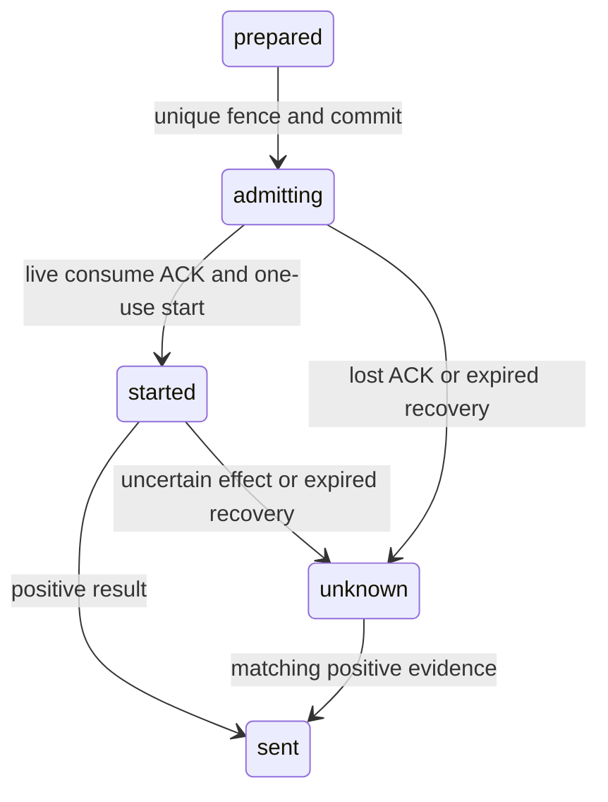

# Connector attempt lifecycle — PLAN-007C3 / SRC-098

2026-10-18 CHG-20261018-13. Ready scoped native persistence and injectable executor. Depends on SRC-097/096/093 and PLAN-007C2. [Dispatch authority contract](../contracts/chat-dispatch-v1.md), [preparation dictionary](connector-preparation-ledger.md), [database standard](database-guidelines.md). No production authority, HTTP endpoint, provider implementation or traffic switch. Parent PLAN-007C remains open for Identity/Chat/control-consumer ledgers.

## Lifecycle and failure semantics

Extend the existing guard: prepared → admitting → started → sent/unknown; admitting → unknown on uncertainty; unknown → sent only with matching positive evidence. Sent never downgrades or accepts another provider message ID. Cancel only staged/prepared; in-flight/unknown/sent cannot become cancelled. All mutations lock guard first, verify complete binding and fence, then payload/request/event. Same request key+different body conflicts and rolls back the whole transaction. Begin requires matching staged payload/grant and prior prepare; pins grant+claim and a fresh fence with database deadline now+5s, permanently one attempt per intent. Replay never changes fence or deadline.

Fresh successful begin commit returns an opaque in-memory admission object registered in a WeakMap. Persisted receipt, fence or serialized object cannot reconstruct it. startLive consumes that object once before awaiting SQL, checks local monotonic5s and DB deadline, verifies payload again, then CASes admitting→started and appends event. Only a successfully acknowledged start commit returns another opaque one-use send object. takeLivePayload consumes that object before awaiting SQL, rechecks deadline/state/fence/digest and returns content once. Copy/replay/new Store instance cannot mint either object. Failure/lost commit ACK forfeits continuation, even if the database committed. No automatic retry/rearm, no timer capable of restoring permission.

Executor ports must provide current begin/Chat-claim authorization, active Connector binding, Identity consume and provider send; no default/mock port in runtime. Each call uses a2s timeout/AbortSignal. Identity consume reply must match request correlation, grant/claim and resource owner/revisions; schema alone is not authentication. Only one live begin handler calls consume once. Recheck active binding before start and immediately before taking payload. Send occurs after transaction closure; timeout/throw marks unknown if DB available, otherwise bounded expiry recovery handles it. Positive response records sent; failed local persistence never retries provider. Late sent evidence can be supplied to the owner-authorized result repository. Ports in tests are synthetic, never native/mTLS/provider evidence.

Recovery scans one explicit business tenant, at most100expired admitting/started guards, locks with SKIP LOCKED, moves each to unknown with an atomic event. It never resets prepared/cancelled/sent or another tenant; it cannot reclaim an unexpired live attempt. Startup can wait at most5s for abandoned reservations then recover; a new process never obtains a continuation meanwhile. This is safe conservative recovery, not a full backup/restore drill. A process paused between final check and external I/O is still subject to the protocol's documented non-atomic clock/network boundary; no hard recall guarantee.

Read status uses current caller authority and exact binding, no request caching, no fence/payload capability. Existing preparation replay returns historical prepared acknowledgment without state mutation after admission; stage replay remains immutable. Cancellation and begin serialize on guard. Future migration activation must quiesce old binaries: schema4 code must never run against extended state5.

## Filled table templates for forward5

All existing tenant_id CHAR36 ASCII ascii_bin NOT NULL retained. UUID additions same encoding, hashes CHAR64 ASCII ascii_bin; UTC times DATETIME(6). No new system scope/journal; registered platform journal unchanged. All fields NOT NULL unless explicitly nullable. Existing full templates remain normative for unchanged columns.

| Required item | connector_dispatch_guard (alter) | connector_dispatch_request (alter CHECK) | connector_attempt_event (new) |
|---|---|---|---|
| Task / requirement / acceptance | SRC-098 CTA-01…07 | Same | Same |
| Schema / physical current | crm_connector; isolated native_connector_test forward5 | Same | Same |
| Writer / aggregate | Connector attempt; one local transaction, no network | Connector begin/result caller namespaces fixed by operation | Same attempt transaction |
| Meaning / excluded | Attempt lifecycle and deadline, never reconstructable permission | Immutable request/body binding, not a provider retry queue | Immutable state-change audit, not broker delivery |
| Kind / scope | Source state, business explicit tenant; no platform fallback | Immutable business | Immutable business |
| Columns | Existing fields; grant_id,claim_id,fence_id UUID nullable; deadline_at UTC nullable; provider_message_id VARCHAR255 utf8mb4_0900_as_cs nullable. Existing version BIGINT UNSIGNED CAS, timestamps retained | Existing fields unchanged. Allowed operations add connector-begin (Chat), attempt-result (internal Connector); request_digest includes supplied fence for local results | tenant_id,intent_id UUID; version BIGINT UNSIGNED; state VARCHAR16 ASCII; fence_id UUID; provider_message_id VARCHAR255 nullable; created_at UTC |
| Keys / constraints | Existing tenant intent/attempt uniques; lifecycle four fields all present iff admitting/started/unknown/sent; provider ID iff sent; existing cancellation iff cancelled. New index(tenant_id,state,deadline_at,intent_id) for expiry | Same PK tenant+operation+request, FK same-tenant guard; operation allowlist expanded only | PK(tenant_id,intent_id,version), same-tenant FK guard; positive version; allowed states admitting/started/unknown/sent; provider iff sent |
| Remote references | Grant/claim/principal authority verified outside SQL through owning ports; outages fail closed; no foreign schema access | Target Connector; callers fixed by operation, no caller from body | Fence belongs to this attempt; no remote FK |
| Query / index / pagination | Point status/fence CAS; tenant-scoped bounded recovery limit1…100; ordered deadline,intent, SKIP LOCKED; no offset/unbounded cross-tenant scan | Unique request read | Audit per tenant+intent ordered version; no transcript |
| Permission | Current begin/read/result/cleanup authority before entry; executor ports must authenticate peers; opaque IDs not authority | Same on every replay | Append only by repository; operator review tenant-scoped |
| Concurrency / retries | Guard lock→payload→request→event; CAS version/state. Begin duplicates return status without live object. WeakMap admission/send handles consumed before awaits; no retry on unknown | Duplicate digest mismatch rolls back mutation/event | One row per changed guard version, atomic with state; replay no new event |
| Audit / outbox | Every new in-flight transition appends event; prior preparation receipts unchanged | Append with begin/result transaction | This minimized audit records state/fence/provider ID; broker outbox/Chat result delivery is a later gate |
| PII / retention | No text/secret; provider ID sensitive metadata. No purge; preserve full intent+restore horizon | No purge | Backup with guard/payload/request as one set; never replay audit as send permission |
| DB grants | Existing SELECT/INSERT/UPDATE, no DELETE/DDL | Existing SELECT/INSERT only | SELECT/INSERT only; migration role DDL separately |
| Migration | Forward5 ALTER adds nullable lifecycle columns and replaces state CHECK atomically per ALTER; old staged/prepared/cancelled rows unchanged, no in-flight backfill | Expand operation CHECK, no data rewrite | Empty new table; no historical events invented |
| Compatibility / rollback | Stop old writers; runner journal applying blocks readiness on partial DDL; forward repair only. No old binary on5, no history edits/reset/drop | Same | Same |
| Fixtures | Retained registered tenants and payload/preparation fixtures; per-run attempts retained | Same | Compare all old rows before/after upgrade; no reset |
| Evidence | [SRC-098](../tracking/details/SRC-098.md): populated migration,17native lifecycle groups and23native regression groups executed | Same | Same |

## Acceptance

- CTA-01: populated4→5 preserves all prior values/migration checksums; nullable additions empty; rerun no-op; exact runtime grants and denied audit UPDATE/DELETE/DDL/foreign SELECT.
- CTA-02: concurrent begins one fence/live handler; request/claim/grant/binding conflicts; payload required/rechecked; cancel-before wins, cancel-after admission fails; replay cannot rearm.
- CTA-03: opaque capabilities single-use, nonserializable across Store/process; start commit/ACK loss and deadline boundaries block send; two tenants remain isolated.
- CTA-04: executor synthetic consume/active-binding/send ports; at most one callback, no send for revoked/unavailable/mismatched consume, timeout or expired local deadline; provider success/lost local result ACK never resends.
- CTA-05: expired tenant-bounded recovery→unknown with atomic audit; late matching sent resolves, conflicting/stale result rejected, sent not downgraded; repeated recovery idempotent.
- CTA-06: retained native preparation/payload regression, Connector units, builds/scripts/schema/boundary/lint/docs/whitespace.
- CTA-07: evidence/checkpoint/runtime status exact; no native auth/mTLS, Chat result transport, live provider/production/backup restore claim.

Runbook command is `pnpm test:connector:attempt`; only retained test DB migrates. Recover per tenant before enabling future readiness after all transient deadlines expire; no generic reset/force-unconsume. Full runtime activation waits for native Identity/Chat authority and authenticated result delivery adapters, plus broader PLAN-006/007B cutover.
