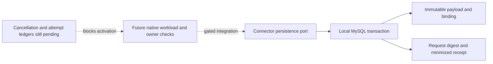

# Connector payload storage — PLAN-007C1 / SRC-096

SRC-097 current source update: [schema4 shared preparation/cancellation guard](connector-preparation-ledger.md) now locks tenant+intent before payload/request. This supersedes the original lock order below and closes the local cancellation gap; native authority and in-flight dispatch remain gated. Payload/request grants stay SELECT/INSERT, with SELECT/INSERT/UPDATE on the separate mutable guard and SELECT/INSERT on prepare/cancel receipts. SRC-096 evidence remains historical schema3 acceptance.

2026-10-18, CHG-20261018-11. Ready for isolated persistence, under [exchange v1](../contracts/chat-exchange-v1.md), [dispatch v1](../contracts/chat-dispatch-v1.md) and [database guideline](database-guidelines.md). PLAN-007C remains partially designed: Identity grant, Chat inbox/claim/registry, Connector cancellation/attempt and consumer control ledgers are still TODO. This slice does not expose payload-put or activate dispatch.

The repository is a persistence port, not an authorization service. Its caller must authenticate the current Chat workload, business tenant, active binding, exact grant and current policy/expiry before every call (including replay). It passes the inspected grant state issued/consumed; consumed permits an existing identical payload only. No remote call occurs inside SQL. Cancellation serialization with prepare/start is a later gate; this repository MUST NOT be wired to an HTTP route or sender until that ledger and native authority adapters are implemented. No fake runtime authority is provided.

## Filled table templates

All columns below are NOT NULL, with no defaults unless stated. UUID columns are CHAR(36) ASCII ascii_bin; digests CHAR(64) ASCII ascii_bin; identifiers are lower-case canonical UUIDs. Positive decimal revisions are DECIMAL(20,0), preserving the full contract range (not JS Number or unsigned BIGINT). UTC creation time is DATETIME(6), supplied by SQL. Both tables are immutable, so no fake version/updated_at.

| Required item | connector_dispatch_payload | connector_payload_request |
|---|---|---|
| Task / requirement / acceptance | SRC-096; CPD-01…06 below | SRC-096; CPD-01…06 below |
| Table / target schema | crm_connector.connector_dispatch_payload | crm_connector.connector_payload_request |
| Physical current | New isolated Connector schema3; retained native_connector_test validation, no monolith move | Same schema3 |
| Writer / aggregate | Connector persistence adapter; one local staging transaction | Same transaction after payload insert/check |
| Meaning / exclusions | Immutable stage content and exact binding; no permission, dispatch state or provider receipt | Request digest binds Chat payload-put request to committed payload; no cached authority |
| Data kind | Immutable source ledger | Immutable replay/audit ledger |
| Scope | business; explicit caller TenantContext; reject PLATFORM_TENANT_ID, missing/invalid tenant | Same business context |
| Columns | tenant_id, intent_id, attempt_id, conversation_id, crm_contact_id, connection_id, principal_id, delegation_id, grant_id UUID; actor_kind VARCHAR(5) ASCII; owner_revision, record_version DECIMAL(20,0); payload_digest, binding_digest CHAR64; payload JSON; created_at UTC | tenant_id, request_id, intent_id UUID; request_digest CHAR64; created_at UTC. Target Connector, caller Chat and operation payload-put fixed by dedicated table, not user-selected |
| Keys / constraints | PK(tenant_id,intent_id); UNIQUE(tenant_id,attempt_id); actor CHECK human/ai; positive revision CHECKs; payload JSON object and byte cap65536 | PK(tenant_id,request_id); index(tenant_id,intent_id); same-tenant FK to payload; no cascade |
| Remote references | Identity grant/principal/delegation, Chat intent/conversation, CRM contact and connection are opaque validated owner references; no remote FK/SQL. Outage denies upstream admission | Only same-schema payload FK; no remote lookup |
| Queries / indexes | Point lookup by tenant+intent; tenant+attempt unique rejects collision. EXPLAIN must show bounded unique lookup | Point lookup tenant+request; local FK index. No cross-tenant scanner/list/export |
| Permission | Caller performs current dispatch/exchange rights checks; storage does not infer rights from IDs/digests; no public runtime integration in this slice | Replays undergo the same current admission before repository; no payload in reply |
| Concurrent writes | Insert immutable row; duplicate key then locking read compares complete binding/grant/content digest. Lock payload before request; transaction rollback on any conflict; deadlock returned as retryable dependency failure, no provider effect | Insert request after payload; duplicate key then locking read compares digest+intent. Whole transaction rolls back on conflict, including orphan candidate payload |
| Audit / outbox | Successful staging and immutable request receipt commit together; no event published in this slice | This minimized append-only request ledger records digest/time/IDs; no text, credential or duplicate transcript |
| PII / retention | Payload contains synthetic text in acceptance; production text sensitive, runtime account only; encryption/backup policy is deployment gate. No purge until full intent lifetime+restore horizon policy approved | No TTL/delete; retain with payload, back up/restore both in one snapshot; never restore a receipt without payload |
| DB grants | Runtime SELECT, INSERT only; migration role DDL separately | Runtime SELECT, INSERT only; runtime cannot UPDATE/DELETE/DDL or read foreign service schema |
| Migration | Add forward3 to existing Connector runner, leave migration1/2 checksums unchanged; no backfill or legacy writer change | Same migration; journal existing explicit registered system tenant 01900000-0000-7000-8000-000000000001; no new journal or default tenant |
| Compatibility / rollback | Expanded schema; old binary readiness rejects unexpected journal version, so old image needs its unchanged schema2 instance; never downgrade journal/drop tables. Fix forward. Main and retained container schema2 not upgraded by this test | Same; new code only published after migrate3 and grants, future integration gated separately |
| Fixtures | Retain private fixture IDs and synthetic text; reuse registered test tenant IDs from native_identity_test; never reset | Reuse baseline request; additional race IDs are retained |
| Evidence | Native acceptance executed; see [SRC-096 evidence](../tracking/details/SRC-096.md) for commands, results and limitations | Same |

## Acceptance and restoration boundary

- CPD-01: native migration2→3 preserves old checksums/data, rerun no-op; journal system tenant exists in Identity (operator verification only, no cross-schema runtime SQL).
- CPD-02: identical and concurrent request/intent replay yield one immutable payload; changed binding/grant/content/request conflicts; rolled-back conflict leaves no orphan.
- CPD-03: two business tenants may reuse IDs but cannot read each other's rows; system/missing tenant denied; consumed grant cannot stage absent content.
- CPD-04: interrupted SQL transaction rolls back on connection loss; fresh process/pool replays committed ACK without new data; corrupted stored payload fails closed. This is not a full MySQL backup restore drill or provider crash test.
- CPD-05: runtime SELECT/INSERT works; UPDATE/DELETE/DDL and foreign-schema reads denied; constraints reject null tenant/cross-tenant FK; unique query plans recorded.
- CPD-06: builds, focused Connector unit regression, script/schema/boundary/lint/docs/whitespace checks; all data retained, no endpoint/worker activation.

Operator runs existing Connector migrate/grant commands only against an explicitly selected local/test schema. Acceptance command is `pnpm test:connector:payload`; it pins local native_connector_test and retained native-auth test operator configuration. It does not start Connector or contact Meta. Full PLAN-006/007B legacy migration and traffic switch remain pending.

Native verification refined locking: use `FOR SHARE` for immutable payload/request comparison after unique insert, requiring only SELECT/INSERT. `FOR UPDATE` would require broader grants and is unnecessary because rows never mutate. InnoDB unique inserts serialize competing keys; conflicting transactions roll back together. Deadlock/connection errors propagate as storage failures for future adapter503 mapping, never a successful receipt. No hidden retry or provider call exists.

The native harness uses registered retained business tenants, reusable baseline IDs and fresh per-run race IDs. Test runtime account has exactly USAGE plus SELECT/INSERT on these two tables. Existing service grant operator adds these same privileges to its original table allowlist; unit tests verify this provisioner and its unsafe-account rejection. The native harness provisions its narrower test account via the existing local Docker root context, not by broadening native_test_operator permissions. Neither credentials nor payload text appear in evidence.
