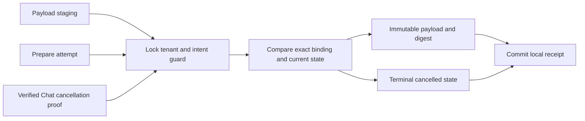

# Connector preparation/cancellation — PLAN-007C2 / SRC-097

Current source update SRC-098: [forward5](connector-attempt-ledger.md) extends the state/DDL and adds attempt audit. The original schema4-only state exclusion below is historical. Cancellation still permits only staged/prepared; after admission it fails without changing state. Preparation replay returns its historical acknowledgment without rearming. Opaque live continuations and a caller-injected executor now exist, but native authority/HTTP/provider integration is still gated.

2026-10-18, CHG-20261018-12. Ready scoped storage design. Depends on completed SRC-096/094/095 and PLAN-007C1. [Dispatch](../contracts/chat-dispatch-v1.md), [exchange](../contracts/chat-exchange-v1.md), [payload dictionary](connector-payload-ledger.md). Parent PLAN-007C remains incomplete for admission/start/result, Identity, Chat and control consumers. This slice adds actual persistence for staged/prepared/cancelled only; no claim that in-flight attempts can be cancelled or that dispatch is activated.

## State and serialization

One Connector-owned guard per business tenant+intent pins the complete immutable DispatchBinding and unique tenant+attempt. Every payload-put, prepare and cancel locks this row first. A no-op unique upsert acquires an exclusive row lock even for concurrent duplicates; it never changes binding/version/timestamps. Then compare all typed binding fields. Lock order: guard → immutable payload → operation request ledger. All SQL stays in one Connector transaction; no network in transaction.

Guard states: staged → prepared → cancelled, or staged → cancelled. Cancel can create the guard before payload exists, then commit cancelled plus its request receipt together. Cancelled is terminal. Subsequent payload-put/prepare (including old request replay) fail INVALID_TRANSITION before returning a historical ACK. This matches the existing exchange reference model. Neither second attempts nor changed binding/proof/grant/content can rearm it. Repeated identical prepare/cancel with new request IDs deduplicate on guard state; request key reuse with altered body conflicts and rolls back all local effects. Same UUID request_id can occur in different operations, each with its own namespace.

Preparation requires existing payload with matching complete binding/grant and recomputed content hash, rechecked even on replay. It never stages content implicitly. Stage and cancel can both succeed if stage committed first; final guard is cancelled and content remains retained. If cancellation commits first, stage/prepare fail. No deletion of historical payload/receipts. Guard version increments only when state changes; timestamps UTC. All successful prepare/cancel requests are appended atomically as minimized audit/replay receipts, without transcript.

Caller boundary unchanged: current workload/tenant/resource/Identity staging rights and issued grant checked before stage/prepare; cleanup authority plus authoritative Chat cancellation-read proof before cancel, including replay. The repository accepts a parsed exact cancellation proof and checks its request_id, receipt_id=intent_id, cancellation_id, reason and state; this structural comparison is not authentication. Actual mTLS/native ports remain unimplemented. No HTTP/worker may use these storage ports yet. In-flight begin/consume/start/unknown/sent states are intentionally unsupported by schema4 and require a forward migration plus matching native authority/runtime gate. No generic state setter exists.

## Filled table templates

Types common to both: tenant_id NOT NULL CHAR36 ASCII ascii_bin; all UUID columns same; hashes CHAR64 ASCII ascii_bin. Nonnullable unless explicitly nullable; no defaults except version1. All other fields supplied explicitly; created_at/updated_at UTC DATETIME(6).

| Required item | connector_dispatch_guard | connector_dispatch_request |
|---|---|---|
| Task / requirement / acceptance | SRC-097; CPG-01…06 | Same |
| Table / target schema | crm_connector.connector_dispatch_guard | crm_connector.connector_dispatch_request |
| Physical current | New schema4 in isolated native_connector_test; no monolith move | Same |
| Writer / aggregate | Connector staging/preparation/cancellation aggregate only | Same local transaction |
| Meaning / exclusions | Binding and preparation/cancellation mutex/tombstone; never send permission | Successful Chat prepare/cancel request digest; not authority/cache grant |
| Data kind | Mutable source guard, immutable binding | Immutable replay/audit ledger |
| Scope | business; explicit validated tenant context, reject platform/missing/foreign context | Same |
| Columns | tenant_id,intent_id,attempt_id,conversation_id,crm_contact_id,connection_id,principal_id,delegation_id UUID; actor_kind VARCHAR5 ASCII; owner_revision,record_version DECIMAL(20,0); payload_digest CHAR64; state VARCHAR16 ASCII; cancellation_id UUID nullable, cancellation_reason VARCHAR32 ASCII nullable; version BIGINT UNSIGNED default1; created_at,updated_at UTC | tenant_id,request_id,intent_id UUID; operation VARCHAR32 ASCII; request_digest CHAR64; created_at UTC |
| Keys / constraints | PK(tenant_id,intent_id), UNIQUE(tenant_id,attempt_id); positive revisions/version; actor human/ai; state staged/prepared/cancelled; cancellation ID/reason both set iff cancelled, reason owner_changed/conversation_closed/authorization_revoked | PK(tenant_id,operation,request_id); index(tenant_id,intent_id); same-tenant FK guard, no cascade; operation connector-prepare/connector-cancel |
| Remote references | Chat intent/proof, CRM contact/connection, Identity principal/delegation are opaque IDs; native API authorization before SQL; no remote FK | No remote FK; caller Chat/target Connector fixed by table; errors upstream fail closed |
| Queries / indexes | Unique tenant+intent point lock and tenant+attempt collision guard; no cross-tenant dispatcher or paging | Tenant+operation+request unique lookup; tenant+intent FK index |
| Permission | Caller enforces live native scopes/seat/field restrictions and proof; IDs not credentials. No production integration | Replays repeat current authority checks |
| Concurrent writes | Exclusive guard lock; typed immutable binding compare; version+state CAS under lock. Retryable DB error rolls back; no automatic side effects/retry | Append after guard/payload lock; compare digest+intent on duplicate; conflict rolls back state/version |
| Audit / outbox | Atomic state+request receipt; stage uses existing payload receipt; migration initialization documented in schema journal. No broker events | Minimized operation/request digest/time; no transcript; never UPDATE |
| PII / retention | Only IDs/counters; preserve guard/tombstone through intent lifetime+restore horizon; no purge in this slice | Same lifetime; backup all four tables in one snapshot; restore never discards cancelled guard |
| DB grants | Runtime SELECT,INSERT,UPDATE; no DELETE/DDL or other schema access | Runtime SELECT,INSERT only; payload tables retain SELECT,INSERT |
| Migration | Forward4 adds tables, then INSERT SELECT same-schema payload bindings to staged guards version1, preserving original creation time. Existing payload has no dispatch execution yet. Journal applying prevents readiness until complete; no history edits | New empty table. Stop old writers before migration/backfill; no resets |
| Compatibility / rollback | Old schema3 readiness rejects4; old direct library writer must be stopped (would bypass guard). Preserve payload/receipts and migrations1…3. Partial migration fails closed for operator forward repair; do not mark applied blindly or drop tables | Same; existing payload API method signature preserved, now locks guard. Rollback uses unchanged prior deployment only; no downgrade journal |
| Test fixtures | Reuse registered SRC-096 tenants and fixtures; seeded retained payload/legacy rows before schema3→4; per-run race IDs retained | Same, compare digests and row counts before/after migration |
| Evidence | [SRC-097 evidence](../tracking/details/SRC-097.md): populated forward4, native races/replay/permissions and payload regression executed | Same |

## Acceptance

- CPG-01: real populated3→4, exact binding backfill and unchanged existing payload/receipt/legacy data/history; repeated migration no-op; registered system journal.
- CPG-02: cancel before stage/prepare, prepare then cancel, replay/new request keys, malformed or mismatched proof and binding, terminal cancellation across a fresh process.
- CPG-03: concurrent stage/cancel and prepare/cancel, identical concurrent requests, conflicting proofs/request reuse; no orphan state on rollback; transaction loss before/after commit.
- CPG-04: two registered tenants, reused IDs, missing/system/foreign context, same-tenant FK and SQL grants; payload/request stay append-only, guard UPDATE only in own schema.
- CPG-05: prepare requires stored matching content/grant and fails on corruption; full payload native regression still passes; EXPLAIN unique reads.
- CPG-06: compiled contracts/Connector, Connector unit tests, script/schema/boundary/lint/docs/whitespace; retained service status and exact exclusions. No native authorization, HTTP, in-flight lifecycle, provider, restore drill or traffic activation evidence.

Runbook: `pnpm test:connector:preparation` builds then runs local retained acceptance, followed by `pnpm test:connector:payload`. Only explicit operator migration changes native_connector_test; main/image schema2 stays unchanged. Full service grant allowlist adds these two tables; native test role has only required four-table access. No secret/logged text; `.local` fixture private. Next gate after this slice is the admitted/start/result fence and recovery ledger, then native authority/HTTP activation.
