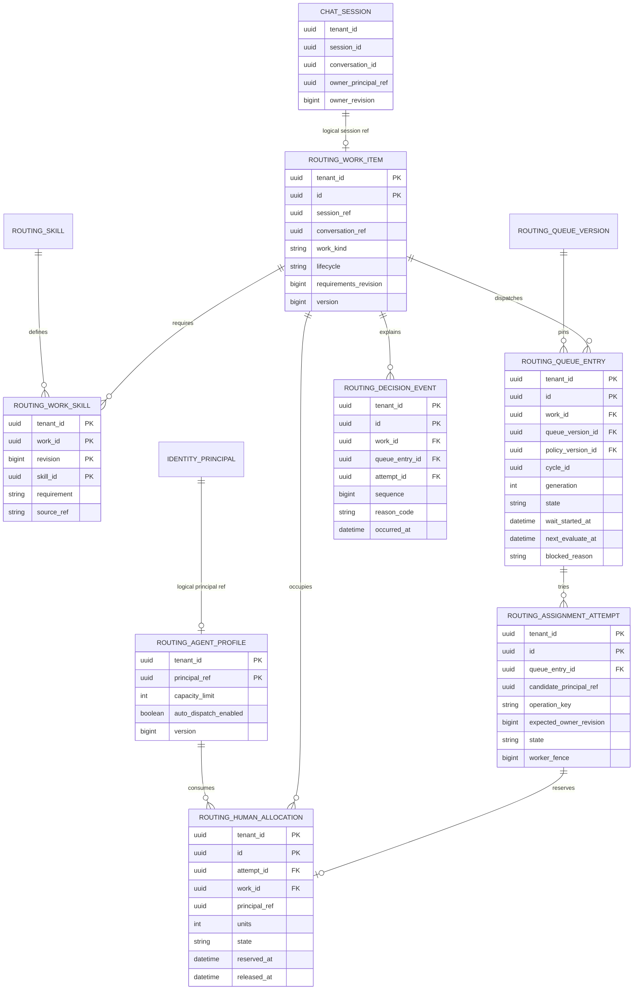
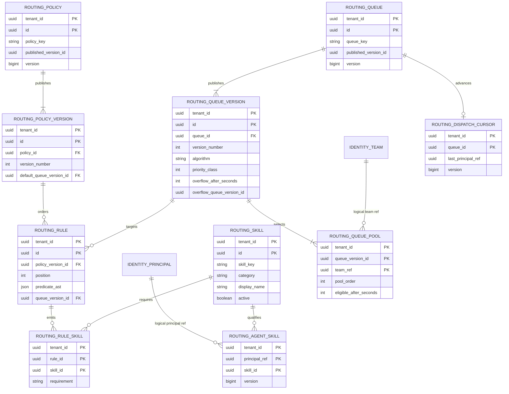
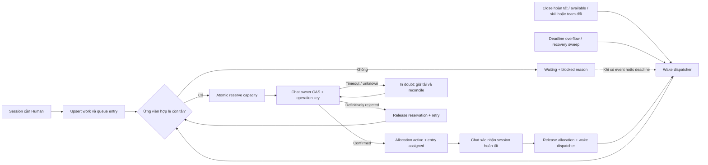

# Conversation routing ERD — Omni-style logical design

**Implementation update SRC-084:** [Exact bounded contract](../contracts/human-routing.md) and [evidence](../tracking/details/SRC-084.md) now implement team skills, Human profiles, versioned connection queues, work/entry/attempt/allocation and operational performance in the monolith. The broader17entity model below remains logical; immutable config/trace reuse and local atomicity are documented in the scoped contract.

PLAN-044 / CHG-20261017-04 · 2026-10-17 · **Logical design for review; chưa Ready cho DDL/API/source.**

[Mở bản xem sơ đồ](conversation-routing-preview.html) · [Runtime SVG](assets/conversation-routing/runtime.svg) · [Config SVG](assets/conversation-routing/configuration.svg) · [Engine flow SVG](assets/conversation-routing/dispatch-lifecycle.svg).

Thiết kế bổ sung cho [Chat/Sales ERD](chat-sales-erd.md), [routing hiện tại](../contracts/routing.md) và [nghiên cứu assignment](../references/conversation-assignment.md). Mục tiêu: mỗi lượt xử lý có một việc, việc chưa có nhân viên phù hợp nằm trong hàng chờ bền vững, engine phân bổ lại khi có capacity. Workflow chỉ quyết định yêu cầu định tuyến, không phải tự viết vòng lặp Close → Pull.

## 1. Kết luận và phần cần thêm

**Cần thêm lớp Work → Queue entry → Assignment attempt → Human allocation.** Chỉ lưu owner và `routing_attention` không đủ để biết việc chờ bao lâu, đã thử ai, vì sao chưa phân được và ai đang chiếm capacity.

| Hiện có | Giữ lại / bổ sung |
|---|---|
| Identity principal, team, team_member, availability, quyền và seat | Giữ authority; thêm Routing profile cho giới hạn tải Human. R1 chưa tạo presence authority thứ hai |
| Conversation thread và `conversation_acquisition_session` | Giữ: `conversation_id` là thread, `session_id` là lượt xử lý. Routing tham chiếu session, không tạo session mới |
| Chat owner/history, session_contribution | Giữ owner và lịch sử đóng góp ở Chat; Routing lưu quyết định và allocation, không lưu một owner canonical khác |
| `routing_attention` | Giữ compatibility cho attention; không dùng làm durable queue |
| `routing_cursor` theo team/capability | Giữ legacy; thêm cursor theo queue nếu dùng round-robin. Chuyển đổi bằng forward gate, không đổi ngầm key cũ |
| `agent_capacity_slot` | Slot thực thi AI có lease, không dùng làm tải hội thoại Human |
| Workflow version/run/wait/timer | Giữ ở Workflow; Routing chỉ lưu ref và operation key để chống gửi trùng |
| Page/ad/post/product/custom fields | Giữ ở owner hiện tại; rule ánh xạ thành queue + skill requirements, không nhân bản cây quảng cáo |
| Chat inbox/unread/activity | Tái dùng cho màn hình; inbox là bộ lọc, không phải routing queue. Unread message khác unseen assignment |

Đây là 17 **logical entities** để review trách nhiệm, không bắt buộc 17 bảng vật lý. Có thể gộp child config vào immutable version artifact nếu validate/query/audit vẫn đáp ứng.

## 2. ERD runtime — phần cốt lõi

Tất cả entity/link/event có `tenant_id NOT NULL`. PK/FK local luôn có tenant. Các đường tới Identity/Chat là **logical reference qua port/API/event**, không phải FK/SQL xuyên service. Các trường `*_ref` dưới đây thể hiện điều đó.

`CHAT_SESSION` là aggregate view để hiểu quan hệ; không đề xuất chuyển owner vào bảng session. Chat tiếp tục giữ owner ở cấu trúc hiện hành. R1 có một `work_kind=human_conversation` nên mỗi session tối đa một work item; nếu mở rộng work kind thì quan hệ session→work thành 1:N theo kind.

## 3. ERD cấu hình — kỹ năng, pool và rule linh hoạt

**Ví dụ:** Page A + ad thuộc dòng máy lọc nước → queue “Tư vấn máy lọc nước” + required skill `product.water_filter`; khách nói tiếng Anh → thêm `language.en`. Skill được tái dùng cho nhiều Page/ad. Team là pool ứng viên, skill là năng lực, quyền Identity mới quyết định có được truy cập hội thoại hay không.

R1 rule first-match theo position, có default queue bắt buộc. Predicate là AST có type và allowlist operator/field; không lưu SQL/JavaScript tùy ý. Thiếu source/custom-field value không được tự coi là match; dùng nhánh fallback có reason. Workflow có thể gửi queue/requirements bằng cùng dispatch command với provenance; không thêm một dispatcher riêng. Queue version phải chỉ ra ít nhất một pool; bản draft chưa publish có thể chưa có version.

## 4. Lifecycle và cơ chế tự lấy việc tiếp

Đây là **luồng engine mặc định được visualize để giải thích**, không phải workflow mà admin phải kéo thả để hệ thống hoạt động. `Waiting → dispatching → assigned` là queue lifecycle; `reserved → in_doubt/active → released` là capacity lifecycle. Một attempt đã thất bại không được dùng lại operation key với payload khác.

### Quy tắc đề xuất cho R1

1. Một work item theo `(tenant, session, work_kind)`; tin nhắn tiếp theo không tạo work mới. Một active queue entry cho mỗi work; requeue/overflow tạo generation lịch sử, không xóa dấu vết.
2. Mọi session mở đang do Human xử lý chiếm **1 slot**; pending/snoozed vẫn chiếm. Đóng tab trình duyệt không giải phóng. Chat xác nhận hoàn tất/hủy hoặc chuyển khỏi Human mới giải phóng; mở lượt mới tạo work mới.
3. Tải toàn tenant/principal = `reserved + in_doubt + active` trên **mọi queue**. Capacity limit là số nguyên không âm; 0 chặn nhận mới. Giảm cap dưới tải đang giữ không đẩy việc ra tự động, chỉ chặn nhận mới.
4. Chọn ứng viên từ pool hợp lệ → check live Identity availability/seat/rights/team + required skills → còn capacity → soft sticky nếu còn hợp lệ → thuật toán queue. Preferred skill chỉ dùng xếp hạng. R1 hỗ trợ round-robin hoặc least-loaded; tie-break ổn định bằng cursor/principal ID.
5. Dispatcher ưu tiên `priority_class`, sau đó `wait_started_at`, rồi ID; chọn việc cũ nhất **đủ điều kiện** để tránh một việc không có skill chặn cả queue. Cạnh tranh nhiều queue dùng thứ tự này ở dispatcher chung; strict priority có nguy cơ starvation, đo tuổi backlog và cấu hình overflow, chưa hứa starvation-free.
6. Wakeup ngay khi nhận event giải phóng tải/availability/eligibility thay đổi; deadline riêng cho overflow/mở secondary pool; periodic sweep để khôi phục event bị lỡ. Không cần chờ sweep thường kỳ để lấy việc. Không cam kết latency hay interval cụ thể trước benchmark.
7. Rule/pool/algorithm được pin immutable version khi enqueue. Publish mới không âm thầm đổi backlog. Re-evaluate backlog là command có audit, thay generation/requirement revision; live revocation hoặc skill bị vô hiệu vẫn chặn ứng viên ngay lần check tiếp theo. Không tự đá owner đang xử lý chỉ vì skill đổi.
8. Overflow giữ `cycle_id` và `wait_started_at` gốc, ghi `entered_at` từng queue; transfer khi đã xử lý mở cycle mới. Chặn vòng overflow lúc publish và runtime bằng giới hạn hop/visited versions. Hết đường fallback → waiting/attention có reason, không tự bỏ việc.
9. R1 **auto-assign**, không có offer accept/reject. Manual assign, transfer và Workflow đi cùng capacity protocol; không bypass counter. Override cap cần quyền và contract riêng, chưa thuộc R1.
10. Native dispatch và custom workflow không được cùng quyết định owner độc lập. Duplicate session event/workflow/recovery dedup bằng work identity và command operation key; không dùng workflow_run_id làm work identity.

### Atomicity, transfer và unknown outcome

Routing local transaction khóa work/active entry, rồi capacity profiles theo principal ID ổn định, reserve slot + attempt + outbox cùng commit. Snapshot eligibility/load chỉ dùng lựa chọn, không phải reservation. Worker claim có lease và fencing riêng; lease hết không có nghĩa Human đã hết làm việc.

Chat phải hỗ trợ owner command idempotent theo operation key, expected owner revision **và active session guard**. Routing không giữ local transaction khi gọi Chat. Nếu timeout sau khi Chat có thể đã commit: giữ `in_doubt`, truy vấn command status/reconcile; không phân lần hai và **không nhả tải chỉ do reservation TTL hết**. Active allocation không có TTL. Exact command/status API và revision protocol còn là physical/API gate.

Transfer giữ allocation cũ active, reserve candidate mới; sau Chat CAS thành công mới chuyển mới→active và cũ→released trong một Routing transaction. Do đó một work có thể tạm có **một active + một reserved/in_doubt** khi transfer, nhưng không có hai active. Transfer bị reject thì nhả reservation mới, giữ owner/allocation cũ. Assign cùng người là idempotent no-op. Chat close chạy đua transfer phải có ordered owner/session revision và reconciliation; stale confirm không được mở lại work đã hoàn tất.

Identity/Chat unavailable: fail closed cho assignment mới, giữ work và tải đã biết, ghi lý do retriable. Remote revoke trước Chat commit phải được reauthorize ở Chat; event projection một mình không đủ. Worker crash trước/sau remote commit đều phục hồi bằng operation status và fencing.

## 5. Candidate data dictionary và table review

Áp dụng [table template](../templates/database-table.md) ở mức logical dưới đây. **NOT_READY** cho physical types/DDL/index plans/API contract; không coi các key logic là unique index đã tồn tại trong MySQL.

| Entity | Sự thật và key/query chính | Concurrency / retention |
|---|---|---|
| routing_skill | Catalog key unique `(tenant,skill_key)`; lookup active/category | CAS; archive khi đã tham chiếu, không cascade history |
| routing_agent_skill | Qualification unique `(tenant,principal,skill)`; skill→eligible candidates | CAS/revision và audit; remove link không xóa trace cũ |
| routing_agent_profile | Routing config unique `(tenant,principal)`; cap/dispatch switch | Aggregate lock bảo vệ tải mọi queue; mutable CAS |
| routing_queue | Stable queue identity unique `(tenant,queue_key)` | CAS published pointer; archive chặn enqueue mới, drain backlog |
| routing_queue_version | Immutable config unique `(tenant,queue,version_number)` | Publish validation; không sửa version đang được pin |
| routing_queue_pool | Team pool unique `(tenant,queue_version,team)` | Immutable cùng version; index theo team để wake queues |
| routing_policy | Stable policy identity unique `(tenant,policy_key)` | CAS published pointer |
| routing_policy_version | Immutable routing rule set unique `(tenant,policy,version_number)` | Publish atomic, bắt buộc default queue |
| routing_rule | Ordered predicate unique `(tenant,policy_version,position)` | Immutable; bounded typed AST |
| routing_rule_skill | Requirement unique `(tenant,rule,skill)` | Immutable; required hoặc preferred |
| routing_work_item | Unique `(tenant,session_ref,work_kind)`; work by session/state | CAS + command dedup; open/completed/cancelled |
| routing_work_skill | Unique `(tenant,work,revision,skill)`; effective requirement revision | Immutable revision; merge duplicate required thắng preferred |
| routing_queue_entry | Unique `(tenant,work,generation)`; active entry pointer/invariant; eligible waiting order + due timers | Work lock; wait_started_at/entered_at/deadline; preserve history |
| routing_assignment_attempt | Unique `(tenant,operation_key)` và immutable request hash; lookup outcome/candidate | State CAS + worker fence/lease; terminal outcome không bị retry ghi đè |
| routing_human_allocation | Unique `(tenant,attempt)`; outstanding by principal/work | Reserved/in_doubt/active count; release once; active per work invariant |
| routing_dispatch_cursor | Unique `(tenant,queue)`; round-robin checkpoint | CAS/lock khi allocation confirmed; không dùng cho least-loaded |
| routing_decision_event | Unique `(tenant,work,sequence)`; timeline keyset pagination | Append-only sanitized reason/refs/revisions, không copy transcript |

Trường chung: UUID ref/id theo chuẩn hiện tại; `tenant_id CHAR(36) ... NOT NULL`, không default; mutable `version BIGINT UNSIGNED`, created/updated UTC; event sequence/time; duration đơn vị giây, capacity đơn vị session. Exact VARCHAR lengths/CHECK/nullable/type cho toàn bộ field sẽ điền ở gate physical. `policy_version_id/rule_id/workflow_ref` được phép absent cho manual command có provenance rõ; deadline/released_at/attempt ref absent theo lifecycle, không dùng NULL cho tenant.

| Mục template chung cho 17 candidates | Quyết định logical / phần còn mở |
|---|---|
| Task / requirement / acceptance | PLAN-044; ROUTE-D01…D08 dưới đây; runtime scenarios RQ-01…RQ-10 chưa chạy |
| Schema / writer / physical current | Target `crm_routing`, Routing duy nhất ghi; chưa tạo bảng. Baseline monolith tới extraction gate DONE |
| Aggregate / loại dữ liệu | Skill/profile/queue/policy/work là truth local; versions/requirements/events immutable; attempts/allocations durable truth điều phối; cursor mutable scheduling state |
| Scope | Business tenant từ authenticated TenantContext, worker tạo context mỗi tenant; không system fallback |
| Cột | Trường chính trong ERD/dictionary; exact physical lengths/default/null/CHECK **NOT_READY** |
| Keys / constraints | Tenant composite keys; only same-owner FK; active-entry/active-allocation enforcement MySQL phải thiết kế ở physical gate, không giả định partial unique indexes |
| Remote references | Identity principal/team/auth/availability; Chat session/owner; source refs Connector/Marketing/CRM; optional Workflow version/run. Qua ports/API/events, outage giữ pending/reconcile |
| Query / indexes | Eligible wait `(tenant,state,priority,wait_started,id)`; due `(tenant,state,next_evaluate,id)`; load `(tenant,principal,state)`; timeline `(tenant,work,sequence)`. Candidate shape; SQL/EXPLAIN/cardinality **NOT_RUN** |
| Quyền | Admin cấu hình, supervisor xem/điều phối trong scope, agent xem tải/quyết định của việc được phép đọc; Identity live check. Exact resource.action/field deny matrix **NOT_READY** |
| Concurrent writes | Work + profile locks, CAS, operation idempotency/hash, fences, outbox/status reconciliation; exact SQL lock-order/retry protocol còn gate |
| Audit / outbox | Config publish và routing mutation + own-service audit/outbox atomic. Reuse hạ tầng inbox/outbox khi contract hỗ trợ; decision event không thay delivery receipt |
| PII / secret / retention | Chỉ IDs/reason/versions và minimal source facts; không secret/transcript. Retention duration/purge order cần gate; giữ refs/receipts đủ lâu cho retry và giải thích |
| DB grants | Routing runtime DML own schema, migration role tách biệt; không credential đọc Identity/Chat DB |
| Migration | Forward expand → backfill active Human sessions/profile → reconcile owner/tải → switch một dispatcher → validate. Không reset/xóa slot AI; gate phải chốt default cap/opt-in và cutover pause/fence |
| Compatibility / rollback | Giữ legacy routing API/IDs tới cutover; không dual writers. Rollback cần drain pending/reconcile unknown trước đổi dispatcher; exact procedure chưa Ready |
| Fixtures | Tái dùng hai synthetic tenants/users; chung agent nhiều queue; duplicate event; capacity=1; pending transfer; crash + restart; retained legacy records |
| Evidence | Logical review và Mermaid render theo log PLAN-044; runtime/DDL/migration/EXPLAIN/vendor test **NOT_RUN** |

## 6. UI và khả năng giải thích

Waitlist đọc queue entry + work + authorized Chat projection: **thời gian chờ, queue, priority, required skills, blocked reason, lần thử gần nhất, lần đánh giá tiếp theo**. Reason chuẩn đề xuất: `all_at_capacity`, `no_matching_skill`, `no_available_agent`, `permission_denied`, `outside_pool`, `dependency_unavailable`, `commit_unknown`. Không hiển thị ước lượng thời gian nhận việc khi chưa có mô hình dự báo.

Màn hình flow có hai lớp: editable business policy/Workflow → Route Work; read-only engine lifecycle + decision timeline từ `routing_decision_event`. Người quản trị hiểu “close giải phóng slot, event đánh thức dispatcher” mà không sửa cơ chế khóa/concurrency.

Workspace agent nhận toast sau **assignment confirmed**, không ngay lúc reserve. Activity/history hiện có có thể làm điểm đọc lại sau khi thêm adapter/contract đúng; source_service hiện chưa tự động hỗ trợ mọi routing event. Nếu cần badge “assigned new” tồn tại qua logout và đánh dấu đã xem: cần thiết kế thêm delivery/recipient/read-state do Chat/workspace sở hữu. `activity-notification` hiện tại là invalidation, chưa phải durable notification center. Phần đó là gate UX riêng, chưa thêm bảng ngầm vào ERD Routing.

## 7. Acceptance và phần cần chốt trước code

Logical review đã thực hiện:

| ID | Tiêu chí tài liệu |
|---|---|
| ROUTE-D01 | Tách work, waiting entry, attempt, Human allocation; đối chiếu legacy/AI slot |
| ROUTE-D02 | Tenant và service ownership rõ; không duplicate owner/presence/workflow authority |
| ROUTE-D03 | Skills reusable; Page/ad/post/custom mapping qua versioned rule |
| ROUTE-D04 | Event wakeup, deadline, recovery; close-tab không nhả tải R1 |
| ROUTE-D05 | Cross-queue cap, transfer, unknown commit, duplicate/crash có invariant |
| ROUTE-D06 | Wait/overflow/version pin/history và trace có dữ liệu phục vụ UX |
| ROUTE-D07 | Candidate table template ghi rõ physical/API/notification gates còn mở |
| ROUTE-D08 | Diagrams render, links/whitespace validate; evidence ghi trong execution log |

Runtime scenarios cho implementation tương lai, **đều NOT_RUN**: RQ-01 duplicate message/session event chỉ một work; RQ-02 mọi agent full→waiting; RQ-03 close một session→event→next eligible; RQ-04 hai queue cạnh tranh cap=1 không vượt tải; RQ-05 pending/snooze/close tab không nhả; RQ-06 timeout sau Chat commit không double assign; RQ-07 transfer crash/close race giữ đúng owner và tải; RQ-08 publish/overflow không mất pin hoặc wait age; RQ-09 revoke/tenant isolation chặn candidate và read leak; RQ-10 restart/replay/cutover giữ legacy và reconcile đúng.

Đề xuất chốt R1 theo các quy tắc mục4; còn trước triển khai: exact physical table templates/DDL, API/events/status/revision, permission matrix, retention, cutover/backfill + default capacity, lựa chọn inbox pending/snooze chiếm tải nếu product muốn khác đề xuất, SLO/benchmark và notification delivery. R2: offer/accept/reject, weighted/channel capacity, calendar, skill proficiency/expiry và performance routing.

## 8. Tham chiếu Salesforce

Salesforce phân biệt [PendingServiceRouting / AgentWork / SkillRequirement / QueueRoutingConfig / UserServicePresence](https://developer.salesforce.com/docs/service/service-presence-developer-guide/guide/service-presence-soap-api-intro.html). Ở thiết kế này: queue entry gần vai trò PendingServiceRouting; attempt + allocation tách rõ các trách nhiệm tương tự AgentWork; rule/work skills biểu diễn yêu cầu kỹ năng. Đây là mapping khái niệm, không sao chép nguyên schema hoặc vòng đời xóa record của Salesforce.

[Omni-Channel route action](https://developer.salesforce.com/docs/platform/api-action/guide/actions-obj-omni-channel.html) là tham chiếu cho Workflow bàn giao công việc vào engine. [External routing caution](https://developer.salesforce.com/docs/service/service-presence-developer-guide/guide/omnichannel-external-routing-create-agentwork.html) củng cố việc tránh hai cơ chế routing cùng phân bổ độc lập. Các nguồn về capacity/wakeup/visual Flow nằm trong nghiên cứu mục6.1/7.1; không khẳng định UI minh họa của CRM là screenshot Salesforce.
