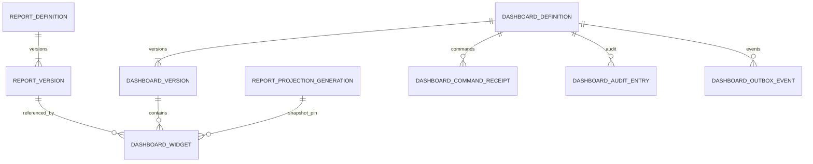

# Dashboard workspace — data dictionary và table design

PLAN-027 · v1.0 · 2026-10-14 · **Implemented SRC-071: sáu bảng đã có ở Reporting schema4, forward004 local/test giữ13bảng cũ.** [Feature](../planning/dashboard-workspace.md), [API](../contracts/dashboard-workspace.md), [AC](../quality/dashboard-workspace-acceptance.md). Theo [table template](../templates/database-table.md), [DB guideline](database-guidelines.md), [schema catalog](schema-catalog.md), [ownership](service-ownership.md). PLAN-027A đã khóa [executable schema/DDL](../contracts/dashboard-implementation.md) trước source.

## 1. Ownership và aggregate

Reporting là writer duy nhất của Dashboard, report refs, template materialization và layout trong `crm_reporting`; test dùng `test_crm_reporting` với fixtures giữ lại. Next.js/BFF không có SQL access. Identity là authority tenant/principal/quyền, chỉ logical references; Chat/CRM/Sales/Marketing không nhận writes khi tạo dashboard. Human/AI ownership của business records không thay đổi bởi dashboard owner.

Report tiếp tục dùng `report_definition` và immutable `report_version` hiện hữu. Dashboard mới là aggregate riêng; không tiếp tục dùng một JSON report draft nhúng các report khác. Template catalog ban đầu là release artifact có hash/version, không persisted system table. Không có cross-service FK/UoW hoặc quyền SQL vào producer.

Mỗi quan hệ trong sơ đồ là same-schema/same-tenant. `report_id`/version và snapshot generation là **typed columns**, không giấu trong JSON. Template lineage ở dashboard version là logical key/version/hash tới release artifact, không FK sang service khác.

## 2. Invariants và lifecycle

- Dashboard head có `revision` cho CAS, `latest_version` trỏ immutable content version. Create=1/1; edit tăng cả hai; archive/restore chỉ tăng revision. Version trong API là decimal string, không JavaScript float.
- Mỗi saved version có 0..12 widget. Blank dashboard có0; template create có1..12 selected recipes. Widget ID ổn định qua reorder/title/resize; remove rồi add là ID mới.
- Widget refs `(tenant_id,report_id,report_version)` bắt buộc tồn tại, report chưa archived và viewer có quyền lúc add/save/run. Không tự nâng latest khi report được sửa.
- Snapshot pin `(tenant_id,binding_id,generation_id)` phải khớp `bindingId` trong report version và catalog/model/metric dependencies. Ready persisted generation không tự chứng minh query endpoint cho phép historical execution. Đợt đầu chỉ chạy pin đang active, theo policy native query hiện tại; pin cũ hiện unavailable và cần explicit đổi snapshot + Save.
- Widget metadata không mang result/data rows/credential/auth claims. Runtime result/cache tách hoàn toàn khỏi definition, key gồm tenant, viewer authority, dashboardVersion/widget/ref/generation và query parameters.
- Report chart/model/filter/time là nội dung report. Widget chỉ có title override, note, layout. Không có chart override hoặc report definition copy tạo nguồn chuẩn thứ hai.
- Bỏ widget không archive report. Duplicate dashboard giữ refs và pins, tạo owner mới là principal hiện tại; tạo từ template tạo report drafts mới. Archive dashboard không archive các reports. Archived report giữ reference/history nhưng runtime fail closed cho widget.
- Không hỗ trợ chuyển owner/team sharing/public access trong đợt này. Quyền dashboard không kéo theo quyền report/source.

## 3. Field dictionary ở API/domain

| Object | Fields / kiểu / giới hạn | Meaning |
|---|---|---|
| DashboardSummary | id UUID; name1..160; ownerPrincipalId UUID; revision/version strings; archived bool; widgetCount0..12; updatedAt ISO UTC; allowedActions[] | Home/selector, không chứa report metadata |
| ReportSummary | id UUID; name; ownerPrincipalId; revision/latestVersion strings; modelRef?; visualizationType?; updatedAt; archived; pickable bool; unavailableReason?; authorizedDashboardCount; allowedActions[] | Derived from current report head/version; malformed draft still listed but not pickable; count only authorized active dashboard heads |
| DashboardVersion | schemaVersion=1; name1..160; description0..4000; widgets[]; templateOrigin?; createdAt/createdBy | Saved content immutable; owner lấy từ head |
| Widget | id UUID; reportId UUID; reportVersion positive decimal string; bindingId UUID; generationId hex64; titleOverride null hoặc trimmed1..160; note0..2000; layout{x,y,w,h} | null title dùng tên của **report version đã ghim**, không latest name |
| Layout | x integer0..11; y integer0..119; w enum4/6/12; h integer3..10; x+w<=12; y+h<=120 | Zero-based12column grid; không overlap cùng version; mobile derive từ desktop |
| TemplateSummary | key ASCII snake_case1..64; version integer>=1; contentHash hex64; name/description/category; reportCount; schematicPreview; compatibility | Metadata không có sample KPI totals |
| TemplateRecipe | key1..64; label; description; sourceSlot; reportDefinition recipe; defaultLayout; note | Uses registered model/metric IDs/versions; time defaults declared, no arbitrary JS/SQL |
| SourceSlot | key; environment=mock; requiredModels/fields/metrics; timePolicy | Match authorized binding/catalog; template chứa slot, không tenant binding ID |
| TemplateCreate | templateKey/version/hash; name; description; selectedRecipeKeys unique1..12; sourceBindings map | Server resolve artifact, không nhận recipe definitions do client truyền |
| Runtime widget result | widgetId; reportId/version; generationId; result OR sanitized error; completedAt | Response ephemeral, not stored in dashboard version |

Owner labels là Identity-authorized presentation qua existing port; Identity unavailable hiển thị fallback an toàn, không tự cấp quyền. Report usage là derived query trên widget của **latest version**, active dashboards và current ACL; count distinct dashboard IDs, không lịch sử versions hoặc số lần đặt widget.

## 4. Template chung cho sáu bảng mới

Các giá trị chung dưới đây là một phần bắt buộc của mỗi table design ở mục5, không phải mục bỏ trống.

| Mục của table template | Thiết kế chung |
|---|---|
| Task / requirement / AC | PLAN-027 → proposed SRC-071; DW-F01…10; DW-AC03/05/06/07/08/10/12 |
| Physical current | Chưa tồn tại; Reporting own schema hiện tại v3; migration tiếp theo chỉ chọn sau kiểm journal thực tế, không sửa001–003 |
| Writer / scope | Reporting repository; business context từ signed native admission; `tenant_id` CHAR(36) ASCII ascii_bin NOT NULL, no default, valid nonzero UUID và không system tenant |
| Types/defaults | Mọi cột NOT NULL trừ dấu `?`; CHAR UUID/hash ASCII binary; text utf8mb4_0900_as_cs; timestamps DATETIME(6) UTC; unsigned BIGINT version>=1; không default tenant/time |
| Remote refs | Principal UUID thuộc Identity, logical only; không FK/SQL tới Identity; actor access giải quyết trước own UoW và recheck trước public delivery |
| Permissions | Reuse native `report_definition.read/design` own/all + seat capability; source/run/export kiểm riêng; no new grants, no privilege from JSON |
| Concurrency | Lock dashboard head (create ID deterministic từ tenant/principal/command); read receipt; CAS; lock report heads theo UUID tăng dần và bindings theo UUID tăng dần; validate; write version/widgets/audit/outbox/receipt atomically; no network trong transaction |
| Retention / PII | Metadata người dùng có thể chứa nội dung riêng tư: giới hạn, escape output, không log name/note/definition. Không secret/transcript/result rows. Archive reversible; history/receipts retained, không purge job đợt này |
| Grants | Schema operator tạo bảng/journal, runtime không DDL/DELETE. Head SELECT/INSERT/UPDATE; mọi bảng immutable SELECT/INSERT, không UPDATE. Không grants schema khác |
| Migration | Expand sáu bảng; fingerprint toàn bộ bảng cũ, backup local, upgrade/no-op/cold test. Legacy convert là explicit command riêng, không bulk backfill khi startup |
| Rollback | Tắt route/menu mới, giữ dữ liệu; app cũ không đọc bảng mới. Chỉ phục hồi legacy view cho legacy records, không diễn giải dashboard mới thành report cũ. Fix bằng forward migration |
| Fixtures / evidence | Giữ synthetic A/B, report reusable, legacy dashboards và unrelated rows. EXPLAIN, MySQL races/rollback/tenant negatives/preservation NOT_RUN đến SRC-071 |

## 5. Filled table designs

### 5.1 dashboard_definition — authoritative aggregate head

| Column | Type / default | Meaning |
|---|---|---|
| tenant_id, id, owner_principal_id | CHAR36; không default | Tenant context, opaque dashboard ID, immutable logical Identity owner |
| name | VARCHAR160 | Current display name/search; trimmed, nonempty |
| revision, latest_version | BIGINT UNSIGNED default1 | CAS revision và immutable content pointer |
| archived | BOOLEAN default0, CHECK0/1 | Lifecycle state |
| legacy_report_id? | CHAR36 null | Explicit conversion source only, không dùng cho dashboard thường |
| legacy_report_version? | BIGINT UNSIGNED null | Version legacy đã được convert; cặp null cùng nhau |
| created_at, updated_at | DATETIME6 | UTC server timestamps |

PK(tenant_id,id). UNIQUE(tenant_id,legacy_report_id,legacy_report_version) bảo đảm convert cùng version một lần; SQL NULL cho phép nhiều dashboard bình thường. FK(tenant_id,legacy_report_id,legacy_report_version) → existing report_version(tenant_id,report_id,version). Không FK owner/tenant tới Identity. Pointer latest_version kiểm trong same transaction để tránh FK cycle.

Indexes: (tenant_id,archived,updated_at,id) cho all home; (tenant_id,owner_principal_id,archived,updated_at,id) cho own. Query luôn tenant+archived+ACL trước keyset; search escaped literal substring trên name sau scope, tối đa160chars, không regex/wildcard API. EXPLAIN với10k retained synthetic metadata rows là gate, chưa có measured latency claim. Không index toàn bộ JSON.

### 5.2 dashboard_version — immutable content snapshot

| Column | Type / default | Meaning |
|---|---|---|
| tenant_id,dashboard_id | CHAR36 | Parent identity |
| version | BIGINT UNSIGNED | Content version>=1 |
| schema_version | SMALLINT UNSIGNED CHECK=1 | Dashboard content schema |
| name, description | VARCHAR160, VARCHAR4000 | Versioned name/description; description default empty string |
| template_key?, template_version?, template_hash? | VARCHAR64 ASCII, INT UNSIGNED, CHAR64 | All null hoặc all present; creation provenance only |
| created_by, created_at | CHAR36, DATETIME6 | Actor logical ref/time |

PK(tenant_id,dashboard_id,version); same-tenant FK dashboard_definition. Lookup exact version hoặc history keyset version descending. Version + widget rows là aggregate content, không JSON copy của report. Title/layout change tạo một version đầy đủ, giữ history cũ. Template lineage được carry forward; không tự update theo catalog template mới.

### 5.3 dashboard_widget — immutable report placement per version

| Column | Type / default | Meaning |
|---|---|---|
| tenant_id,dashboard_id | CHAR36 | Parent scope |
| dashboard_version | BIGINT UNSIGNED | Saved version containing this placement |
| id | CHAR36 | Stable widget ID across saved layout versions |
| report_id, report_version | CHAR36, BIGINT UNSIGNED | Exact existing report version; never latest pointer |
| binding_id,generation_id | CHAR36, CHAR64 | Exact source pin, binding matches resolved report |
| title_override?, note | VARCHAR160 null, VARCHAR2000 default empty | Optional display title, context note |
| grid_x,grid_y,grid_w,grid_h | SMALLINT UNSIGNED | Layout as bounded above; no defaults inferred from chart |

PK(tenant_id,dashboard_id,dashboard_version,id). FKs: parent dashboard_version; (tenant_id,report_id,report_version) → report_version; (tenant_id,binding_id,generation_id) → report_projection_generation(tenant_id,binding_id,id). All `ON DELETE RESTRICT`; no cascade/purge in scope. Index(tenant_id,report_id,dashboard_id,dashboard_version) for authorized usage query joined to head.latest_version. CHECK dimensions/range/x+w/y+h; overlap/count<=12 and binding match require aggregate validator in locked transaction. Max12rows/version; duplicate report ref allowed with distinct widget IDs. Immutable rows, no update-in-place layout.

### 5.4 dashboard_command_receipt — immutable replay result

| Column | Type / default | Meaning |
|---|---|---|
| tenant_id,principal_id,command_id | CHAR36 | Idempotency namespace from trusted actor + header |
| request_hash | CHAR64 | Canonical kind/route/body/expectedRevision hash |
| dashboard_id | CHAR36 | Created/updated aggregate |
| result | JSON <=16KiB, depth<=6 | IDs/revision/version/generated report refs only; no query results/labels/definition |
| created_at | DATETIME6 | Committed timestamp |

PK(tenant_id,principal_id,command_id); FK dashboard_definition; index(tenant_id,dashboard_id,created_at,command_id). Receipt result returned only after current authority checks, then current metadata read separately. Same key/body returns original IDs and version; different hash409. Unique conversion source reconciles a second independent command safely, returns existing authorized target or safe conflict. Transaction rollback leaves no receipt/partial reports. Never copy result into a cross-tenant cache.

### 5.5 dashboard_audit_entry — immutable minimized audit

| Column | Type / default | Meaning |
|---|---|---|
| tenant_id,id,dashboard_id,actor_id | CHAR36 | Context, event ID, aggregate, logical actor |
| action | VARCHAR32 | create/update/duplicate/archive/restore/from_template/convert_legacy |
| revision | BIGINT UNSIGNED | Head revision affected |
| created_at | DATETIME6 | UTC |

PK(tenant_id,id); FK dashboard_definition; UNIQUE(tenant_id,dashboard_id,revision); index(tenant_id,dashboard_id,created_at,id). Atomic one audit per successful mutation, including template create. No names/config/report results, principal ref is authorized audit metadata. Failed authorization goes to existing sanitized security log, not fabricated successful audit. Template-created reports additionally retain existing report audit/outbox effects in same UoW.

### 5.6 dashboard_outbox_event — immutable domain event fact

| Column | Type / default | Meaning |
|---|---|---|
| tenant_id,id,dashboard_id | CHAR36 | Tenant routing/event/aggregate |
| event_type | VARCHAR64 | `reporting.dashboard.created.v1`, `.updated.v1`, `.archived.v1`, `.restored.v1` |
| aggregate_revision | BIGINT UNSIGNED | Committed head revision |
| created_at | DATETIME6 | UTC |

PK(tenant_id,id); UNIQUE(tenant_id,dashboard_id,aggregate_revision); FK dashboard_definition; index(tenant_id,created_at,id). Payload is these fields only, consumers must authorize API reads. Duplicate/template/conversion map to created event plus audit action. No relay, Kafka deployment, sent status or background job is implied. Future delivery receipts follow separate contract.

## 6. Template creation và report persistence

Template registry validates recipe definitions through the same semantic compiler as manual reports; no separate formula engine. `sourceSlot` binding substitute chỉ binding ID/time policy đã khai báo, không tự đổi metric version/grain/currency. Time policy của hai mẫu demo giữ đúng scenario window/asOf trong recipe và đòi coverage; không lấy now thành lịch sử giả. Currency lấy recipe/source compatibility, không default USD cho template bất kỳ.

After trusted admission: pin template artifact/hash → deterministic dashboard ID → acquire head/idempotency lock → lock existing report heads if duplicate/convert and source bindings in sorted order → revalidate local pinned metadata → create all required report heads/versions/catalog refs/audits/outbox through same-service transaction-scoped repository → insert dashboard head/version/widget/audit/outbox/receipt → check admission expiry → commit. No HTTP call into own report API inside transaction. Existing report repository must expose an application port accepting own transaction; this is Reporting-local UoW, not cross-service access.

Each selected recipe becomes one new report draft owned by current principal. Duplicate dashboard instead reuses existing refs; no duplicate reports. Receipt records generated IDs for replay. Template update affects only future creates. Source/catalog change during create returns conflict before commit, so no orphan reports from partial create. Cancel before submit creates nothing; lost ACK reconciles with same key after current rights recheck.

## 7. Legacy compatibility and conversion

Legacy dashboards stay byte-for-byte inside existing report_version; keep old display route while new feature rolls out. Home can expose a separately labelled “Dashboard cũ — chuyển đổi” list from authorized legacy metadata; regular Reports list/picker excludes `kind=dashboard` by structural discriminator, not title. No side effects from GET/list/startup.

Explicit conversion input legacy report ID + immutable edit version + expected current head revision. Must still be current/nonarchived/authorized and pass strict v1 shape/semantic checks. For each inline widget create a saved report from the exact definition; keep generation, title/note/order; generate layout deterministically (v1 wide widgets12, remaining6 columns, preserve order). Create new Dashboard with provenance fields in one transaction; no legacy archive/rewrite/delete and no inbox/source reseed. Rerun same source version yields the same target; changed legacy version requires explicit separate conversion. Never use legacy head revision as report version: archive can increment revision without incrementing edit version.

Migration acceptance compares original legacy document bytes/hash, widget definition fingerprints, current authorized query results and all unrelated table fingerprints before/after. Data preservation is NOT_RUN here; this is a design requirement.

## 8. Review và implementation gate

Table designs specify ownership/columns/keys/query/grants/concurrency/retention/migration/test obligations. They are not executable DDL or measured EXPLAIN evidence. PLAN-027A will generate exact DDL/JSON schemas and reconcile with the then-current migration journal before SRC-071. No change to database, schema version, grants, users or running services occurred for this document.
