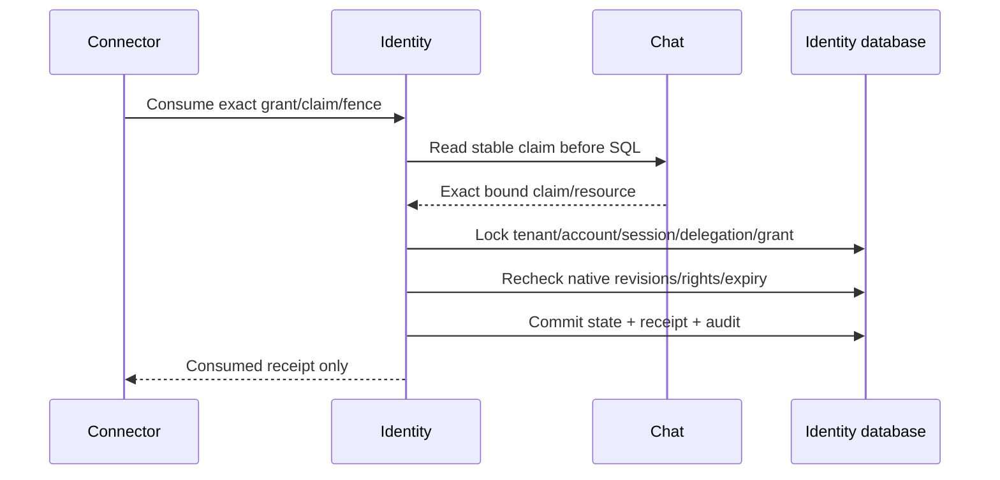

# Identity Human dispatch ledger — PLAN-007C5

2026-10-18 / CHG-20261018-15. Ready for SRC-100 after SRC-099. [Wire contract](../contracts/chat-dispatch-v1.md), [native authority](../contracts/identity-dispatch-authority.md), [catalog](schema-catalog.md), [database rules](database-guidelines.md). Baseline Identity-owned ledger; no AI delegation, remote endpoint or independent deployment.

## Filled table templates

All four tables: target `crm_identity`, physical current `agentic_crm`, retained test `native_identity_test`. Owner/writer Identity only. Existing native auth is still monolith; moving this ledger alone would break the local authorization transaction. Business `tenant_id CHAR(36) ascii_bin NOT NULL`, explicit CHECK excludes registered system tenant; no implicit default. IDs CHAR(36) ascii_bin, digests CHAR(64) ascii_bin, time UTC DATETIME(6). Migration38 additive;1…37 immutable. No FK to Chat/Connector, no cascade/purge. Acceptance IDL-01…07 below applies to every table.

| Template item | identity_dispatch_delegation | identity_dispatch_grant | identity_dispatch_request | identity_dispatch_event |
|---|---|---|---|---|
| Meaning / type | Immutable native Human session registration | Authoritative lifecycle, one binding per intent | Successful command replay tombstone | Append-only transition ledger |
| Columns | tenant_id,id,principal_id,session_hash,principal_revision/security_revision BIGINT UNSIGNED >0,created_at | tenant_id,id,intent_id,attempt_id,delegation_id,binding_json/resource_json JSON objects,principal_revision/security_revision >0,state VARCHAR16 issued/consumed/revoked,claim_id/fence_id nullable,expires_at,version >0,created_at,updated_at | tenant_id,caller VARCHAR16 chat/connector/identity,operation VARCHAR32 issue/consume/revoke,request_id,grant_id,request_digest,created_at | tenant_id,grant_id,version >0,state issued/consumed/revoked,claim_id/fence_id nullable,created_at |
| Null/default/unit | All NOT NULL; no defaults; hash is verifier, never raw session | Only claim/fence nullable; version default1; expiry issue DB time+10s | All NOT NULL, no defaults | Only claim/fence nullable, no updated_at |
| Keys / constraints | PK tenant+id; native validation of system session, no cross-scope FK | PK tenant+id; UNIQUE tenant+intent,tenant+attempt; FK tenant+delegation; claim/fence iff consumed; state/version CHECK | PK tenant+caller+operation+request; FK tenant+grant; caller/operation CHECK | PK tenant+grant+version; FK tenant+grant; state/version/claim-fence CHECK |
| Remote refs | Internal delegation ID; session only at Identity | Versioned immutable binding/resource snapshot; stable Chat claim verified before SQL | IDs are refs, not bearer authority | No content or credentials |
| Queries / indexes | Exact PK lookup/lock | Exact PK or tenant+intent/attempt unique index | Exact composite PK | Tenant+grant ordered version, at most3transitions |
| Rights | Native session + current Human rights | Current roles/team/seat/text policy, issue stamps on consume | Authorize before replay | Owner-authorized receipt only |
| Concurrent writes | tenant SHARE → account SHARE → session SHARE → delegation UPDATE | Delegation serializes; grant UPDATE, version CAS; no network under SQL | First digest immutable; mismatch409 | Atomic with state/request |
| Audit/outbox | Immutable registration row | State+receipt+event transaction; no broker publisher | Durable receipt | Local audit only |
| PII/retention | Identity-only session verifier; never response/log; retain restore horizon | Control refs only; no transcript; no automatic expiry deletion | Digest only; retained indefinitely local | Retained with grant |
| DB grants | SELECT,INSERT,UPDATE(no-op locking) | SELECT,INSERT,UPDATE | SELECT,INSERT | SELECT,INSERT |
| Migration / backfill | Forward38 create; no legacy row mutation | Same | Same | Same |
| Compatibility / rollback | Existing binaries ignore new tables; disable adapter, forward fix; never drop receipts | Same, never rearm | Preserve across restart | Never rewrite audit |
| Fixtures / evidence | Reuse SRC-099 synthetic Human/two tenants; private narrow test credentials | Real MySQL/native authority; injected synthetic Chat claim | Conflict/rollback/replay | Grant denial, atomic audit, EXPLAIN; NOT_RUN before source |

Registration is internal native-authenticated code, not a new wire operation. Immutable delegation ID binds principal/session verifier and both revision stamps. Re-register with different session/revision conflicts. New delegation cannot rearm an existing intent. No credential or verifier crosses the dispatch protocol.

Issue accepts trusted Chat peer context; one grant per intent gets a fixed10s SQL expiry after lock acquisition. Replay cannot refresh TTL or alter binding/resource. Consume accepts trusted Connector peer and exact stable Chat claim proof (binding/grant/claim/resource), retrieved before SQL. Proof port is injected here; not mTLS evidence. Under native authorization locks, compare issue-time stamps and expiry, then atomically commit issued→consumed + request + event. First claim/fence is final. Replaying consumed returns a receipt, never an invocation capability.

Internal explicit revoke requires the original native Human under current policy. Issued→revoked terminal; consumed stays consumed. Native logout/security/ACL changes independently prevent new admission even without eager grant rewrite. Read/replay still checks current rights. Expired state is derived from fixed SQL expiry; reads do not mutate. Consumed remains consumed after TTL. No broker, provider, HTTP/worker registration or main database upgrade in this scope. Runtime grants for ordinary CRM users must exclude all new sensitive Identity ledgers.

## IDL-01…07

Discovery during verification: retained native_identity_test is at32, not37. Before applying38, run existing approved migrations33…37 with a separate preservation artifact: session_contribution.thread_id maps to conversation_id in34,33adds conversation_need object rows; all existing rows/other columns must remain. Main agentic_crm is untouched. Never invent37→38 evidence by skipping the prerequisite upgrade.

1. Populated37→38 and repeat preserve old rows and journal checksums; business scope/constraints.
2. Native register/issue/consume/revoke/read with retained fixture and narrow DB role; other service/credential tables denied.
3. Concurrent issue one fixed grant; consume different fences one winner; revoke/consume one terminal winner; native authority locks as SRC-099.
4. Request digest/binding conflict; foreign tenant/peer/session/principal/revision/proof denied; malformed/foreign request never calls proof port.
5. Exact SQL expiry, lost ACK/new instance replay, no TTL extension/rearm; consumed terminal beyond expiry/revoke.
6. State/request/event rollback together; audit mutation/DDL/foreign SQL denied; indexed EXPLAIN; no provider call.
7. Build/native/unit/boundary/docs checks, evidence and progress: packages2/17, active local1/17 until actual cutover.
