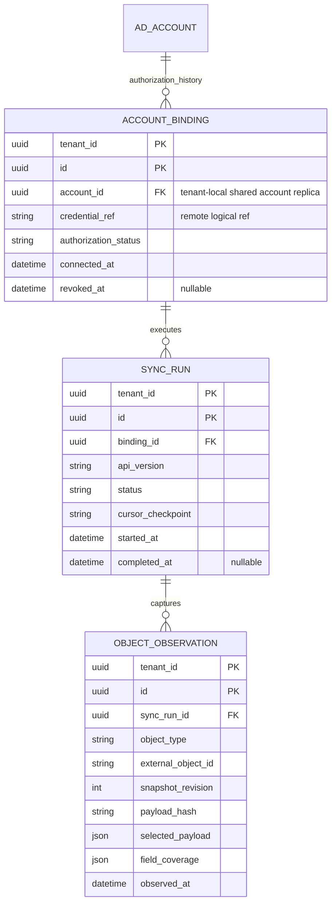
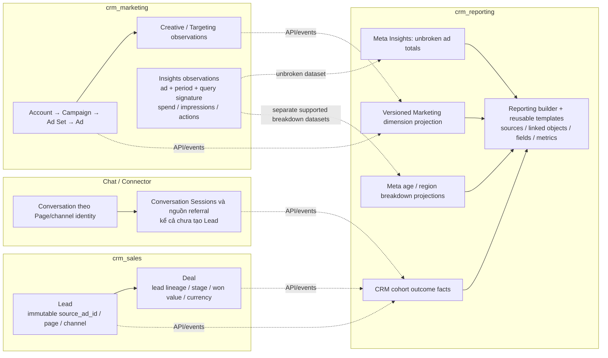
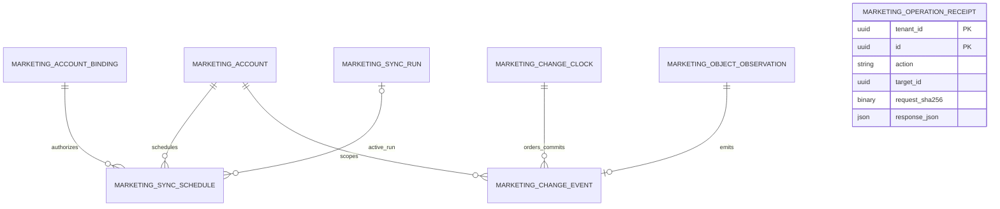

# Marketing ERD — bản review

Current SRC-068 / CHG-20261013-10: [Customer360/session contract](../contracts/customer-360-session.md) is authoritative for inbox_v2 and forward28: new Ad retains the open session, actual create/follow-up/closing context is separate from immutable origin, direct Deal is supported, duplicate Lead consolidation preserves original history. Prior v1 splitting descriptions below are historical. Stage/milestone configuration and connected funnel reporting remain outside this implemented slice.

**Nguồn chuẩn Chat/Sales đích đã chốt, CHG-20261013-08:** [ERD cuối Conversation–Session–Stage–Touchpoint–Lead–Deal](chat-sales-erd.md). Giữ session theo lượt inbox, nhiều touches/session, stage và milestone history độc lập status, origin tách follow-up links. Phần Chat/Sales trong sơ đồ kết hợp bên dưới là baseline trước quyết định mới để đối chiếu; không dùng đường Ad→Session cũ như giới hạn một Ad cho cả lượt. Marketing hierarchy vẫn giữ nguyên. Logical design accepted, chưa là replacement DDL/API Ready hoặc runtime mới.

**Next behavior CHG-20261013-07:** Ad mới khi session còn open phải giữ session (user accepted); session đo lượt inbox, có thể chứa nhiều ad touchpoints theo [clarification](chat-sales-model-review.md). ERD/source fields bên dưới vẫn phản ánh acquisition_v1 một opening source/session; exact relationship/API/DDL thay thế chưa Ready, runtime chưa đổi.

**Model critique 2026-10-13:** [Chat/Sales review](chat-sales-model-review.md) chỉ ra rủi ro coupling referral với chat lifecycle, conversion denominator theo agent close, và thiếu sales-context/attribution semantics cho nhiều lượt chat trên cùng Deal. Recommendations là proposed, không thay contract hoặc nguồn hiện tại; CHG-20261013-06.

**Review Conversation → Lead → Deal, 2026-10-13:** SRC-045/046/053 DONE scoped trong baseline monolith; acquisition sessions đã có ở migration26. Phần Chat/Sales bên dưới dùng tên trường hiện tại khi có thể, nhưng vẫn là ERD logical, không thay DDL. Chuẩn physical/API: [acquisition implementation](../contracts/acquisition-session-implementation.md) và [organic Sales base](../contracts/organic-sales-base.md). Marketing SRC-051 hiện READY với phần đã làm được giữ lại; producer/API/worker còn pending theo tracker.

Conversation có 0..N acquisition sessions (legacy có thể chưa có), tối đa một phiên active. Session có 0..N Leads; Lead có 0..N Deals. Mỗi Lead/Deal bắt buộc một Contact; Lead manual không cần Conversation/session, Deal manual không cần Lead. Deal từ Lead phải cùng Contact và Lead không disqualified; không yêu cầu accepted và không tự chuyển trạng thái Lead. Deal giữ bản chụp nguồn bất biến từ Lead, gồm source_conversation_session_id; won không đóng session và không chứng minh tiền đã thu.

Message thuộc Conversation; bảng message_acquisition_membership nối message tới tối đa một session, hoặc ghi unresolved_late/unresolved_legacy. Acquisition session khác chatflow_session; uniqueness qualification_session_id chỉ chống tạo trùng Lead từ Chatflow. Session không có cột Contact riêng trong physical schema26: Contact được xác định qua Conversation.

**Current implementation — SRC-054/SRC-051, 2026-10-08:** independent `crm_marketing` is at schema3 (26 business tables + system journal, 400 columns, 105 provider fields). SRC-051 scheduler/change-store foundation is tested; complete provider ingestion/API/worker remains IN_PROGRESS. [Database contract](../contracts/marketing-database.md) and [physical dictionary](../data/marketing-physical-dictionary.md) supersede the earlier proposed-DDL status below. Periodic backend/Meta ingestion is deferred to SRC-051/SRC-055; Reporting remains separate.

PLAN-015…017, 2026-10-08. PLAN-017 gộp hai ERD core và Page/Instagram thành một sơ đồ tổng thể; giữ nguyên quan hệ đã review. Logical ERD đề xuất từ [field mapping](marketing-field-mapping.md) và [Meta dossier](../references/meta/marketing-dossier.md). Tên entity/kiểu dưới đây phục vụ review quan hệ, chưa là DDL hoặc bảng đã triển khai. Schema owner: `crm_marketing`; exact table templates/keys/indexes/API ở PLAN-011.

## 1. ERD Marketing tổng thể — kèm baseline Chat/Sales trước CHG-20261013-08

PLAN-018 / CHG-20261008-03 bổ sung [Conversation Session → CRM](../contracts/conversation-acquisition-session.md). Sơ đồ giờ bao gồm cả Chat, CRM Core và Sales; các đường `..` là quan hệ nghiệp vụ/reference qua API/events, không cross-service FK. Các entity Marketing còn giữ owner `crm_marketing`. Page/Instagram REF trong Marketing biểu diễn cùng external identity của channel owner.

```mermaid
erDiagram
    AD_ACCOUNT ||--o{ CAMPAIGN : owns
    CAMPAIGN ||--o{ AD_SET : contains
    AD_SET ||--o{ AD : contains
    AD_ACCOUNT ||--o{ CREATIVE : library
    AD ||--o{ AD_CREATIVE_BINDING : observed_bindings
    CREATIVE o|--o{ AD_CREATIVE_BINDING : resolved_creative
    CREATIVE ||--o{ CREATIVE_REVISION : observed_versions
    CREATIVE_REVISION ||--o{ CONTENT_VARIANT : contains
    AD_SET ||--o{ TARGETING_REVISION : observed_versions
    TARGETING_REVISION ||--o{ TARGETING_AUDIENCE_REF : includes_or_excludes
    AUDIENCE_REFERENCE o|--o{ TARGETING_AUDIENCE_REF : resolved_metadata
    FACEBOOK_PAGE_REF o|..o{ CONVERSATION : facebook_channel
    INSTAGRAM_ACCOUNT_REF o|..o{ CONVERSATION : instagram_channel
    CRM_CONTACT ||..o{ CONVERSATION : customer_context
    CONVERSATION ||--o{ CONVERSATION_SESSION : interaction_episodes
    AD o|..o{ CONVERSATION_SESSION : ctm_source
    CONVERSATION o|..o{ SALES_LEAD : conversation_context
    CONVERSATION_SESSION o|..o{ SALES_LEAD : primary_origin
    CONVERSATION_SESSION o|..o{ SALES_DEAL : pinned_origin
    CRM_CONTACT ||..o{ SALES_LEAD : needs
    CRM_CONTACT ||..o{ SALES_DEAL : opportunities
    SALES_LEAD o|--o{ SALES_DEAL : converts

    FACEBOOK_PAGE_REF o|--o{ CREATIVE_REVISION : page_actor
    INSTAGRAM_ACCOUNT_REF o|--o{ CREATIVE_REVISION : instagram_actor
    FACEBOOK_PAGE_REF o|--o{ FACEBOOK_POST_REF : resolved_author
    INSTAGRAM_ACCOUNT_REF o|--o{ INSTAGRAM_MEDIA_REF : resolved_author
    FACEBOOK_POST_REF o|--o{ CREATIVE_REVISION : effective_story
    INSTAGRAM_MEDIA_REF o|--o{ CREATIVE_REVISION : effective_media
    FACEBOOK_PAGE_REF ||--o{ PAGE_INSTAGRAM_LINK : observed_link
    INSTAGRAM_ACCOUNT_REF ||--o{ PAGE_INSTAGRAM_LINK : observed_link

    CONVERSATION {
        uuid tenant_id PK
        uuid id PK
        string channel_identity_ref "Chat-owned logical reference"
        uuid crm_contact_id "Core reference"
        string provider_thread_key "nullable"
    }
    CONVERSATION_SESSION {
        uuid tenant_id PK
        uuid id PK
        uuid conversation_id FK
        int sequence
        datetime opened_at
        datetime closed_at "nullable"
        string status "active closed"
        string source_classification "paid organic unknown"
        string source_channel
        string source_page_id "nullable"
        string source_ad_id "nullable Marketing reference"
        string source_touchpoint_id "nullable Connector reference"
        string policy_version
    }
    CRM_CONTACT {
        uuid tenant_id PK
        uuid id PK
        string display_name
    }
    SALES_LEAD {
        uuid tenant_id PK
        uuid id PK
        uuid contact_id "Core reference"
        uuid conversation_id "nullable Chat reference"
        uuid conversation_session_id "nullable Chat reference"
        uuid source_conversation_session_id "immutable Chat reference"
        uuid qualification_session_id "nullable Chatflow reference"
        string source_ad_id "immutable snapshot"
        string status
    }
    SALES_DEAL {
        uuid tenant_id PK
        uuid id PK
        uuid contact_id "Core reference"
        uuid lead_id "nullable Sales reference validated by application"
        uuid source_conversation_session_id "nullable immutable Chat reference"
        string stage
        decimal amount
        string currency
    }
    AD_ACCOUNT {
        uuid tenant_id PK
        uuid id PK
        string provider
        string external_account_id
        string name
        string currency
        string timezone_name
        int account_status_code
    }
    CAMPAIGN {
        uuid tenant_id PK
        uuid id PK
        uuid account_id FK
        string external_campaign_id
        string objective
        string configured_status
        string effective_status
        string daily_budget_raw
        string bid_strategy
    }
    AD_SET {
        uuid tenant_id PK
        uuid id PK
        uuid campaign_id FK
        string external_adset_id
        string optimization_goal
        string destination_type
        string billing_event
        string configured_status
        string effective_status
    }
    AD {
        uuid tenant_id PK
        uuid id PK
        uuid adset_id FK
        string external_ad_id
        string name
        string configured_status
        string effective_status
    }
    CREATIVE {
        uuid tenant_id PK
        uuid id PK
        uuid account_id FK
        string external_creative_id
        string name
    }
    AD_CREATIVE_BINDING {
        uuid tenant_id PK
        uuid id PK
        uuid ad_id FK
        uuid creative_id FK "nullable until resolved"
        string external_creative_id
        datetime observed_from
        datetime observed_to "nullable"
        string resolution_status
    }
    CREATIVE_REVISION {
        uuid tenant_id PK
        uuid id PK
        uuid creative_id FK
        int revision
        uuid page_ref_id FK "nullable until resolved"
        uuid instagram_account_ref_id FK "nullable until resolved"
        uuid facebook_post_ref_id FK "nullable until resolved"
        uuid instagram_media_ref_id FK "nullable until resolved"
        string instagram_actor_id
        string effective_instagram_media_id
        string page_actor_id
        string effective_object_story_id
        string call_to_action_type
        json object_story_spec
        json asset_feed_spec
        json transformation_spec
        datetime observed_at
    }
    CONTENT_VARIANT {
        uuid tenant_id PK
        uuid id PK
        uuid creative_revision_id FK
        string kind
        string provider_path
        string asset_ref "nullable"
        string text "nullable"
    }
    TARGETING_REVISION {
        uuid tenant_id PK
        uuid id PK
        uuid adset_id FK
        int revision
        json targeting_spec
        json placement_spec
        int advantage_audience "nullable"
        string payload_hash
        datetime observed_at
    }
    AUDIENCE_REFERENCE {
        uuid tenant_id PK
        uuid id PK
        string external_audience_id
        string authorized_account_scope
        string name
        string subtype
        json lookalike_spec
    }
    TARGETING_AUDIENCE_REF {
        uuid tenant_id PK
        uuid id PK
        uuid targeting_revision_id FK
        uuid audience_reference_id FK "nullable until resolved"
        string external_audience_id
        string usage "include or exclude"
    }

    FACEBOOK_PAGE_REF {
        uuid tenant_id PK
        uuid id PK
        string external_page_id
        string name "nullable"
        string metadata_source
        string coverage_status
        datetime observed_at
    }
    INSTAGRAM_ACCOUNT_REF {
        uuid tenant_id PK
        uuid id PK
        string external_instagram_id
        string username "nullable"
        string metadata_source
        string coverage_status
        datetime observed_at
    }
    FACEBOOK_POST_REF {
        uuid tenant_id PK
        uuid id PK
        uuid page_ref_id FK "nullable until resolved"
        string external_post_id
        string publication_status "published unpublished unknown"
        string coverage_status
    }
    INSTAGRAM_MEDIA_REF {
        uuid tenant_id PK
        uuid id PK
        uuid instagram_account_ref_id FK "nullable until resolved"
        string external_media_id
        string media_type "nullable"
        string coverage_status
    }
    PAGE_INSTAGRAM_LINK {
        uuid tenant_id PK
        uuid id PK
        uuid page_ref_id FK
        uuid instagram_account_ref_id FK
        string evidence_ref
        datetime observed_from
        datetime observed_to "nullable"
    }
```

**Cách đọc:** Campaign trả lời chiến lược/mục tiêu; Ad Set là cấu hình tệp và tối ưu phân phối; Ad là đơn vị nối với nguồn Lead; Creative chứa nội dung/CTA và các biến thể.

Page có nhiều Conversations, mỗi Conversation có nhiều Sessions. Với Facebook channel, Page là business parent; với Instagram DM dùng Instagram Account tương ứng trong target, không bắt buộc cả hai. Session CTM mang nguồn Ad của chính lượt tương tác đó và nối vào Lead/Deal; Conversation giữ context dài hạn. Contact là CRM Core anchor; Lead/Deal thuộc Sales. Đường optional source giữ manual/organic/unknown cases. Session không đồng nghĩa Chatflow session. Ranh giới và cutover đã triển khai scoped local tại SRC-053; live provider/Marketing integration và service extraction giữ gate riêng. Lead→Deal là quan hệ nghiệp vụ; migration25 không tạo FK deal.lead_id.

- Một Creative dùng ở nhiều Ads. AD_CREATIVE_BINDING giữ lịch sử quan sát để Ad đổi creative không làm mất context cũ. Mỗi Ad có tối đa một binding hiện hành đã biết; metadata chưa resolve vẫn giữ external ID.
- Một Creative revision có nhiều text/image/video/CTA variants. Không coi toàn bộ variants đều đã được hiển thị hoặc đều tạo ra cùng một Deal.
- Targeting revision giữ cấu trúc gốc và include/exclude refs; audience metadata có thể chưa đọc được. Audience reference không chứa thành viên và không liên kết trực tiếp Contact.
- Cấu hình Advantage+ là context targeting, không chứng minh nhân khẩu học/tệp thực tế của người chuyển đổi.
- PK biểu diễn `(tenant_id,id)`; mọi FK cùng schema phải chứa tenant và kiểm account scope. `account_id/campaign_id/adset_id` trong sơ đồ là **local IDs**; `external_*` là provider IDs dạng string.
- Quan hệ parent chuẩn có cardinality một; khi sync child trước parent, giữ staging/unresolved record và reconcile trước đưa vào canonical hierarchy. Không giả parent hoặc bỏ record âm thầm. Exact staging schema thuộc PLAN-011.
- Các entity chính còn có name, sync coverage, provider timestamps và current revision theo field mapping; sơ đồ chỉ hiển thị fields quan trọng để review.

### Giải thích quan hệ Page/Instagram và Post/Media

PLAN-016 / CHG-20261008-02: bổ sung theo review. Các entity REF trong sơ đồ tổng thể là metadata/projection trong Marketing, không chuyển ownership credential/webhook từ Channels/Connector. Tất cả có tenant_id NOT NULL; ID provider dạng string, local reference/FK luôn tenant-bound. Metadata account dùng quảng cáo không tự cấp quyền đọc inbox.

- **Creative đại diện nội dung quảng cáo của Facebook post:** có thể dùng post đã có hoặc unpublished post. Giữ Creative ID riêng với Post ID; nhiều Creatives có thể tham chiếu cùng post. Creative chứa thêm CTA/asset/configuration, nên không áp unique 1:1 Creative↔Post.
- Creative revision bổ sung nullable local refs `page_ref_id`, `instagram_account_ref_id`, `facebook_post_ref_id`, `instagram_media_ref_id`, bên cạnh external evidence đã có. Resolve được mới gắn local ref; thiếu quyền đọc post/account vẫn giữ external ID và coverage.
- Mapping từ Meta: `actor_id`/`object_story_spec.page_id` → Page actor; `instagram_user_id` → Instagram actor; `effective_object_story_id` → Facebook Post; `effective_instagram_media_id` → Instagram Media. Giữ `object_story_id` riêng vì có thể null với unpublished post. Nguồn: [Creative reference](../references/meta/2026-10-07-marketing/creative.md.txt).
- **Ad Account không sở hữu Page/Instagram theo cây một-nhiều.** Quan hệ sử dụng được quan sát qua Creative: một account có thể dùng nhiều identity, một identity có thể xuất hiện ở nhiều account đã authorize. Không suy quyền sử dụng từ quan hệ cùng Business hay từ ID.
- PAGE_INSTAGRAM_LINK lưu lịch sử quan hệ được API/owner xác nhận, không suy chỉ vì hai identity cùng xuất hiện trong Creative. Không bắt buộc mọi Instagram account phải có Page link; exact endpoint/permission và current-link cardinality được chốt ở PLAN-011. Đường nhiều trong sơ đồ biểu diễn các bản ghi lịch sử, không khẳng định nhiều liên kết đồng thời.
- Name/username/media_type/publication_status là metadata tùy coverage và endpoint được phép đọc; current103-field selection mới đủ identity/post references trong Creative. Việc hydrate thêm fields này cần exact provider contract trước code. Chưa mở scope full Page publishing, social content management hoặc media download.
- Đối chiếu `source_page_id` của Conversation/Lead với Page identity trong report; không lấy Page của Creative để ghi đè nguồn hội thoại. Instagram messaging identity cũng phải resolve từ evidence của Connector, không từ cấu hình placement.

## 2. Kết nối tài khoản và lịch sử đồng bộ

PLAN-019: bỏ taxonomy/nhãn do marketer gán trong CRM. Marketing vận hành trên Meta; báo cáo dùng phân cấp Account→Campaign→Ad Set→Ad và metadata/Insights được Meta cung cấp. [Luồng vận hành và grain attribution](../contracts/marketing-operating-flow.md). Ba entity trong sơ đồ trên chỉ phục vụ kết nối/sync/quan sát, không phải luồng phân loại content.

OBJECT_OBSERVATION là pattern lịch sử chung cho Account/Campaign/Ad Set/Ad/Creative/Audience, không quyết định phải có một bảng JSON dùng cho mọi object. CREATIVE_REVISION/TARGETING_REVISION là projection nghiệp vụ từ observations, không hai nguồn chuẩn độc lập. Mỗi projection lưu observation reference trong exact design. Cấu hình budget/status/optimization và quan hệ parent cũng cần history, không chỉ creative/targeting. Observation time không được gọi là thời điểm thay đổi thực tế tại Meta khi chưa có evidence.

Chỉ một binding active làm writer cho cùng tenant/provider/account trong phase đầu; cùng external Ad Account được kết nối bởi nhiều tenant (mỗi tenant có replica/binding riêng), không unique toàn hệ thống theo account. Ad/Insights chỉ được lưu khi Creative Page thuộc tenant của phiên sync; khác tenant skip, thiếu evidence defer. Campaign/Ad Set replicas chỉ chứa children đã được nhận của tenant; reconnect giữ history. Credential reference trỏ tới owner được chốt ở PLAN-011, không chứa token. Partial fetch/revoked permission không được biến thành delete mọi object.

## 3. Insights và đường nối conversion

Đường chấm là API/events, không FK/SQL xuyên schema. Reporting resolve immutable ad source vào dimension có tenant/account scope và revision; không sửa Lead khi Marketing sync bổ sung.

Insights là scope mở rộng riêng. Logical observation key: tenant/provider/account + level/object + period/account timezone + query signature (fields/filters/attribution/breakdowns). Fetch revision/as_of là lịch sử cập nhật của cùng grain, không cộng nhiều lần. Dataset base không breakdown tách khỏi asset/age/gender/placement breakdowns. Không gán một CRM won cho mọi breakdown row của Ad; không gọi Meta actions là số Lead CRM.

Session→Lead cần mẫu số gồm cả sessions chưa tạo Lead; Conversation/Contact là measures riêng. Lead→Won dùng distinct Lead cohort có ít nhất một won; won value đếm từng Deal một lần theo currency. Detail và rates theo [performance plan](../planning/marketing-conversion-performance.md).

## Các điểm cần review

| Quyết định đề xuất | Tác dụng |
|---|---|
| Creative là object riêng, Ad→Creative có lịch sử | So sánh content dùng lại ở nhiều ads mà vẫn giữ context lúc phát sinh outcome |
| Page/Instagram là identity refs; Post/Media là content refs riêng | Creative đại diện nội dung quảng cáo và tham chiếu post/media, không ép Creative ID bằng Post ID |
| Targeting nguyên cấu trúc + version + audience refs | So sánh cấu hình tệp, không gán nhầm thành thông tin khách hàng |
| Phân lớp Meta làm gốc; không CRM taxonomy | Marketer vận hành trong Meta, CRM nối outcome bằng ad_id |
| History bao phủ budget/status/parent/content/targeting | Đọc được hiệu suất theo cấu hình đã quan sát, có trạng thái thiếu lịch sử |
| Marketing và Sales nối trong Reporting qua API/events | Giữ owner và tenant isolation; không copy mọi marketing field lên Lead |
| Meta Insights và CRM outcomes là hai fact sets | Đối chiếu delivery/cost với conversion mà không đếm trùng |

Review này không mở quyền tạo/sửa quảng cáo hoặc tự điều chỉnh budget. Chưa tạo bảng, migration, sync worker hay report mới. Sau review: PLAN-011 hoàn thiện physical table templates, exact schemas/contracts và acceptance trước SRC-051/049.

PLAN-023 / CHG-20261008-09: [Shared account and Page tenant admission](../contracts/marketing-tenant-admission.md). All tables retain tenant_id NOT NULL. The same external Ad Account may have independent tenant-local replicas/bindings. Ads/related metadata/Insights are admitted only when Creative Page resolves to the sync tenant; foreign Ads skip, unresolved defer. Parent configuration can be shared; children and ad-level Insights remain tenant-filtered. No cross-tenant payload/history persistence or campaign/account aggregate metric substitution.

## SRC-051 control storage (applied schema3)

Four additional physical tables support the approved metadata worker. These relationships are tenant/account-scoped within crm_marketing; the authority receipt is a logical Channels reference. [Physical fields](marketing-physical-dictionary.md), [control templates](../contracts/marketing-sync-tables.md). Worker/HTTP integration remains IN_PROGRESS.

Operation receipts reference their command target logically; target type depends on action. Marketing observations store an optional authority receipt reference and digest. Old rows remain unverified; no fabricated grant backfill.
