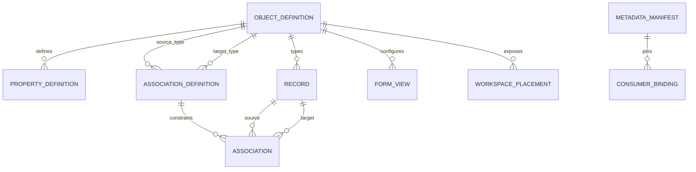

# Shared entity model — PLAN-028

Implemented slice2026-10-15: canonical registry reused; CRM object_workspace_config added by forward30 per [physical contract](../contracts/object-platform-r1.md). Lifecycle/dependency manifests below remain proposed PLAN-028E; connected Reporting/Workflow are not yet producers/consumers of this new config.

2026-10-15 · Logical target, **không phải DDL/table change**. [Plan](../planning/no-code-object-platform.md). Baseline [model](model.md), [dictionary](dictionary.md), [ownership](service-ownership.md) giữ nguyên cho runtime tới implementation gate. Trước thêm/sửa bất kỳ bảng nào, PLAN-028A/B/C phải điền từng [table template](../templates/database-table.md), [schema catalog](schema-catalog.md) và [DB guidelines](database-guidelines.md).

## Canonical definitions và consumer bindings

| Logical entity | Reuse / target owner | Fields/semantics cần chốt ở exact gate |
|---|---|---|
| ObjectDefinition | object_type / CRM | tenant, stable id/key, label/singular/plural/help/icon, standard/custom, owner service, display property, schema revision; presentation extensions chưa persisted |
| PropertyDefinition | property_definition + registered standard fields / CRM catalog; standard owner publishes semantics | stable object/property ref, key/type/options/required/default/index, sensitivity, owner read/write/query capability; standard IDs hiện `standard:<key>` scoped by object |
| AssociationDefinition | association_type / CRM | stable id, source/target object refs, direction, cardinality, forward/reverse labels, status/version; optionality/delete semantics tách cardinality |
| Record / custom values | crm_record/custom_record và typed property_index_value hiện hữu; target mỗi owner có registry riêng | tenant/service/object/record ref, value version, owner revision, custom values theo immutable keys; không tạo JSON replica thứ hai |
| Association instance | association / CRM link owner | same-tenant endpoint refs; status/verification/version; inverse view cùng một link, không hai independent links |
| Form / view / workspace placement | existing forms/views; proposed placement CRM-owned | field/column IDs, versioned configuration, nav group/order/enabled; visibility intersection current rights, không ACL master |
| Published metadata manifest / dependency usage | Proposed canonical version + consumer-owned bindings | schema revision/digest, immutable refs, consumer/version/usage, impact/reconciliation status; no record values |
| Reporting model / binding | Reporting / crm_reporting | canonical refs + own model version, source binding/generation/watermark, grain/metrics/query capabilities |
| Workflow artifact / run | Workflow API/Core / crm_workflow, crm_workflow_core | canonical bindings/manifest digest, root ref/event sequence, graph/executor version, execution authority |

Các row proposed trên là logical requirements, chưa quyết định mỗi row = một bảng. Physical designs phải ưu tiên reuse; mọi bảng mới kể cả link/audit/outbox/journal/backfill có tenant_id NOT NULL, registered system tenant chỉ cho control-plane. Không database/table/column theo tenant. Record/value storage của Sales/Chat/Ticket thuộc owner sau extraction, không CRM ghi remote SQL.

## Quan hệ logical

Diagram là logical relationship, không cross-schema FK. Mọi reference chứa tenant; endpoints cross-service chỉ APIs/events/reconciled refs. Standard domain relation như Lead→Contact do owner đăng ký **read-only domain relation** trong catalog; không tạo thêm editable association làm nguồn sự thật thứ hai. ERD phân biệt domain relation và custom association, thể hiện direction/optional/cardinality/capability.

## Cardinality và lifecycle

1:N nghĩa một source có nhiều targets, mỗi target tối đa một source trong association type đó; đảo chiều hiển thị N:1. 1:1 giới hạn cả hai đầu. N:N dùng association rows; tuple tenant/type/source/target không trùng. Cả hai endpoint cùng tenant, active và đúng object type. Association không tự grant/share records hoặc kế thừa owner. Lookup UI lưu link, không giấu record ID trong custom string.

V1 không master-detail/cascade delete. Link/unlink explicit, audit, current rights cả hai đầu và CAS; exact unlink/version contract mới phải chốt, M1 chỉ có create/list. Archive record giữ lịch sử; planner loại archived records theo query policy, active dependencies có thể block theo owner. Thay cardinality khi có links cần impact/violation scan; không tự drop links. N:N có thuộc tính dùng custom junction object và hai 1:N definitions, không thêm pseudo-field type.

Custom object/field đề xuất lifecycle active → deprecated → archived; existing M1 create active tiếp tục compatibility. Config drafts/publish cho placement/model/run tách khỏi record archive. Deprecated vẫn đọc lịch sử, không cho binding mới; archive chỉ khi dependency checks/retention cho phép. Standard object/core property không archive/đổi key/type bằng tenant editor. M1 không có lifecycle endpoints này, chỉ mở sau PLAN-028A.

Label đổi giữ ID/key. Add optional field compatible nhưng cần catalog refresh; add required trên existing data tiếp tục reject cho tới resumable backfill gate. Index enable chỉ usable sau backfill+dual maintenance+validation hoàn tất; failed jobs không quảng bá query capability. Enum option removal/type conversion/formula/unique chưa R1. Khi retire definition giữ historical manifest đủ cho saved report/run retention; revoke quyền vẫn có hiệu lực ngay khi kiểm lại.

## Scalar types, schema và quyền

R1 giữ string/text/integer/decimal/boolean/date/datetime/enum của M1; decimal API string, money amount+currency, datetime UTC với timezone hiển thị. UI email/phone/URL chỉ có thể là format hint sau validation contract, chưa type lưu trữ mới. Reference/collection thuộc relation/binding type system, không tự mở type property mới. Null/absent/unavailable/forbidden không tráo đổi.

Schema revision/digest cho cấu trúc tách authorization revision/current caller view; catalog-v1 digest đang gồm quyền vẫn được giữ compatibility. Consumer pin structural semantics nhưng refresh authorized view. Native Identity là authority field/record policy; tenant super-admin theo [policy](../contracts/tenant-super-admin.md), service/AI explicit grants. Đọc schema không cấp record read; filter/sort/group/aggregate/export đều là sử dụng field cần quyền.
