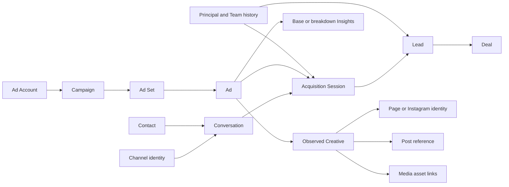

# Reporting semantic catalog — objects, links, attributes và metrics

SRC-086 / 2026-10-17: [Connected conversion](../contracts/conversion-reporting.md) implemented:5objects/6models,10saved reports, goal/horizon và native record drilldown qua core chung. Chat/Sales/CRM giữ facts qua monolith application ports; Reporting giữ catalog/definition JSON trong own schema6. Immutable origin, direct branch, raw/canonical merge và current backlog tách biệt. [Evidence](../tracking/details/SRC-086.md). Các đoạn PLAN-047/048 chưa triển khai bên dưới là lịch sử trước lượt code.

PLAN-047 review2026-10-17: [Conversion semantics gaps](../planning/conversion-operations-review.md) làm rõ direct Deal không cần qua Lead: Session→Lead và Session→Won tổng là các KPI song song, không mặc định là nested funnel. Funnel tuần tự qua Lead cần numerator cùng lineage; Lead cohort riêng và raw/canonical merge policy phải được pin. Đây là clarification của target design, chưa thay đổi catalog/executor đã lưu; exact connected gate PLAN-048 TODO.

PLAN-028: [Connected custom-object extension](../contracts/no-code-object-platform.md) compile stable CRM object/property/association refs thành Reporting model versions; explicit root/collection/optional/exists grain, current ACL và source watermark. PLAN-028B/SRC-075 chưa implemented; existing synthetic catalog giữ nguyên, không auto-upgrade mock reports.

PLAN-0272026-10-14 refines [Dashboard/Report/Template data](dashboard-workspace.md) for design review: widget references an immutable saved edit version plus source generation, template recipes materialize ordinary reports, no duplicate metric engine or per-widget embedded query. Published/shared/parameterized target below stays broader future scope. Current schema/source unchanged; exact new artifacts gated by PLAN-027A.

PLAN-022A · 2026-10-10 · Ready semantic/product design; wire schema, physical table templates và producer coverage còn PLAN-022. [Module plan](../planning/report-builder.md) · [Source ownership](service-ownership.md) · [Marketing dictionary](marketing-storage-dictionary.md) · [Session implementation](../contracts/acquisition-session-implementation.md).

SRC-063/PLAN-022B implements a scoped [catalog and definition kernel](../contracts/reporting-semantic-kernel.md):19 objects/85 fields/26 metric descriptors/4 versioned models; table/KPI/bar/line/pivot encodings and flat typed AND filters. This document remains broader target semantics; model/query shape in the exact contract supersedes the illustrative JSON below for first-slice code. Missing charts, full KPI set, OR/EXISTS, historical projection and execution are not implicitly supported.

## 1. Các lớp metadata

SRC-058 adds [typed synthetic snapshot/projection contract](../contracts/reporting-projections.md): independent additive catalog25 objects/120 fields, descriptor-validated source rows, explicit historical/link objects, immutable paged generations and field coverage. CatalogV1 and original four models unchanged. Mock data does not certify connected producer availability or implement additional KPI formulas.

| Descriptor | Fields bắt buộc trong thiết kế | Quy tắc mở rộng |
|---|---|---|
| DatasourceBinding | stable ID, tenant, owner service, adapter kind/version, mock/connected environment, allowed models, auth capability, snapshot/replay capability, watermark/coverage | Secret chỉ tham chiếu secret owner; người dùng không nhập DB credential hay arbitrary URL |
| ModelVersion | stable model ID + immutable version, object refs, allowed relationship graph, default grain/time, capability matrix | Publish validate graph/ambiguity/cycles/ACL; version cũ không tự chạy model mới |
| ObjectDescriptor | stable object ID, owner, natural key namespace, grain, fields, authoritative timestamps, source record ACL mapping, correction/delete policy | Phân biệt source object với projection; registered object không đồng nghĩa adapter đã sẵn sàng |
| FieldDescriptor | stable property ID, semantic key, label/i18n, logical type, role, unit/currency, null reason, cardinality hint, sensitivity/read permission, group/filter/sort/aggregate capability, provenance | Rename label không đổi ID; archive giữ reference và đưa migration mapping rõ |
| RelationDescriptor | ID/version, from/to keys, tenant/provider/account namespace, cardinality, optionality, temporal predicate, relationship label, join/exists/group capability | Không nối bằng name; bridge many-to-many không tự cho aggregate measures |
| MetricDescriptor | ID/version, base grain, expression AST, eligible dimensions/relations, aggregation class, time/cohort/owner role, unit, null/zero, numerator/denominator, coverage constraints, drilldown grain | AST allowlist; derived metric inherits quyền từ mọi input; không eval JS/SQL |
| ReportVersion | model/metric versions, dataset binding, links, projections, filters, time/as_of, grouping/pivot, totals/sort/limit, visualization và drilldown policy | Immutable published version, draft CAS; template cùng shape |
| DashboardVersion | widget→report version refs, layout, typed parameters, filter mappings, refresh/compare policy | Pin versions; upgrade widget có diff và validate; quyền viewer mới là authority |

Field roles: `id`, `dimension`, `time`, `measure_input`, `attribution`, `reference`. Types gồm string/enum/boolean/integer/decimal/currency/date/datetime/duration/reference; arrays/JSON không được group hoặc sum trực tiếp. Multi-valued field phải có descriptor bridge/explode semantics hoặc chỉ filter exists. Text tự do và transcript mặc định không được đưa vào generic catalog.

Typed custom property lấy stable property_definition ID + schema revision từ CRM metadata, không tạo cột/bảng mỗi tenant. Chỉ quảng bá query capability sau khi adapter/index hỗ trợ type/operator. Không tự biến mọi property numeric thành money hoặc cộng cross-currency.

## 2. Object và fact catalog v1

“Synthetic” nghĩa có thể tạo fixture theo semantic contract ở SRC-058, không chứng minh producer đã có field/event. PLAN-022 lập exact mapping tới code/contract thực tế cho từng field.

| Object / dataset | Grain / owner | Dimensions và metric inputs chủ yếu | Coverage hiện tại / ranh giới |
|---|---|---|---|
| conversation | tenant + conversation ID / Chat | channel/identity/contact refs, created_at, current status/owner refs | Thread đã có; không dùng first/latest ad của thread cho mọi phiên |
| conversation_session | tenant + acquisition session ID / Chat | conversation/contact, opened/closed, source kind/channel/Page/ad, policy version, opening/close reason | SRC-053 có lineage; không alias chatflow/auth session |
| message_event | tenant + message ID + revision / Chat | session membership, inbound received_at, outbound sent_at, direction/status, sender principal | Chỉ metadata; unresolved membership và queued/unknown không phải sent |
| assignment_event / handling_interval | tenant + event/interval ID / owner history Chat/Sales | resource/session, from/to principal/team, role, valid interval và evidence | Producer coverage phải khảo sát; không suy từ team membership hiện tại |
| channel / page_identity | tenant + internal channel identity / Channels hiện tại, Connector target | platform, connection, Page/Instagram ref, names/status | Page binding authority không phải Marketing replica; Channel không đồng nghĩa Facebook Page |
| team / agent_principal | tenant + principal/team ID + revision / Identity | display name, Human/AI kind, active status, membership intervals | Chỉ dimension; quyền hiện hành kiểm Identity, không dựa snapshot cũ |
| contact | tenant + Contact ID / Core | permitted attributes, created_at, contact association | Distinct across sessions; không có mutable single-ad acquisition owner |
| lead / lead_lifecycle | tenant + Lead ID; stage event ID / Sales | origin session/source snapshot, qualified/accepted times, owner at event, declared source riêng | Multiple Leads/session hợp lệ; qualified history thiếu thì metric unavailable |
| deal / deal_lifecycle | tenant + Deal ID; outcome revision / Sales | primary Lead/session lineage, stage, closed_at, amount/currency, owner at outcome | Won value không là receipt; mỗi Deal đúng1 trong grain/currency |
| ad_account / campaign / ad_set / ad | tenant + provider + account + object ID / Marketing | hierarchy/name/status/objective/optimization/targeting ref, observed revisions | Database có; periodic ingestion chưa hoàn tất; parent totals chỉ từ admitted ads |
| creative | tenant + provider + creative ID + observed revision / Marketing | body/title/CTA/content refs, Page/Instagram refs | Metadata content được phép, không transcript; revision tại observation |
| post_ref | tenant + provider + publisher identity + post ID / Marketing | Page/post identity, type, permitted title/time/status | Reference/optional hydrated metadata; không mặc định có post organic Insights |
| media_ref / creative_asset_link | tenant + provider namespace + media/asset ID; link revision / Marketing | media kind, provider identity, creative/post links | Instagram media và image/video asset có namespace riêng; không phải Media blob service hay chat attachment |
| insights_base | tenant/provider/account/ad + nonoverlapping period + query signature / Marketing | impressions/clicks/link clicks/spend, provider actions, currency/timezone | Unbroken totals; mock trước SRC-055, revisions replace chứ không sum |
| insights_age / insights_region | base grain + breakdown tuple, mỗi query profile riêng / Marketing | provider age hoặc region + supported measures | Không cross-join age với region; CRM outcomes không có demographic evidence |

Insights daily là profile v1; custom date ranges gồm các ngày hoàn chỉnh trong timezone account. Không prorate daily spend theo giờ UTC hay timezone dashboard. Nếu nhiều account timezone, hiển thị split/account-local labels hoặc chọn kỳ đồng nhất đã hỗ trợ; không so sánh “cùng ngày” bằng phép đổi nhãn.

## 3. Relationship graph và aggregate safety



Sơ đồ là hướng truy vết, cardinality/query semantics chính xác ở bảng dưới; không phải FK xuyên service.

| Path | Cardinality / cách dùng | Chặn hoặc kiểm soát |
|---|---|---|
| Session→Conversation→Channel identity | N:1; dimension lookup | Preserve session-source Page khi khác context hiện tại; tenant scope bắt buộc |
| Session→Contact | N:1; group/contact distinct | Session count cộng được, distinct Contact subtotal không cộng được |
| Session→Lead→Deal | 1:N→1:N; metric-specific preaggregation hoặc exists | LEFT semantics giữ session chưa Lead; SUM amount không đi qua messages/secondary associations |
| Session→Ad→Ad Set→Campaign→Account | N:1 tại chosen revision | Paid unresolved khác organic/manual; keep Unknown group và coverage |
| Ad→Insights | 1:N theo kỳ/profile/revision | Chọn một profile, một revision/cell, compatible currency/time; aggregate trước join CRM |
| Ad→Creative→Page/Post | N:1 chỉ khi observed mapping singular tại thời điểm chọn | Thiếu/đa mapping→Unknown hoặc unsupported; không lấy latest creative để gán ngược quá khứ |
| Creative→Media/asset list | N:M bridge | EXISTS filter được phép; per-asset conversion/spend không có evidence thì reject, không equal split |
| Session/Lead→Agent/Team | N:1 theo explicit owner role/event; handling có thể N:M | Historical analytical owner khác current ACL owner; rate numerator và denominator cùng role |
| User-selected secondary CRM association | Có thể N:M | V1 exists/filter hoặc detail; không thay primary attribution lineage |

Builder mặc định **base records with or without related records**. Chế độ “has matching related record” biên dịch thành EXISTS. `has none` thành NOT EXISTS. Filter trên related record có scope rõ: lọc cohort gốc bằng EXISTS, hoặc lọc metric numerator; không ngầm đổi LEFT thành INNER. Ví dụ “chỉ Lead qualified” không được tự xóa sessions không Lead khỏi denominator của Session→Lead.

Để join Marketing spend với CRM outcomes: project/aggregate từng fact family theo **common eligible grain** rồi nối 1:1. CRM cohort theo acquisition day/ad, Meta spend theo cùng ad/account-local day; gồm cả ad-day có spend mà0 session và ad-day có sessions mà thiếu spend (null/coverage), không INNER join chỉ các ad đã convert. Không nhân fact raw lên nhau và không sửa bằng `SUM(DISTINCT amount)` vì hai Deals có cùng giá trị vẫn là hai Deals.

## 4. Metric definitions và owner roles

Window `[from,to)`; time input có timezone; timestamps UTC. Cohort origin tính theo source timestamp đã chọn, outcome quan sát tới `as_of`. Report snapshot là vector source watermarks/revisions; `as_of` không tự có nghĩa dữ liệu đủ. Thiếu lịch sử tại thời điểm yêu cầu phải `HISTORY_UNAVAILABLE`, không dựng từ current state.

| Metric key v1 | Định nghĩa / grain | Thời gian và lưu ý |
|---|---|---|
| new_conversations | distinct Conversation created in window | Không đếm thread reopen thành thread mới |
| sessions_opened | distinct acquisition Session opened in window | Denominator bao gồm phiên chưa convert; exclude unresolved membership với coverage |
| engaged_contacts | distinct Contact của sessions cohort | Recompute grand total, không sum các ad/team subtotals |
| inbound_messages | distinct inbound message received | Activity time; session breakdown chỉ messages có membership |
| sessions_with_lead / deal / won | distinct session cohort có ≥1 corresponding outcome tới as_of | Won stage giữ session nesting, không dùng raw Leads count làm stage height |
| session_to_lead / deal / won_rate | corresponding converted session IDs / all eligible session IDs | 0 denominator→null; labels nói rõ outcome tới as_of |
| crm_leads / qualified_leads | distinct Lead theo creation/qualification hoặc thuộc session cohort được chọn | Definition pin time mode, không tráo activity với cohort |
| lead_to_deal / lead_to_won_rate | distinct Lead cohort có ≥1 Deal/won tới as_of / eligible Lead cohort | Primary lineage, exclude manual Deal khỏi numerator này |
| lead_acceptance_rate | qualified Lead cohort đã accepted tới as_of / qualified Lead cohort | Accepted_by role riêng; pending count riêng |
| deals_won / won_value | distinct Deal won / sum value mỗi Deal một lần theo currency | Closed activity hoặc session cohort, label rõ; không là collected revenue |
| received_sessions | distinct session assigned to selected principal/team | Initial assignment role, unassigned bucket; history evidence required |
| handled_sessions | distinct sessions có agent sent response hoặc recorded handling action được allowlist | Agent participation có thể overlap; team/grand totals recompute distinct |
| closed_sessions | distinct session theo closed_at và closing principal | Close reason new_referral/system tách Human close; không gọi là resolved ticket |
| first_response_p50 / p95 | percentile_cont của first eligible sent_at − first received_at trong session | Response đầu toàn bộ Human/AI hoặc Human-only metric riêng; pending/unanswered và sample n riêng |
| handoff_acceptance_p50 / p95 | accepted_at − request_at trên completed handoffs | Handoff cohort; pending không tính completed latency; không average p95 |
| impressions / clicks / link_clicks / spend | sum canonical observations trên compatible nonoverlapping grains | Clicks khác link clicks; spend decimal/currency; missing≠0 |
| ctr / cpc / cpm | 100×clicks/impressions; spend/clicks; 1000×spend/impressions | Tính từ tổng aligned inputs; link CTR/CPC có metric key riêng |
| reach / frequency | Provider observation ở đúng queried grain; frequency theo provider contract | Không SUM/AVG daily reach, không lấy impressions/sum reach làm frequency |
| cost_per_session / lead / won | aligned acquisition spend / cohort sessions, Leads hoặc won Deals tương ứng | Denom0→null; outcome window/as_of/coverage hiển thị; không chia theo agent |
| won_value_to_spend | cohort won value cùng currency / acquisition spend | Nhãn “CRM won value / spend”; không gọi profit hoặc cash ROAS |

Owner roles: `session_initial_assignee`, `first_responder`, `qualifier_at_qualified`, `accepted_by`, `deal_owner_at_won`, `current_owner`. Mỗi report chọn role rõ; current_owner là góc vận hành hiện tại, không là historical performance. Qualification rate theo qualifier không có denominator “sessions được giao” tương ứng nên phải chọn metric khác hoặc group theo session_initial_assignee cho cả numerator/denominator. Agent chuyển team giữa kỳ không chuyển outcome lịch sử sang team mới.

First response có hai metrics riêng: any eligible sent response và first Human response; AI auto-response không được tính Human. Negative/out-of-order timestamps bị quarantine/coverage warning, không clamp âm thành0. Median/p95 chỉ tính lại từ underlying latency facts. Closed session duration là wall-clock elapsed, không gọi agent working time hay SLA business-hours.

Provider actions/action_values giữ action type, attribution window và report-time semantics; không gắn nhãn CRM Leads/Sessions. Impressions/clicks là exposure/engagement, không tự suy causal conversion. Multi-touch attribution, customer identity merge/correction, business-hours SLA và productive handling time nằm ngoài v1.

## 5. Time, history, currency và coverage

- **Activity:** mỗi metric dùng event time của chính nó. Spend kỳ này cạnh won closed kỳ này có thể hiển thị hai series nhưng không tạo acquisition CPL/ROAS từ phép chia đó.
- **Acquisition cohort:** sessions mở trong window, outcomes tới fixed as_of. Lead-based funnel dùng qualified/created Lead cohort riêng; không mixed funnel cùng stage.
- **Matured comparison:** cố định horizon H (ví dụ7/30 ngày là tham số, không đổi session lifecycle); chỉ sessions đã đủ H tại as_of được đưa vào rate so sánh, pending cohorts hiển thị riêng. Hai kỳ dùng cùng horizon và owner role; metric value_outcomes cũng dừng ở opened_at+H.
- **Mapping policy:** `observed_at_acquisition` mặc định cho historical metadata; `latest_known` là mode opt-in có nhãn và pin revision. Không backdate quan sát Marketing mới cho lịch sử chưa có evidence; late ID resolution chỉ enrich đủ chứng cứ, không mutate Sales source snapshot.
- **Currency:** monetary cells decimal strings + ISO currency; group theo currency hoặc reject tổng nhiều loại; không convert FX ở v1. Rate per currency chỉ khi spend/outcomes aligned. Rounding chỉ khi render.
- **Coverage:** distinguish complete/partial/stale/missing/unsupported/suppressed/forbidden/unresolved/legacy. Zero chỉ khi observation hoặc closed-world completeness chứng minh0. Quyền bị deny không hiển thị raw reason/row counts giúp suy số liệu hidden.

## 6. Query definition và extension contract

Ví dụ logical, không phải payload đã có endpoint; exact JSON Schema ở PLAN-022:

```json
{
  "schemaVersion": 1,
  "model": { "id": "crm_acquisition", "version": 1 },
  "bindingId": "synthetic_marketing_v1",
  "baseObject": "conversation_session",
  "relations": ["session_ad", "ad_adset", "adset_campaign", "campaign_account"],
  "dimensions": ["campaign.id", "session.opened_week", "account.currency"],
  "metrics": [
    { "id": "sessions_opened", "version": 1 },
    { "id": "session_to_won_rate", "version": 1 }
  ],
  "filters": { "op": "and", "args": [
    { "field": "session.source_kind", "op": "eq", "value": "paid" }
  ] },
  "time": {
    "mode": "acquisition_cohort", "field": "session.opened_at",
    "from": "2026-09-01T00:00:00Z", "to": "2026-10-01T00:00:00Z",
    "timezone": "UTC", "asOf": "2026-10-10T00:00:00Z"
  },
  "mappingPolicy": "observed_at_acquisition",
  "visualization": {
    "type": "pivot", "rows": ["campaign.id"],
    "columns": ["session.opened_week", "account.currency"],
    "values": ["sessions_opened", "session_to_won_rate"],
    "totals": "recompute"
  }
}
```

Planner pipeline: authenticate/resolve current scope → resolve pinned descriptors → type/capability/ACL check tất cả dependencies → validate paths/cardinality/time/currency → select facts/revisions/coverage → push authorized filters/exists → preaggregate từng fact family → join common grain → evaluate derived metrics → totals/pivot → limits/render metadata. Security row predicates áp **trước aggregate**; top-N/pagination sau aggregate, tổng từ full authorized set. “Other” group recompute distinct/ratio/percentile, không lấy grand total trừ sum displayed distinct.

Query AST chỉ cho literals, field/metric refs, boolean filters, typed comparison/in/not-null, safe arithmetic và guarded divide trong calculated metric; không loops/subqueries/eval. Derived metrics có dependency DAG, cấm cycle, inherit unit/currency/ACL. V1 người dùng chọn registered calculated metrics; publishing công thức mới cần report metric-admin permission và validation, không bypass allowed dimensions.

Adapter contract cần capabilities + describe + snapshot pages consistent token + changes cursor + current authorization + tombstones. Opaque cursors bind tenant/binding/query/snapshot; retry cùng page không double count, expired cursor yêu cầu new snapshot generation. Out-of-order revisions không ghi đè revision mới. Permission/producer outage fail closed cho access, có thể hiển thị freshness error chứ không trả stale unauthorized cached values.

Extension acceptance: thêm field `lead.intent_score` decimal filterable từ custom property registry; thêm một `service_offering` model/source synthetic có N:1 link tới Lead bằng registered association. Đăng ký descriptor, adapter/index và fixtures; report cũ giữ hash/meaning, builder tự render type operators, không sửa chart hoặc domain-specific query switch. Model/metric breaking change tạo version mới + migration diff/validation; chưa đủ data thì capability unavailable, không auto-upgrade saved report.

## 7. Quyền và consistency bắt buộc

Definition sharing không chia sẻ dữ liệu. Viewer cần report.read cộng source object/field read; designer cần report.design; publisher/template admin và export permission riêng. Historical team label không làm authority của own/team/all hiện tại. Mọi filter, group, sort, metric input, drilldown, tooltip và export đều qua field policy.

Nếu Contact/Lead/Deal relationship bị deny, không diễn giải nó thành “không tồn tại” rồi hiển thị conversion sai. Composite cohort metric yêu cầu đủ quyền tất cả participating sources và một cohort population được policy cho phép; thiếu thì unavailable/reject. Nếu Sales row scope hẹp hơn Chat, không đưa tỷ lệ hidden outcomes thành0; chỉ triển khai authorized common-population rule sau PLAN-022 chốt evidence. V1 connected cost ratios require full admitted-ad outcome population quyền phù hợp; team/agent slice không được nhận toàn bộ ad spend làm numerator.

Cache key: tenant + binding environment + definition/model/metric versions + parameter/query hash + current permission fingerprint/auth revision + mapping policy + source snapshot vector. Recheck before delivery/drill/export; revoked rights evict/deny, không chỉ chờ TTL. Partial dashboard widget errors không biến thành0 hoặc giữ giá trị cũ dưới nhãn mới. Tenant switch hủy requests và clear prior results.

## Field summaries extension — 2026-10-12

CHG-20261012-07: [bounded Ready contract](../contracts/reporting-measures.md) adds field/aggregation authoring and registered COUNT/AVG/MIN/MAX on existing numeric populations. Distinct, missing-data policy, formula dependencies and recomputed totals are explicit. Existing26 descriptors remain unchanged; no schema migration, freeform formula editor or new source grain.

## Common visualization extension — 2026-10-12

CHG-20261012-08: [Ready scoped contract](../contracts/reporting-visualizations.md) adds horizontal bar, stacked bar, area, pie/donut and descriptor-driven quick-start presets to SRC-064. Trend uses temporal line/area, composition requires additive measures and complete nonnegative partitions, exact table remains available. Existing definitions stay compatible; no database migration. Published reusable templates/dashboard/period comparison remain separate.
