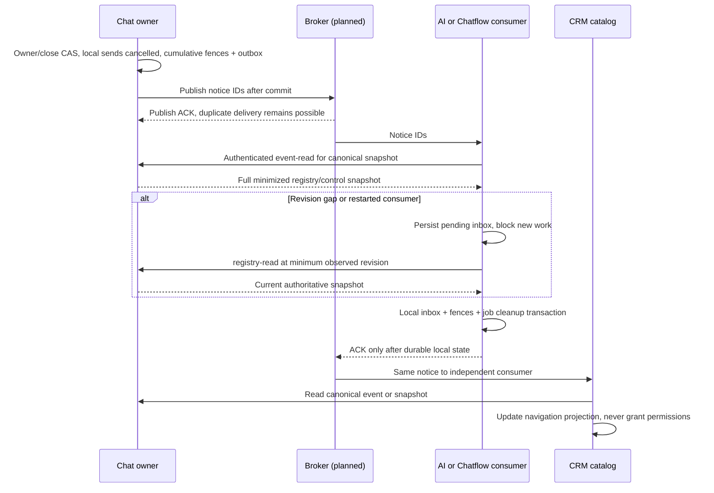

# Chat registry/control contract kit

SRC-095 implements the scoped [PLAN-006H contract](../contracts/chat-control-v1.md): six private read/reference DTOs, registry snapshot/event/notice schemas, generated TypeScript/[OpenAPI](../contracts/chat-control.openapi.json), and a test-only recovery reducer. No server, broker, schema migration or new running process. [Evidence](../tracking/details/SRC-095.md).

## Cancellation across services



Chatflow pauses on ownership change and cancels on close; AI cancels its old execution and releases capacity. Cumulative pause/cancel watermarks are necessary: if close arrives after a newer pause notification, the close must still cancel older work. A new-generation job survives old notifications. Terminal work is unchanged. Existing monolith hooks retain their transactional behavior until a durable adapter is implemented and validated.

Every control generation change also increases record_version so existing dispatch v1 binding rejects old pre-claim work after close/reopen. A claimed external request may remain in flight; cancellation cannot promise provider recall. A catalog or reference-check reply never authorizes a message/tool mutation by itself.

## Verify locally

```powershell
. ./scripts/dev-shell.ps1
node --test scripts/tests/chat-control-contract.test.mjs
pnpm test:scripts
pnpm --filter @agentic-crm/contracts build
pnpm contracts:check
pnpm schemas:check
pnpm architecture:chat
pnpm lint
pnpm docs:check
```

Generator scripts/generate-chat-control-contracts.mjs is included in canonical generation/drift checks. packages/contracts exports schema/types only; scripts/lib/chat-control-reference.mjs is a specification fixture, not a runtime library or production reference authority. Tests model copies of local transactions, lost ACK, serialized JSON snapshots, authenticated peer fixtures and exact revision arithmetic. They do not validate real SQL isolation, capacity tables, crypto, NATS ACK scheduling/retention, network retry exhaustion or native ACLs. Broker backoff/replica/retention values are a contract profile for later adapter tests, not installed settings or measured SLOs.

## Next ledger design gate

PLAN-007C scopes only the new protocol ledgers so an isolated adapter can be built and tested next:

| Owning service | Required ledger design | Gate before source |
|---|---|---|
| Identity | Grant, request digest, consume/claim/fence admission and expiry/revoke tombstones | Native current auth/delegation port; no copied password/session policy authority |
| Chat | Intent/claim/cancel proof, exchange inbox/source/event/message dedup, registry/control counters and outbox | Existing source lineage; tenant keys; no second writer for real legacy Conversation |
| Connector | Immutable staged content, attempt/fence/result, cancellation tombstone and replay | Own schema; no cross-service FK; restore never rearms provider |
| Each consumer | Versioned inbox digest, pending gap/quarantine, projection/watermarks and local cleanup receipt | Consumer-local atomicity; cumulative cleanup/late registration/restore tests |

For each table fill docs/templates/database-table.md with own schema, tenant_id, indexes/uniques, grants, compatibility, retention and forward lineage. Define retained synthetic fixtures, two-tenant negatives and crash/restart/native DB tests. This inventory alone migrates nothing. SRC-096/PLAN-007C1 now implements only [Connector payload/request persistence](../data/connector-payload-ledger.md) in retained native test schema3; remaining inventory stays pending. PLAN-007C is not broad PLAN-007B: moving legacy registry/history, full public mutation/feature parity and traffic switch still require parent PLAN-006/007B. No empty Chat service scaffold is counted as extraction.
