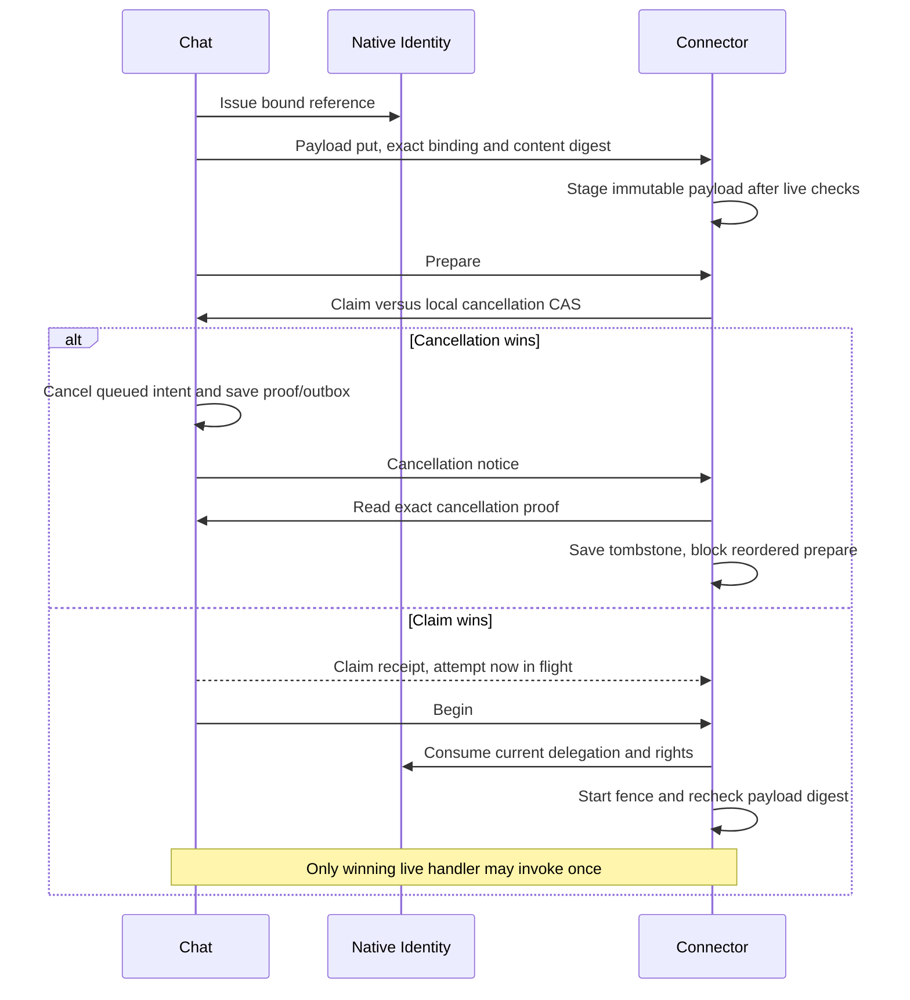
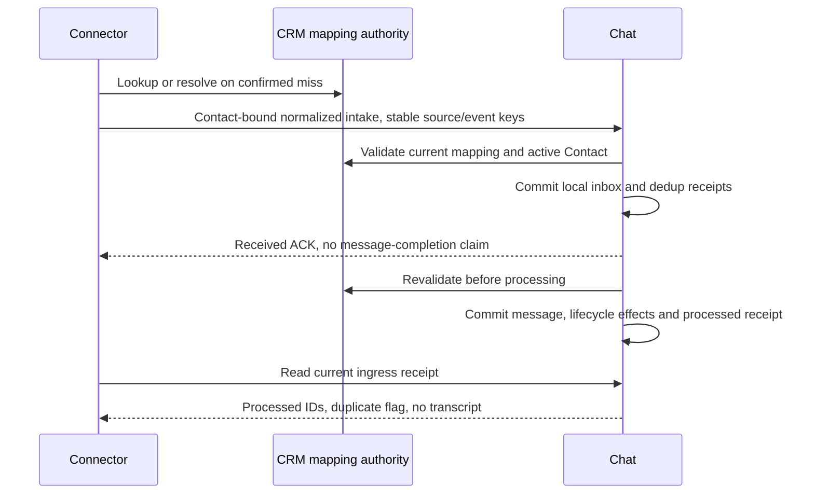

# Chat exchange contract kit

SRC-094 implements [PLAN-006G](../contracts/chat-exchange-v1.md) as five private operation schemas, generated TypeScript/[OpenAPI](../contracts/chat-exchange.openapi.json) and a test-only reference model. Current deployments do not serve these routes. [Evidence](../tracking/details/SRC-094.md). This extends the [dispatch kit](dispatch-contract.md); it leaves the production application modules unchanged.

```powershell
. ./scripts/dev-shell.ps1
node --test scripts/tests/exchange-contract.test.mjs
pnpm test:scripts
pnpm --filter @agentic-crm/contracts build
pnpm contracts:check
pnpm schemas:check
pnpm architecture:chat
pnpm lint
pnpm docs:check
```

Source schema generator: scripts/generate-exchange-contracts.mjs, included in canonical contracts:generate/check. It embeds the current intake definition and DispatchBinding; tests compare them exactly so future shared contract changes require review. Public package exports schemas/types only. scripts/lib/exchange-reference.mjs is not a server/client and is not exported into application runtime.

## Outbound content and cancellation



The diagram is the target protocol, not running service evidence. A later cancel cannot recall a claimed operation. A restored payload/receipt cannot authorize another provider call. Unknown stays unknown unless matching sent evidence arrives. Cancellation notices can arrive before staging/prepare, and retries retain the original binding/proof.

## Ingress and replay



Reference scenarios cover changed source/event/message keys, canonical timestamps, rich content, contact revoke between accept/process, foreign tenant, lost ACK and snapshot restore. Lifecycle conversation IDs are injected fixture outputs; session selection, routing, need enrichment, Reporting and native database transactions still require real adapter parity tests. JSON snapshots model recovery rules only. Peer/authority fixtures do not implement crypto, live CRM validation or native permissions. No HTTP server, MySQL ledger, provider or background worker was activated.

Next architecture gate: PLAN-006H exact remaining local registry/current-reference ports, AI/Chatflow cancellation and broker/recovery compatibility. Then PLAN-007B fills owning-service table/migration/grant/reconciliation manifests before implementing durable adapters. Retain the current monolith writer until migration and feature-parity evidence exists.
