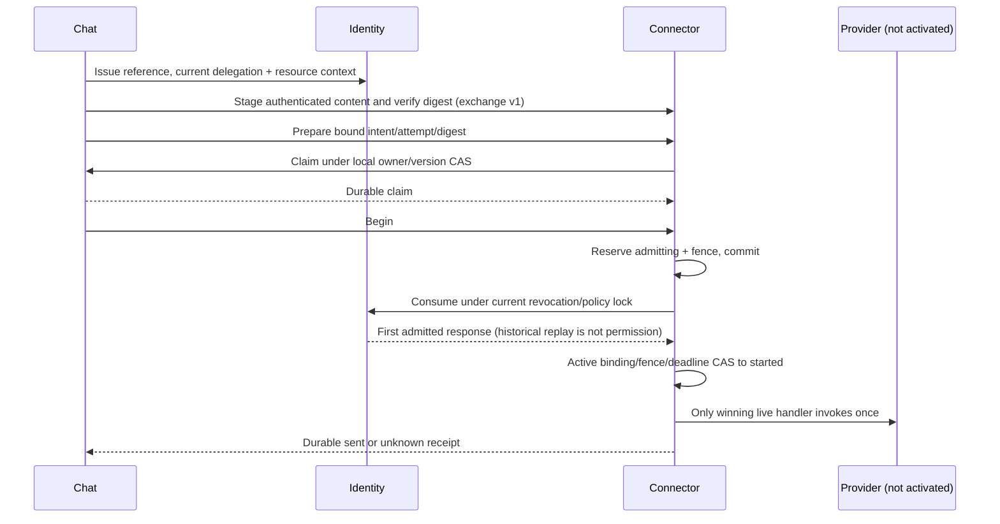

# Dispatch v1 contract kit

SRC-106 adds [chat-claim-proof](../contracts/chat-claim-proof.md) request/reply and OpenAPI route without changing seven legacy operation shapes. Native Chat wire reader and Identity inspector validate correlation/claim/grant/binding/context; native dispatch acceptance now serializes the proof through JSON. No business HTTP listener is registered.

SRC-093 implements [PLAN-006F contract](../contracts/chat-dispatch-v1.md) as machine schemas and executable reference scenarios. [OpenAPI](../contracts/chat-dispatch.openapi.json), [JSON Schema](../../packages/contracts/schemas/chat-dispatch-v1.json), [generated TypeScript](../../packages/contracts/src/generated/chat-dispatch-v1.ts). These describe private routes; no server listens on them in the current runtime.

```powershell
. ./scripts/dev-shell.ps1
node scripts/generate-dispatch-contracts.mjs --check
node --test scripts/tests/dispatch-contract.test.mjs
pnpm --filter @agentic-crm/contracts build
pnpm contracts:check
pnpm schemas:check
pnpm architecture:chat
```

Canonical `pnpm contracts:generate` includes dispatch artifacts; `contracts:check` fails on drift. Source is scripts/generate-dispatch-contracts.mjs. Never hand-edit generated schema/types/OpenAPI. Package exports the schema and types only; executable reference logic lives in scripts/lib/dispatch-reference.mjs and is not exported to application runtime. Existing CI runs the checks through canonical verify and test:scripts; remote CI execution is separate evidence.

## Why three fences are needed



Takeover before claim blocks; revoke before consume blocks; disabled binding before start blocks. After its admission boundary, each authority regards that attempt as already in flight. They do not share a global transaction. A10s issuance TTL does not authorize sends: consume always checks current policy. Resource_context carries owner/revision/team/share facts from Chat; Identity evaluates its current scopes/team membership/seat/text policy. A change before Chat claim rejects stale context.

Losing a consume response does not permit retrying the effect from a consumed receipt. Restart clears volatile invocation permission and conservatively turns admitting/started into unknown. Late sent can resolve unknown; missing/negative/timeout results cannot make it retryable. This can leave an unsent attempt unknown after crash-before-I/O, an explicit safety tradeoff. V1 has one attempt per intent and no automatic rearm or provider retries.

## Evidence boundaries

Tests use synthetic UUIDs, a fake clock and trusted peer contexts standing in for already authenticated mTLS connections. They exercise schema checks, current-authority decisions,49takeover/revoke interleavings, idempotency/fences, TTL/deadline, outage, lost response, restart snapshots and unknown reconciliation. Snapshot restore is JSON serialization in the model, **not MySQL crash recovery**. Simulated provider-effect counter is not a provider receipt or network delivery test. The reference policy subset covers ordinary own/team/all/seat/text checks; current production Identity remains canonical, including native super-admin/AI execution rules.

Artifacts in artifacts/dispatch-contract store test/check logs only; no real transcript, password, certificate/private key or external request. Runtime adapters must implement the same invariants and pass real database/concurrency/network/cryptographic tests before readiness can be claimed.

## Next implementation gate

PLAN-006G/SRC-094 now supplies the [payload/ingress/cancellation contract kit](chat-exchange.md). The following runtime requirements remain; machine contracts do not complete durable transport or persistence.

Before a durable remote server: complete PLAN-007B scoped ledgers/table templates/migration/grants/reconciliation, the authenticated payload transfer port, and remaining PLAN-006 ingress/cancel/consumer compatibility. Then build an isolated local adapter using retained synthetic tenants and independently owned schemas. Validate actual mTLS/workload rotation/revocation, native session/role scope, concurrent consume/owner CAS, kill/restart after commits, DB outage, lost ACK and no second effect. No cross-service SQL, no new default grant, no live Meta activation. Keep the current monolith writer until full parity/single-writer migration evidence.
