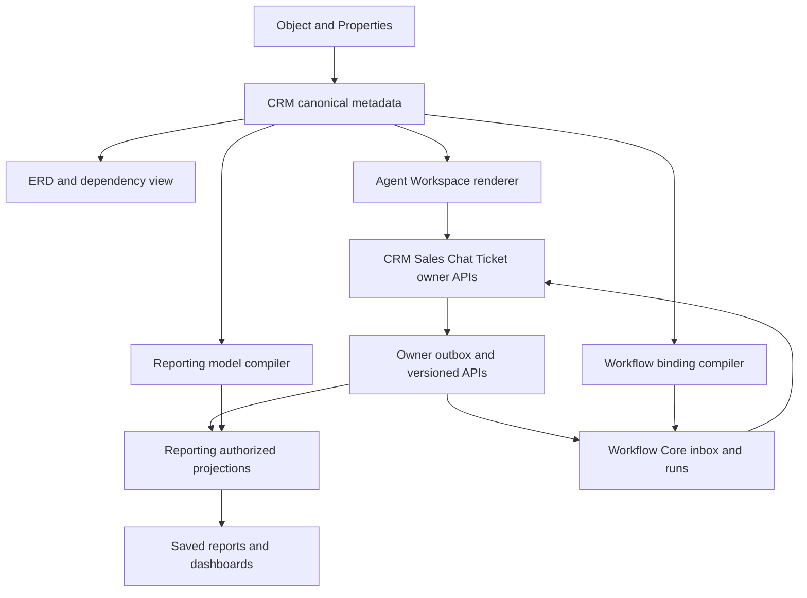

# No-code CRM Object Platform — PLAN-028

Implementation update CHG-20261015-03: PLAN-028A/SRC-073/074 DONE bounded catalog/config/Object & Properties/ERD/Workspace. [Exact implemented contract](../contracts/object-platform-r1.md) và [evidence](../tracking/details/SRC-074.md). Remaining lifecycle/unlink/reverse-label/dependency/backfill ở PLAN-028E; R2/R3 giữ gates. Các mô tả toàn bộ mục tiêu phía dưới vẫn là plan, không runtime claim.

2026-10-15 · Owner: Codex · CHG-20261015-02. **Product/architecture plan; chưa Ready cho source mới.** Đây là kế hoạch ưu tiên tiếp theo theo yêu cầu người dùng, mở rộng nền M1 thay vì xây registry thứ hai. Exact contracts, table designs và acceptance gates ở PLAN-028A…D phải hoàn tất trước source tương ứng. Task status chỉ authoritative tại [tracker](../tracking/tasks.md).

[UX](../ux/object-properties-workspace.md) · [Entity model](../data/no-code-entity-model.md) · [Integration contract direction](../contracts/no-code-object-platform.md) · [Acceptance](../quality/no-code-object-platform-acceptance.md) · [Salesforce references](../references/salesforce-object-platform.md).

## 1. Kết quả sản phẩm

Admin vào **Settings → Object & Properties**, thấy standard/custom CRM objects. Chọn object để quản lý properties, associations, form/view và workspace placement; nút **Xem ERD** mở sơ đồ quan hệ theo metadata hiện tại. Admin tạo object mới, thêm field, liên kết với standard/custom objects, sau đó bật **Hiển thị trong Agent Workspace**. Agent có quyền quản lý records bằng list/detail/form/related lists sinh từ metadata.

Report Builder chọn object mới làm datasource gốc, hoặc đi qua association từ object khác, để tạo saved report dùng trên Dashboard hiện có. Workflow chọn cùng object làm root, cấu hình trigger/criteria/actions/related records và theo dõi execution. Thiết lập metadata một lần; consumer lưu references và phiên bản, không sao chép thành nguồn schema độc lập.

Ví dụ nghiệm thu xuyên suốt: **Service Request** liên kết Contact và Service Offering; fields title/request_status/requested_at/estimated_amount/currency; agent tạo/sửa request; report số request theo trạng thái/dịch vụ; workflow khi request_status chuyển sang approved thì cập nhật field follow_up_due và tạo Activity qua command đã đăng ký. Đây là dữ liệu synthetic; không mở scheduling engine Appointment, receipt hay doanh thu thực thu.

## 2. Baseline đã có và khoảng trống

| Phần | Có trong source/evidence | Kế hoạch bổ sung |
|---|---|---|
| Metadata | SRC-010/011: object_type, property_definition, association_type; tám scalar types, immutable key/type, typed index, CAS | Catalog hợp nhất standard/custom, lifecycle/dependency usage, publication metadata và index/backfill có kiểm soát |
| Admin | `apps/web/app/crm/metadata.tsx`: create object/property, đổi label, form/view, association type | Trang Object & Properties, settings tabs, ERD, wizard, placement và impact preview |
| Records | SRC-011/012/013: generic custom CRUD, Contact/Company/Activity, association và scoped query | Workspace menu/config, usable list/detail/related lists, lookup picker; giữ owner command cho domain |
| Workflow | SRC-065 canonical catalog + typed validator; SRC-066/067 M2 CMS/canvas | Custom object producer/enrollment/actions chưa có; PLAN-024B…E vẫn bắt buộc |
| Reporting | SRC-057/058/059/063/064 + SRC-071/072: mock catalog/projections, query, report/dashboard UI | Connected CRM adapter, dynamic model/fields, authorized traversal và projection lifecycle; không đổi mock thành live |
| Standard object | Contact/Company/Activity có generic capabilities; Lead/Deal qua Sales; Conversation/Ticket theo owner | Hiển thị tất cả descriptors; bật extension writes theo capability thật. Deal custom values hiện disabled; không hứa generic CRUD cho mọi standard object |

Baseline kiểm từ [registry](../contracts/registry.md), [record API](../contracts/crm-records.md), [UI](../contracts/crm-ui.md), [Workflow catalog](../contracts/workflow-catalog.md), [Reporting model](../data/reporting-semantic-model.md). Source reads là inventory, không phải runtime retest.

## 3. Phạm vi release và giới hạn

**R1 — model và vận hành:** Object & Properties, standard/custom field catalog, create custom object/field, tám type hiện có, association 1:1/1:N/N:N, ERD read-only với đường mở editor, form/view cấu hình, placement trong workspace, record CRUD/lookup/related list. Core/reserved fields không đổi semantic; property key/type bất biến. Custom object có display-name property cấu hình; fallback ID nếu chưa có, không tự tạo business identity. Không thêm bảng theo tenant/object.

**R2 — connected reporting:** Chọn custom object gốc và related objects, typed fields/filter/group/aggregate, distinct root counts và totals đúng grain, saved reports/widgets trên Dashboard hiện có. Root-only trước, traversal theo capability sau; cùng gate phải có ACL, watermark, incremental updates/tombstones và model upgrade. Không phụ thuộc live Marketing; không đóng SRC-049/060/061/062 rộng hơn.

**R3 — business automation:** Record-created/updated sau commit, changed fields/entry criteria, root/related reads, bounded update/create command, Decision, durable Delay, owner routing nếu adapter sẵn sàng, fault path và run inspector. Activation/publish pin version; debug mặc định không side effect. Custom lifecycle fields có thể dùng enum nhưng generic Flow không thay state machine của Lead/Deal/Ticket.

**Sau R3:** formula/roll-up, unique custom fields, multi-select, calculated dependencies, master-detail ownership/cascade, before-save flow, scheduled batch flow, screen flows, reusable subflow, loops/parallel paths, arbitrary layout/script/import. Không sao chép toàn bộ Salesforce feature set vào release đầu. Association có thuộc tính nghiệp vụ (quantity/role/price) dùng custom junction object với hai associations; simple link không chứa JSON tùy ý.

## 4. Kiến trúc và các quyết định

Shared entity model là vocabulary/IDs/type/relations/capabilities chung, **không shared service database hoặc generic SQL executor**. CRM owns custom records/schema/associations; Sales/Chat/Ticket giữ domain record authority. Reporting owns semantic models/metrics/projections; Workflow owns graph/run. Theo ADR-017/021/022; [logical ownership](../data/no-code-entity-model.md) quy định transport và publication.

Metadata definition active không tự bật workspace, datasource hoặc workflow trigger. Mỗi consumer có trạng thái ready/unavailable và reason; admin placement không cấp object/field quyền. Human tenant super-admin tuân policy hiện có; AI/service vẫn cần explicit quyền/allowlist. Dataset/export/run luôn kiểm quyền hiện tại.

Không sửa wire M1 hoặc diễn giải lại workflow-catalog v1. Adapter compatibility giữ immutable IDs; các extensions đi qua versioned contract mới khi strict consumers cần. Published report/workflow pin semantic manifest; rename label không phá binding; destructive changes bị impact gate chặn, không rewrite active versions.

## 5. Thứ tự thực hiện tuần tự

| Gate/task | Deliverable và điều kiện xong |
|---|---|
| PLAN-028A | Exact metadata/lifecycle/capability/association/UX contract; inventory từng standard owner; OpenAPI/schema, full table templates nếu cần, compatibility, index/backfill, permission matrix và R1 tests. Dependency PLAN-028 |
| SRC-073 | Catalog/metadata/association backend extensions theo PLAN-028A; preserve existing IDs/records/indexes, migration forward nếu cần |
| SRC-074 | Object & Properties + ERD + Agent Workspace placement/renderer và R1 native/browser gate; dependency SRC-073 |
| PLAN-028B | Exact CRM connected producer/snapshot/event/query/ACL + Reporting dynamic model plan; dependency SRC-074. Chốt scope overlap PLAN-022/SRC-049 trước source |
| SRC-075 | Connected custom-object Reporting, relation semantics và saved-report/dashboard E2E; dependency PLAN-028B, SRC-074, SRC-058, SRC-059, SRC-072 |
| PLAN-028C | Custom object Flow bindings/producers/actions tích hợp PLAN-024B…E; exact activation/enrollment/re-entry/anti-cycle/delay/fault authority; dependency SRC-075 và PLAN-024E |
| SRC-076 | Custom object business Flow E2E theo PLAN-028C và delivered distributed runtime prerequisites; tạo backlog runtime cụ thể ở PLAN-028C trước promote READY |
| PLAN-028D | Bounded release/scale/restore/compatibility test matrix, budgets, retention; dependency SRC-076 |
| SRC-077 | Retained two-tenant E2E, restart/replay/upgrade/permission revocation/capacity evidence; dependency PLAN-028D, SRC-076 |

SRC-059 còn drilldown/metric scope được hoàn tất theo gate riêng trước SRC-075; PLAN-024B…E thiết kế và source runtime chưa DONE là dependency thật, không chỉ checklist. Các nhiệm vụ trên TODO cho tới dependency và spec tương ứng Ready. Không tự mở nhiều implementation tasks, agent song song hoặc background schedule. PLAN-028 DONE chỉ nghĩa bộ kế hoạch/traceability đã hoàn thành.

## 6. Rủi ro và kiểm soát

| Rủi ro | Quyết định/gate |
|---|---|
| Schema đổi phá report/run | Immutable IDs/manifests, dependency impact, deprecate trước retire, explicit upgrade |
| Query N:N nhân số tiền/số record | Root grain, EXISTS/collection semantics, preaggregation; reject ambiguous measure/path |
| UI thấy object nhưng adapter không hỗ trợ | Capability per owner/action/property, disabled với lý do; no false success |
| Thu hồi quyền nhưng cache/snapshot còn dữ liệu | Current authorization ở discovery/query/delivery/export/action; cache bind revisions và fail closed |
| Flow tự kích hoạt vô hạn/ghi lặp | Event identity/sequence, causation chain, re-entry policy, bounded execution và idempotent receipts |
| Dữ liệu có trước required/index mới | Bounded resumable backfill rồi validate/activate; chưa hỗ trợ thì reject, không silent invalid rows |

Không có blocker cho việc lập kế hoạch. Các wire/DDL/runtime limits chưa chốt là công việc trong gates, không là approval còn chờ của người dùng.
