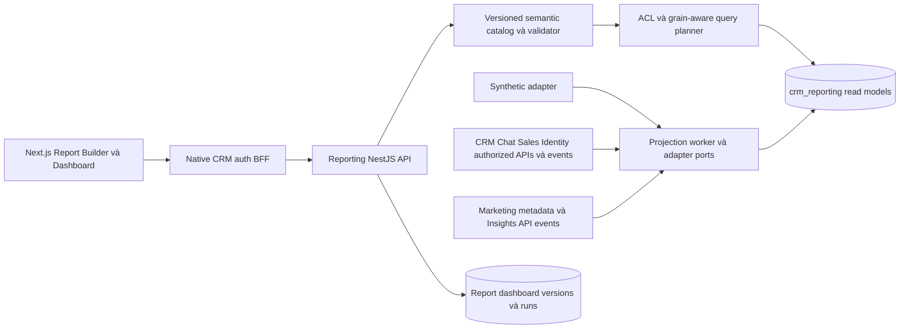

# Report Builder — kế hoạch module và dashboard động

**Current design proposal 2026-10-14:** [PLAN-027](dashboard-workspace.md) replaces the mixed builder/dashboard entry with separate Dashboard and Reports menus, home/template/picker flows and dedicated dashboard aggregate. User requests documents for review before code. New API/DDL gate PLAN-027A and SRC-071/072 are proposed TODO; broad SRC-061 global filters/comparison/sharing remain open. Historical implementation entries below are not current task status; consult tracker.

**2026-10-12 / CHG-20261012-06:** User accepted early API-backed UI. [PLAN-022H](../contracts/reporting-authoring.md) scopes source/model/fields/axes/flat filters/chart/pivot/private draft/CSV over delivered APIs. SRC-064 is the sole active source task; SRC-059 requeued READY, incomplete scope/evidence preserved. Full SRC-060 follows SRC-059 and SRC-064; no publish/dashboard/drilldown completion claim. No database changes.

**Lifecycle phase2026-10-12 / CHG-20261012-05:** PLAN-022G [durable mock runs](../contracts/reporting-runs.md) implemented with native caller-driven execution/cancel/pinned results and own schema3. SRC-059 still IN_PROGRESS for authorized drilldown/remaining KPI semantics and acceptance; no autonomous worker/UI claim. [Evidence](../tracking/details/SRC-059.md).

**Native phase2026-10-12 / CHG-20261012-04:** PLAN-022F [query/CSV API](../contracts/reporting-query-api.md) implemented over the mock core with explicit native run/export/source grants and delivery reauthorization. SRC-059 IN_PROGRESS for durable run/drilldown and remaining KPI semantics; SRC-060 UI not claimed. [Evidence](../tracking/details/SRC-059.md).

**Current update2026-10-12 / CHG-20261012-03:** SRC-063/057/058 DONE; PLAN-022E Ready for [internal mock query execution](../contracts/reporting-query.md), now implemented as the first SRC-059 phase.26metrics/group/pivot/CSV tested; native query/source authority, runs/drilldown and UI still pending. SRC-059 is the only IN_PROGRESS source task; SRC-051 READY. [Evidence](../tracking/details/SRC-059.md). Earlier planning paragraphs retain their original dated context.

PLAN-022A · CHG-20261010-01 · Codex · 2026-10-10. **Ready product/semantic planning; chưa Ready source, chưa có builder runtime.** Exact API/schema/table/producer gates thuộc PLAN-022. [Tracker](../tracking/tasks.md) là nguồn trạng thái; SRC-051 vẫn là source task đang active. Kế hoạch này không claim task triển khai song song.

**Implementation updates CHG-20261010-02 / CHG-20261012-01:** người dùng yêu cầu triển khai từng phần. PLAN-022B/SRC-063 deliver semantic kernel; PLAN-022C/SRC-057 deliver [private draft storage/native ACL API](../contracts/reporting-persistence.md). SRC-051 requeued READY with progress retained. Header records original planning time; current status follows tracker/checkpoint. Full builder has not run; remaining exact projection/query/publish/UI/producer gates stay in PLAN-022.

## 1. Kết quả cần dựng

2026-10-12 CHG-20261012-02: PLAN-022D/SRC-058 now deliver [typed synthetic snapshots/projections](../contracts/reporting-projections.md) in own schema2:25objects/120fields,immutable generation activation,replay/checkpoint and tombstones. [Runbook](../development/reporting-projections.md). Next remaining exact query/rights/execution contract before SRC-059; no connected/public raw source API or mock UI activated.

Một module Reporting trong CRM để analyst tự chọn datasource, object gốc và object liên quan, metric/dimension, filter, X/Y axis, group by và pivot; lưu report, ghép dashboard, lọc và drilldown tới record có quyền. Report dựng mới và report từ template dùng **cùng semantic catalog, query engine và renderer**. Không thêm endpoint Marketing riêng cho từng biểu đồ.

Hai phạm vi nghiệm thu tách biệt:

- **RB-MOCK:** builder/backend thật với dữ liệu synthetic có nhãn mock; Conversation, acquisition Session, Channel, Team/Human/AI agent, Contact/Lead/Deal và Campaign/Ad Set/Ad/Creative/Page/Post/Media, cùng Insights mock. Không cần chờ Meta live. Dữ liệu mock đi qua adapter, không đặt KPI cố định trong React.
- **RB-CONNECTED:** thay binding bằng versioned read API/event từ các producer đã Ready; CRM source hiện hữu và Marketing metadata/Insights có freshness thật. Không đổi report definition chỉ vì thay adapter. Không ghép mock spend với outcome thật rồi trình bày là hiệu suất thật.

Thực hiện RB-MOCK trước, RB-CONNECTED qua SRC-049 sau SRC-051/055. Không đổi lifecycle Conversation Session, không triển khai receipt, multi-touch attribution, tạo quảng cáo, gửi Conversions API hoặc kết nối SQL tùy ý.

## 2. Tham khảo sản phẩm

| Nguồn / pattern | Áp dụng vào CRM | Điều chỉnh cho bài toán này |
|---|---|---|
| [HubSpot custom report builder](https://knowledge.hubspot.com/reports/create-reports-with-the-custom-report-builder) | Primary source + additional sources; chọn fields/filters; kéo field vào X/Y/breakdown; bảng và pivot | Hiển thị grain/cardinality/coverage ngay khi nối source; lưu metric version thay vì cho SUM mọi field |
| [Salesforce report builder](https://trailhead.salesforce.com/content/learn/modules/lex_implementation_reports_dashboards/lex_implementation_reports_dashboards_using_report_builder) và custom report type pattern | Report type chọn records/fields; primary/related object model; detail, summary và matrix grouping | Relationship allowlist có optional/exists semantics; session không Lead vẫn nằm trong denominator |
| Salesforce dashboards | Dashboard gồm components tham chiếu saved reports, có filters và drilldown | Chạy bằng quyền viewer hiện tại; không mượn quyền người tạo dashboard |

Evidence tham khảo: trang HubSpot được tải HTTP200 ngày 2026-10-10, xác nhận primary/additional data sources, field/axis/breakdown, pivot và second Y axis. Trang Salesforce liên kết trên tải HTTP200, xác nhận report type quyết định records/fields, Outline group rows (summary) hoặc rows+columns (matrix), Filters và Fields panes. Một số URL Trailhead cũ/thử sai trả404; dashboard và advanced custom report type là pattern tham khảo, chưa kiểm riêng UI/edition hiện hành. Không sao chép giới hạn số field hoặc cấp subscription của sản phẩm khác thành yêu cầu CRM.

## 3. Phạm vi phiên bản đầu

| Năng lực | RB-MOCK v1 | Phần mở rộng sau |
|---|---|---|
| Catalog | Source/model/field/relation/metric registry có version, capability và provenance | Connector SDK có kiểm định; nhiều provider/warehouse |
| Data | Synthetic adapter đầy đủ đối tượng; cùng shape với producer contract dự kiến | Authorized snapshots + event/change streams từ CRM/Marketing |
| Query | Dimension, aggregate, date bucket, filter AND/OR, exists, cohort, time comparison, stable sort/top-N | SQL editor không thuộc mục tiêu; advanced window functions sau gate |
| Visualization | KPI, detail/summary table, pivot, bar/stacked bar, line/area, combo, donut, cohort funnel, scatter, heatmap | Geo map chỉ khi có geography đáng tin; custom renderer qua registry |
| Report | Draft, validate, preview, publish version, clone/template, archive; controlled CSV | XLSX/PDF, email delivery, public embed là scope tiếp theo |
| Dashboard | Widget layout, resize, shared parameters, compare periods, cross-filter, drilldown, manual refresh | Scheduled refresh/subscriptions cần job/retention/notification contract riêng |
| Quyền | Private/team/tenant sharing của definition; current row/field ACL; viewer/designer/publisher/exporter | Không có public links hoặc external BI credentials ở v1 |

Không phải mọi chart đều nhận mọi metric. Builder chỉ đưa lựa chọn tương thích; ví dụ funnel cần stage membership cùng cohort, scatter cần 2 metric cùng grain, donut không dùng p95 latency.

## 4. Kiến trúc và ownership

Source layout dự kiến: `services/reporting/{src,migrations,tests}` cho NestJS API/worker; Next.js business navigation Reporting có Reports/Dashboards/Templates/Data catalog. BFF dùng native session và truyền tenant/principal có xác thực; frontend không tự đặt trusted tenant. Các directory/API trên là đề xuất, chưa tồn tại do tài liệu này.

Reporting sở hữu catalog, report/template/dashboard definitions, run/export jobs và projections trong `crm_reporting`. Chat sở hữu conversation/session/message; Sales sở hữu Lead/Deal; Identity giữ quyền và team/principal; Marketing giữ metadata/Insights; Channels hiện vẫn giữ Page/credential authority trong monolith. Không import producer domain implementation hoặc SELECT trực tiếp `agentic_crm`/`crm_marketing` từ Reporting.

Projection nhận authorized snapshot/change batches qua ports, đồng bộ theo source revision, dedup/replay; không dùng Redis làm source of truth. Rebuild chạy generation mới rồi switch sau reconciliation, không truncate dataset đang phục vụ. MySQL-first; chỉ chuyển warehouse khi có đo lường và ADR.

## 5. Semantic model và KPI

[Semantic catalog](../data/reporting-semantic-model.md) quy định object grain, field descriptors, allowed links, attribution/owner/time/currency và metric formulas. Hai tầng phải tách:

1. **Datasource binding:** owner, environment `mock|connected`, transport, authorization, freshness và adapter capability.
2. **Data model:** logical objects, attributes, relationships và metrics có stable IDs/version; report tham chiếu tầng này. Thêm datasource không làm đổi metric key hay mất saved report.

Nhóm KPI chính:

- Conversation/session: số thread mới, sessions mở, Contacts tham gia, organic/paid/unknown, lead/deal/won cohort conversions, phiên chưa có phản hồi/chưa có Lead.
- Team/agent: received/handled/closed sessions, first response p50/p95, handoff acceptance latency, qualification/acceptance/conversion theo owner ở đúng thời điểm; phân biệt Human/AI và kích thước mẫu.
- Marketing: impressions/clicks/link clicks/spend, CTR/CPC/CPM, CRM Leads/Deals/won value, cost per acquired session/Lead/won và won-value-to-spend theo cohort/currency hợp lệ.
- Chiều hiệu quả: date/channel/Page/Ad Account/Campaign/Ad Set/Ad, creative/CTA/post/media có evidence, source kind, team/agent role, CRM attributes; age/region chỉ cho provider breakdown có hỗ trợ.

Không thể suy CRM conversion theo age/region hoặc từng asset của dynamic creative từ mỗi `ad_id`. Chi phí không được chia đều cho agent/team hoặc lặp lại trên từng Lead/Post/Media. Field picker giải thích lý do và đề xuất chiều khả dụng.

## 6. Luồng người dùng

Chọn **Create report → blank hoặc template → dataset/source → base object → related objects → fields/metrics → filters và time mode → chart/pivot → preview → save/publish → add to dashboard**. Preview đồng thời hiển thị sample count, grain, timezone, as_of, watermark, mock badge, excluded/unknown coverage và lý do metric bị khóa.

[UX specification](../ux/report-builder.md) mô tả anatomy, X/Y/series, pivot rows/columns/values, responsive và error states. Save draft được phép lưu cấu hình chưa hợp lệ; publish/run phải validate. Đổi chart giữ query, đổi source/relationship hiển thị impact lên fields/filters trước khi áp dụng. Không silently bỏ điều kiện.

Dashboard filter ánh xạ bằng semantic field IDs có kiểu, không theo tên hiển thị. Global Page/Campaign/date/team filters chỉ áp vào widget có mapping hợp lệ. Widget không hỗ trợ hiển thị “Không áp dụng bộ lọc này”; không để người xem tưởng mọi KPI cùng cohort. Cross-filter có chips, Clear và undo; drilldown thực hiện ACL mới.

## 7. Templates để nghiệm thu engine

| Template | Dataset / grouping | KPI / visualization |
|---|---|---|
| Conversation acquisition | Sessions theo tuần/channel/Page/source kind | Sessions, engaged Contacts, session→Lead→Deal→Won; trend + cohort funnel |
| Team operations | Assignment/response facts theo team/agent role/Human-AI | Received/handled, first response p50/p95, unanswered/pending; bar + pivot |
| Agent conversion | Session acquisition owner hoặc qualification owner, chọn rõ mode | Cohort conversion, qualified Leads, won value với lineage; summary table |
| Paid performance | Base ad/day totals + acquisition-session outcomes, Campaign→Ad Set→Ad | Spend, impressions, CTR, CRM conversion, cost ratios; combo + drilldown |
| Page/content effectiveness | Evidence-backed Page/Post/Creative, media chỉ khi cardinality cho phép | Sessions/leads/won, spend theo chiều hợp lệ; table + bar |
| Delivery audience | Provider age hoặc region dataset, campaign/ad filter | Impressions/clicks/spend/CTR; bar + heatmap, không CRM outcome |
| Executive dashboard | Saved report versions từ các template trên | Cards + trend + campaign pivot, common parameters và từng widget coverage |

Templates là JSON/versioned definitions seed tenant-scoped, không hard-code thuật toán theo tên template. Người dùng clone và đổi dimension/metric bằng builder chung.

## 8. API, storage và vận hành cần chốt ở PLAN-022

Interface dự kiến `/reporting/v1`: catalog/models/fields/relations/metrics; definitions/drafts/versions; validate/preview/runs; dashboards/widgets/versions; templates; drilldown; exports. Contract phải có request schema strict, bounded expressions, IDs/version pins, errors, pagination, idempotency và ETag. Chưa quảng bá các route này là đã có trong OpenAPI.

Validation trả errors theo field path/code, compiled grain, required permissions, unsupported capabilities, estimated cost và warnings. Query response trả typed columns/rows/totals, chart encoding, coverage/freshness per source, snapshot vector, query/definition hash, timezone/currency, partial/truncation status và drill token có scope/expiry. Report definition không chứa arbitrary SQL/JS.

Logical persistence inventory: source binding; semantic model version; report definition/version; dashboard/version/widget binding; template version; source checkpoint/projection generation; typed dimension/fact/bridge projections; run/result/export metadata; local audit/inbox/outbox/idempotency và migration journal. Đây **không phải DDL Ready**. PLAN-022 phải điền từng mục trong [table template](../templates/database-table.md), keys/indexes/CAS/retention/grants/migration trước khi tạo bảng. Mọi bảng có tenant_id NOT NULL; catalog built-in được version trong package rồi materialize cho tenant, không dùng system tenant như wildcard đọc business data.

Đề xuất budget v1 để kiểm thử: tối đa 6 object/5 relationship edges, 4 grouping dimensions, 8 metrics; pivot 3 row + 2 column dimensions, 5.000 cells; chart 500 points; detail page100; preview30s; async run120s; export100.000 rows và25MiB; 2 active query jobs/tenant, 12 widgets/dashboard. PLAN-022 pin configurable hard limits và reject-before-run/cancel/timeout behavior; SRC-062 ghi benchmark thật với fixture100k sessions, không claim SLO production từ con số đề xuất. Pivot/cardinality vượt hạn mức báo rõ, không âm thầm cắt rows hoặc dựng total từ truncated data.

Audit chỉ lưu IDs/query hash/changed fields/counters; không transcript, credentials hoặc kết quả chứa PII. CSV escape công thức, export private và có TTL; quyền được kiểm lúc queue/run/download. Dashboard/manual refresh không khởi tạo lịch nền mặc định.

## 9. Chia task và thứ tự triển khai

| Task | Dependency | Deliverable / gate |
|---|---|---|
| PLAN-022A | PLAN-021 DONE | Kế hoạch này, semantic model, UX spec, acceptance và backlog; design-only |
| PLAN-022 | PLAN-022A | Exact catalog/query/API JSON Schemas + fixtures; mỗi producer field có coverage/adapter mapping; đầy đủ table templates/DDL/index/ACL/retention và mock runbook. Chốt port snapshot/events/rights; field thiếu capability phải khóa |
| PLAN-022B / SRC-063 | PLAN-022A / PLAN-022B; SRC-038 | Scoped exact semantic catalog/validator contract rồi kernel code/tests, không DB/API/UI; phần đầu theo yêu cầu triển khai từng phần |
| PLAN-022C / SRC-057 | SRC-063 / PLAN-022C; SRC-038; SRC-063 | Scoped private draft/version persistence: own schema/grants/forward migration, pinned catalog, native BFF own/all ACL, CAS/idempotency/audit; MySQL/native HTTP/reconnect; no publish/query |
| PLAN-022D / SRC-058 | SRC-057; SRC-053 / PLAN-022D; SRC-057; SRC-053 | Scoped typed synthetic adapters + immutable fact/dimension generations, snapshots/replay/tombstones/CAS; all kernel objects plus history, reusable G1, explicit mock provenance |
| SRC-059 | SRC-058 | Validator/query planner, metrics/cohorts/pivot, run/cache/drilldown/CSV; exact totals/ACL/fan-out/limits/revocation tests |
| SRC-060 | SRC-059 | Next.js report builder: nguồn/related objects/fields/filters/X/Y/series/chart/pivot/save/template; browser/keyboard/responsive |
| SRC-061 | SRC-060 | Dashboard layout/version/filter mapping/cross-filter, compare periods, template library; viewer ACL/widget freshness |
| SRC-062 | SRC-061 | RB-MOCK end-to-end release: golden KPI fixture, custom-field extension proof, cold/warm migration preservation/restart, MySQL + browser + capacity evidence |
| SRC-049 | SRC-062; SRC-051; SRC-053; SRC-055; PLAN-022 | Authorized CRM/Marketing adapters, coverage reconciliation, connected templates/release. Live Meta proof riêng với synthetic integration |

SRC-057 uses scoped gate PLAN-022C; SRC-058 uses PLAN-022D. Broader PLAN-022 remains open for exact query/native source rights, publish and UI contracts; complete query gate before claiming SRC-059. One source task at a time; SRC-051 remains requeued READY with progress retained. Mock delivery does not depend technically on SRC-051/055 and does not imply Marketing completion.

PLAN-022 producer gate đặc biệt kiểm assignment/team history, first-sent message/session membership, Lead qualification/acceptance, Deal terminal history, current ACL and tombstones. Nếu producer hiện thiếu event/bulk read, ghi additive adapter work rõ trong SRC-049; không lấy UI list API phân trang thành consistent snapshot hoặc suy timeline từ current owner. Mock full coverage không được đánh dấu connected full coverage.

## 10. Tiêu chí hoàn tất và rollout

[RB acceptance matrix](../quality/report-builder-acceptance.md) là gate cho từng source task. RB-MOCK DONE khi analyst dựng được ít nhất 3 report khác nhau và dashboard từ cùng catalog, sửa axis/pivot/filter thực sự đổi kết quả backend; test chứng minh không double count, không vượt quyền, pin versions và giữ dữ liệu qua restart. Catalog phải cho thêm một custom numeric attribute và một source/model mới bằng descriptor+adapter+fixtures, không sửa UI/engine switch-case.

RB-CONNECTED chỉ DONE sau tenant-scoped source reconciliation với owner APIs/observations, revision/revoke/delete/rebuild tests và data freshness rõ. Giữ organic report hiện hữu trong rollout; feature flag Reporting mới theo tenant; rollback tắt route/consumer mới nhưng giữ definitions/checkpoints, forward fix schema, không sửa migration lịch sử hoặc reset volume.

Phiên 2026-10-10 chỉ lập kế hoạch và kiểm tài liệu. Không code API/UI, tạo DB/migration, seed data, chạy background job, commit/push/deploy. Những gate runtime trên đều NOT_RUN.
