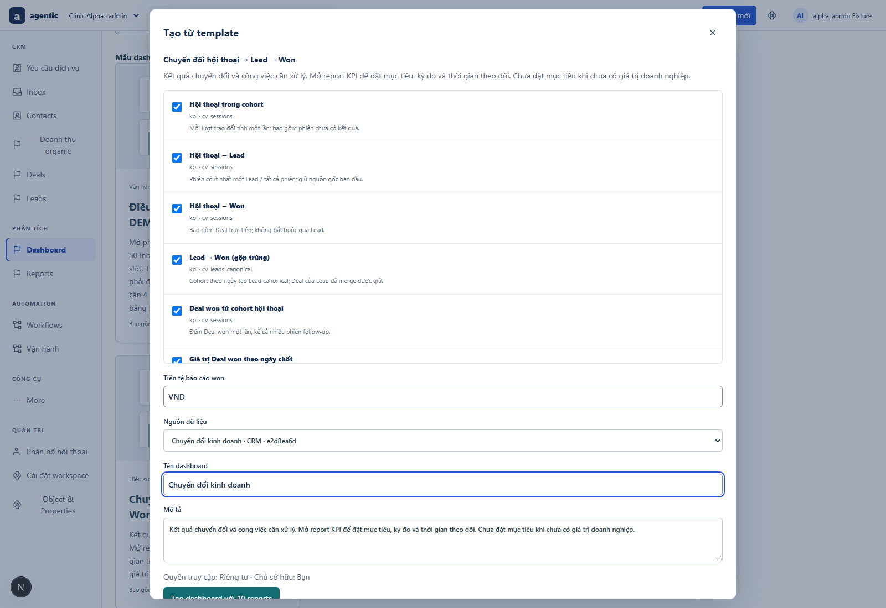
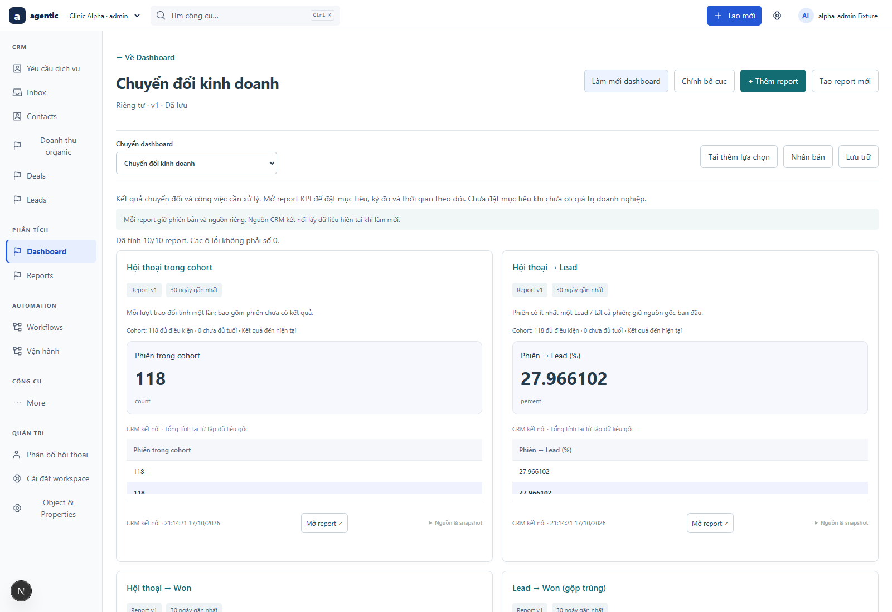
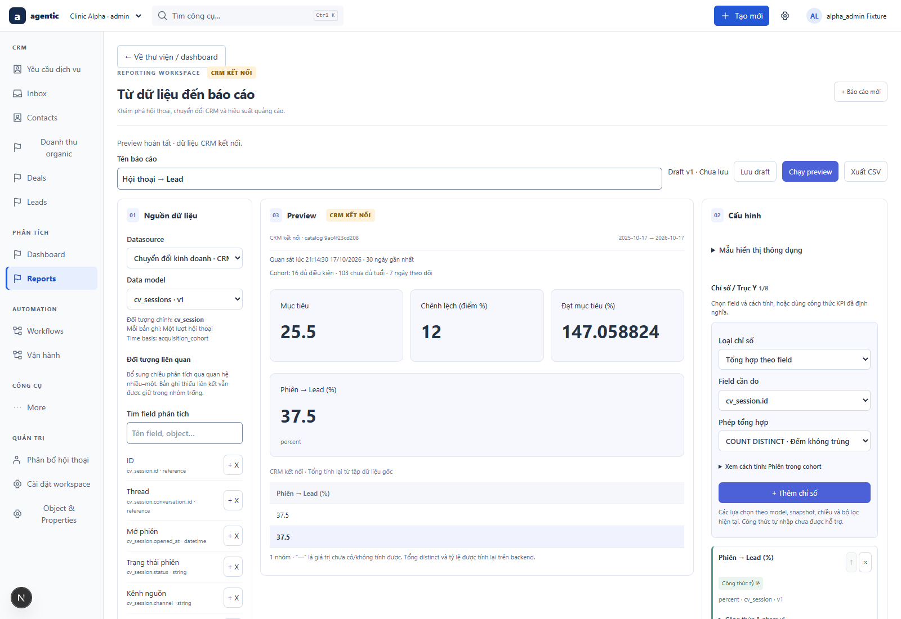
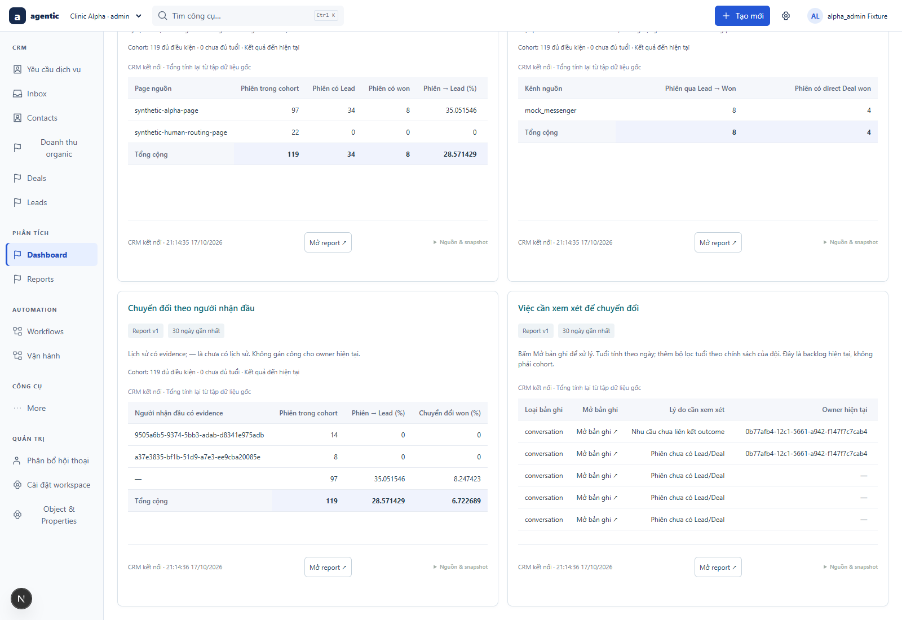
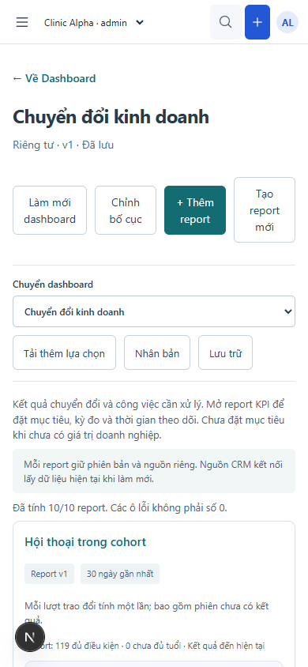

# Nghiệm thu chuyển đổi và dashboard mục tiêu — SRC-086

**PASS bounded local slice**, 2026-10-17. [Dashboard](http://localhost:18080/?dashboards=1&dashboard=231b1486-4a14-588a-adb9-2dba107dea79) · [Contract](../contracts/conversion-reporting.md) · [Runbook](../development/conversion-reporting.md) · [Execution evidence](../tracking/details/SRC-086.md).

| Tiêu chí | Evidence thực chạy và phạm vi |
|---|---|
| CV-01 | Unit: phiên không có outcome vẫn ở mẫu số; nhiều Leads/Deals, direct branch, zero/null, exact decimal và currency mismatch. Native:1phiên/2Leads/3won,30.375VND. |
| CV-02 | Native: nguồnS1, tạo Deal trongS2, closingS3; origin vẫnS1, thêm một Deal7.125 tạo tổng37.500; context không nhân bản giá trị và không tạo false attention. |
| CV-03 | Unit cross-origin raw/canonical; native merge giữ Deal.lead_id gốc, canonical count1/won2/value20.25. Current merge snapshot, không historical replay. |
| CV-04 | Unit horizon7,3eligible/1immature và late won loại khỏi tử số; native port full opened history có owner, partial history trả null. Connected liveDefinition luôn dùng observedThrough hiện tại. |
| CV-05 | Unit tenant/unknown fields,10001rows rejected, catalog mismatch; native read/all scope/revoke/field filter/export; DB CHECK/FK/PK và runtime append-only; browser refresh giữ pins. |
| CV-06 | Native owner history test transaction rollback; browser historical owner tách current operational owner. Need attention dùng explicit sales_need_outcome mapping, không stage won (source inspection); UI hiển thị lý do nhu cầu chưa liên kết. Không claim kiểm thử toàn bộ lifecycle Need trong slice này. |
| CV-07 | Browser tạo10reports, chạy10/10widgets; native ingress→Lead/won và direct won làm số won tăng2; goal25.5/horizon7 lưu/mở lại; report pin không tự nâng; link bản ghi;390px không overflow/pageerror. |

411unit/59files,9native groups,6storage groups,8browser groups và12nhóm dashboard native regression PASS. Backend/Reporting build, Web typecheck và isolated Next production build PASS. Test dùng MySQL/Redis local và Edge headless trên Windows/Node24.21.0. [Browser](assets/conversion-reporting/browser.json), [native](assets/conversion-reporting/native.json), [storage](assets/conversion-reporting/storage.json), [unit](assets/conversion-reporting/unit.log), [build](assets/conversion-reporting/web-build.log).

## Ảnh đã kiểm tra

Ảnh là dữ liệu synthetic; target25.5 chỉ dùng kiểm thử rồi gỡ khỏi phiên bản report hiện hành. Lịch sử version test vẫn giữ. Kết quả cộng dồn do fixtures được tái sử dụng.

Giới hạn snapshot hiện tại, source bounded và refresh thủ công ở runbook. Không có production-provider, cảnh báo tự động hay cash-collected claim.
