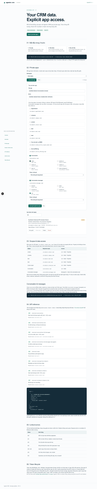
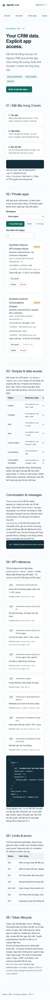
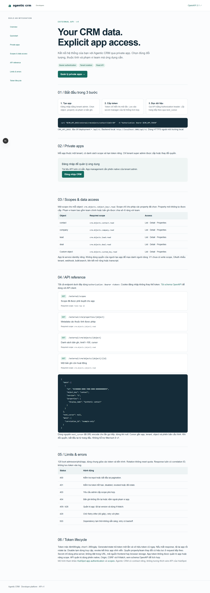
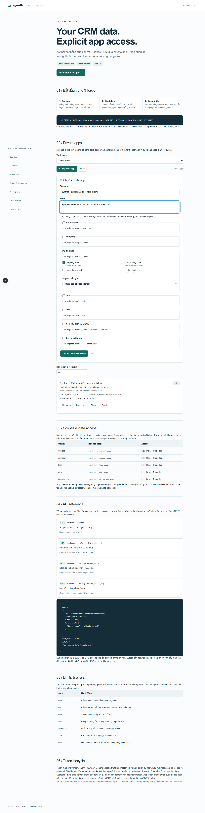
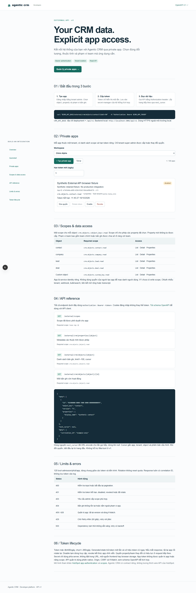
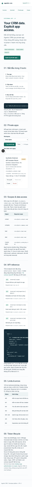

# External API acceptance — SRC-088

Contract scenarios [EA-01…08](../contracts/external-api.md#acceptance). [Evidence](../tracking/details/SRC-088.md) is the source of executed results, including limitations. Runtime assertions use synthetic retained data; no usable tokens in screenshots or evidence.

| Scope | Verification |
|---|---|
| EA-01 | Native super-admin create/list/configure; nonadmin denial; CAS/duplicate/unknown field rejection; browser form |
| EA-02 | Hash only/list/audit minimization; invalid/expired/rotated/disabled/revoked token; new service instance persisted state |
| EA-03 | Tenant-header mismatch, token tenant tampering, foreign record404, missing scope403, selected property projection, team ACL, query-inference rejection |
| EA-04 | Native Contact list/detail/metadata; signed cursor continuation/tamper/config-version rejection; real HTTP schema validation |
| EA-05 | Parallel MySQL admissions enforce120 across callers; rotation cannot reset quota; safe error envelope; dependency errors map503 |
| EA-06 | Public docs/native admin create/edit/token controls; secret hidden before screenshots; desktop1440 and mobile390/320; no browser storage token |
| EA-07 | OpenAPI10operations, all component/request/response schemas compile; exact source/artifact drift check; scope/quickstart/lifecycle/errors examples |
| EA-08 | Forward37/rerun0 with preexisting table fingerprints; local SQL backup and restricted grants; backend/web builds, unit and static checks |

Not production acceptance: public OAuth/write/webhooks/bulk, distributed Identity outage/load/SLO, and production recovery/retention remain separate. No test here proves those capabilities.

## Conversation extension — SRC-089

[EC-01…05 contract](../contracts/external-conversations.md) · [Executed evidence](../tracking/details/SRC-089.md). Nine retained MySQL/real HTTP groups and six local browser groups cover explicit metadata/content grants, selected fields, parent/team intersection, inactive teams, tenant/archive denial, context-bound cursor and live grant removal. OpenAPI now14operations. No schema changes; all synthetic apps left disabled.

## Reviewed screenshots
Synthetic fixture only; tokens hidden before capture.

