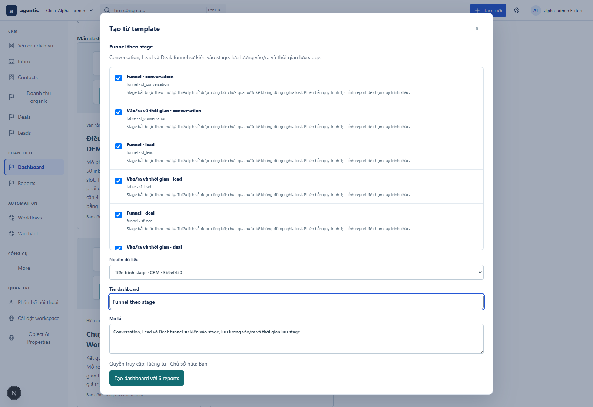
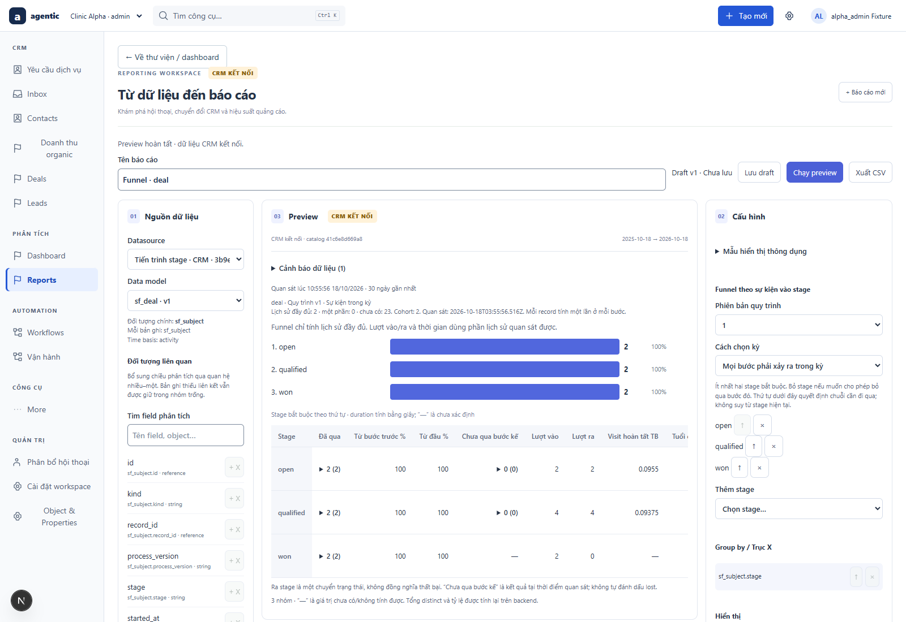
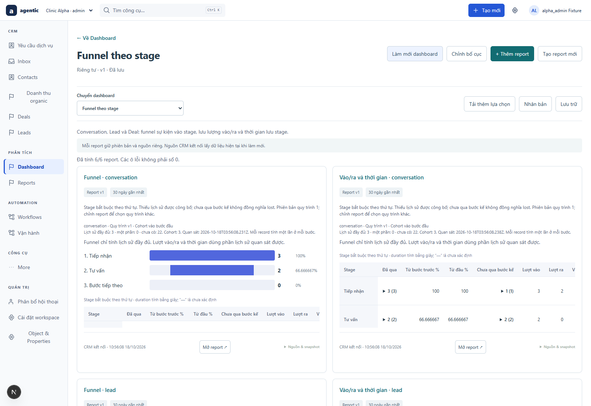
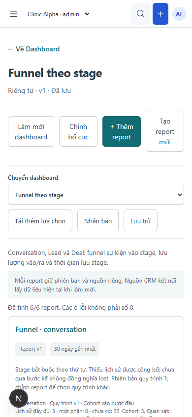
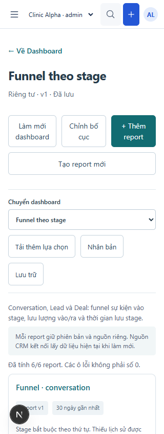

# Nghiệm thu stage funnel — SRC-087

2026-10-18 · Bounded SF-01…08 theo [contract](../contracts/stage-funnel-reporting.md), không đóng các đề xuất rộng hơn trong [research](../planning/stage-funnel-reporting.md). [Hướng dẫn](../development/stage-funnel-reporting.md).

| Scope | Evidence đã chạy |
|---|---|
| SF-01 ordered funnel | Unit normal/skip/backward/reentry/equal timestamp; native Lead/Deal no-op, qualification/handoff/accept, Deal backward/reentry/won; browser live mutation. Distinct và visit tách riêng. |
| SF-02 time/denominator | Unit exclusive end, pre-window entry, entry-cohort/event-window, zero/null và pending. UI rolling 1…365 ngày, current cutoff; horizon/historical-asOf bị từ chối. Không claim historical replay. |
| SF-03 consistency | Unit gap/broken-chain/duplicate-step, source overflow; native CAS rollback/idempotent replay, unique sequence/CHECK, atomic outbox. Correction/import lịch sử stage chưa hỗ trợ. |
| SF-04 Conversation | Native SessionProgress episode/process, stage độc lập milestones; unit partial/closed age; 13 nhóm regression SessionProgress gồm enrollment partial, new episode/version, concurrent close/stage. Regression milestone correction không phải stage correction. |
| SF-05 Sales | Native Human creation/draft/qualify/disqualify/handoff/accept, Deal transition; Chatflow producer port gọi trực tiếp với synthetic FK fixtures và service actor. Không claim full Workflow/AI/Chatflow authentication E2E. Merge giữ raw ID qua source inspection/unit filters và 9 nhóm conversion regression. |
| SF-06 permissions/storage | Native wrong tenant, revoked grant/read-own, stage field filter deny và export deny; unit all-event-field/row scopes; 7 nhóm storage kiểm tra catalog pin/FK/CHECK/index và append-only grants. Destination rechecks nằm trong native CRM; browser mở authorized member. |
| SF-07 workspace | 8 nhóm Edge browser: discovery, template6reports,6/6widgets, native transitions, edit/preview/save/reopen,CSV, immutable widget pins, native links, desktop/390/320px không pageerror/page overflow. 12 nhóm dashboard regression đạt sau sửa lỗi opaque future draft catalog selection. |
| SF-08 durations/preservation | Unit paired duration/current age, terminal exclusion, visit bắt đầu trước kỳ; CRM35→36 giữ113bảng cũ; Reporting6→7 local/test giữ20business tables. Fixtures retained; không backfill/reset. Opening/closing reconciliation chưa triển khai. |

428 unit tests/61 files PASS. Backend/Reporting build, Web typecheck và isolated Next production build PASS; kết quả static cuối phiên ở [task evidence](../tracking/details/SRC-087.md). Native11, storage7, browser8; regressions conversion9, SessionProgress13, dashboard12 groups PASS. Không có test vendor-account hoặc live provider trong slice này.

[Unit](assets/stage-funnel/unit.log) · [Native](assets/stage-funnel/native.json) · [Storage](assets/stage-funnel/storage.json) · [Browser](assets/stage-funnel/browser.json) · [Web build](assets/stage-funnel/web-build.log) · [Migration](assets/stage-funnel/upgrade.json).

## Ảnh synthetic đã kiểm tra

Widget có scroll nội bộ để đọc bảng số chính xác và danh sách ID; không giấu warning khi dữ liệu cũ thiếu lịch sử. Các test rerun tạo thêm synthetic records/reports và giữ lại theo quy định.
