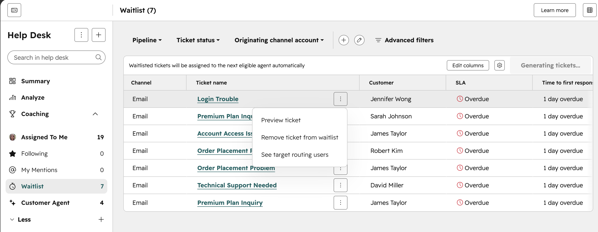
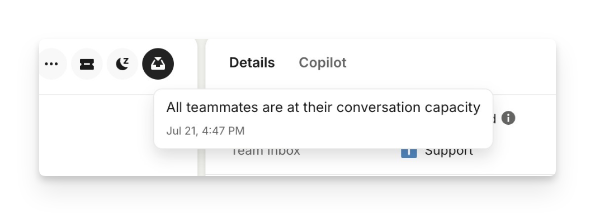
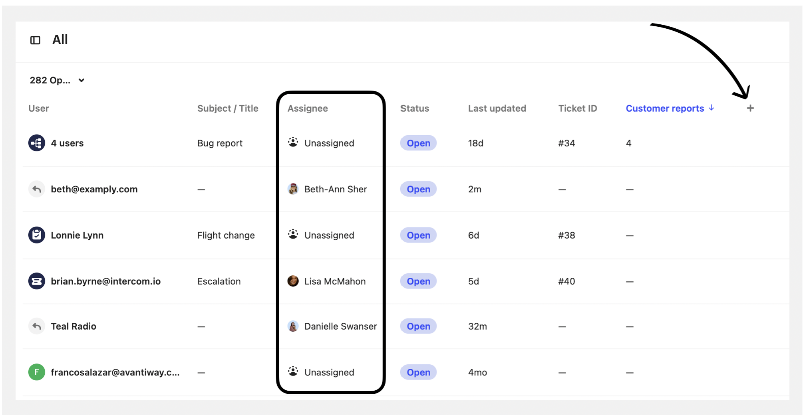
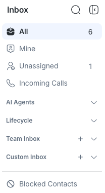
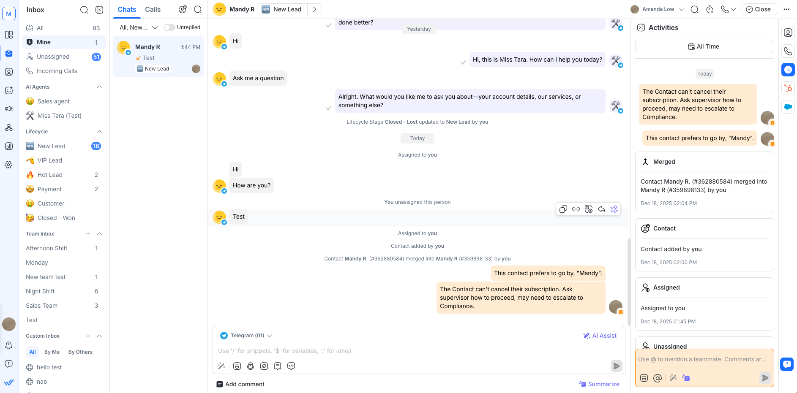
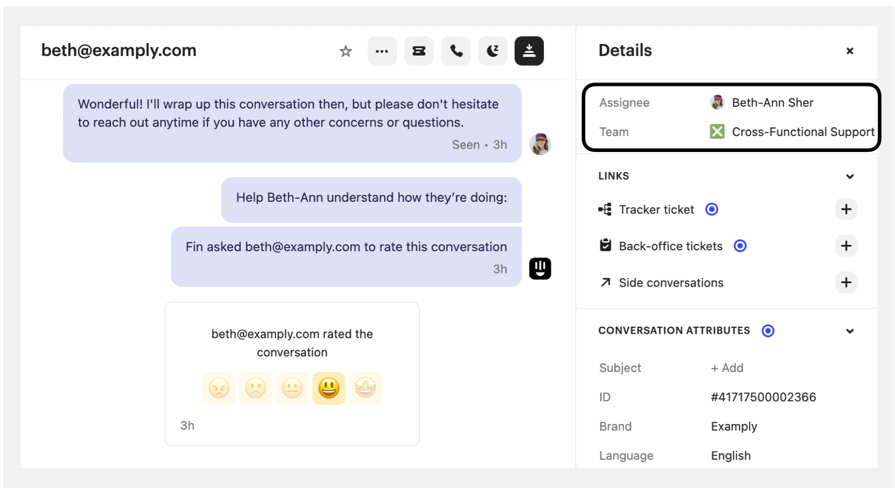
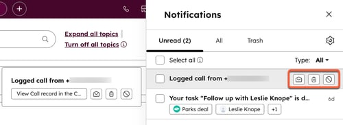
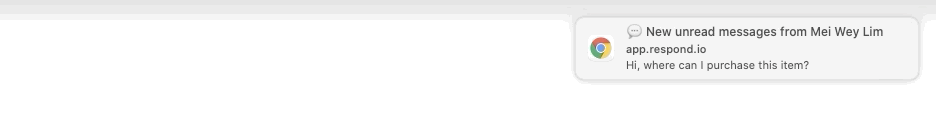

# Ảnh tham chiếu Waitlist và Assignment

PLAN-041 · Thu thập 2026-10-17 · Ảnh công khai từ tài liệu chính thức, không phải ảnh chụp tenant đang chạy.

HubSpot rõ nhất để quản lý toàn bộ hàng chờ; Intercom rõ nhất ở lý do chưa giao; respond.io minh họa tốt lịch sử “Assigned to you”. Chưa đủ ảnh đúng sự kiện incoming assignment để xếp hạng alert của cả ba.

[Mở gallery HTML](assignment-ui-gallery.html) · [Nguồn và SHA-256 từng ảnh](assets/assignment-ui/sources.json) · [Nghiên cứu routing](conversation-assignment.md)

## 1. Hàng chờ

### HubSpot — Waitlist

**Đúng hàng chờ capacity.** Rõ nhất ở cấp danh sách: Waitlist riêng, số lượng, SLA và banner tự giao cho agent đủ điều kiện. Đây là Help Desk Ticket, không phải legacy Conversations Inbox.

[Nguồn chính thức](https://knowledge.hubspot.com/help-desk/use-the-waitlist-in-help-desk) · [Mở ảnh gốc đã lưu](assets/assignment-ui/hubspot-waitlist.png)

### Intercom — lý do chưa giao

**Đúng lý do hết capacity.** Tooltip giải thích mọi teammate đã đầy capacity. Rõ ở từng hội thoại; ảnh này không cho thấy toàn bộ danh sách chờ hay thứ tự ưu tiên.

[Nguồn chính thức](https://www.intercom.com/help/en/articles/6553774-balanced-assignment-deep-dive) · [Mở ảnh gốc đã lưu](assets/assignment-ui/intercom-capacity-reason.png)

### Intercom — bảng Assignee

**Unassigned, chưa chứng minh chờ capacity.** Bảng cho thấy cuộc nào đã có người xử lý, cuộc nào Unassigned. Không thể suy mọi dòng Unassigned đều đang chờ vì đầy tải.

[Nguồn chính thức](https://www.intercom.com/help/en/articles/6561699-assign-conversations-to-teammates-and-teams) · [Mở ảnh gốc đã lưu](assets/assignment-ui/intercom-assignee-table.png)

### respond.io — Unassigned / Team Inbox

**Inbox chung, chưa phải Waitlist riêng.** Sidebar dễ hiểu và gọn. Tuy nhiên Unassigned không giải thích chờ vì offline, đầy tải, thiếu rule hay chưa từng phân công.

[Nguồn chính thức](https://respond.io/help/inbox/getting-started-with-inbox) · [Mở ảnh gốc đã lưu](assets/assignment-ui/respond-unassigned.png)

## 2. Trạng thái nhận việc và thông báo

### respond.io — Assigned to you

**Đúng trạng thái / lịch sử đã giao.** Trong workspace có Mine, dòng Assigned to you trong hội thoại và Activities ghi thời điểm Assigned. Đây là dấu vết giao việc; không chứng minh popup xuất hiện lúc vừa nhận việc.

[Nguồn chính thức](https://respond.io/help/inbox/getting-started-with-inbox) · [Mở ảnh gốc đã lưu](assets/assignment-ui/respond-assigned-workspace.png)

### Intercom — Assignee và Team

**Đúng người đang phụ trách.** Details cho thấy người và team được giao. Rõ quyền sở hữu hiện tại, nhưng không có badge mới giao hoặc alert incoming assignment trong ảnh.

[Nguồn chính thức](https://www.intercom.com/help/en/articles/6561699-assign-conversations-to-teammates-and-teams) · [Mở ảnh gốc đã lưu](assets/assignment-ui/intercom-assigned-workspace.png)

### HubSpot — Notifications

**Thông báo chung; chưa đúng assignment.** Ảnh chính thức cho thấy popup và ngăn Notifications. Nội dung là logged call / task, không phải nhận hội thoại mới. Ảnh nguồn nhỏ, không thể dùng để đánh giá chi tiết alert assignment.

[Nguồn chính thức](https://knowledge.hubspot.com/user-management/how-to-set-up-user-notifications-in-hubspot?isVariant=b) · [Mở ảnh gốc đã lưu](assets/assignment-ui/hubspot-notification-drawer.png)

### respond.io — desktop toast

**Thông báo tin nhắn mới; chưa đúng assignment.** Khung hình 32 (đánh số từ 0) trích từ GIF chính thức. Popup báo New unread messages, không phải Contact Assigned. Chỉ tham khảo hình thức desktop toast.

[Nguồn chính thức](https://respond.io/help/user-account/notifications) · [Mở ảnh gốc đã lưu](assets/assignment-ui/respond-new-message-toast.png)

## Nhận xét để áp dụng vào Agentic CRM

Đây là đề xuất UX từ ảnh tham chiếu, chưa thay đổi contract Ready hay source.

- **Queue:** dùng mục Chờ phân công riêng như HubSpot; hiển thị số lượng, thời gian chờ và SLA. Thêm lý do từng dòng theo cách Intercom: đầy capacity, agent offline, chưa có người đủ kỹ năng.
- **Đã giao:** giữ Mine / Của tôi và lịch sử giao việc như respond.io; phân biệt “mới được giao” với “có tin nhắn chưa đọc”.
- **Alert đề xuất:** toast “Bạn được giao hội thoại …”, kèm khách hàng, Page/kênh, lý do phân công và nút Mở hội thoại; lưu lại trong ngăn thông báo. Không tự chuyển màn hình khi agent đang gõ. Đây là đề xuất của nghiên cứu, không phải UI vendor đã xác minh.

## Phần còn thiếu và giới hạn

Chưa thu được ảnh đúng popup/banner nhận hội thoại mới của cả ba hệ. HubSpot hiện chỉ có ngăn thông báo chung; Intercom có owner hiện tại; respond.io có sự kiện Assigned trong timeline và toast tin mới. Không dùng chúng làm bằng chứng cho incoming assignment. Vì vậy PLAN-041 giữ IN_PROGRESS cho phần ảnh còn thiếu, không xác nhận đã đủ bộ theo yêu cầu.

Tài liệu [Intercom notifications](https://www.intercom.com/help/en/articles/187-how-teammates-get-notifications) và [respond.io notifications](https://respond.io/help/user-account/notifications) mô tả cấu hình/sự kiện thông báo. Riêng respond.io phân biệt Contact Assigned với New Message; bảng Notification Types cho biết Contact Assigned không đi vào Notification Center. Không kết luận sản phẩm thiếu tính năng chỉ vì tài liệu không có ảnh.

Bước tiếp theo để bổ sung bộ ảnh đúng: chụp một lần phân công từ người/automation sang agent khác trên tenant demo của từng vendor, quan sát tại workspace người nhận. Cần có phiên demo truy cập được; phiên nghiên cứu này chỉ sử dụng nguồn công khai. Không dùng cuộc gọi incoming làm mẫu nhận hội thoại chat.

## Evidence của phiên

- IMG-01: 8 ảnh từ nguồn chính thức đã mở và đọc trực quan; không vẽ lại UI. Một ảnh là frame GIF trích nguyên khung, bảy ảnh giữ byte gốc.
- IMG-02: manifest lưu nguồn trang, URL ảnh, ngày thu thập, kích thước, SHA-256 và giới hạn ngữ nghĩa. Ngày thu thập không phải ngày chụp UI.
- IMG-03: kiểm tra file ảnh/hash/link nội bộ; kết quả lệnh kiểm tra tài liệu ghi tại [execution log](../tracking/log.md).
- IMG-04: ảnh đúng incoming-assignment popup của ba vendor còn thiếu. Không kiểm thử tính năng hay đăng nhập tenant vendor.

Quyền đối với ảnh thuộc các nhà cung cấp; lưu làm tài liệu tham chiếu nội bộ.
