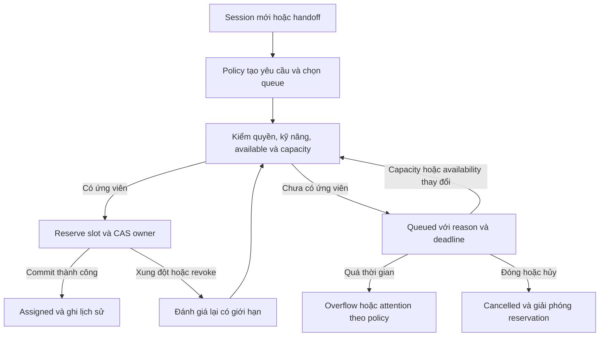
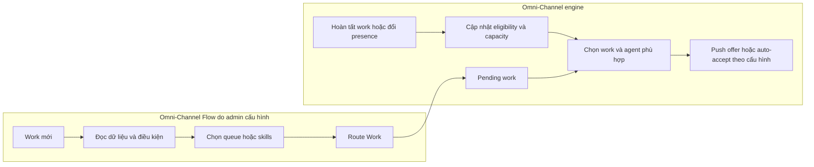

# Phân công hội thoại: kỹ năng, nguồn, capacity và hàng chờ

PLAN-044 follow-up: [logical conversation routing ERD](../data/conversation-routing-erd.md) and [visual preview](../data/conversation-routing-preview.html) turn these recommendations into proposed entities/lifecycles. Logical design only; no physical schema/runtime implementation.

PLAN-040 · Codex · 2026-10-17. **Research/recommendation only**, không phải contract Ready hoặc tính năng đã triển khai. Dependency PLAN-037/SRC-017/SRC-078/SRC-082 DONE; đã claim trước authoring. Nguồn: tài liệu chính thức của năm vendor và source hiện tại; không đăng nhập hay kiểm thử tenant vendor.

Nhóm chính G04 — điều phối đội ngũ; liên quan G01 — xử lý hội thoại, G05 — cấu hình và G06 — tự động hóa theo [capability map](../product/capability-map.md). Team lead quản lý kỹ năng/công suất/hàng chờ; admin quản lý quyền và policy; agent xem việc được giao và lý do chờ. Kết quả mong muốn: mỗi lượt có người phù hợp hoặc một trạng thái chờ có trách nhiệm, không mất việc khi toàn đội quá tải.

## 1. Khuyến nghị chính

Ảnh đối chiếu UI bổ sung: [Waitlist và Assignment — HubSpot, Intercom, respond.io](assignment-ui-screenshots.md). Phân biệt hàng chờ capacity, Unassigned, lịch sử đã giao và alert; bộ ảnh popup nhận việc mới vẫn chưa đủ.

Chọn mô hình **hồ sơ kỹ năng độc lập + routing policy có phiên bản + hàng chờ bền vững**, cho phép workflow gọi cùng cơ chế phân công. Page/ad/post là ngữ cảnh đầu vào. Dòng sản phẩm, nghiệp vụ và ngôn ngữ là các trục kỹ năng tái sử dụng. Không tạo một hồ sơ kỹ năng riêng cho từng bài quảng cáo.

Mỗi lượt xử lý mới (`session_id`) cần một quyết định routing; không phân lại sau mỗi tin nhắn. Giữ owner trong lượt đang mở, trừ lệnh transfer/takeover hoặc policy xử lý sự cố rõ ràng. Khi mọi agent phù hợp đầy tải, phải đưa việc vào queue có lịch sử, tự thử lại khi có chỗ và có nhánh quá hạn. `owner = null` hoặc một saved Inbox chưa đủ cung cấp vòng đời đó.

Đề xuất mặc định cho bản đầu: auto-assign, Human available + đủ quyền + đủ kỹ năng bắt buộc + còn slot; chọn người ít hội thoại mở nhất, hòa thì người lâu chưa được giao nhất. Cho phép round-robin có cùng capacity gate khi doanh nghiệp muốn chia đều cơ hội bán hàng. Mức capacity/SLA cụ thể phải cấu hình và đo thử; tài liệu này không đặt con số production mặc định.

## 2. Đối chiếu sản phẩm

Các ghi nhận dưới đây thuộc sản phẩm/phạm vi được dẫn, không phải mọi edition hoặc mọi loại kênh. Không suy mô hình database nội bộ từ tài liệu UI.

| Sản phẩm / phạm vi | Kỹ năng và quy tắc | Phân bổ và hết capacity | Bài học áp dụng |
|---|---|---|---|
| HubSpot Help Desk | Skill catalog có nhóm, language/custom skills; gắn user; ruleset theo channel dùng ticket properties | Load balanced/round-robin/random; available users; capacity theo tổng hoặc channel. Waitlist giữ việc khi agent phù hợp đầy tải, ưu tiên SLA/thời gian chờ và tự giao khi có chỗ | UI cấu hình đơn giản, kỹ năng độc lập, tách Unassigned khỏi Waiting capacity. Help Desk Ticket không phải legacy Conversations Inbox |
| Salesforce Omni-Channel | Ánh xạ field của work item sang nhiều kỹ năng; hồ sơ agent có proficiency/hiệu lực; queue và skill routing | Least Active hoặc Most Available, presence, work size/capacity; queue priority và thời gian chờ | Mẫu enterprise cho work requirement, kỹ năng và capacity units; không cần sao chép toàn bộ độ phức tạp ngay |
| Intercom Inbox | Workflow chọn team inbox; membership và channel availability quyết định tập người nhận | Balanced chờ tại team inbox, xét giới hạn cá nhân/inbox, chọn ít open conversations nhất. Round-robin là chế độ khác, không xét assignment limit | Phải ghi rõ thuật toán nào tôn trọng capacity; UI nên giải thích vì sao chưa giao |
| respond.io Workflows | Assign To chọn user/AI/team/workspace; nhánh workflow quyết định phân luồng | Round-robin hoặc least open Contacts; tùy chọn online và dưới ngưỡng open Contacts; không đạt thì chờ đến khi được giao hoặc timeout branch | Workflow thuận tiện cho doanh nghiệp nhắn tin/social; đơn vị assignment là Contact nên không sao chép trực tiếp sang session CRM |
| Zendesk omnichannel routing | Triggers gắn required/optional skills; custom queue theo conditions, primary/secondary groups | Availability + capacity + priority/skills; có queue và overflow. Optional skills có thể timeout; required skills giữ nguyên | Kỹ năng bắt buộc khác ưu tiên mềm; queue policy, giới hạn thời gian và fallback phải rõ |

Nguồn chính thức, đọc ngày 2026-10-17:

- H1 — [HubSpot: route tickets](https://knowledge.hubspot.com/help-desk/route-tickets-in-help-desk), cập nhật 2026-09-07; distribution, team-only, workflow và availability.
- H2 — [HubSpot: skills](https://knowledge.hubspot.com/help-desk/route-tickets-in-help-desk-based-on-agent-skills-in-your-account); Service Hub Enterprise, language/custom skills và ruleset.
- H3 — [HubSpot: capacity limits](https://knowledge.hubspot.com/help-desk/set-ticket-capacity-limits-for-users-in-help-desk), cập nhật 2026-09-09; count/exclusions, total/channel và manual assignment có thể vượt giới hạn.
- H4 — [HubSpot: waitlist](https://knowledge.hubspot.com/help-desk/use-the-waitlist-in-help-desk), cập nhật 2026-10-01; capacity prerequisite, priority/SLA/wait time, channel exclusions/max wait. **Lưu ý discrepancy nguồn:** H3 vẫn nói full capacity sẽ unassigned đến khi gán tay; H4 mới hơn mô tả tự chờ/tự giao. Kết luận có điều kiện: dùng hành vi H4 cho cấu hình Waitlist, không khẳng định mọi tenant/channel mặc định như nhau; cần kiểm tenant khi triển khai tích hợp thực.
- S1 — [Salesforce: skills-based routing](https://trailhead.salesforce.com/content/learn/modules/omni-channel-lex/understand-sbr); nhiều skills/work item và agent, mapping từ fields, proficiency và ngày hiệu lực.
- S2 — [Salesforce: queue-based routing](https://trailhead.salesforce.com/content/learn/modules/omni-channel-lex/understand-qbr); queue priority/age, Least Active/Most Available, capacity units và presence.
- I1 — [Intercom: balanced assignment](https://www.intercom.com/help/en/articles/6553774-balanced-assignment-deep-dive), cập nhật 2026-09-11; eligible pool, caps, least-open, tie-break và unassigned reason.
- I2 — [Intercom: round robin](https://www.intercom.com/help/en/articles/6512504-round-robin-deep-dive); không dùng assignment limit, không bảo đảm drain backlog khi người away trở lại.
- R1 — [respond.io: Assign To](https://respond.io/help/workflows/step-assign-to), cập nhật 2026-10-09; online/threshold gates và waiting queue/timeout branch. Tài liệu nêu timeout tối đa/mặc định 7 ngày; không lấy số này làm SLA CRM.
- R2 — [respond.io: workflow overview](https://respond.io/help/workflows/workflows-overview); template assignment khi Contact mở conversation.
- Z1 — [Zendesk: queue routing](https://support.zendesk.com/hc/en-us/articles/6712096584090-Understanding-how-omnichannel-routing-uses-queues-to-route-work-to-agents); first matching custom queue, primary/secondary groups, reassessment và rời queue khi assigned.
- Z2 — [Zendesk: skills](https://support.zendesk.com/hc/en-us/articles/5833468891674-About-using-skills-to-route-tickets); skill types, required/optional, timeout và khác biệt email so với messaging/calls. Không coi standalone skills Views là auto-dispatch.

## 3. Hồ sơ kỹ năng nên tổ chức thế nào?

"Tệp kỹ năng nhân viên" nên là hồ sơ cấu hình có cấu trúc, tìm kiếm/bulk edit được, thay vì tài liệu tự do hoặc danh sách user lặp trong từng workflow. Nếu hỗ trợ CSV import/export, CSV chỉ là hình thức quản trị; runtime đọc dữ liệu đã validate, có version/audit.

| Thành phần | Ví dụ | Vai trò |
|---|---|---|
| Identity/quyền | Human active, chat seat, team tư vấn, quyền read/reply, phạm vi Page | Điều kiện cứng; skill không cấp quyền |
| Skill taxonomy | Language: vi/en; Product: dòng A/B; Function: tư vấn/bảo hành; certification khi cần | Danh mục tái sử dụng, mỗi skill có ID ổn định |
| Agent skill profile | principal, skill, level nếu cần, valid-from/to, người xác nhận, active | Khả năng của nhân viên; nhiều-nhiều, không nhân bản theo từng ad |
| Operational profile | available/away/offline, ca làm khi có, capacity tổng/theo kênh, pool tham gia | Khả năng nhận việc tại thời điểm phân công; tách khỏi chuyên môn |
| Work requirements | required skills, preferred skills, team/queue, priority, cost, preferred owner | Yêu cầu của lượt cần phân công; kết quả từ policy/workflow |

R1 chỉ cần skill membership và required/preferred; proficiency/expiry chỉ thêm khi có quy trình đánh giá thực. Không dùng AI tự tuyên bố nhân viên đạt chứng chỉ. Mở rộng bằng danh mục có kiểu, validation và quyền quản trị; tránh tag tự do vừa mang nghĩa quyền, vừa mang nghĩa năng lực.

**Page:** thường đại diện thương hiệu, chi nhánh, kênh và nhóm chịu trách nhiệm; dùng để xác định pool/phạm vi xử lý. Một Page bán nhiều dòng sản phẩm, một nhân viên phục vụ nhiều Page. Page access là quyền hoặc phạm vi coverage, không tự chứng minh chuyên môn.

**Ad/post:** dùng mapping `source reference → product/intent/priority/policy` có version và hiệu lực. Chỉ tạo rule riêng theo ad/post khi có ngoại lệ chiến dịch; mặc định nhóm nhiều nguồn vào một dòng sản phẩm hoặc mục đích. Không suy ad = post, không join theo tên quảng cáo, không suy product từ campaign title như dữ kiện chắc chắn.

**Dòng sản phẩm:** phù hợp làm trục skill dài hạn. Một agent có thể biết A và B; một session cần A + ngôn ngữ Việt + tư vấn. Hỗ trợ hàng nghìn ads bằng mapping về ít nhóm chuyên môn; tránh hàng nghìn skills hoặc teams.

**Lớp tùy chỉnh:** bổ sung region, branch, segment, intent, language qua typed fields/catalog. Workflow đọc field được phép và tạo Work requirements; không cho script/SQL tùy ý vào eligibility. Catalog custom fields hiện có không đồng nghĩa mọi field đã là workflow binding chạy được.

Thứ tự suy ngữ cảnh đề xuất: xác nhận/pin của Human trong lượt → mapping ad/post đã xác thực → mapping nguồn rộng hơn đã cấu hình → default Page → general triage. Explicit priority/first match cho policy; AND giữa required skills, OR chỉ ở nhóm lựa chọn được khai báo. Khi rule trùng ưu tiên phải báo conflict, không cộng ngầm mọi yêu cầu khiến không ai đủ điều kiện. Hard permissions và bắt buộc nghiệp vụ không bị rule ưu tiên ghi đè.

Thiếu ad/post/referral hoặc metadata đến muộn: đánh dấu unknown và vào triage theo Page. Mapping nguồn chỉ là giả thuyết ban đầu về nhu cầu; không thay immutable acquisition source. Nếu khách nêu nhiều sản phẩm mà không agent nào đủ mọi skill, triage xác định nhu cầu chính hoặc chuyển chuyên gia, không tự tạo nhiều owner đồng thời cho một conversation. AI có thể đề xuất intent kèm confidence/evidence khi được cấu hình; không phụ thuộc AI để routing cơ bản hoạt động.

## 4. Đơn vị và thời điểm phân công

[Contract identity](../contracts/conversation-identity.md) hiện chốt `conversation_id` là thread lâu dài, `session_id` là một lượt xử lý. Khuyến nghị work key gồm tenant + conversation + session + work kind; mỗi lượt có tối đa một yêu cầu initial handling đang active. Retry dùng cùng operation key; transfer/requeue là attempt/generation mới trong lịch sử, không tạo hàng chờ song song cho cùng việc.

| Tình huống | Hành vi đề xuất |
|---|---|
| Inbound hợp lệ tạo session đầu tiên | Phân loại → chọn queue → dispatch một lần |
| Tin tiếp theo trong session đang mở | Giữ owner; không quay vòng lại, không tăng slot |
| Ad/referral mới trong session đang mở | Ghi touchpoint; không tự mở session, đổi owner hoặc reset capacity |
| Inbound hợp lệ sau khi đóng lượt trước | Session mới, đánh giá policy mới; owner cũ là preference có điều kiện |
| Workflow follow-up mở lượt | Route qua cùng dispatcher, chống trùng với inbound/recovery đang chạy |
| Human takeover/transfer hoặc AI handoff | Command có quyền, revision fence và audit; cùng lượt, không nhân đôi capacity |
| Owner away tạm thời | Dừng cấp việc mới; không tự giật mọi việc đang xử lý. Reassign theo timeout/end-of-shift policy riêng |
| Owner bị disable/mất quyền | Chặn hành động theo quyền hiện tại; đưa vào xử lý reassignment/attention, không chờ hết timeout bảo mật |
| Tin trễ, replay webhook, delivery receipt | Không mở lại work item đã hoàn tất hoặc tự phân công lượt lịch sử |

**Sticky owner mặc định mềm:** ưu tiên agent xử lý lượt trước nếu còn trong pool, đủ kỹ năng/quyền, available và có capacity. Nếu không đạt, chọn người khác ngay; tùy queue có thể chờ owner cũ trong một grace period đã cấu hình. Contact/Lead/Deal owner chỉ là tín hiệu ưu tiên khi có policy rõ, không tự kế thừa hoặc đổi theo conversation owner. Agent đang giữ nhiều khách hàng cũ không được bỏ qua hard cap.

## 5. Capacity và thuật toán lựa chọn

`available` không có nghĩa là `còn capacity`. Eligibility = active tenant/principal + seat/quyền/field/channel scope + team/pool + required skills + presence + capacity. Kiểm tra lại tại thời điểm commit; snapshot chọn ứng viên không thay live authorization.

**R1 đề xuất:** mỗi session mở có Human owner chiếm một slot; đếm chung toàn bộ Page/queue mà agent phục vụ trong tenant. Gồm open/pending và snoozed để không tạo cách lách tải bằng ẩn hội thoại. Conversation đóng, chuyển owner hoặc chuyển thành team queue giải phóng slot; đổi team nhưng giữ cùng owner không được đếm hai lần. Slot giữ chỗ chưa commit cũng phải tính vào tải. Capacity = 0 nghĩa không nhận mới; giới hạn thiếu cấu hình phải được gate trước khi enable policy, không âm thầm coi vô hạn.

**R2 tùy chọn:** weighted work units, giới hạn tổng + theo channel/queue, và trạng thái waiting_customer được giảm/không tính tải. Cần hai số riêng: owned backlog và active handling load. Khi khách trả lời hoặc hết snooze mà agent đã full, phải có quy tắc reacquire slot/requeue; không bật weight=0 trước khi thiết kế trường hợp này. Snooze hiện tại chỉ là overlay UI, không tự có nghĩa ngừng tính capacity.

AI có hai giới hạn riêng: số conversation được phép phục vụ (nếu doanh nghiệp cần) và concurrent executions/API quota. Ledger execution TTL 30s hiện có không thể dùng làm slot Human kéo dài nhiều phút/giờ. AI đang chờ Human không được tính là Human đã tiếp nhận; assistant AI hỗ trợ agent cũng không trở thành owner thứ hai.

| Thuật toán | Dùng khi | Lưu ý |
|---|---|---|
| Least active/open + tie-break lâu chưa được giao | Mặc định đội tư vấn/chăm sóc có xử lý dài ngắn khác nhau | Hợp với R1 slot đồng đều; lọc capacity trước |
| Round-robin giữa ứng viên đủ điều kiện và còn slot | Chia đều cơ hội mới cho sales | Số lần được giao công bằng không có nghĩa tải bằng nhau; không dùng biến thể bỏ cap |
| Least utilization / weighted load | Capacity và độ khó khác nhau rõ rệt | R2; định nghĩa tỷ lệ tải và cách xử lý zero cap. Khác Salesforce Most Available là chênh lệch capacity tuyệt đối |
| Preferred owner rồi balanced | Khách quay lại/quan hệ lâu dài | Preference không thắng hard eligibility; đo cả thời gian chờ |
| Manual pick / offer-accept | Đội cần chủ động nhận hoặc contact center | Mọi claim phải reserve slot atomic; offer có lease/expiry/decline. Để sau R1 auto-assign |

Không dùng conversion rate để tự dồn khách tốt vào một agent ở R1: chưa kiểm soát khác biệt nguồn, chất lượng lead và sample size. Có thể đo hiệu quả theo cohort để quyết định policy sau.

## 6. Hàng chờ khi tất cả agent đầy tải

Queue cần tồn tại như trạng thái điều phối có persistence. Saved Inbox là cách nhìn queue đó; thêm/xóa filter không được thay thứ tự cấp việc hay quyền nhận việc.

Trạng thái logical R1: queued → reserved → assigned; reservation thất bại/hết lease quay về queued; close/cancel hủy pending work. Quá hạn chuyển overflow hoặc attention có trách nhiệm theo policy, không làm biến mất hội thoại. `assigned` là kết thúc dispatch attempt, không có nghĩa agent đã đọc/đã trả lời/đã hoàn thành; capacity vẫn giữ đến sự kiện giải phóng.

Required behavior:

1. Queue có target team/pool, policy version, priority, enqueue time, reason (`all_at_capacity`, `no_available_agent`, `no_skill_match`, `no_authorized_agent`, `outside_hours`, `dependency_unavailable`), deadline và attempt history. Phân biệt không ai đủ kỹ năng với tạm thời đầy tải.
2. Dispatcher được đánh thức bởi release capacity, presence/shift thay đổi, skill/pool thay đổi, queue entry và deadline; có bounded reconciliation để phục hồi event bị lỡ. Durable state ở DB của owner; Redis có thể đánh thức, không là nguồn duy nhất.
3. Chọn việc theo priority class + age, cùng mức thì FIFO theo enqueue time/ID. Cần aging/max-wait escalation để việc thường không bị đói; không reset tổng thời gian chờ khi overflow. Nếu đầu hàng không có agent đúng skill, vẫn xét việc sau phù hợp trong phạm vi scan đã định, tránh một việc chặn cả hàng.
4. Overflow theo thứ tự primary pool → secondary pool được cấp quyền → bỏ preferred skills theo policy → supervisor/triage. Không bỏ required skills, không nới tenant/seat/permission. Hết giờ làm có lịch xử lý/callback theo cấu hình; không hứa thời gian chưa đo.
5. Hai dispatcher cùng thấy một slot chỉ một reservation thắng. Sau reserve phải CAS owner/session/revision; commit thất bại release idempotent. Manual assign, workflow và auto-routing dùng cùng gate để không cộng tải vượt giới hạn.
6. Message khách gửi thêm khi queued nhập cùng session/work item, không reset chờ và không tạo lần assignment mới. Thông báo chờ nếu được bật phải dedup và tôn trọng quyền/kênh gửi; không gửi từ bản nghiên cứu này.
7. Manual override vượt capacity, nếu cần, phải là capability riêng có lý do/audit và hiển thị over-capacity; không ngầm bỏ cap cho supervisor. Quyền nghiệp vụ cứng không thể override bằng routing.

Khi intake đã nhận message bền vững, queue overload không được xóa/drop message. Cần backlog alert, giới hạn scan/retry và chính sách degraded intake riêng; không giữ vô hạn trong một workflow process hoặc setTimeout. UI hiển thị tuổi chờ và lý do; thứ tự tuyệt đối/ETA chỉ đưa cho khách khi thuật toán có thể bảo đảm, vì skill/priority có thể đổi vị trí.

### 6.1. Khi nào hàng chờ được phân bổ tiếp? — PLAN-042

Kiểm tra nguồn chính thức ngày 2026-10-17 theo câu hỏi bổ sung. **Khuyến nghị CRM: đánh thức dispatcher ngay khi điều kiện nhận việc thay đổi; timer dùng cho deadline và quét phục hồi.** Không bắt mọi hội thoại chờ một lịch phân bổ theo phút. Đây là đề xuất thiết kế, chưa triển khai hoặc đo latency.

Phải phân biệt ba khái niệm: sự kiện làm hệ thống xét phân công lại; chu kỳ/độ trễ xử lý nội bộ; thời hạn chờ trước khi đổi policy. Tài liệu nói tự giao khi có người đủ điều kiện không tự chứng minh vendor dùng event bus, polling hay xử lý trong một số giây cố định.

| Hệ / nguồn | Điều tài liệu xác nhận | Time-based và giới hạn bằng chứng |
|---|---|---|
| [HubSpot Waitlist](https://knowledge.hubspot.com/help-desk/use-the-waitlist-in-help-desk) | Giữ ticket tới khi matching agent có capacity; tự giao ticket ưu tiên cao nhất cho matching agent đầu tiên available. Xếp theo SLA rồi thời gian chờ | Max wait theo kênh; hết hạn rời Waitlist và vẫn Unassigned. Không công bố polling interval hoặc cam kết số giây. Chỉ áp dụng cấu hình Waitlist/capacity phù hợp |
| [Intercom Balanced assignment](https://www.intercom.com/help/en/articles/6553774-balanced-assignment-deep-dive) | Conversation đợi trong team inbox tới khi có teammate eligible; phải active, thuộc inbox, dưới các giới hạn áp dụng và đúng channel availability. Khi có chỗ, chọn việc theo priority/SLA/wait theo cấu hình | Không công bố dispatch interval. Vài giây để reason tooltip xuất hiện là độ trễ hiển thị reason, không phải chu kỳ routing. Không suy behavior này sang round-robin |
| [respond.io Assign To](https://respond.io/help/workflows/step-assign-to) | Khi bật online/capacity gate mà không ai đạt, Contact chờ tại Assign To tới khi được giao hoặc timeout | Timeout Branch tối đa/mặc định7ngày là giới hạn chờ, không phải lịch thử lại. Tài liệu chưa mô tả chính xác wakeup event, polling interval hoặc latency; không khẳng định online sẽ được giao trong X giây |
| [Salesforce Route to a Queue](https://help.salesforce.com/s/articleView?id=omnichannel_routing.htm&language=en_US) | Nêu rõ: khi rep đăng nhập Omni-Channel, hoàn tất work item hoặc đổi status, hệ thống kiểm tra việc có thể giao cho rep. Work mới cũng được thử route ngay | Bằng chứng trực tiếp về trigger nghiệp vụ theo thay đổi availability/capacity; không có con số dispatch latency trong nguồn này. Điều kiện capacity phụ thuộc mô hình đã chọn |
| [Zendesk custom queues](https://support.zendesk.com/hc/en-us/articles/6716530152858-Creating-custom-omnichannel-routing-queues) / [queue behavior](https://support.zendesk.com/hc/en-us/articles/6712096584090-Understanding-how-omnichannel-routing-uses-queues-to-route-work-to-agents) | Khi primary/secondary đều không available, ticket ở lại queue tới khi có agent. Ticket mới được thử phân bổ sau ticket triggers; ticket update đánh giá lại queue conditions | Không công bố chu kỳ drain. Đánh giá ticket thuộc queue nào khác với chọn agent cho ticket. Timeout kỹ năng hoặc giới hạn chờ là policy riêng |

Chi tiết đề xuất cho CRM:

1. **Thử ngay khi enqueue.** Nếu chưa có ứng viên, giữ queued cùng reason, original enqueue time và deadline. Không chờ tin nhắn mới của khách hoặc refresh browser để kích hoạt.
2. **Đánh thức theo thay đổi:** agent từ away/offline sang available, slot được giải phóng do close/transfer phù hợp, tăng capacity, thay đổi skill/team/quyền/kênh, bắt đầu ca hợp lệ, yêu cầu của work item thay đổi. Mở lại session đang tính tải cũng phải cập nhật capacity trước khi chọn việc mới. Thay đổi policy chỉ tác động backlog theo quy tắc version đã chốt, không âm thầm rewrite.
3. **Đánh thức các pool bị ảnh hưởng.** Chọn cặp work–agent theo eligibility và priority; sự kiện agent A có chỗ không đồng nghĩa lấy bất kỳ dòng đầu bảng gán cho A. Xét các queue A đủ điều kiện phục vụ; một work không match không chặn việc sau. Fill số slot thực còn trống bằng các reservation tuần tự/atomic.
4. **Timer có hai vai trò riêng:** durable deadline cho overflow/nhắc supervisor/nới preferred skill theo policy; bounded reconciliation để tìm việc đủ điều kiện nhưng chưa được giao do crash/missed wakeup. Ví dụ khởi điểm thử nghiệm: sweep mỗi30giây có jitter; đây là đề xuất CRM, không phải thông số vendor. Backoff theo lỗi dependency, không hot-loop mỗi work.
5. **Không xóa khỏi queue trước khi giao thành công:** queued→reserved→assigned, recheck live eligibility, chống hai worker lấy cùng slot/cuộc; thất bại trả về queued và giữ tuổi chờ. Chỉ phát notification sau owner commit. Assignment không đồng nghĩa đã đọc/trả lời.
6. **Workflow chỉ yêu cầu phân công một lần và chờ kết quả.** Dispatcher tiếp tục xử lý hàng chờ; không cần workflow delay→assign→delay vô hạn hoặc chạy lại từ đầu khi agent online.

Ví dụ: lúc10:00:00 agent A đủ kỹ năng nhưng tải5/5, khách X vào queue. Lúc10:00:12 A đóng một lượt và capacity thực về4/5; hệ thống đánh thức dispatcher ngay, xét các việc chờ phù hợp và ưu tiên cao nhất, reserve slot rồi giao. Nếu X đứng sau một việc ưu tiên cao hơn, X vẫn chờ. Nếu không còn đủ quyền/kỹ năng hoặc A chuyển away giữa lúc chọn và commit, phải chọn lại. Timer30giây chỉ là đường phục hồi khi wakeup bị lỡ; deadline overflow là một mốc độc lập.

Mục tiêu thử nghiệm có thể đặt p95 từ eligible-state commit đến assignment commit không quá3giây trong tải định nghĩa, cộng chỉ số tuổi oldest-ready-work, reservation failures và reconciliation lag. Đây là SLO đề xuất cần benchmark/acceptance cụ thể, không phải bảo đảm hiện tại hay số liệu vendor. Thời gian tổng khách chờ còn phụ thuộc capacity, kỹ năng và thứ tự ưu tiên; không có hẹn cố định chỉ từ vị trí queue.

DOC-WAKE-01: đối chiếu5vendor, nêu rõ unknown nội bộ. DOC-WAKE-02: tách wakeup/deadline/reconciliation và ví dụ fairness/concurrency. DOC-WAKE-03: docs/whitespace kiểm tra trong execution log; runtime NOT_RUN. Không thay đổi contract Ready, schema hoặc mã nguồn.

## 7. Vai trò của workflow và cấu hình

### 7.1. Salesforce: hành vi tự giao tiếp là native engine hay visual Flow? — PLAN-043

Đối chiếu nguồn chính thức ngày2026-10-17. **Trong native Omni-Channel routing, việc agent có capacity rồi được cấp thêm việc là hành vi của routing engine sau khi đã cấu hình/bật; admin không phải dựng Flow close→pull-next cho mỗi agent.** Omni-Channel Flow là lớp điều kiện và chỉ định đích routing có thể chỉnh trong Flow Builder. External routing là trường hợp riêng, ngoài kết luận này.

| Lớp | Salesforce thể hiện ở đâu? | Phạm vi |
|---|---|---|
| Điều phối nền | Omni-Channel routing, theo cấu hình Queue/Service Channel/Routing Configuration/Presence | Agent đăng nhập, hoàn tất work hoặc đổi status khiến engine kiểm tra việc có thể giao. Native engine xử lý backlog theo eligibility/capacity; không yêu cầu flow riêng để polling/pull-next |
| Cấu hình vận hành | Routing Configurations, Presence Configurations, Service Channels | Chọn thuật toán, ưu tiên, tải của work item, giới hạn agent, trạng thái available, cách tính/giải phóng capacity và auto-accept; là cấu hình declarative, không nhất thiết là canvas |
| Luồng nghiệp vụ trực quan | Setup → Flows → Omni-Channel Flow | Get Records, Decision, Skill Requirements, Check Availability for Routing và Route Work; ví dụ chọn queue theo ngôn ngữ/khách hàng. Route Work là bước cuối của nhánh, bàn giao việc cho cơ chế routing |

Nguồn:

- SF-W1 — [Route to a Queue](https://help.salesforce.com/s/articleView?id=omnichannel_routing.htm&language=en_US&type=5): nêu hai thời điểm kiểm tra là work mới và khả năng nhận việc của agent thay đổi; login/finish/status change đều có thể kích hoạt. Đây là push từ hệ thống, không yêu cầu agent chủ động pull sau mỗi lần close.
- SF-W2 — [How Does an Omni-Channel Flow Work?](https://help.salesforce.com/s/articleView?id=service.how_does_an_omni_channel_flow_work.htm&language=en_US&type=5): ví dụ Get Records→Decision ngôn ngữ→Route Work tới hai queues; Route Work là node cuối. [Create an Omni-Channel Flow](https://help.salesforce.com/s/articleView?id=sf.omnichannel_create_a_flow.htm&language=en_US&type=5) bổ sung Skill Requirements và kiểm tra availability. Không suy rằng Flow chờ tại Route Work rồi chạy lại toàn bộ lúc agent đóng việc khác.
- SF-W3 — [Advanced Routing with Omni-Channel Flows](https://help.salesforce.com/s/articleView?id=sf.omnichannel_flows.htm&language=en_US&type=5): Flow Builder dùng cho routing rules; non-real-time objects như Case/Lead/custom object có thể invoke Omni-Channel Flow từ parent flow. [Trailhead setup messaging](https://trailhead.salesforce.com/content/learn/modules/agentforce-deployment-quick-look/set-up-the-messaging-connection) cho thấy Routing Configuration/Queue được cấu hình riêng với inbound/outbound flows.
- SF-W4 — [Clear Omni-Channel Capacity](https://help.salesforce.com/s/articleView?id=000384795&language=en_US&type=1), Jun4,2026: tab-based capacity phụ thuộc routed work tabs; đóng tab giải phóng tải nhưng không nhất thiết đổi owner/trạng thái Case. [Service Channel Settings](https://help.salesforce.com/s/articleView?id=service.service_presence_service_channel_settings.htm&language=en_US&type=5): status-based giữ tải tới khi completed/reassigned; các channel có cấu hình/status support khác nhau. Do đó không đồng nhất nút Close UI với Completed nghiệp vụ ở mọi channel.
- SF-W5 — [Create Presence Configurations](https://help.salesforce.com/s/articleView?id=sf.service_presence_configuration_settings.htm&language=en_US&type=5): có Automatically accept work requests; bật thì agent không phải accept thủ công. Auto-routing và auto-accept là hai cấu hình khác nhau; có thể push offer trước khi agent nhận.

Sơ đồ dưới đây là diễn giải của nghiên cứu về ranh giới, không phải ảnh Salesforce hoặc một Flow có thể import:

**Đề xuất UX cho Agentic CRM, chưa được triển khai:** giữ ba mức hiển thị thay vì buộc tenant tự dựng vòng giải phóng tải và giao tiếp.

1. **Cài đặt có giá trị mặc định rõ:** bật tự phân công, capacity/session, điều kiện giải phóng slot, thuật toán, ưu tiên, timeout/overflow. Thiết lập mặc định phải nhìn thấy và giải thích được.
2. **Workflow chỉnh sửa:** điều kiện Page/ad/product/intent → yêu cầu kỹ năng/queue → node Yêu cầu phân công. Các lựa chọn này đi qua cùng dispatcher, không cho workflow bypass capacity/owner authority.
3. **Sơ đồ hệ thống chỉ đọc + lịch sử quyết định:** hiển thị Hoàn tất lượt→giải phóng slot→xét hàng chờ→chọn việc→giao→thông báo; bấm xem cấu hình liên quan và lý do/agent pool. Ví dụ trace synthetic:10:00:12 close→5/5 thành4/5→eligible work X→assigned→5/5. Sơ đồ giải thích này là đề xuất CRM, không khẳng định Salesforce cung cấp đúng màn hình tương tự.

DOC-FLOW-01: kiểm tra native-versus-Flow bằng nguồn chính thức; DOC-FLOW-02: phân biệt close tab/completed và routing/acceptance; DOC-FLOW-03: docs/whitespace trong log. Không đăng nhập tenant Salesforce, không benchmark hoặc xác nhận một template editable close→pull có sẵn. Một số Salesforce Help direct opens trả CSS Error; nội dung lấy từ official indexed search excerpts và Trailhead, không suy tính năng từ trang rỗng.

### 7.2. Ranh giới workflow đề xuất cho CRM

Một màn Routing settings đơn giản và một node Workflow nâng cao nên gọi cùng policy/dispatcher. Người vận hành không phải dựng canvas chỉ để bật team + capacity + chia việc.

Chuỗi logical: session opened → đọc context được cấp quyền → branch Page/product/intent → submit routing request → nhận outcome `assigned|queued|attention` → workflow tiếp tục hoặc chờ tín hiệu/deadline. Khi queued, workflow có durable wait, không loop gọi assign liên tục. Workflow không tự đếm số việc rồi PATCH owner vì có race và nhiều workflow có thể cùng gán.

Policy routing có các mục: phạm vi/trigger, điều kiện nguồn, requirements, primary/overflow pools, thuật toán, continuity, capacity, priority/timeouts và enabled version. Một decision authority cho mỗi session/work kind; nếu nhiều workflows đề xuất thì arbitration có thứ tự/version, không last-writer-wins. Assignment event không được tạo vòng lặp enrollment không giới hạn.

Policy publish mới áp dụng session mới; việc đang chờ pin version mặc định. Re-evaluate backlog phải là thao tác có audit/dry run, giữ enqueue age. Quyền và agent status luôn live dù policy pinned. Session đang được xử lý không tự transfer chỉ vì sửa mapping ad.

UX đề xuất:

- Users/Teams → Routing profile: skills, coverage/pools, capacity và availability; skill matrix có bulk edit và lịch sử.
- Routing → Policies/Queues: rule order, requirement, distribution, overflow, draft/publish và thử một mẫu context để xem người đủ điều kiện/lý do loại.
- Inbox: owner/team hiện tại, queued reason/age, action nhận/chuyển có quyền; không đồng nhất nhãn unread với waiting assignment.
- Team operations: backlog theo lý do, agent load/limit, p50/p95 wait, oldest wait, overflow/timeout, fairness; tách thời gian được giao khỏi first response.

## 8. Ví dụ giả lập và tiêu chí chọn

Ví dụ synthetic: Page P phục vụ dòng A/B. Ad A1 và post P1 map sang dòng A, tiếng Việt, tư vấn. Lan có A + vi, tải 3/3; Minh có A + vi, tải 1/3; Hà có B + vi, tải 0/3. Lượt mới từ A1 giao Minh; Hà ít việc hơn nhưng không đạt skill bắt buộc. Khi Lan và Minh đều 3/3, lượt vào queue A. Minh đóng một lượt thì dispatcher cấp việc phù hợp chờ lâu nhất theo priority. Khách nhắn thêm ba tin vẫn là một việc. Ngày sau khách mở lượt mới: ưu tiên Minh nếu đủ điều kiện/còn chỗ, nếu không chọn người khác. Mọi số tải ở ví dụ chỉ để minh họa.

| Tiêu chí | Quyết định đề xuất | Vì sao phù hợp CRM |
|---|---|---|
| Tần suất thay ad/post cao | Mapping nguồn → product/intent | Không phải chỉnh skill nhân viên theo mỗi chiến dịch |
| Nhiều Page dùng chung người | Agent profile tái sử dụng, global capacity | Tránh từng Page đều tưởng agent còn đủ slot |
| Khách quay lại trên cùng thread | Work key theo session; sticky mềm | Cân bằng liên tục chăm sóc với thời gian chờ |
| Nhu cầu đơn giản | Routing settings có defaults rõ | Giảm cấu hình workflow thủ công |
| Luồng nghiệp vụ nhiều nhánh | Workflow tạo requirements qua primitive chung | Linh hoạt mà vẫn giữ audit/capacity đồng nhất |
| Đội thường xuyên full | Durable queue + retry theo event + overflow | Không bỏ sót khách trong Unassigned |
| Quyền/chuyên môn bắt buộc | Hard filter trước scoring | Không đổi chất lượng/tenant isolation để giảm wait |
| Việc có độ khó khác nhau | R1 slot; R2 weighted/status capacity khi có evidence | Có thể triển khai từng bước và đo được |

Ưu tiên đánh giá: correctness/tenant/ownership là điều kiện loại; tiếp theo phù hợp kỹ năng và không vượt tải; sau đó thời gian phản hồi, công bằng và continuity. Không gán trọng số hiệu suất giả khi chưa có số liệu thực tế.

## 9. Repository hiện có và khoảng cách

| Khả năng | Evidence hiện tại | Khoảng cách với đề xuất |
|---|---|---|
| Eligibility/round-robin/transfer/takeover | [Module](../modules/agents.md), [routing contract](../contracts/routing.md), [source routing](../../services/core-baseline/src/modules/agents/routing.ts) | Human capacity hiện unlimited; chưa có business skill catalog/matching |
| Capacity ledger | [Dictionary](../data/dictionary.md), [capacity source](../../services/core-baseline/src/modules/agents/capacity.ts) | Đếm AI execution running; không phải Human conversation capacity |
| Không có ứng viên | `routing_attention`, owner null/team target | Chưa là queue có enqueue order/deadline/drain-on-capacity cho Human |
| Lượt xử lý | [Chat ingress](../../services/chat/src/ingress-message.ts), [identity contract](../contracts/conversation-identity.md) | Có `acquisition_session.opened`; native Chat sở hữu session; xem tracker cho runtime cutover |
| Workflow assignment | [Engine](../../services/core-baseline/src/modules/workflow/engine.ts), [graph](../../services/core-baseline/src/modules/workflow/graph.ts) | Trigger hiện conversation.created/need.assessed, node assign_owner gọi round-robin; chưa có durable wait for assignment |
| Follow-up route | [Workflow Chat port](../../services/core-baseline/src/modules/workflow/chat-port.ts) | Legacy recovery đã gỡ; native consumer integration chưa nghiệm thu trả unavailable, thuộc backlog Workflow |
| Inbox/views | [Research trước](agent-workspace-queues-views.md), [Custom Inbox](../contracts/custom-inbox-builder.md) | Saved-query/share không là dispatcher hoặc workload ledger |

Đặc biệt: `conversation.created` không có nghĩa mỗi `session_id` mới. Không sửa semantics event cũ để giả hỗ trợ trigger mới. Phải chốt versioned event/enrollment và compatibility trước code. Giữ một owner authority trên Chat/registry trong baseline; lịch sử session dùng snapshots, không thêm một owner độc lập trên WorkItem.

Target ownership đề xuất, chưa physical design: Identity sở hữu principal/team/permission; Routing sở hữu skill configuration phục vụ phân công, policy, pool, work queue và reservations; Chat xác nhận owner/session và handling facts; Workflow sở hữu definition/run/wait; Marketing/Connector giữ source reference/evidence; Reporting giữ projection. Nếu chọn skill profile thuộc Identity trong exact design phải cập nhật ownership rõ ràng, không dual writer. [Routing service](../services/routing.md), [Chat](../services/chat.md), [ownership matrix](../data/service-ownership.md) vẫn là nguồn chuẩn hiện tại.

Trong monolith dùng application ports/UoW đã định. Khi extraction, reserve → propose → owning service CAS → confirm/reconcile bằng versioned APIs/events; không network call trong shared SQL transaction, không cross-service SQL/FK/UoW. WorkItem không chứa transcript. Mọi application record/link/audit phải tenant-scoped; physical tables cần schema catalog/guideline/table template và forward migration ở task thiết kế sau. Phiên này không thêm/sửa bảng hoặc API.

## 10. Gates và nghiệm thu đề xuất

Trình tự tiếp theo cho hướng này: exact design R1 → implementation skill/policy + Human capacity/queue → event/session/workflow integration → vận hành/recovery tests. Đây là hướng đề xuất, chưa claim source task hoặc đổi backlog ưu tiên đang có. Một lát cắt chỉ sẵn sàng khi contract, data ownership, table templates, compatibility và acceptance đồng bộ.

R1 nên chốt: cấu hình skill required/preferred; Page/product mapping; least-open và capacity-aware round-robin; auto-assign theo session; sticky mềm; hàng chờ bền vững; primary/overflow; reason/audit/metrics; concurrency/recovery. Weighted/status capacity, offer-accept, performance routing và full custom-field workflow thuộc R2 có gate riêng. Không mở rộng Ticket hoặc provider live chỉ để phục vụ research này.

| ID / phạm vi tương lai | Scenario cần chứng minh trước DONE |
|---|---|
| ASG-01 | Nhiều ad/post map cùng product; thiếu nguồn vào triage; Human correction không sửa acquisition origin |
| ASG-02 | Skill match nhưng sai tenant/quyền/Page scope vẫn bị loại; preferred được nới, required không bị nới |
| ASG-03 | Một session nhiều tin chỉ một work item; session mới route lại; ad mới trong session không reset; late/replay không tạo việc |
| ASG-04 | Một agent nhiều Page/queue được tính tổng; hai workers tranh slot cuối chỉ một thắng; override phải có quyền/audit |
| ASG-05 | Tất cả full/offline/no-skill có reason khác nhau; release slot tự drain; head-of-line không chặn việc phù hợp sau |
| ASG-06 | Close/transfer/revoke trong lúc reserve không tạo owner/slot mồ côi; worker crash/lost ACK/event replay được reconcile |
| ASG-07 | Sticky owner full/offline/mất quyền thì fallback; transfer trong lượt không sửa Lead/Deal owner hoặc lịch sử cũ |
| ASG-08 | Queue timeout/overflow giữ tổng wait, chống starvation; manual nhận từ queue tranh chấp chỉ một người thắng |
| ASG-09 | Workflow/inbound/recovery race không route hai lần; publish policy mới không âm thầm viết lại run/backlog/history |
| ASG-10 | UI giải thích assignment/queue; số assigned không giả là replied; quyền filter/count/export và synthetic retained-data upgrade đạt |

Tất cả ASG-01…10 **NOT_RUN**: là tiêu chí đề xuất cho implementation, không được đóng bằng nghiên cứu tài liệu.

## 11. Evidence nghiên cứu

DOC-ASG-01: đối chiếu năm vendor bằng nguồn chính thức, phân biệt đơn vị Ticket/Contact/Conversation/work item và giới hạn từng chế độ. DOC-ASG-02: đề xuất trả lời đủ skills/source/workflow/session/capacity/queue/overflow và ownership. DOC-ASG-03: local source inspection xác nhận gaps, không nâng scope đã triển khai. DOC-ASG-04: docs links/Markdown/whitespace checks và tracking cùng phiên; kết quả trong [execution log](../tracking/log.md).

Working tree ban đầu sạch, main base `8455fac`. Không source/DB/runtime mutation, provider message, commit/push/deploy, reset, subagent hoặc lịch nền. Dịch vụ không fresh-check trong phiên research. Runtime/vendor portal tests NOT_RUN. Bản nghiên cứu là đề xuất review được; không tự chuyển module Draft thành Ready.
