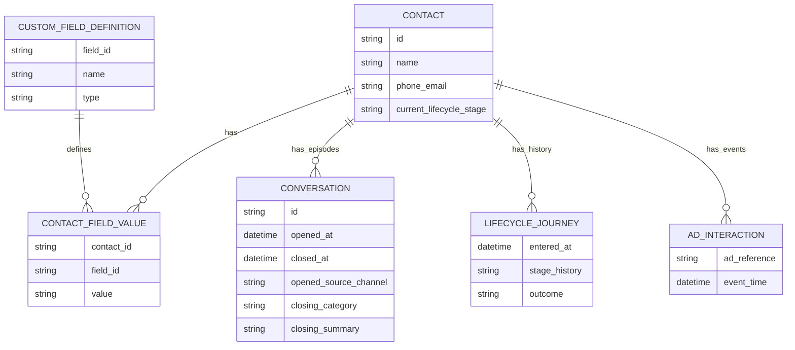

# Contact hay Conversation Session: custom fields và attribution

PLAN-029 · Codex · 2026-10-15 · **Nghiên cứu/khuyến nghị, chưa là contract Ready hoặc yêu cầu triển khai đã duyệt.** Đối chiếu tài liệu công khai của respond.io, Chatwoot, Meta và baseline SRC-068/069/074. Không thử tenant sản phẩm đối thủ, không có khảo sát khách hàng hoặc số liệu về mức độ phổ biến của vấn đề trên thị trường.

Follow-up [Salesforce MessagingSession / Email-to-Case / stage fields](salesforce-session-stage-fields.md): có Session custom fields, nhưng field ownership và stage guidance/validation là các lớp riêng; không suy toàn bộ qualification nên đưa vào Session.

## 1. Kết luận đề xuất

Giữ Contact cho hồ sơ khách; giữ Session cho từng lượt xử lý; lưu nhu cầu/cơ hội có vòng đời riêng trên Lead/Deal. Nên bổ sung khả năng field theo Session có giới hạn khi có use case dùng được trong Inbox và ít nhất một consumer thực tế. Không chuyển toàn bộ thông tin theo lượt vào Contact, cũng không biến Session thành bản sao Lead/Deal.

Attribution quảng cáo là một lớp khác với custom fields. Nguồn quan sát được, touchpoints, thời điểm và liên kết tới kết quả phải là dữ liệu có cấu trúc do hệ thống quản lý; không cho agent sửa nguồn bằng field tùy ý. CRM này đã có phần nền đó. Nếu mục tiêu trước mắt là đo quảng cáo → hội thoại → doanh số, ưu tiên khai thác nguồn/session/context đã có qua producer/report được kiểm quyền, không cần chờ generic Session custom fields.

Việc sản phẩm trình bày màn hình theo Contact không chứng minh rằng backend chỉ giữ trạng thái Contact hiện tại. respond.io có cả conversation records, closing notes, ad events và lifecycle journeys. Chatwoot công bố cả hai loại attributes.

## 2. Nguồn và giới hạn chứng cứ

Các URL dưới đây đã đọc qua HTTP công khai ngày 2026-10-15. Mốc cập nhật là thông tin trang công bố; không suy phiên bản đang bật trong một tenant cụ thể. Trích ngắn chỉ dùng để xác định claim; phần phân tích là diễn giải. Không coi tài liệu marketing là chứng minh hiệu quả kinh doanh đã đo.

| ID | Nguồn chính thức | Điều xác nhận được |
|---|---|---|
| R1 | [respond.io — Contact Fields](https://respond.io/help/workspace-settings/contact-fields), cập nhật17-08-2026 | Custom fields nằm trên Contact; dùng personalization và thay đổi field kích hoạt Workflow. Trích: “Custom Fields are User-created Contact Fields”. |
| R2 | [respond.io — Conversations settings](https://respond.io/help/workspace-settings/conversations), cập nhật07-10-2026 | Có closing category, summary, auto-close và sentiment cho conversation; categories dùng trong Reports. Trích: “A closing note consists of a conversation category and a summary.” |
| R3 | [respond.io — Reports: Conversations](https://respond.io/help/dashboard-reporting/reports-conversations), cập nhật07-10-2026 | Có Conversation ID riêng với Contact ID; timestamps mở/đóng, nguồn mở, first/last assignee, category, new/returning và Paid Ads. Trích: “additional ad-level attribution in reporting”. |
| R4 | [respond.io — Meta Business Accounts](https://respond.io/help/integrations/meta-business-accounts), cập nhật17-08-2026 | Lưu CTC ad events trong activity; ad-triggered routing và gửi Lead/Purchase qua CAPI. FAQ thừa nhận số liệu có thể khác Ads Manager vì tập quan sát/attribution khác. Trích: “can only report the ad attributions received through Meta's API”. |
| R5 | [respond.io — Reports: Lifecycle](https://respond.io/help/dashboard-reporting/reports-lifecycle), cập nhật12-10-2026 | Contact có lịch sử stage và nhiều journey khi tái nhập sau terminal/cleared; lọc/group theo Campaign/Ad Group/Ads. Trích: “we treat that as a new journey”. Trang không đủ xác định quy tắc chọn ad khi nhiều lần chạm trong các journey. |
| C1 | [Chatwoot — Custom Attributes](https://www.chatwoot.com/features/custom-attributes) | Phân biệt dữ liệu Contact lâu dài và dữ liệu Conversation như issue type/order reference/escalation/product/resolution; có filters, automation và API. Trích: “Different conversations with the same contact can have different values.” Không suy lifecycle Conversation của Chatwoot giống hệt Session của CRM này. |
| M1 | [Meta — messaging_referrals](https://developers.facebook.com/documentation/business-messaging/messenger-platform/webhooks/webhook-events/messaging_referrals.md) | Callback khi người đã có thread quay lại qua m.me/ref hoặc Messenger Ad; payload có Page, PSID, timestamp, ad_id và context tùy trường hợp; new-thread referral xem postback. Trích: “the user already has a thread”. `OPEN_THREAD` là loại provider event, không phải lệnh tạo CRM session. |

R2/R3 chứng minh respond.io lưu thông tin ở cấp conversation ngoài Contact; chưa chứng minh có generic arbitrary conversation custom fields. R5 chứng minh có journey history, nên không được mô tả respond.io như hệ chỉ ghi đè một field mà mất hết hành trình. Không tìm được bằng chứng đủ để khẳng định mọi hệ Facebook inbox đều thiếu attribution hoặc đều tính sai. Manychat Help bị challenge truy cập trong phiên này, không dùng làm chứng cứ so sánh tính năng. Browser connector lỗi policy/network; nghiên cứu dùng nội dung public HTTP, không đăng nhập/tương tác tài khoản.

## 3. Đặt dữ liệu ở đâu

| Phạm vi | Ví dụ | Vì sao |
|---|---|---|
| Contact | Ngôn ngữ ưu tiên, hồ sơ liên hệ, phân khúc quan hệ, kênh liên lạc ưu tiên | Có ý nghĩa xuyên các lần tương tác; cập nhật hồ sơ hiện tại có chủ đích |
| Conversation/thread | Page/kênh, identity binding và ngữ cảnh luồng dài hạn | Tránh nhầm một thread Facebook với một lần tư vấn; một người có thể có nhiều namespace Page |
| Session | Mục đích lượt này, nhóm yêu cầu chính, chi nhánh đang tư vấn, mức khẩn cấp, disposition/lý do kết thúc lượt | Có thể khác giữa các lần quay lại; cần giữ lịch sử của từng lượt |
| Session need / Lead | Nhu cầu cụ thể, sản phẩm mong muốn, ngân sách, lịch dự kiến | Một session có thể chứa nhiều nhu cầu. Field đơn trên Session không mô tả đúng đồng thời hai nhu cầu; Lead dành cho nhu cầu cần qualification/follow-up xuyên phiên |
| Deal / đối tượng nghiệp vụ sở hữu kết quả | Giá trị, currency, won/lost, đơn hàng/lịch hẹn và kết quả tương ứng | Có vòng đời và quyền riêng; không gán doanh số bằng cách chọn “thành công” trên Session |
| Touchpoint/source fact | ad_id, Page, thời điểm, provider evidence, nguồn mở phiên và coverage | Một phiên có thể có nhiều ad touches. Fact quan sát được khác mô hình chia credit cho quảng cáo |

Các giá trị như “dịch vụ quan tâm gần nhất” có thể hiển thị trên Contact như bản tóm tắt dẫn xuất, kèm nguồn session/need và thời điểm. Không dùng current Contact value để group báo cáo lịch sử. Không tự copy mọi field sang phiên sau: chỉ prefill các field có quy tắc rõ và người dùng biết đó là giá trị được kế thừa.

Stage, category và sales outcome có ý nghĩa khác nhau. Category/disposition là ứng viên field chuẩn cấu hình được khi có nhu cầu thống nhất báo cáo; trường đặc thù từng tenant mới dùng custom fields. Không thêm một `status`/`won` tùy chỉnh để thay session processing state, milestone evidence hoặc Deal stage.

## 4. Khi nào thiếu dữ liệu theo lượt thực sự gây lỗi

Ví dụ giả lập để phân tích, không phải dữ liệu khách hàng: Contact A mở S1 từ Ad A để hỏi dịch vụ X, tạo Lead L1; sau khi đóng S1, quay lại S2 từ Ad B hỏi dịch vụ Y; S3 tiếp tục L1 và chốt Deal D1 trị giá10triệu VND. Trong S2 có thêm touch Ad C nhưng phiên đang mở vẫn là S2.

Nếu chỉ có một Contact.source_ad và một Contact.interest hiện tại, B/C và Y có thể thay A và X. Join toàn bộ lịch sử với Contact hiện tại sẽ khiến nguồn S1 đổi theo hiện tại. Giữ first_ad mãi mãi cũng không trả lời được nguồn tái kích hoạt ở S2. Lưu cả first/last tốt hơn nhưng vẫn không biểu diễn đầy đủ các lượt và nhiều nhu cầu.

Mô hình có lịch sử cho phép trả lời riêng: acquisition origin của L1/D1 ở S1; S3 là closing context nếu có fact; S2 liên quan Y và B/C. Liên kết S3 không tự ghi đè origin. Tổng won value của D1 vẫn10triệu, không cộng thành30triệu vì ba sessions và không nhân theo số touchpoints.

| Tình huống | Mức cần dữ liệu theo lượt | Hệ quả nếu chỉ có Contact hiện tại |
|---|---|---|
| Inbox đơn giản, chủ yếu khách mới, ít tái mua; chỉ cần trả lời nhanh | Thấp cho custom fields Session | Contact + timeline/category có thể đủ; thêm nhiều trường tăng nhập liệu |
| Khách quay lại sau nhiều chiến dịch, nhiều nhu cầu hoặc nhiều sản phẩm | Cao | Nhu cầu/nguồn bị lẫn; automation dùng nhầm lượt; khó đo tái kích hoạt |
| Đo SLA, chất lượng agent, lý do không tiến triển của mỗi lượt | Cao cho episode boundaries + outcome/history | Thời gian/owner/nhãn hiện tại không tái hiện hiệu suất từng lượt |
| Tư vấn → hẹn → nhiều lần follow-up → bán hàng | Cao cho context/history và business outcome links | Không phân biệt acquisition, hỗ trợ và closing; dễ gán credit sai |
| Đã có event ledger, ticket hoặc order/deal history đầy đủ | Không bắt buộc phải gọi entity là Session | Có thể dựng báo cáo theo lượt từ nguồn khác nếu boundary/join/history rõ |

Vấn đề là mất grain và lịch sử, không phải thiếu tên bảng Session. R2/R3/C1 cho thấy các nhà cung cấp đã có cơ chế để xử lý nhu cầu này; chưa có cơ sở định lượng bao nhiêu doanh nghiệp bị ảnh hưởng, hay mức tăng conversion nếu CRM bổ sung tính năng.

## 5. Attribution chi tiết vẫn có giới hạn

Custom fields không khôi phục quảng cáo không được provider quan sát. M1 xác nhận có referral cho người quay lại thread; không đảm bảo mọi click/view đều có đủ metadata trong integration thực tế. R4 giải thích báo cáo respond.io và Ads Manager có thể khác nhau; đây là khác biệt coverage/cách tính, không phải bằng chứng lỗi do thiếu Session.

Phải tách: nguồn mở session, tất cả touches quan sát được, nguồn primary origin của Lead/Deal, ngữ cảnh tạo/chăm/chốt, và policy phân bổ credit. Mô hình first/last/assisted là quy tắc phân tích cần window/version rõ; không chứng minh nhân quả hoặc incremental lift. Tối ưu ngân sách dựa trên correlation cần validation riêng; không hứa có custom fields sẽ đo ROAS chính xác tuyệt đối.

Unknown/unresolved vẫn là unknown; không tự kế thừa last_ad của Contact để điền nguồn một phiên organic. Phân biệt `observed paid`, `declared source`, và organic/unknown theo bằng chứng và contract. Không gộp người qua Pages bằng PSID trần. Late/duplicate events, referral không kèm message và thiếu ad metadata đều cần coverage policy; session không được mở lại/tách lại chỉ để làm đẹp số liệu.

## 6. Khả năng khai thác và ưu tiên

| Ứng dụng | Dữ liệu cần | Giá trị / điều kiện |
|---|---|---|
| Triage/routing | Session purpose, branch, urgency; Contact language/profile | Chọn đúng queue cho lượt hiện tại; owner changes vẫn qua Chat command |
| Follow-up | Session disposition + Lead/Deal/context còn active | Theo đúng nhu cầu chưa hoàn tất; không follow-up nhầm vì Contact đã mua sản phẩm khác |
| Reporting | Session ID/cohort + field value tại mốc đo + need/milestone + Sales outcome refs | So sánh conversion theo dịch vụ/chi nhánh/lý do; cần connected producer/ACL và lịch sử, không chỉ renderer |
| Marketing | Touchpoint/source history + distinct outcome + spend cùng grain/time/currency | Đo chất lượng các lượt từ campaign; ghi rõ first-origin, assisted hay closing, không cộng trùng |
| Human/AI handoff | Hồ sơ Contact + session summary/fields + nhu cầu đang chọn | AI không mang budget/intent cũ thành ý định hiện tại; extraction là đề xuất có provenance, không tự tạo won/consent |
| QA/CSAT | Session/category/assignee history + survey response đúng lượt | Đánh giá lượt tư vấn cụ thể, không dùng một Contact satisfaction để thay mọi phiên trước |

Khuyến nghị theo hai track, chưa thay thứ tự tracker:

1. **Attribution:** tận dụng ngay nền session/source/touchpoint/context đã có để thiết kế connected reports đúng grain và coverage. Cần gate Reporting/Marketing phù hợp; đây là thiết kế ưu tiên đề xuất, không tuyên bố full connected runtime đã có.
2. **Session metadata:** làm lát cắt hẹp nếu có tác vụ vận hành cụ thể: field trong session đang chọn, nhập/sửa có quyền, xem lại phiên đóng, filter hoặc một report thật. Ví dụ purpose/branch/urgency/close reason; chỉ giữ field có quyết định hoặc hành động sử dụng, tránh form nhập liệu dài.
3. **Generic no-code trên Session:** chỉ sau exact owner adapter/capability/lifecycle contract. Reuse canonical property descriptors/renderer; Chat owns values/lifecycle/history. Shared catalog không đồng nghĩa mọi bảng/giá trị phải ghi ở CRM hoặc bật generic record CRUD. Workflow và Reporting khai báo readiness thật.

Chi phí đáng kể nằm ở metadata/version compatibility, field ACL, closed-session corrections, lịch sử dùng cho report, current-vs-as-of filtering và owner events; không chỉ thêm một JSON column. Với hiện trạng connected Reporting/custom-object Workflow còn gates, bật field editor mà không có consumer sẽ mang lại ít giá trị phân tích.

## 7. Baseline và gate trước implementation

Đã có theo [SRC-068 contract](../contracts/customer-360-session.md): session continuity khi có Ad mới, touchpoint membership, immutable origin và created/follow_up/closing contexts. Đã có theo [SRC-069 contract](../contracts/session-progress.md): pinned process, stage/history, need-scoped milestone evidence/correction và connected behavioral funnel giới hạn. [R1 contract](../contracts/object-platform-r1.md) chỉ cho custom values trên custom/Contact/Company/Activity/Lead. Session chưa có custom-field persistence/API/UI/canonical owner adapter; không bật bằng sửa allowlist đơn thuần. Live Meta và full Marketing/Reporting integration không được suy từ local/mock source.

Nếu chọn triển khai, exact gate cần chốt scope field, loại giá trị/validation, metadata owner và value owner, tenant/record/field rights, audit tối thiểu, CAS/idempotency, event schema và lịch sử/correction. Đề xuất phiên mới mặc định trống với field theo lượt; phiên đóng chỉ correction có lý do/quyền, không sửa nguồn immutable. Report phải pin được ngữ nghĩa/value time; chỉ giữ current JSON hoặc audit không truy vấn được là chưa đủ. Đọc schema catalog/DB guidelines và điền table template trước mọi đề xuất DDL; chưa có bảng/migration nào được thiết kế hay thêm trong nghiên cứu này.

Các scenario ứng viên dưới đây **NOT_RUN**, dùng cho design gate sau:

- Một Contact, hai Sessions có branch/purpose khác nhau; thay Contact hiện tại không đổi kết quả lịch sử.
- Một session hai needs khác nhau không ép thành một product/budget hoặc ghép evidence thành conversion giả.
- Ad B đến khi S1 đang mở chỉ thêm touch, không reset stage/fields hoặc sửa primary origin.
- Một Deal có origin S1, follow-up S2, closing S3: distinct value một lần; assisted counts không được cộng như doanh thu độc lập.
- Phiên đóng sửa nhầm field qua correction có actor/time/reason; report as_of cũ giữ đúng ngữ nghĩa đã chọn.
- Field deny/cross-tenant/stale write/schema deprecation/duplicate event không làm lộ dữ liệu hoặc nhân outcome.
- Hai cohort: unique Contacts và unique Sessions được ghi nhãn/mẫu số riêng; không gọi5session thành5khách.

## 8. Cách kiểm chứng nhu cầu sản phẩm

Phỏng vấn team sales/marketing/support bằng các ca thực tế đã được phép dùng: khách quay lại qua Ad khác, nhiều nhu cầu, một Deal qua nhiều lượt và lý do thất bại theo lượt. Đo tỷ lệ Contacts có nhiều sessions/needs, tần suất agent phải đọc lại timeline, công sức đối soát và completeness của từng field; hiện chưa thu thập những số này. Pilot giới hạn với dữ liệu được phép, so sánh độ đúng attribution theo evidence và thời gian thao tác. Chốt tiêu chí thành công trước pilot; không invent phần trăm ROI hoặc ngưỡng thị trường.

Quyết định nghiên cứu: **nên có lớp field theo Session cho ngữ cảnh từng lượt; Contact vẫn là hồ sơ chính. Ưu tiên kết nối và khai thác dữ liệu attribution sẵn có trước việc mở bộ custom fields rộng.** Đây là khuyến nghị cho người dùng xem xét, không sửa các business contracts đã chốt và không tự claim task source.

## 9. Clarification: ERD logical respond.io và vị trí nhập liệu

Follow-up2026-10-15: người dùng không thấy layout nhập custom fields cho Conversation trong Inbox. Quan sát đó phù hợp tài liệu; recommendation Session fields của CRM này không được diễn giải thành tính năng đã xác nhận của respond.io.

Đọc thêm [Managing Contacts in Inbox](https://respond.io/help/inbox/managing-contacts-in-inbox), cập nhật04-09-2026, xác nhận sidebar và Contacts module đọc/ghi cùng một Contact record; [Assigning and Closing a Conversation](https://respond.io/help/inbox/assigning-and-closing-a-conversation), cập nhật07-10-2026, mô tả dialog Closing Notes với category/summary, hiển thị tùy workspace settings. Đây không phải form arbitrary Conversation custom fields.

Sơ đồ dưới là mô hình khái niệm suy từ hành vi công khai, **không phải database schema nội bộ hoặc API field names đã xác minh**. Field-value/journey/ad-interaction entities là cách biểu diễn logical, không khẳng định tồn tại các bảng vật lý tương ứng. Không vẽ FK từ ad interaction hoặc lifecycle journey tới conversation vì tài liệu đã đọc chưa đủ xác định association/cardinality/attribution rule đó. Không mô tả tenant/security/merge/channel/message model đầy đủ.

| UI/documented surface | Dữ liệu thao tác | Phạm vi |
|---|---|---|
| Inbox → Contact details sidebar | Standard/custom Contact fields | Cùng giá trị với Contacts module; không phải bản sao theo Conversation |
| Settings → Contact Fields | Định nghĩa field/type/visibility/order | Schema Contact |
| Close → Closing Notes dialog, nếu bật | Category + Summary | Nội dung của lượt hội thoại được đóng; category configurable không đồng nghĩa arbitrary schema |
| Reports → Conversations | ID, source, timestamps, assignees, closing details | Quan sát các lượt và performance, không phải form nhập custom fields |
| Lifecycle / Activities / Ads reports | Stage/journey history và ad events/attribution được công bố | Các lớp lịch sử riêng; không suy một Contact chỉ có một trạng thái lịch sử |

Trong ngữ cảnh báo cáo, Conversation của respond.io gần với lượt mở–đóng mà CRM này gọi là Session; không áp tên đó vào long-lived Facebook thread và không giả định chính sách segmentation giống hệt. Kết luận được xác nhận là **custom fields nhập trên Contact; conversation có metadata và closing notes chuyên biệt**. Chưa có bằng chứng cho generic Conversation custom-field editor. Khả năng lịch sử/attribution và khả năng cấu hình field là hai capability riêng.
