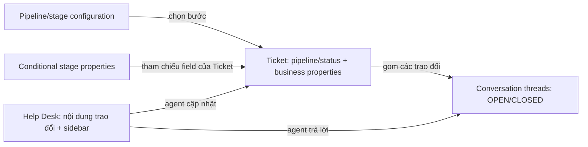

# HubSpot — Conversation, Ticket và stage properties

PLAN-031 · Codex · 2026-10-15 · Research-only. Tiếp nối [Salesforce](salesforce-session-stage-fields.md) và [respond.io](conversation-session-fields-attribution.md). Đọc tài liệu chính thức công khai; chưa kiểm tra authenticated portal, license hoặc API thực tế. Không thay đổi contract Ready hay runtime CRM.

## Kết luận

Follow-up: [ERD và close/reopen/threading/merge flow](hubspot-ticket-conversation-lifecycle.md). “Reply vào closed ticket” không đồng nghĩa mọi lần khách quay lại đều mở ticket cũ; phải xác định thread và kênh trước.

HubSpot đưa tiến trình nghiệp vụ vào workspace xử lý hội thoại qua Ticket. Conversation thread có trạng thái OPEN/CLOSED; Ticket có pipeline/status riêng. Không có bằng chứng trong phạm vi nguồn đã đọc cho một configurable business pipeline trực tiếp trên Conversation Session tương đương acquisition session của CRM mình. Không đồng nhất các đơn vị dữ liệu giữa hai sản phẩm chỉ vì cùng tên conversation.

## Nguồn và phạm vi xác nhận

Tất cả được đọc qua web open/find ngày 2026-10-15; không dùng Community làm căn cứ quyết định tính năng.

| ID | Nguồn chính thức | Nội dung dùng |
|---|---|---|
| H1 | [Conversations API — Update a thread](https://developers.hubspot.com/docs/api-reference/legacy/conversations/conversations/threads/update-conversation) | Thread status OPEN/CLOSED; response có threadAssociations.associatedTicketId. URL thuộc nhóm legacy API reference, không suy rằng toàn sản phẩm đã deprecated. |
| H2 | [Object pipelines](https://knowledge.hubspot.com/object-settings/set-up-and-customize-pipelines) | Ticket statuses là stages; conditional stage properties tham chiếu property có sẵn. |
| H3 | [Create/respond in Help Desk](https://knowledge.hubspot.com/help-desk/create-respond-to-tickets-in-help-desk) | Đổi Ticket status từ sidebar hoặc khi gửi email; yêu cầu properties khi status có điều kiện. |
| H4 | [Manage tickets in Help Desk](https://knowledge.hubspot.com/help-desk/manage-tickets-in-help-desk) | Một Ticket có thể chứa nhiều conversations; phản hồi vào closed ticket mở lại ticket hiện hữu theo mô tả trang. |
| H5 | [Help Desk sidebar](https://knowledge.hubspot.com/help-desk/customize-the-right-sidebar-of-help-desk) | Property/association cards; visibility có điều kiện; tài liệu ghi Service Hub Professional/Enterprise. |
| H6 | [Conversations Inbox](https://knowledge.hubspot.com/inbox/use-the-conversations-inbox) | Inbox và Help Desk khác nhau; account sau 2024-04-01 không có tickets trong Inbox. |

## Mô hình và giao diện

Đây là sơ đồ trách nhiệm khái niệm, không phải physical ERD hoặc schema nội bộ HubSpot. Ticket có thể tồn tại khi chưa có conversation; không đặt quan hệ bắt buộc 1:1.

H2 mô tả pipeline Support mặc định: New, Waiting on contact, Waiting on us, Closed. Admin cấu hình field cần xuất hiện/Required theo stage. Giá trị nằm trên record; rule tham chiếu field, không tạo bản sao giá trị cho từng stage. Tài liệu mô tả thao tác thủ công; chưa kiểm chứng enforcement tương đương qua mọi API/workflow/import. Pipeline rules và conditional property logic không được tự coi là cùng một cơ chế.

H3 xác nhận agent đổi status ngay khi đọc/trả lời. H5 cho phép tổ chức sidebar thành cards/tabs và điều kiện hiển thị. Form bật lên khi chuyển bước khác với card hiện thường trực: thiết kế hai lớp này độc lập. Không suy visibility thành quyền truy cập hoặc validation. H3 còn ghi end-chat/keep-ticket-open là beta trong khi H4 mô tả không gắn nhãn beta; chưa kết luận rollout cho mọi portal.

H4 cho thấy hồ sơ nghiệp vụ có thể kéo dài qua nhiều cuộc trao đổi. Do đó không dùng số lần Ticket đổi status hoặc reopen thay cho số acquisition sessions. H6 giúp tránh lấy ảnh Inbox legacy để kết luận Help Desk thiếu stage/field UI. Lead/Deal có pipeline riêng trong H2; không suy Ticket status là sales qualification/won.

## Áp dụng cho Agentic CRM — đề xuất, chưa phê duyệt thiết kế

Pattern đáng tham khảo là một workspace cho nhiều đối tượng sở hữu dữ liệu. Người dùng không phải rời chat để nhập thông tin, nhưng cần biết đang sửa Session, Lead, Deal hay Ticket nào.

Ví dụ tự đặt: đang trao đổi ở Session S3, agent cập nhật nhu cầu trên Lead L1; qua bước gửi đề xuất thì nhập gói dịch vụ trên Deal D1. Đóng S3 không làm mất L1/D1 hoặc tự kết luận won. Một lần trao đổi có nhiều nhu cầu phải chọn record đích rõ ràng.

Giữ [Session progress](../contracts/session-progress.md) hiện tại cho tiến độ lượt tư vấn và evidence trong phiên. Theo dõi nhu cầu dài hạn trên Lead, cơ hội trên Deal, hỗ trợ trên Ticket khi module được triển khai. Stage-dependent form chỉ ghi vào object sở hữu field; không sao chép các field nghiệp vụ vào Session để phục vụ một layout. Context/attribution theo phiên vẫn có giá trị riêng và cần bảo toàn lịch sử.

Các kiểm chứng nếu chọn thiết kế sau này, hiện NOT_RUN: hai phiên cùng một Lead không reset nhu cầu; chọn đúng record khi có nhiều nhu cầu; đóng Session không đóng Deal; đổi stage hiện đúng field/ACL; kiểm tra required ở UI/API/automation; báo cáo không nhân đôi outcome theo số hội thoại. HubSpot reference không thay thế exact ownership/API/event/validation design của mình.
