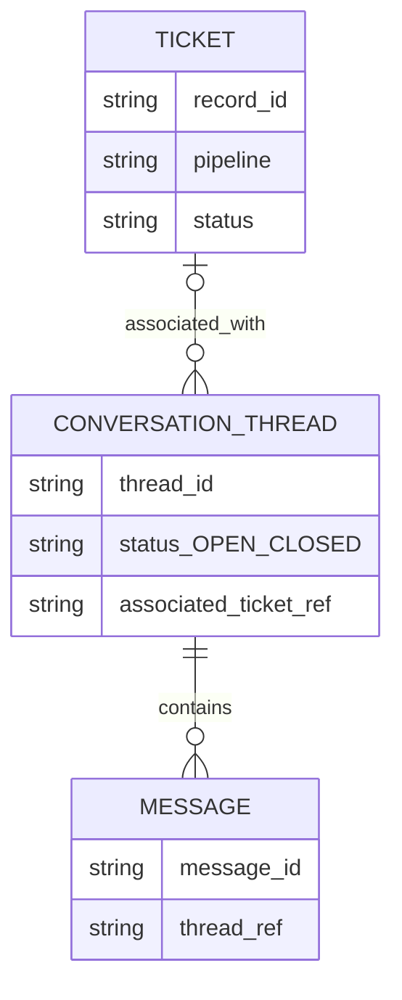
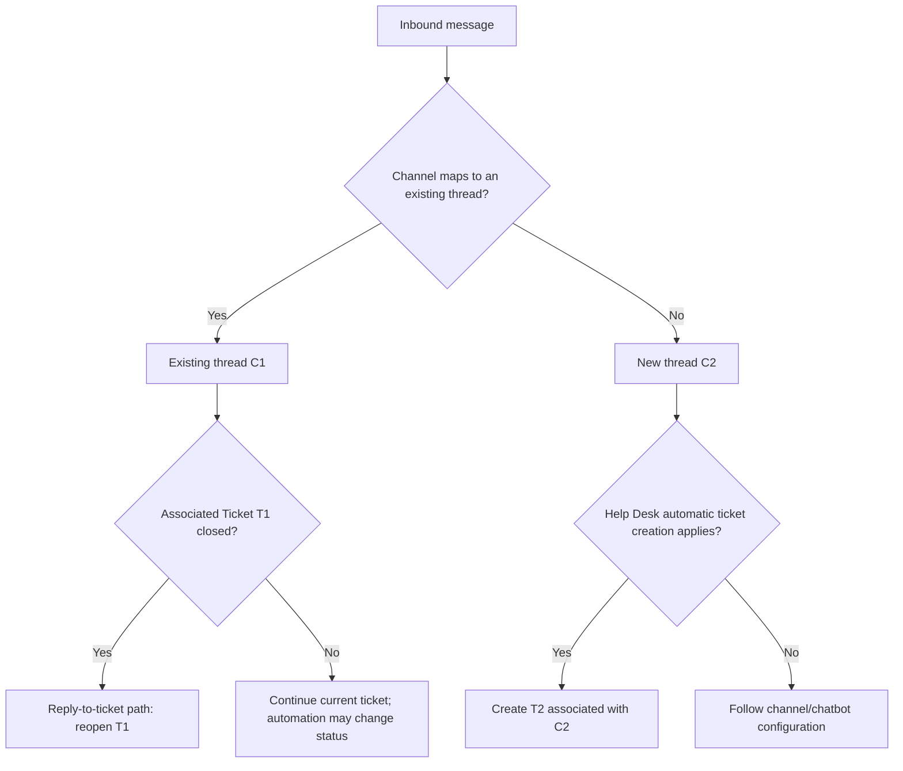
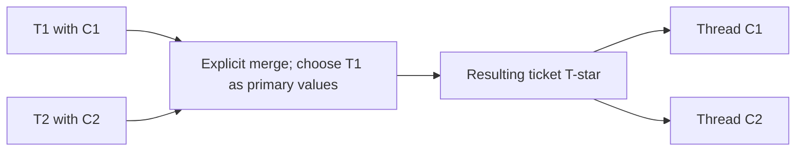

# HubSpot — Ticket/Conversation close, reopen, threading and merge

PLAN-031 follow-up · Codex · 2026-10-15 · Research only. [Stage research](hubspot-conversation-stage-fields.md). Public documentation, no authenticated portal test. This corrects any interpretation of the earlier answer as “every returning customer always reopens their old ticket.” Conversation thread is not established as equivalent to our acquisition Session.

## Evidence by surface

| Official source | Bounded finding |
|---|---|
| [Legacy Inbox tickets](https://knowledge.hubspot.com/records/manage-the-tickets-in-your-inbox) | Close Ticket closes associated conversations. More → Close conversation leaves Ticket open. Reopen Ticket reopens its sole conversation; with multiple conversations, none are reopened. These rules are explicitly legacy Inbox documentation. |
| [Create/respond in Help Desk](https://knowledge.hubspot.com/help-desk/create-respond-to-tickets-in-help-desk) | End chat can retain an open Ticket; ended chat cannot reopen. This page labels the feature beta. Rule-based chatbot intake is an exception to automatic ticket creation. |
| [Manage Help Desk tickets](https://knowledge.hubspot.com/help-desk/manage-tickets-in-help-desk) | Reply to closed Ticket reopens it at the first Open status. Merge consolidates threads; split supports email/form messages. This page omits the end-chat beta label. |
| [Email threading](https://knowledge.hubspot.com/inbox/compose-and-reply-to-emails-in-the-conversations-inbox) | Headers and subject determine thread matching; a different subject can produce another conversation. Same contact is insufficient. |
| [Channel migration](https://knowledge.hubspot.com/help-desk/move-an-inbox-and-historical-conversations-to-help-desk) | New conversations arriving through migrated Help Desk channels automatically receive associated tickets. This is not a universal bot/channel override. |
| [Merge records](https://knowledge.hubspot.com/records/merge-records) | Combines associations/history, generally prefers primary values; cannot unmerge. Default resulting Record ID is new; primary-ID preservation is beta. |
| [Connect Help Desk channels](https://knowledge.hubspot.com/help-desk/connect-channels-to-help-desk) | Facebook Messenger is supported. No exact post-close Facebook thread segmentation threshold established by this page. |

Do not copy legacy single/multiple-conversation reopen rules into Help Desk as universally verified behavior. Fresh Help Desk close-Ticket cascade across multiple conversations, and exact Facebook return-message segmentation, remain NOT_VERIFIED. End chat is distinct from merely changing a thread status via API.

## Logical ERD

Logical subset only, not internal SQL/schema/API field names. Optional Ticket covers Inbox threads without tickets; manual Ticket can have zero threads. One active Ticket association per thread is documented in legacy Inbox and is represented by the singular associatedTicketId in the [thread API](https://developers.hubspot.com/docs/api-reference/legacy/conversations/conversations/threads/update-conversation). No vendor SESSION table invented; no implied immutable message membership after split operations.

## Inbound decision flow

This combines documented behaviors into an explanatory flow, not HubSpot's internal routing algorithm. Match is channel-specific: email offers explicit header rules; ended live chat cannot reopen. No assertion that every Facebook message after close takes either branch.

## Two-ticket scenario: status changes versus association changes

Assume T1—C1 and T2—C2. Merely reopen T1 and close T2: the associations remain unchanged in this model. This is an inference from separate status and association operations; no documented automatic reparenting was found. A later reply mapped to C2 can therefore reopen T2. Do not route by “the only open ticket for this contact.”

T-star avoids claiming that the original T1 ID always survives. Verify resulting status/ID and thread list, then continue processing. Merge is not close-T2, nor evidence that two transcripts become one thread. No general drag/reparent-to-existing-ticket UI capability has been verified. Moving a conversation between Inbox and Help Desk is a different operation.

## CRM design implication — proposal only

Keep message/session attribution stable when changing the business record being handled. Status changes should not silently transfer context. A future Ticket link/merge command needs explicit source/target, authorization, audit, outcome de-duplication and late-message resolution. These are recommendations, not new Ready requirements; current [session contract](../contracts/customer-360-session.md) remains authoritative.

Candidate portal checks NOT_RUN: close one/many linked threads; manual Ticket reopen; reply email versus fresh subject; live-chat End chat versus ordinary close; Messenger return before/after delay; close T2/reopen T1 without merge; explicit merge then reply to each original thread. Mermaid rendering NOT_RUN.
