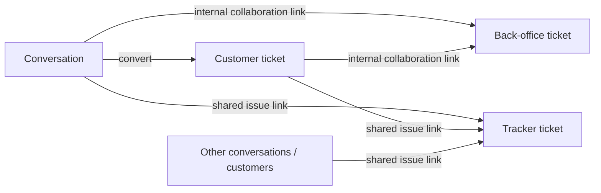
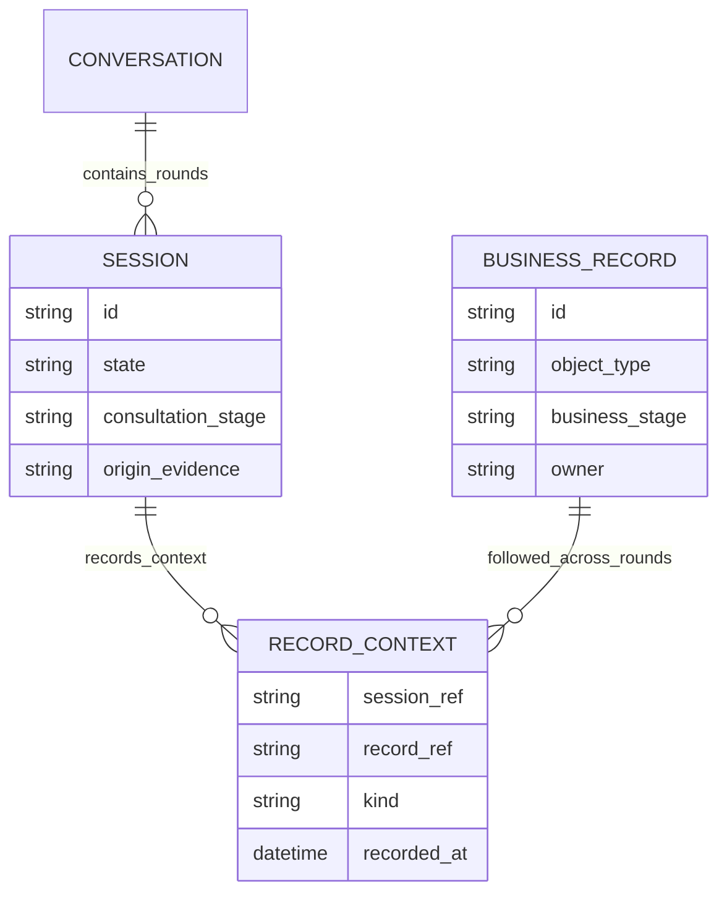

# Intercom và quản lý nhiều lượt trao đổi

PLAN-032 · Codex · 2026-10-15 · Research/recommendation only. [HubSpot lifecycle](hubspot-ticket-conversation-lifecycle.md), [Salesforce](salesforce-session-stage-fields.md), [respond.io](conversation-session-fields-attribution.md). Chưa sửa Ready contract, schema hoặc runtime. Public official docs; không authenticated Intercom workspace/license/channel test.

## 1. Bằng chứng chính thức

Đọc trực tiếp qua web open ngày 2026-10-15. Không dùng Community/Reddit làm evidence về capability; các giới hạn cũ trong kết quả tìm kiếm không thắng tài liệu official hiện tại.

| ID | Nguồn | Verified scope |
|---|---|---|
| I1 | [Tickets explained](https://www.intercom.com/help/en/articles/6436600-tickets-explained) | Conversations handle simple exchanges; Customer tickets track longer queries, Back-office tickets support internal collaboration, Trackers aggregate shared issues. |
| I2 | [Create Customer ticket](https://www.intercom.com/help/en/articles/7112463-how-to-create-a-customer-ticket) | Convert conversation or create standalone ticket; conversion appears in both conversation and ticket reporting. No inferred physical inheritance table or generic 1:N session relation. |
| I3 | [Manage Customer tickets](https://www.intercom.com/help/en/articles/8300304-how-to-manage-customer-tickets) | Customer replies/internal notes, state control and ticket custom attributes in sidebar; links to Back-office/Tracker. |
| I4 | [Ticket types](https://www.intercom.com/help/en/articles/7112127-how-to-set-up-ticket-types) | Type defines captured fields/category; customer visibility differs by category. Do not infer arbitrary stage-required validation from type configuration. |
| I5 | [Tickets FAQs](https://www.intercom.com/help/en/articles/8379479-tickets-faqs) | Accepted customer reply to Waiting on customer/Resolved ticket shifts to In progress; first configured state in that group. Multiple Tracker links are currently allowed. |
| I6 | [Reply prevention](https://www.intercom.com/help/en/articles/3449698-prevent-replies-after-you-close-a-conversation) | Conversation and Ticket have independent reply windows. Timer uses last customer-visible activity, not close time. Web/mobile blocks replies; email settings are separate. Channel-specific behavior must be retained. |
| I7 | [Facebook channel](https://www.intercom.com/help/en/articles/326-connect-your-facebook-channel) | A reply after over five days closed creates a new Intercom conversation; old history remains accessible, agent replies through latest conversation. Page uses both “5+” and “more than 5”; exact equality untested. This is distinct from Meta send windows. |
| I8 | [Snooze](https://www.intercom.com/help/en/articles/6564538-snooze-a-conversation) | Temporary hold, resumes on timer/reply and other documented events; not equivalent to completed issue. |
| I9 | [Back-office management](https://www.intercom.com/help/en/articles/8300305-how-to-manage-back-office-tickets-in-the-inbox) | State changes post linked events and by default reopen/unsnooze customer conversations; workspace setting can suppress state-driven unsnoozing. Do not infer universally independent lifecycle or unconditional cascade-close. |
| I10 | [Tracker management](https://www.intercom.com/help/en/articles/8300306-how-to-manage-tracker-tickets) | State change prompts propagation to linked Customer tickets; linked events/notes and customer-report review are explicit operations. |
| I11 | [Merge conversations/tickets](https://www.intercom.com/help/en/articles/8862676-merging-conversations-and-tickets) | Secondary closes/read-only, keeps ID/history/reporting and summary link; transcripts are not concatenated. New replies use primary. Facebook/Instagram/WhatsApp require same user and channel. Back-office/Tracker merge unsupported. |

I5's broad deletion/unlink wording is not applied to every ticket category or Tracker API. I11 discourages assuming routine reversible merge; some repairs require support. Neither behavior is needed for the recommended normal continuation path.

## 2. Intercom logical responsibility map

Đây là capability map, không physical ERD. Convert, link và merge là ba thao tác khác nhau. Customer ticket không được suy thành một parent tự gom mọi lần khách quay lại; Tracker cũng không phải mặc định hồ sơ bán hàng của một Contact. Cấu hình tiếp nhận quyết định conversation; phân loại nghiệp vụ quyết định hồ sơ cần xử lý.

## 3. Chọn giải pháp cho CRM mình

| Phương án | Phù hợp khi | Hạn chế với nhiều lượt tư vấn |
|---|---|---|
| Một conversation mở lại liên tục | Yêu cầu ngắn, ưu tiên ít thao tác | Ranh giới lượt và attribution khó đọc nếu thiếu episode/history riêng |
| Mỗi lượt tạo Ticket rồi merge | Xử lý record trùng phát sinh ngoài dự kiến | Merge thành việc thường xuyên; khó giữ rõ KPI lượt, hồ sơ, SLA và quyền trả lời |
| Nhiều Session liên kết hồ sơ bền vững | Một nhu cầu đi qua nhiều ngày/kênh, cần attribution từng lượt | Cần lựa chọn hồ sơ rõ và lịch sử liên kết; phù hợp nhất baseline CRM |
| Tracker gom vấn đề chung | Sự cố tác động nhiều khách hoặc nhiều yêu cầu | Là lớp tổng hợp bổ sung, không thay Lead/Deal/Ticket của từng khách |

Khuyến nghị phương án thứ ba. Học Intercom cách đặt hồ sơ dài hạn và liên kết công việc ngay Inbox; giữ Session riêng đã có trong CRM. Không cần thêm object Case tổng quát chỉ để gom các lượt khi Lead/Deal đã sở hữu nhu cầu/cơ hội. Ticket hỗ trợ vẫn là module chưa triển khai, không nâng status từ nghiên cứu này.

## 4. Mô hình áp dụng

BUSINESS_RECORD là ký hiệu trình bày cho Lead/Deal hoặc Ticket tương lai, không phải bảng mới dùng chung ownership. RECORD_CONTEXT cho Lead/Deal đã có physical `sales_session_context` với created/follow_up/closing; Ticket mapping chưa Ready. Quan hệ xuyên service là logical refs qua authorized ports, không thêm cross-service SQL/FK.

Một hồ sơ có nhiều lượt chăm; một lượt có thể chăm nhiều hồ sơ. `session_need` trong Session progress là subject hành vi cục bộ, không phải Lead dài hạn và không được tự gộp xuyên phiên. [Current Customer360](../contracts/customer-360-session.md), [Session progress](../contracts/session-progress.md), [approved ERD](../data/chat-sales-erd.md) vẫn là nguồn chuẩn.

## 5. Luồng đề xuất và phần đã có

1. Còn Session active: tiếp tục phiên; ad referral mới chỉ bổ sung touchpoint. Chờ khách hoặc hẹn trả lời là pending/snooze, không mặc nhiên kết thúc phiên. Đây là baseline, chưa thêm timeout.
2. Agent thực sự kết thúc lượt: đóng S1, giữ Lead/Deal tiếp tục theo lifecycle nghiệp vụ riêng. Closing Session không đồng nghĩa resolved/won.
3. Inbound hợp lệ tiếp theo tạo S2 trên thread hiện hữu. Customer360 cho chọn hồ sơ cùng Contact và Continue tạo follow_up fact. Không tự chọn mọi hồ sơ của Contact hoặc tạo Lead/Ticket mới chỉ vì có S2.
4. UI nên đưa ba lựa chọn cạnh hồ sơ: tiếp tục nhu cầu cũ, tạo nhu cầu khác, chỉ trao đổi. Nếu nhiều nhu cầu thì agent chọn record đích cho từng thao tác; đây là đề xuất UX tiếp theo, chưa claim runtime đã có đủ cả ba nhánh.
5. Hồ sơ đã kết thúc: ghi nhận lần liên hệ mới và đánh giá nội dung. Không tự đổi Deal won/lost vì một tin cảm ơn hoặc câu hỏi hỗ trợ. Ticket reopen/new request cần policy riêng ở exact Ticket design; chưa cài tự reopen.
6. Trùng hồ sơ: explicit consolidation có preview/history; không merge các Session thật chỉ để tiếp tục cùng một nhu cầu. Liên kết sai cần correction có audit trong gate tương lai, không xóa evidence lịch sử.

Ví dụ: S1 từ Ad A tạo L1; S2 từ Ad B tiếp tục L1 và tạo D1; S3 khách hỏi việc khác tạo L2, đồng thời chốt D1 nếu có command/evidence. Kết quả: 3 lượt, 2 nhu cầu, 1 Deal won; D1 origin giữ S1, created context S2, closing context S3. Referral Ad B lúc S1 còn active thì vẫn S1, không sinh S2.

## 6. Thuộc tính, stage và báo cáo

Contact giữ hồ sơ danh tính. Session giữ ngữ cảnh lượt, nguồn/touchpoint và tiến độ tư vấn. Lead giữ qualification/nhu cầu; Deal giữ gói/giá trị/giai đoạn thương mại; Ticket tương lai giữ vấn đề/kết quả hỗ trợ. Form theo stage tham chiếu field đúng object thay vì nhân bản dữ liệu mỗi lần mở Session.

Inbox đề xuất hiển thị “Lượt trao đổi hiện tại” và “Hồ sơ đang xử lý” riêng, cùng timeline các lần liên hệ trên hồ sơ. Session owner và business owner không tự ghi đè nhau; follow-up date ở hồ sơ nếu hẹn chăm dài hạn, snooze ở queue nếu đang tạm chờ. History nhìn từ hồ sơ phải nối qua các session context có quyền đọc, không lấy tất cả message của Contact.

Báo cáo ba grain: lượt trao đổi/response; hồ sơ/business cycle; outcome/Deal. Các context chỉ chứng minh vai trò của phiên, chưa tự tạo attribution weights. Không cộng won value theo số lần follow_up; không suy conversion từ current stage hoặc field đã điền.

## 7. Phạm vi tiếp theo

Giữ đúng thứ tự source hiện tại PLAN-028E. Nếu ưu tiên multi-round UX, cần exact gate cho selected-record timeline, default suggestions, correction/reassociation, closed-record continuation và field bindings. Không triển khai thêm Tracker/back-office/timeout hoặc generic Session fields từ nghiên cứu này.

Candidate acceptance NOT_RUN: S1→S2 cùng L1 không reset source; hai nhu cầu trong S2 không tự chia sẻ field/evidence; S2 close không đóng L1/D1; tin sau Deal won không reopen Deal; duplicate consolidation giữ lịch sử; cross-channel context kiểm identity/ACL; link correction giữ as-of; báo cáo 3Session/1Deal không nhân doanh thu. Vendor portal/API/UI/live Meta, source/runtime tests và Mermaid rendering NOT_RUN.
