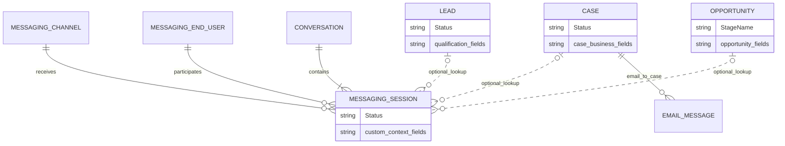

# Salesforce — MessagingSession, Email-to-Case và field theo stage

PLAN-030 · Codex · 2026-10-15. Research-only theo yêu cầu tiếp tục PLAN-029. Nguồn Salesforce Help/Developers/Trailhead; không thao tác Salesforce org, không xác nhận entitlement/license/UI cụ thể của khách hàng. Các sơ đồ là logical subset; phần đề xuất CRM không phải contract Ready. [Nghiên cứu respond.io](conversation-session-fields-attribution.md) · [Object Platform research](salesforce-object-platform.md).

## 1. Kết luận

Salesforce có Enhanced Facebook Messenger và standard object MessagingSession có thể mở rộng custom fields. Họ phân biệt Conversation dài hạn, MessagingSession của lượt xử lý, và Case/Lead/Opportunity mang tiến trình nghiệp vụ. Không cần dùng email như sự thay thế vì giả định Salesforce thiếu Facebook; Email-to-Case là một đối chiếu bổ sung hữu ích.

Field thuộc object/record. Stage là giá trị của một picklist trên record. Path tham chiếu field của object để hướng dẫn ở từng bước; Dynamic Forms quyết định bố cục/visibility; Validation Rules kiểm tra dữ liệu lúc save; Flow thực hiện automation. Không phải mỗi stage có một bộ giá trị field độc lập. Báo cáo lịch sử cần history/evidence riêng, không thể suy từ cấu hình Path.

## 2. Bằng chứng chính thức

Đã truy cập/nghiên cứu ngày2026-10-15. “Direct” nghĩa đọc nội dung trang; “indexed” nghĩa extract từ kết quả tìm kiếm official vì một số Salesforce Help/atlas pages chỉ trả CSS Error hoặc shell. Không dùng các câu trả lời Community/IdeaExchange làm bằng chứng quyết định tính năng.

| ID | Nguồn | Cách đọc / nội dung xác nhận |
|---|---|---|
| S1 | [Set Up Facebook Messenger Channels](https://help.salesforce.com/s/articleView?id=service.messaging_facebook_parent.htm&language=en_US&type=5) | Indexed: kết nối Facebook Page; nhiều enhanced channels có thể nối các Pages khác nhau. Không khẳng định mọi standard legacy channel còn được bán/hỗ trợ. |
| S2 | [Messaging Object Model](https://developer.salesforce.com/docs/service/messaging-object-model/guide/messaging-object-model.html) | Direct: Conversation chứa một hoặc nhiều messaging sessions; MessagingEndUser theo channel; MessagingSession là object vận hành chính. ConversationEntry là message/event và có cơ chế lưu/access khác. |
| S3 | [Lifecycle of a Messaging Session](https://help.salesforce.com/s/articleView?id=service.messaging_life_cycle.htm&language=en_US&type=5) | Indexed full article: New/Waiting/Active/Consent/Inactive/Error/Ended; transitions phụ thuộc channel/capacity/initiation; requirement/trigger cấu hình sai có thể làm lỗi session. |
| S4 | [Create Custom Fields on the Messaging Session Object](https://help.salesforce.com/s/articleView?id=service.support_create_custom_fields_on_the_messaging_session_object.htm&language=en_US&type=5) | Direct: Object Manager → Messaging Session → Fields & Relationships; tạo field, FLS, page layout. Ví dụ thuộc Experience Cloud/Enhanced Chat context passing, không phải bằng chứng native Facebook pre-chat form. |
| S5 | [Create Customer Flows for Enhanced Chat](https://help.salesforce.com/s/articleView?id=sf.miaw_custom_field_example.htm&language=en_US&type=5) | Indexed: map pre-chat variables vào custom MessagingSession fields qua Update Records trước Route Work. Recipe không áp dụng Facebook Messenger. |
| S6 | [Accept a Message and Chat with a Customer](https://help.salesforce.com/s/articleView?id=service.livemessage_agent_accept_message.htm&language=en_US&type=5) | Direct: mở session từ Omni-Channel; Details lookup để liên kết Case, Lead, Opportunity; applicability gồm Enhanced Facebook. |
| S7 | [Guide Users with Path](https://help.salesforce.com/s/articleView?id=sales.path_overview.htm&language=en_US) | Indexed full article: Path theo object + picklist + record type. Supported list có Cases/Leads/Opportunities/custom objects; không liệt kê MessagingSession. Không claim Path chuẩn áp được trực tiếp trên session. |
| S8 | [Optimize Sales Processes with Path](https://trailhead.salesforce.com/content/learn/modules/sales_admin_optimize_salesforce_for_selling/sales_admin_optimize_for_selling_unit_1) | Direct: chọn key fields và guidance cho từng bước; ví dụ hai Lead record types có paths khác nhau. |
| S9 | [Metadata API — PathAssistant](https://resources.docs.salesforce.com/latest/latest/en-us/sfdc/pdf/api_meta.pdf) | Indexed section PathAssistant/PathAssistantStep: entityName, fieldName, recordTypeName; step có picklistValueName, fieldNames, info. Đây là metadata config, không phải business field-value entity. PDF không render trong nghiên cứu này. |
| S10 | [Dynamic Forms](https://trailhead.salesforce.com/content/learn/modules/lightning_app_builder/get-started-with-dynamic-forms-lab) | Indexed: đặt field/section riêng và visibility rules; không tự cung cấp quyền truy cập dữ liệu. |
| S11 | [Required and Read-Only Fields in Dynamic Forms](https://help.salesforce.com/s/articleView?id=dynamic_forms_req_fields.htm&language=en_US&type=5) | Direct: universally required khác page-level required; field required trên page mà bị ẩn có thể không chặn save. |
| S12 | [Create Validation Rules](https://trailhead.salesforce.com/content/learn/projects/customize-a-salesforce-object/create-validation-rules-1) | Direct: ví dụ Opportunity Closed Lost yêu cầu Close Reason bằng validation formula. |
| S13 | [Create Support Processes](https://trailhead.salesforce.com/content/learn/projects/create-a-process-for-managing-support-cases/create-support-processes) và [Record Types](https://trailhead.salesforce.com/content/learn/projects/create-a-process-for-managing-support-cases/support-cases-record-types) | Indexed/direct: Support Process và Record Type cấu hình Case Status/picklists/layout theo loại yêu cầu, không phải tạo object mới cho từng stage. |
| S14 | [Email-to-Case Threading](https://help.salesforce.com/s/articleView?id=sf.support_email_to_case_threading.htm&language=en_US&type=5) | Direct: email vào/ra có EmailMessage; token/header matching liên kết vào Case; không match thì tạo Case mới. |
| S15 | [Email-to-Case Considerations](https://help.salesforce.com/s/articleView?id=sf.faq_cases_email.htm&language=en_US&type=5) | Direct: tạo Case trước EmailMessage khi chưa match; EmailMessage.Status phản ánh thao tác email; validation/custom code errors không thuộc nhóm retry như lỗi nền tảng. |
| S16 | [Create a Flow to Reopen Closed Cases](https://help.salesforce.com/s/articleView?id=000395281&language=nl_NL&type=1) | Indexed English article body: recipe Flow trên EmailMessage mở lại closed Case khi có email inbound. Đây là customization, không mặc định tất cả org tự reopen/new-case giống nhau. |
| S17 | [Persist Pre-Chat Inputs Across Messaging Sessions](https://help.salesforce.com/s/articleView?id=sf.miaw_handle_sessions.htm&language=en_US&type=5) | Indexed: recipe Web/In-App dùng ConversationId chung để lấy input phiên trước; không mặc định dữ liệu pre-chat kế thừa qua session, không áp recipe cho Facebook. |

## 3. Mô hình Messaging và chỗ nhập field

Sơ đồ rút gọn quan hệ có trong mô tả sản phẩm, không phải toàn bộ Salesforce ERD hoặc mapping SQL/FK. custom_context_fields/case_business_fields là ký hiệu nhóm thuộc tính, không phải API column/JSON blob thật. EmailMessage relation chỉ mô tả Email-to-Case, không nói mọi EmailMessage phải có Case. Không tự thêm các identity merge hay Contact/Account relations chưa cần cho câu hỏi. Một Session có lookup nghiệp vụ không đồng nghĩa đã có attribution origin/assisted/closing như model CRM của mình.

Agent nhận chat trong Service Console và xem Details của MessagingSession; admin có thể đưa field lên record page/layout theo FLS. Đây là UI record-based, khác mô hình sidebar chỉ sửa Contact của respond.io. S4 xác nhận khả năng field mở rộng; S5 là ví dụ điền tự động qua pre-chat/Flow. Khả năng tạo custom field không đồng nghĩa mọi field editable với mọi profile hoặc mọi channel có cùng form thu thập ở phía khách.

MessagingSession.Status phục vụ routing/capacity/vòng đời giao tiếp. Không diễn giải Active thành qualified, Inactive thành lost, hoặc Ended thành resolved/won. Một Case vẫn có thể cần xử lý khi phiên chat đã kết thúc. Các bước tư vấn tùy chỉnh trên Session là một cấu hình nghiệp vụ bổ sung; S7 không cho cơ sở khẳng định Salesforce có Path chuẩn ngay trên MessagingSession.

## 4. Họ gắn thuộc tính vào stage như thế nào?

| Lớp | Cấu hình/data | Vai trò |
|---|---|---|
| Object field definition | Tên/API key/type của field trên Case/Lead/Opportunity/đối tượng hỗ trợ | Định nghĩa nơi lưu giá trị |
| Record data | StageName/Status và các giá trị nghiệp vụ của record | Giá trị hiện tại, không tạo bản sao mỗi khi qua stage |
| Record Type + business process | Loại quy trình, các giá trị status/stage áp dụng, layout/picklists | Hai loại yêu cầu có thể có quy trình khác nhau trên cùng object |
| Path + step | Picklist value + field references + guidance | Highlight thông tin cần chú ý/điền ở bước đó |
| Page layout / Dynamic Forms | Field sections, visibility, page-required behavior | Tổ chức nơi nhập; không thay data authority/FLS |
| Validation Rules | Điều kiện trên record khi save | Chặn trạng thái thiếu dữ liệu theo nghiệp vụ |
| Flow | Trigger/action theo thay đổi record | Routing, update/create/link/hành động tiếp theo theo cấu hình |

Ví dụ tự đặt để giải thích, không phải template Salesforce: Opportunity có Budget, ProposedPackage, LossReason. Ở bước tìm hiểu, Path hiển thị Budget; ở bước đề xuất, hiển thị Budget và ProposedPackage; ở Closed Lost, kiểm LossReason. Budget vẫn là cùng một field trên cùng Opportunity. Chuyển stage không tạo Budget_Step1 và Budget_Step2, cũng không tự xóa giá trị khi field bị ẩn. Nếu muốn biết budget ở từng lần thương lượng cần history/snapshot/child records được thiết kế riêng.

S9 xác nhận mapping bằng fieldNames tham chiếu entityName ở step của picklist. S12 chứng minh yêu cầu dữ liệu khi Closed Lost nằm trong validation rule. Không nên hiểu cách Trailhead nói “key fields cần hoàn thành” là Path tự tạo toàn bộ server-side validation. Đặc biệt page-level required khác universally-required và khác conditional validation; chỉ highlight hoặc ẩn/hiện không đủ để bảo đảm API/automation phải đi theo cùng business rule.

Ví dụ rule logical để học cách thiết kế: `stage = ClosedLost AND loss_reason is empty -> reject save`. Đây là mô tả nghiệp vụ, không phải code migration/API mới của CRM. Rule áp cho trạng thái hiện tại sẽ khác rule chỉ kiểm khi transition; cần chốt hành vi edit record cũ, import, automation và rollback stage. Path không tự cung cấp bộ rules đó.

## 5. Email-to-Case: nội dung trao đổi đi theo một hồ sơ yêu cầu

Luồng cơ bản là email inbound → kiểm threading → Case hiện có hoặc Case mới → EmailMessage. Agent trả lời trong Case feed; Case giữ status/fields nghiệp vụ, EmailMessage giữ nội dung và metadata thư. EmailMessage.Status như sent/replied/forwarded không phải tiến trình xử lý yêu cầu.

Ví dụ giả lập: email thứ nhất báo lỗi thiết bị; agent hỏi thông tin bằng email thứ hai; khách phản hồi hôm sau; bộ phận kỹ thuật tiếp tục ngày kế tiếp. Các email match thread cùng Case nên serial number, issue type, resolution và Case Status tiếp tục trên cùng hồ sơ. Không cần tạo một Case hay bộ field mới cho mỗi ngày/đợt trao đổi.

Nếu trả lời một email của Case đã đóng, matching thread và chính sách reopen là hai việc khác nhau. S16 hướng dẫn cấu hình Flow reopen; không suy status đóng tự buộc tạo hồ sơ mới. Nếu không match threading thì tạo Case mới theo S14. Không lấy Contact.email làm đủ điều kiện nhập mọi email của khách vào cùng Case.

Đối với CRM của mình, Case tương ứng yêu cầu/ticket có vòng đời nghiệp vụ; Session là lượt tương tác. Đây là tham chiếu tổ chức dữ liệu, không yêu cầu triển khai Ticket đang Draft hay triển khai email ngay trong task này.

## 6. Áp dụng vào Agentic CRM

Nghiên cứu củng cố việc Session có khả năng sở hữu custom fields; đồng thời giảm lý do đưa mọi qualification field vào Session. Chọn owner theo vòng đời dữ liệu:

- Contact: hồ sơ ổn định và ưu tiên giao tiếp.
- Session: context lượt hiện tại, intake reason, branch xử lý, wrap-up/disposition nếu exact contract chọn.
- Need/Lead: nhu cầu/sản phẩm/ngân sách cần theo xuyên nhiều lượt, có thể nhiều nhu cầu trong một lượt.
- Deal: cơ hội, amount/currency, sales stage/outcome. Ticket/Case chỉ khi gate riêng Ready.

UI có thể hiển thị một panel thống nhất nhưng phải ghi đúng object sở hữu field. Agent đang ở session S2 vẫn có thể sửa ngân sách Lead L1 qua Sales command có quyền; không cần sao chép L1.budget vào S2 chỉ để hiện trên panel. Khi có nhiều Leads/Deals, phải chọn record rõ, không tự dùng “latest” hoặc cập nhật tất cả records của Contact.

Đề xuất concept stage configuration cho CRM: process version → stage → field references + display order + guidance; transition rules riêng; field values vẫn trên owning record. Đây là cấu hình đề xuất, không khẳng định schema Salesforce có bảng StageFieldRule hoặc đã được thêm vào dự án. Cần phân biệt binding tới field trên root Session với field của Lead/Deal liên quan: cross-object rendering không tự cho phép cross-service SQL/UoW hoặc shared validation writer.

Session đang có process version/stage/milestone evidence theo [contract](../contracts/session-progress.md). Có thể mở rộng exact gate để bind fields theo stage, nhưng không thay stage bằng sales outcome và không coi “đã nhập field” là milestone evidence. [Customer360 contract](../contracts/customer-360-session.md) tiếp tục giữ origin khác context tạo/chăm/chốt. [Object Platform R1](../contracts/object-platform-r1.md) chưa hỗ trợ Session extension adapter; không chỉ sửa allowlist để mở field persistence.

### Bài học triển khai quan trọng

S3 và S15 nêu lỗi do field requirements/validation ở ingress. Vì vậy không yêu cầu khách cung cấp đủ ngân sách/chi nhánh/lý do kết thúc ngay khi webhook/email tạo session. Nên cho intake tối thiểu đi vào trạng thái chưa đủ dữ liệu; kiểm điều kiện ở thao tác nghiệp vụ cần nó như qualify/handoff/close theo contract. UI cần cho nhập phần còn thiếu trước khi chuyển stage, và cho biết object nào cần sửa. Nếu user không có field write quyền, phải có đường xử lý hợp lệ thay vì một validation không thể hoàn thành.

S17 còn cho thấy field của session không mặc định được kế thừa qua mọi lượt. CRM cần policy rõ: field nào trống ở phiên mới, field nào prefill có provenance, field nào thực ra phải đọc từ Contact/Lead. Không copy nguồn quảng cáo hoặc intent cũ làm fact của session mới.

### Các gate cần chốt nếu triển khai (đều NOT_RUN)

1. Một field thuộc một owner; cùng field xuất hiện ở nhiều stage vẫn cùng value, không bị xóa khi ẩn.
2. Một Lead qua nhiều sessions vẫn giữ qualification và history riêng; hai Leads trong một session không bị trộn dữ liệu.
3. Session operational status, consultation stage và Deal outcome có invariant riêng; đóng session không tự won/lost/resolve record.
4. Missing custom business fields không làm mất intake; transition rule áp nhất quán qua UI/API/AI/workflow và không vượt field ACL.
5. Field definition/rule/process version pinned hoặc có upgrade policy; correction và historical report không diễn giải current value như snapshot quá khứ.
6. Mutation cross-object qua owning command/ports; extraction dùng API/events/saga. Không cross-service SQL/FK/UoW.
7. UI render đúng selected session/need/Lead/Deal; hiển thị thiếu quyền và rule thất bại; stale/CAS/retry an toàn.

## 7. Mức độ kết luận

Đã có bằng chứng về Salesforce Facebook Messaging, MessagingSession custom fields, record lookup/console, Path metadata, Dynamic Forms/validation và Email-to-Case grouping. Chưa thử UI/tenant/license, không claim arbitrary Path hoặc Dynamic Forms được hỗ trợ trực tiếp trên MessagingSession, không xác nhận lead/deal attribution model của Salesforce giống CRM này. Session field capability không chứng minh full marketing attribution.

Khuyến nghị nghiên cứu: **field thuộc object; stage tham chiếu field và điều kiện hoàn thành; session giữ ngữ cảnh tương tác, còn hồ sơ nhu cầu/cơ hội giữ dữ liệu xuyên phiên.** Chưa đổi thiết kế Ready, chưa thêm table/API/source task, chưa thay thứ tự PLAN-028E và connected Reporting/Workflow gates.
