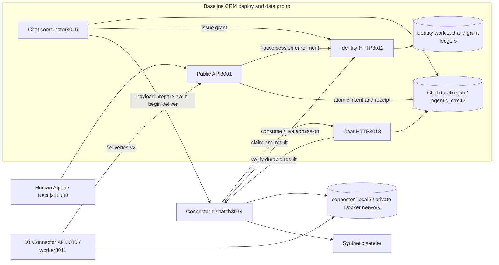
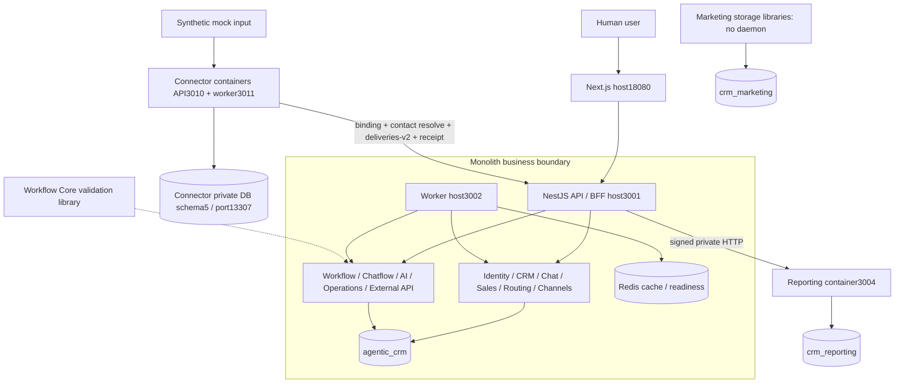
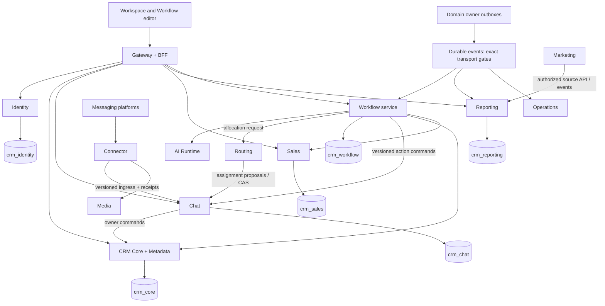

# Kiến trúc triển khai thực tế và thứ tự tách

## Current local deployment — 2026-10-27

SRC-109/T01–T09 DONE, Codex 2026-10-27. D3 Human-first 6/6; independent local delivery3/14 (Reporting, Connector, Chat). Legacy Conversation graph retired; main baseline46/crm_chat4, both Chat tenant gates active epoch2 after accepted post-write freeze/forward recovery. Source data and original receipts retained. Production, AI native, live-provider delivery and other-owner business consumers remain outside this acceptance. No commit/push/reset. [Pins/startup/recovery](../development/chat-main-local-runtime.md).

Windows Next18080 → local TCP entry13001 → baseline Docker public API13101. Container-local entry3001 remains for Docker/WSL callers. API forwards Chat commands to independent Chat API3020 and crm_chat4; its separate worker runs six jobs. Identity/CRM/Channels/Routing/Sales/Workflow/dispatch are baseline adapters on agentic_crm46. Existing Connector transport/D1 and Reporting retain their own images/databases. Direct Compose RPC and DB networks avoid Windows host loops. MySQL/Redis and existing connector MySQL volumes retained. Old D2 Chat/coordinator/Identity containers removed; six old source accounts locked.

Main authenticated Human smoke, Windows/web proxy, post-write freeze/restart/forward recovery epoch2 and event/local inbox replay passed. The original Beta expired-grant attention is retained without a resend. No downstream consumer business or real-provider acceptance. Host relay is credential-free and only binds127.0.0.1; Docker mirrored localhost publish remains an environment limitation. Earlier dated snapshots below are historical, not current start instructions.

## Historical deployment snapshots

Historical audit2026-10-22 / CHG-20261022-01 (OPS-20261022-01 subsequently CLOSED by CHG-02 with compatible D2 rollout/public send/restart; see tracker): [fresh progress/runtime audit](../tracking/service-progress.md) supersedes older health snapshots. Catalog14; Reporting/Connector retain independent local delivery evidence. Docker9healthy/1D2 worker restarting; API3001/worker3002/Reporting3004/Connector3010/3011 ready, web18080 unavailable. D2 backend image manifest42 versus main journal43 fails complete journal validation in the same-image Chat process; OPS-20261022-01 OPEN. No runtime mutation or additional extracted service; Chat T05/D3 2/6 unchanged.

2026-10-21 / CHG-20261021-12: [R1 source relocation](../development/repository-relocation.md) moves baseline to `services/core-baseline` and validator to `packages/workflow-definition`. Local monitor/API3001/worker3002 restarted from new paths and ready; web18080 remains stopped. Reporting/Connector unchanged. Verification images are built for packaging checks only, not rolled out; no new service extraction or data authority change. Earlier snapshots below retain their original dates.

Current source organization: [repository map / ADR-028](../architecture/repository-map.md), 2026-10-21. Catalog hiện có 14 owner boundaries; Reporting/Connector là hai service đã tách theo evidence trước phiên map. Chat là candidate, Marketing là storage/scheduler package, Workflow Core là library. PLAN-059 chỉ kiểm source/config và tài liệu, không probe runtime mới hoặc deploy; các snapshot có ngày bên dưới là lịch sử. Map phân biệt source ownership với image/process count và ghi các cleanup trước rollout.

2026-10-19 / CHG-25: D2 HTTP local activated; readiness and public synthetic send PASS. Host monitor3020/API3001/worker3002 running; no web browser/E2E claim. Chat extraction remains candidate T04 DONE, D3 2/6; this maintenance does not add an extracted service.

**Review2026-10-19 / PLAN-058:** [Bản đồ đủ17ranh giới và nhóm image](../planning/deployment-groups-review.md). Có bốn nhóm image ứng dụng cấu hình: web, backend core, Connector, Reporting; Chat độc lập là nhóm kế tiếp sau D3. Snapshot Docker có10container healthy, gồm7app processes và3hạ tầng; D2 Identity/Chat/worker cùng image backend, chưa phải extraction. Không thấy container web/public API trong snapshot; host app chưa probe lại. Các sơ đồ có ngày cũ dưới đây là lịch sử. Core không cần tách mỗi module thành image; D4 chỉ chọn một đầu ra Workflow/AI khi exact scope Ready.

**SRC-108 latest:** D2 delivered6/6 on main Alpha, [evidence](../tracking/details/SRC-108.md), [runbook](../development/human-outbound-local.md). Human public command/worker and owning HTTP adapters are wired. Identity/Chat below are processes of the baseline group, with separate credentials but still baseline data/CRM coupling; they are not counted as extracted services. Reporting+Connector remain2/17packaged/local. Main42, Connector5, D1 ingress unaffected; synthetic provider only.

Current local inter-owner dispatch uses explicit HTTP local (ADR-026), private service keys, pinned Identity admission signing key and live service/tenant registry; TLS remains optional. no Connector SQL into baseline. Public/job/attempt IDs persist through retry. Internal remote states fence legacy sender; public statuses stay queued/sending/unknown. T09 source removes the old D2 Chat/coordinator launch entries and rollout/rollback script. Those pinned D2 containers were subsequently stopped/fenced and removed during accepted T09. Current main traffic uses independent Chat; see the current deployment above. D1 MySQL actually has no published13307; new dispatch joins its existing database network. Dated diagrams below are historical baselines.

**SRC-107 current state:** Connector mock ingress now serves native local traffic, D1 5/5; [evidence](../tracking/details/SRC-107.md), [runbook](../development/connector-local.md). Reporting + Connector2/17 local; source/package2/17. Earlier notes below describe prior stages. Backend data/transaction boundaries remain baseline; no production/provider/outbound activation.

SRC-098: [sơ đồ vòng đời attempt và phục hồi](../data/connector-attempt-ledger.md) có code MySQL/executor nhưng chưa nối vào API/worker. Chỉ database test schema5; topology đang phục vụ người dùng giữ nguyên. Callback test không phải native Identity/Chat hoặc provider production.

SRC-097: [sơ đồ khóa chung stage/prepare/cancel](../data/connector-preparation-ledger.md) và schema4 đã được kiểm thử MySQL trên database test giữ dữ liệu. Topology phục vụ người dùng không đổi; chưa có begin/sender/HTTP mới. Main Connector chưa cấu hình, image test schema2 giữ nguyên.

SRC-096 bổ sung [sơ đồ lưu payload/receipt trong Connector](../data/connector-payload-ledger.md) và repository MySQL thật. Chỉ database test native_connector_test lên schema3; topology phục vụ người dùng vẫn như SRC-091. Chưa nối payload-put/dispatch endpoint, chưa chuyển traffic Chat, chưa rebuild/thay image đang giữ.

SRC-095 bổ sung [sơ đồ đồng bộ registry/hủy AI–Chatflow và khôi phục](../development/chat-control.md), tiếp nối dispatch/exchange kits SRC-093/094. Đây là giao thức đích và model tests; topology đang chạy vẫn Reporting container + CRM monolith như bên dưới. PLAN-007C tiếp theo thiết kế ledger cho adapter độc lập, chưa chuyển dữ liệu/traffic Chat.

Audit 2026-10-18 · PLAN-054 / SRC-090. [Target ADR-017](architecture.md), [migration gates](../planning/microservices-migration.md), [packaging contract](../contracts/service-packaging.md). Source baseline at audit: `21eaadd`, clean working tree. Không có evidence production deployment trong workspace này.

Updated SRC-091: Reporting local switched to container3004; Connector retained image acceptance and worker health completed. [Rollout runbook](../development/phased-service-rollout.md) · [Evidence](../tracking/details/SRC-091.md). Existing monolith domain boundary remains unchanged.

SRC-092 adds the [Chat dependency map and automated boundary check](../architecture/chat-extraction.md).253direct import entries remain acknowledged monolith work. Exact remote grant/revocation protocol and data migration gates are still pending; no new runtime service in this step.

## Hiện trạng được kiểm tra

| Thành phần | Source / đóng gói | Runtime local được kiểm tra | Kết luận |
|---|---|---|---|
| Next.js workspace | apps/web; target web, compose.yaml | Host18080 HTTP200 | Frontend riêng; các màn hình không phải service riêng |
| Identity, CRM, Chat, Sales, Routing, AI, Workflow, Chatflow, Channels, Operations, External API | services/core-baseline; chung target backend, API + worker | Host3001/3002 HTTP200, MySQL agentic_crm | Modular monolith; chưa tách database/transaction/release theo domain |
| Reporting | services/reporting; private NestJS HTTP; crm_reporting v7; independent image/Compose | Container agentic-crm-reporting-reporting-1 tại3004 healthy; native comparison preserved | Server/data/package đã tách; local rollout SRC-091. Connected source authorization/observations vẫn qua owner ports ở monolith |
| Connector | services/crm-connector; independent target; compose.connector.yaml + compose.connector.local.yaml; own schema5 | Local project API3010/worker3011/MySQL13307 healthy; actual native Chat delivery, retained recovery/rollback | Mock ingress active SRC-107; old schema2 test project retained/stopped; real provider/outbound/full Channels/Chat extraction chưa bật |
| Marketing | services/marketing; own schema/storage/scheduler libraries | Không có main/API/worker entrypoint hoặc deploy target | Mới tách storage/source; SRC-051 chưa hoàn tất |
| Workflow Core | packages/workflow-definition; compiler/validator library | Không có server/worker/database riêng | Thư viện, chưa phải service chạy độc lập; runtime vẫn monolith |
| Media, Ticket và các service đích khác | Descriptors/gates | Chưa có deploy units riêng | Không tạo container rỗng để tính là đã tách |
| MySQL / Redis | pinned images, persistent named volumes | agentic-crm-mysql-1 / redis-1 healthy, host13306/16379 | Hạ tầng Docker đang chạy; database-per-service không bắt buộc instance-per-service |

Compose manages Reporting and Connector containers. Legacy monitor3020 observes Reporting/Connector API ready/unowned but retains no worker probe; `pnpm connector:rollout --status` verifies direct worker readiness and current registry without stopping app children. Native ingress acceptance: [SRC-107](../tracking/details/SRC-107.md). This is local mock input, not production/provider evidence.

## Đích đến và trình tự thực hiện

ADR-023/PLAN-055: common CRM platform with staged deploy groups. Canonical CRM metadata and Identity policy are shared through owner ports/contracts; business authority remains with each domain. Catalog boxes below are responsibility boundaries, not a requirement to deploy15–16 services now. SRC-091 applies the first runtime rollout; [exact scope](../contracts/phased-service-rollout.md).

Every other stateful service also owns its schema from the [schema catalog](../data/schema-catalog.md); omitted DB boxes keep the diagram legible. Arrows are logical contracts, not shared transactions. Ticket remains separately gated. Kafka for Workflow and proposed transport for other streams are design, not installed infrastructure.

| Thứ tự | Việc tách / đóng gói | Điều kiện trước khi chuyển traffic |
|---|---|---|
| 1 — SRC-090 | Reporting image, Compose, retained-fixture container test và runbook | Existing own schema/API, signed smoke, runtime grants, restart; không cần chuyển bảng |
| 2 — SRC-091 then exact Chat gates | Reporting local activation; Connector operational package; PLAN-006 + PLAN-007B before Chat cutover | Retained queue/restart/health tests now; CRM canonical resolve, Identity delegation/revoke, owner/dispatch fencing, registry partition, snapshot/replay/single writer before ownership transfer |
| 3 | Unified Workflow và AI execution | PLAN-024B…E/PLAN-009, pinned old runs, Kafka contracts, tool/owner fences, recovery và isolated package tests |
| 4 | Identity/CRM/Sales extraction when independent operations justify it | Preserve common metadata/policy authority; replace cross-module UoW/FK, reconcile with watermark and permission comparison; no table move before contract |
| Separate backlog | Marketing SRC-051; Routing/Media/Operations/Ticket by dependency | Exact own-domain contracts and operational need; Marketing is not a Chat extraction prerequisite |

Không tách mỗi module thành container trỏ chung agentic_crm: hiện crm_record/owner/share/audit và nhiều transaction vẫn liên module. Việc đó tăng lỗi mạng nhưng chưa tạo release/data isolation. Sau mỗi extraction, kiểm tra own DB grants, API compatibility, tenant isolation, lost ACK/replay, migration preservation, restart/restore và runbook trước khi claim service đã triển khai.
