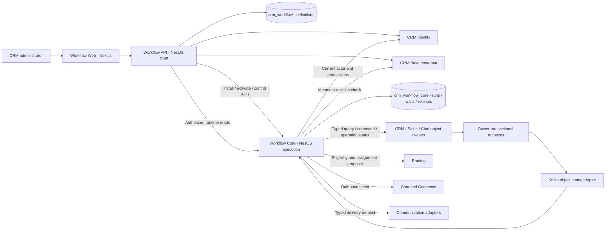
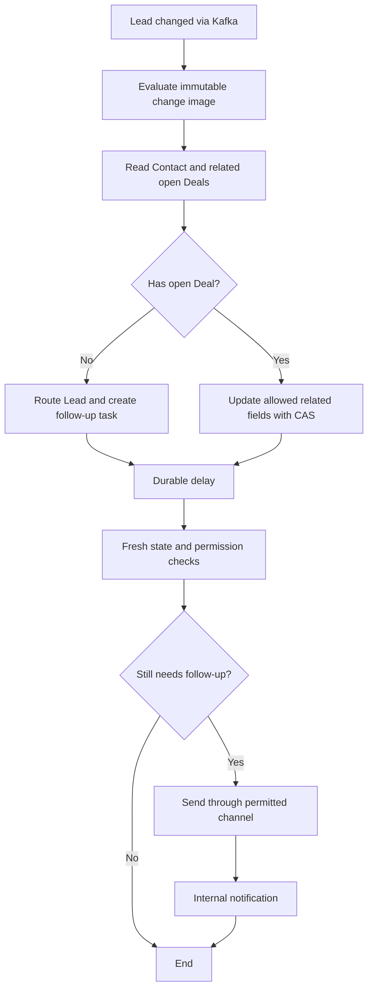

# Workflow CMS và execution architecture

PLAN-024 · 2026-10-13 · ADR-022 / CHG-20261013-01. **Ready ở cấp kiến trúc và kế hoạch thiết kế; chưa Ready để triển khai toàn bộ.** Exact contracts/DDL/security/rollout cần các gate trong [plan](../planning/workflow-platform.md). CMS ở đây là giao diện quản trị và cấu hình workflow trong CRM. Không mở rộng sang website content CMS.

## 1. Module đã có đến đâu

Kiểm kê source tại `main`, base `1cfa300`; workspace sạch trước phiên. Đây là kiểm tra source và evidence lịch sử, không phải kiểm thử lại runtime ngày 2026-10-13.

| Khả năng | Bằng chứng hiện hữu | Khoảng thiếu so với yêu cầu |
|---|---|---|
| Definition/version/publish/enable và run detail/cancel | [application](../../apps/backend/src/modules/workflow/application.ts), [HTTP](../../apps/backend/src/modules/workflow/http.ts), [contract M2](../contracts/workflow.md) | Chưa có Workflow API độc lập, draft canvas, validation/activation giữa hai service |
| Engine bền vững | [engine](../../apps/backend/src/modules/workflow/engine.ts), SRC-019 DONE: starter selection, action ledger, lease/fence, retry, persisted waits | Chưa có Workflow Core riêng; action ports hiện dùng TransactionScope monolith |
| Nhiều primitive | [graph.ts](../../apps/backend/src/modules/workflow/graph.ts): assign_owner, start_chatflow, wait_event, condition, request_lead_handoff, wait_timer, end | Registry mở rộng theo version, search/update related records, communication adapters chưa có |
| Trigger | Chỉ conversation.created theo connection; hai child signals chatflow.completed / lead.accepted | Chưa có generic CRM object change qua Kafka, before/after filters hoặc re-enrollment |
| CRM Base metadata | [registry](../contracts/registry.md), [properties/records](../contracts/crm-records.md), [CRM service](../services/crm.md) | Traversal query đa object và change-image API còn phải thiết kế; không mặc định đã có |
| UI | Operations run detail ở SRC-022; M2 authoring chủ yếu JSON API | Canvas CMS, property picker, liên kết object, publish review và run inspection mới cần source |
| Integration | Chatflow/Sales ports nối ở SRC-020/021; [historical evidence](../tracking/details/SRC-019.md) | Independent remote execution, Kafka và email/notification production chưa được chứng minh |

Giữ engine và test M2 làm nền tảng; không viết lại toàn bộ vì đổi tên service. Legacy graph tối đa 50 node, DAG, timer 1…86400 giây; graph mới có schema/version riêng và không thay validator cũ ngầm định.

## 2. Ranh giới ba thành phần



| Thành phần | Sở hữu | Không làm |
|---|---|---|
| [Workflow Web](../services/workflow-web.md) | Workflow list, graph canvas, trigger/node inspector, metadata picker, validation/publish review, run timeline | Không DB, Kafka credential, secret provider hay quyết định authorization |
| [Workflow API](../services/workflow-api.md) | Draft/immutable version, metadata bindings, publish validation, activation request/audit, CMS APIs và runtime view composition | Không chạy node, claim timer hay sửa run DB |
| [Workflow Core](../services/workflow-core.md) | Installed executable artifacts, active deployment generation, Kafka inbox/enrollment, run/step/wait/action receipts, scheduler và workers | Không sửa draft, không định nghĩa object schema, không SQL vào business services |

Web stateless. API và Core là hai service độc lập, hai schema/grants/migration lineages; worker/consumer/scheduler của **Core** cùng own schema. API có `crm_workflow`; Core có `crm_workflow_core`. Cả hai chưa được tạo. Core nhận bản cài immutable của graph qua contract, không SELECT definition DB. API đọc run qua Core, không tạo writer thứ hai. Share JSON Schema/generated types thuần túy, không ORM/domain implementation/UoW.

CRM Base là **nguồn schema chung**, không là nơi ghi tất cả domain records: CRM sở hữu Contact/custom objects và metadata; Sales sở hữu Lead/Deal; Chat sở hữu Conversation; Ticket còn gated. [Shared metadata contract direction](../data/workflow-metadata.md) áp dụng đồng nhất cho UI, validator và runtime.

## 3. Definition, publish và activation

Definition chọn đúng một enrolled object type. Các object liên quan xuất hiện bằng association path có tên/chiều/cardinality; một run luôn có root record rõ ràng. Draft có thể thiếu cấu hình để người dùng lưu việc đang làm; chỉ graph hoàn chỉnh mới publish được.

Version chứa graph_schema_version, node type/version refs, catalog revision, object/property/relation refs, execution-role ref, service actor, trigger/re-enrollment policy, failure policy và checksum. Published artifact bất biến. Run pin cả version/checksum và executor capability version; version mới không đổi run đang chờ.

Publish/activate là saga có operation key, không transaction xuyên API/Core:

1. API kiểm quyền design/publish, graph/binding types, live metadata, action capability và role; lưu immutable artifact + installation request + outbox atomically. Publisher có quyền thiết kế không đồng nghĩa actor có quyền thực thi.
2. Core nhận `InstallWorkflowVersion` theo tenant/version/digest, verify issuer/audience, checksum và capabilities, lưu own immutable artifact và receipt. Cùng key khác digest là conflict; retry trả receipt cũ.
3. API gửi `ActivateWorkflowVersion` với expected deployment generation. Core CAS active pointer + activation receipt; đây là authority duy nhất của version đang nhận trigger. CMS thể hiện installing/activation_pending/active/failed theo operation status.
4. Mất ACK: API reconcile cùng operation key; không publish/activate version khác để đoán. Core outage không được hiển thị active. Disable dừng enrollment mới; cancel run là command riêng, không đảo effect đã commit.

Activation có ranh giới rõ: sự kiện được đánh giá bằng deployment generation tại thời điểm **Core nhận bền vững lần đầu**. Ghi selection kể cả disabled/no-match; replay không đổi version. Sự kiện cũ chưa từng nhận có thể đến sau activation: policy mặc định không enroll nếu occurred_at trước activated_at; backfill cần chiến dịch riêng có preview/approval và không thuộc phase đầu. Clock skew/quarantine threshold chốt ở PLAN-024B; không giả định Kafka offset là global wall clock.

API direction: CMS list/create/draft/save/validate/versions/publish/deployment, metadata/node catalogs, dry-run và run detail/cancel qua BFF. Internal Core: install/activate/disable/status/cancel/reconcile, capabilities và sanitized run read. Exact paths/DTO/errors/ETag nằm ở PLAN-024C; không đổi `/workflows` M2 trước compatibility gate. Dry-run chỉ đọc có quyền và sinh execution trace dự kiến, không gọi side effect.

## 4. Kafka: CRM object change → enrollment

Kafka là transport được chọn cho luồng này theo yêu cầu user, supersede đề xuất JetStream **trong phạm vi này**. Không cài broker hoặc chuyển mọi service trong phiên thiết kế.

Owning service ghi domain mutation + audit + outbox trong local transaction. Outbox relay giữ nguyên event_id khi retry; Kafka producer ACK không phải evidence workflow đã chạy. Core validate producer/topic authority và schema, commit own inbox + durable evaluation work rồi mới commit offset. Xử lý offset liên tục theo partition; không commit vượt message chưa persist khi chạy concurrent. Crash sau DB commit trước offset commit chỉ tạo delivery lặp.

Đề xuất logical topic `crm.<owner>.object-change.v1`, key `tenant_id:object_type_id:record_id`; metadata/association changes có catalog/topic version riêng. Owner là CRM/Sales/Chat theo registry, không gom SQL để CRM phát thay. Envelope định hướng:

```json
{
  "event_id": "synthetic-event-42",
  "event_type": "crm.object.changed.v1",
  "schema_version": 1,
  "tenant_id": "synthetic-tenant-a",
  "producer": "sales",
  "object_type_id": "lead",
  "record_id": "synthetic-lead-1",
  "record_revision": "42",
  "change_sequence": "8",
  "operation": "updated",
  "changed_property_ids": ["lead.status"],
  "catalog_revision": "12",
  "change_ref": "synthetic-change-42",
  "occurred_at": "2026-10-13T03:00:00Z",
  "causation": {"root_event_id": "synthetic-event-42", "workflow_run_id": null, "depth": 0}
}
```

Ví dụ semantic, **không phải JSON Schema/wire fixture hợp lệ**; actual IDs theo UUID/catalog canonical. `record_revision` là CAS của owner; `change_sequence` là sequence liên tục trên change stream của record, tránh coi các revision không phát event là gap. PLAN-024B phải chốt producer manifest/chính xác sequences trước code.

Payload Kafka chỉ refs/field IDs và reason codes, không transcript, email/phone values hay secret. Criteria cần giá trị before/after phải lấy **immutable change image đúng change_ref** qua owner API có field ACL; không lấy record hiện tại rồi gọi đó là lịch sử. Current query/action reads lấy fresh authorized record. Không có image/revision, schema chưa biết hoặc stream gap thì giữ pending/reconcile/attention; không enroll theo dữ liệu suy đoán.

| Tình huống | Quy tắc |
|---|---|
| Duplicate | Inbox unique tenant+producer+consumer+event_id và payload digest; khác digest quarantine |
| Out-of-order/gap | Persist theo record sequence; reconcile missing changes qua owner change-log API. Không drop thay đổi trung gian chỉ vì đã thấy revision lớn hơn |
| Unrecoverable retention gap | Attention + stop affected record evaluation; reconcile snapshot chỉ làm baseline mới khi operation riêng chấp thuận, không tự gửi follow-up quá khứ |
| Event trước wait | Persist correlation/event ledger; lúc register wait kiểm predicate/event evidence đã nhận. Wakeup không là nguồn state duy nhất |
| Unsupported/poison | Quarantine bền vững kèm tenant/ref/reason; có thể commit offset sau quarantine để không khóa partition; replay giữ event/action identity |
| Broker outage | Outbox tăng backlog; DB timer và admitted runs vẫn chạy. Backpressure/fairness per tenant; alert oldest age và lag |
| Tenant mismatch | Reject trước business evaluation; broker ACL chỉ cho service, không thay tenant/actor authorization |

Chọn at-least-once + business idempotency; không hứa exactly-once giữa Kafka/MySQL/provider. Broker version/client pin, SASL/TLS/ACL, replication/retention, partition sizing, offset reset/DLQ tooling và RPO/RTO có evidence là gate PLAN-024B/E. Retention phải phục vụ replay window và image/receipt retention tương ứng; local/test giữ synthetic data, không reset mặc định.

## 5. Trigger, re-enrollment và tránh vòng lặp

Trigger catalog: record created/updated/archived; property changed; association added/removed. Phase đầu tập trung create/update trên object đã có producer được kiểm thử; delete/archive chỉ có hành vi khi owner hỗ trợ và xác định policy. Related-record changes không tự trở thành root changes: phải có explicit related trigger và reverse association resolver bounded; deferred khỏi phase đầu nếu chưa có manifest.

Condition nhập workflow hỗ trợ changed(property), value predicates và nhóm AND/OR typed. Mặc định `only_when_entering`: before không đạt, after đạt. Created coi before absent. `every_matching_change` và re-enrollment sau completion là lựa chọn explicit; mặc định không song song nhiều run của cùng definition/root. Unique selection tenant+definition+event; enrollment guard tenant+definition+root serialize concurrent triggers. Guard xuyên version để publish mới không tạo run trùng.

Khi root đang có run active, trigger được ghi `skipped_active`, không queue một đợt follow-up ẩn để chạy sau. Khi terminal, event mới có thể enroll nếu re-enrollment đã bật; duplicate/replay vẫn không tạo run. Disable không xóa selections. Nhánh lỗi/attention không tự cấp lại quyền.

Mọi action propagation giữ root_event_id, causation_run_id, action_key và depth. Default không cho definition tự enroll từ chính effect chain của nó; chặn cycle nhiều workflow bằng chain/depth budget, hạn mức run/action per tenant và circuit breaker. Không dựa duy nhất vào changed value vì vòng lặp A→B→A vẫn có thể xảy ra. Exact depth/window limits ở PLAN-024B/D. Generic update no-op không tăng business change khi owner xác định không có thay đổi thực.

## 6. Node registry và các action bắt buộc

Core registry descriptor gồm type, version, category, input/output JSON Schema, metadata dependencies, required capabilities/permissions, retry class, idempotency mode, error codes và editor hints. Web render từ catalog do API cung cấp; publish lẫn executor kiểm cùng version. Plugin là code adapter đã đăng ký/kiểm thử, không tenant JavaScript hoặc URL tùy ý.

| Nhóm / node định hướng | Hành vi | Owner/effect và lỗi cần explicit |
|---|---|---|
| `branch.if_else`, `branch.switch` | Predicate typed; AND/OR, ordered first match, default bắt buộc | Null/absent/denied khác nhau; denied trả lỗi, không suy thành false |
| `delay.duration`, `delay.until` | Persist UTC due_at; until dùng datetime ref + offset; quá hạn thì tiếp tục một lần | Không giữ worker/SQL transaction lúc chờ; business calendar và DST recurrence là extension riêng |
| `wait.event` | Chờ signal/predicate của exact bound record/child, deadline + timeout edge | Có event-before-wait và event/timeout CAS; không broad tenant event match |
| `data.get_record` | Đọc root hoặc explicit RecordRef | Owner read và field ACL hiện hành; not_found/forbidden/unavailable phân biệt nội bộ |
| `data.find_related` | Duyệt association đã khai báo, filter/sort typed và giới hạn số kết quả | CRM association API rồi owner query/read API; không SQL join xuyên service |
| `data.search_records` | Tìm theo object + indexed filters, có tenant/ACL và purpose scope | Bound root/association hoặc explicit permitted search scope; không tìm mọi record ngầm |
| `data.update_record`, `data.update_related` | Field patch typed tới exact selected records; CAS từng record | Owner command/API; state transition/reserved attribution không được generic PATCH |
| `business.transition` | Move stage/status bằng command được catalog công bố | Sales/Ticket/Chat kiểm state machine, prerequisites và quyền |
| `routing.assign_owner` | Chọn team/Human/AI theo eligibility/capacity; actual owner CAS ở domain | No candidate → queue/attention edge; service actor không trở thành Human/AI owner |
| `business.request_handoff`, `business.start_chatflow` | Giữ capability M2 qua async command/status adapters | Pin child version, exact parent binding, cancel/reconcile riêng |
| `followup.create_task` | Tạo việc follow-up liên kết record, assignee, due_at | CRM Activity/task capability phải có contract; chưa coi task lifecycle đã tồn tại chỉ vì có Activity |
| `communication.send_message` | Tạo outbound intent theo Conversation/channel/template refs | Chat kiểm owner/consent/window; Connector giữ provider credentials/delivery |
| `communication.send_email` | Request email transactional hoặc marketing với template/purpose explicit | Adapter authority phải chốt; consent/suppression/from identity và unsubscribe theo purpose |
| `communication.notify` | Thông báo nội bộ cho principal/team/owner, deep link record | Notification adapter kiểm recipient tenant và current record visibility khi render/open |
| `end` | Kết thúc với outcome reason code | Không tác dụng ngoài; một terminal transition |

Đây là catalog thiết kế, không là danh sách node đang chạy. MVP hỗ trợ graph DAG nhiều loại node và nhiều nhánh **exclusive**, không đồng nghĩa parallel fork. Bound tối đa ban đầu 50 node/graph, 3 association hops, 100 target records/action, 20 branch cases, depth predicate 5; đây là proposed product limits phải được contract/load validation ở PLAN-024D. Vượt bound phải lỗi/attention, không silently truncate tập sẽ update. Parallel fork/join, loop tự do, nested workflows, arbitrary code và tự migrate active run deferred; chỉ mở bằng ADR bổ sung.

Find/update nhiều record không cần node loop: node xử lý bounded collection, persist exact target IDs + revisions/digest trước effect; per-target action key ổn định `(run,node,target)` không có attempt. Node read đã succeeded replay dùng output đã pin; node read mới sau delay lấy dữ liệu mới. Update retry không chạy lại search để vô tình đổi tập target. CAS conflict dừng target và theo explicit conflict edge; không overwrite Human edit bằng last-write-wins. Batch khác service có thể partial; giữ receipts từng target, kết thúc needs_attention, không giả rollback toàn bộ.

Binding dùng root/event/outputs/danh sách target có typed refs. Field copy phải có cùng type hoặc named conversion allowlist có semantics; tiền giữ decimal string + currency, không ép float hoặc cộng nhiều currency. Output refs chỉ từ dominator chắc chắn đã chạy; nhánh chưa chạy không tạo giá trị ngầm.

## 7. Execution và side effects

Run: queued → running ↔ waiting → completed/failed/cancelled; attention là reason/operational state không tự reopen terminal. Step có pending/running/waiting/succeeded/failed/skipped và receipt rõ. Worker lease/heartbeat/fence kế thừa nguyên tắc M2; mọi local completion phải CAS token + run cancellation generation. Recovery scan MySQL là authority, Redis chỉ wakeup/cache.

Remote command protocol: persist intent/input digest/action key → kết thúc transaction → gọi owner API → persist operation ref/receipt qua fenced transaction. Owner phải kiểm live authorization, expected record/owner revision và idempotency trong transaction effect của mình. Crash sau remote commit trước Core receipt: query/retry **cùng** action key. Lease Core không tự fence service khác; stable operation key + owner CAS/admission expiry là bắt buộc.

Cancel/permission revoke trước dispatch ngăn command mới; command đã in-flight có thể hoàn tất. Core ghi outcome thực, cancel pending child/intent qua owner contract và hiển thị effect đã xảy ra; không cam kết thu hồi email đã gửi. Network timeout phân biệt `retryable_before_accept`, `accepted_pending`, `delivery_unknown`. Với provider không có idempotency/status thì unknown cần reconciliation/attention, không blind resend. Send node mặc định success khi owner nhận intent bền vững; chờ delivered phải dùng explicit wait và timeout, không đánh đồng accepted với delivered.

Retry bounded exponential + jitter cho transient; honor Retry-After. Forbidden/invalid metadata/invalid transition là permanent hoặc explicit attention. Exact retry/deadline policy được pin ở version; không dùng retry để vượt live permission. Fault edge explicit; không silently tiếp tục sau lỗi write/send. Durable timers lưu due_at một lần; thay đổi date property sau khi đến node không reschedule ngầm. Muốn đánh giá lại phải dùng cancellation/re-enrollment rule explicit.

## 8. Giao tiếp và dữ liệu cá nhân

Workflow Core không tích hợp SMTP/Meta trực tiếp. Message adapter đi Chat→Connector theo authority hiện có. Email và in-app notification là capability interfaces chưa có production adapter được xác minh; PLAN-024D phải chọn owning service/contract trước mở node trong CMS. Không thêm database notification chỉ từ một tên node. Missing adapter hiển thị unavailable và chặn publish; mock chỉ có trong test/simulation.

Template versions/recipient refs được pin cho request; recipient address, consent, suppression, ownership và channel rights được resolve/check tại dispatch bởi owner. Không cho workflow tự bật consent hoặc đổi system attribution. Quiet hours/rate limits do delivery policy; delay node không thay permission send. Audit ghi refs/status/reason, không message body/transcript/token. Core persist IDs và scalar tối thiểu; dữ liệu nhạy cảm cần TTL/encryption/redaction design trước physical persistence. UI quyền đọc run không tự cấp quyền đọc các record/fields nằm trong run.

## 9. Ví dụ nghiệp vụ đích

Lead chuyển trạng thái đủ điều kiện → tìm Contact liên quan và Deal đang mở qua catalog → branch theo số Deal. Nếu chưa có Deal, routing chuyển Lead vào Sales queue và tạo việc follow-up. Nếu có Deal, đọc phiên bản mới của từng Deal rồi cập nhật **thuộc tính custom đã đăng ký** `followup_due_at`; chuyển stage nếu cần phải qua Sales transition command. Delay 1 ngày → đọc lại Lead/Deal → nếu chưa được Human xử lý và vẫn đủ quyền/consent, gửi message **hoặc** email theo contact preference/capability; notify owner và end. Tên property/template là ví dụ cần tenant registration, không field có sẵn được ngầm tạo.



Đây là acceptance scenario tương lai; không phải demo đã chạy. V1 thực hiện trên Lead/Contact/Deal hoặc custom objects có capability Ready; Ticket và provider thật giữ gate riêng.

## 10. Migration và vận hành

Mặc định legacy runs tiếp tục trên engine M2 tới terminal. Chỉ definition mới/chuyển explicit mới dùng Core; định tuyến mỗi definition generation chỉ đến một starter. Không dual enroll monolith và Core từ cùng sự kiện. Shadow consumer chỉ validate và trace, không effect; activation/cutover checkpoint có watermark, selection/receipt reconciliation và rollback fencing. Rollback ngăn enrollment mới, giữ Core drain/reconcile in-flight, không đưa run đã có effect về monolith để chạy lại. Applied migrations và graph schema M2 giữ nguyên.

Core metrics: Kafka lag/oldest pending, outbox age, enrollment decisions, run/step latency, due timer lateness, retry/lease takeover, DLQ, unknown delivery và duplicate suppressed; tenant label dùng bounded internal representation. Trace xuyên event/run/node/action/owner operation, không payload. Liveness process-only; readiness nêu rõ ingress/execution/downstream degraded, không ngăn timers recover chỉ vì Kafka lỗi. API/Web/Core scale riêng; per-tenant concurrency/quota tránh noisy neighbor. HA/rebalance/restore/load/retention proof là release gates, chưa có SLO production được đo.

[Acceptance](../quality/workflow-platform-acceptance.md) · [Design sequence và open gates](../planning/workflow-platform.md) · [HubSpot/Salesforce references](../references/workflow-platform.md).
