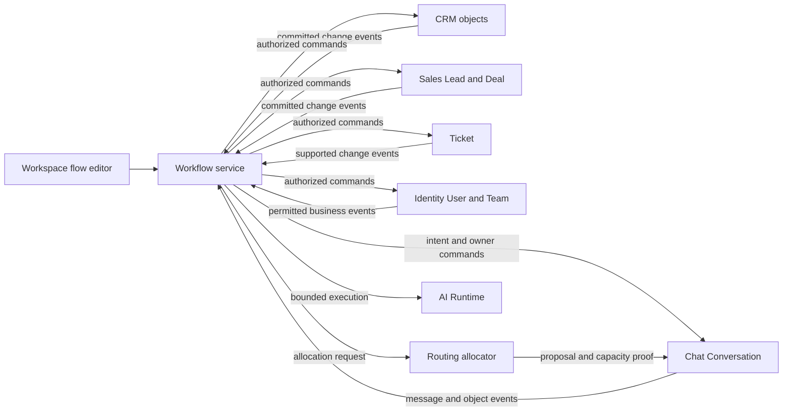

# Workflow architecture — one business orchestration service

ADR-027 / CHG-20261021-07 supersedes the service split of ADR-022 and the independent Chatflow target of ADR-017. One Workflow service owns all configurable business flows; business record authority stays with its owner. Architecture accepted2026-10-21; source migration is not yet implemented.

## Components and data

| Component | Responsibility | Persistence |
|---|---|---|
| Workspace editor | Design/version/review/run inspection for all flow types | Browser draft cache only; canonical data at Workflow |
| Workflow API | Definitions/versions, validation, publish/activation, run operations | crm_workflow |
| Engine / scheduler / event consumer | Enrollment, run/step/wait/timer, reconciliation | Same Workflow-owned schema/lineage |
| Execution workers | Invoke owner commands, persist receipts/results | Same Workflow-owned schema/lineage |

Components can run separate processes for throughput or failure isolation without becoming separate services. No crm_workflow_core or crm_chatflow target database. Chatflow tables are removed by the approved forward retirement migration; historical migration names do not imply extra service owners.

## Business authority

Arrows express target responsibility, not implemented endpoint/provider readiness. Workflow decides business rule order/branch/wait. Routing computes eligibility/capacity; resource owner commits assignment. Identity decides current permission. Chat commits message/episode/owner state; Sales commits Lead/Deal outcomes; CRM owns Contact/custom records; Ticket owns support lifecycle.

## Events and consistency

Each source commits its own state/outbox. Workflow inbox/enrollment handles duplicate/out-of-order events and causal loops. No owner waits for Workflow to acknowledge an unrelated record update. Atomicity is local; remote action uses stable ID, current rights, expected revision and durable receipt/reconciliation. Event permissions do not authorize later effects.

Kafka remains the chosen direction for generic object-change ingestion under PLAN-024B; exact source envelope/topic/partition/replay/security coverage remains scoped implementation. Existing local event adapters need not be replaced before independent work is useful. One service does not mean every direct Human command must pass through an orchestrator.

## Conversational flows

Send prompt, collect message, AI draft, validate evidence, Human task and Sales command are ordinary Workflow nodes. They share version/run/step/wait/variables/action receipts with non-chat automation. Chat Conversation/episode IDs are context references; they are not Workflow run IDs. A template may qualify a Lead, route a Conversation or follow up a Deal without spawning a separate Chatflow definition/session engine.

## Current source and migration

SRC-019 provides the baseline Workflow engine; SRC-020 is retired; SRC-065 is a validator library at packages/workflow-definition; SRC-066/067 provide baseline CMS/canvas; SRC-081 supplies need/follow-up integration. Their behavior/tests remain historical evidence. Common conversational execution is still future scope; removal of Chatflow does not imply its replacement is implemented. [Compatibility](../contracts/legacy-chatflow.md), [plan](../planning/workflow-platform.md), [acceptance](../quality/workflow-platform-acceptance.md).

The first cutover requirement is one starter/one effect path per migrated flow, not a wholesale rename. Preserve IDs and terminal receipts; drain old runs or use an explicit versioned adapter. No automatic migration of active runs, destructive table removal or provider send is authorized by this document update.
